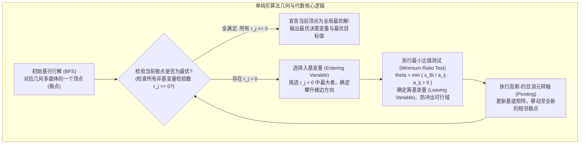
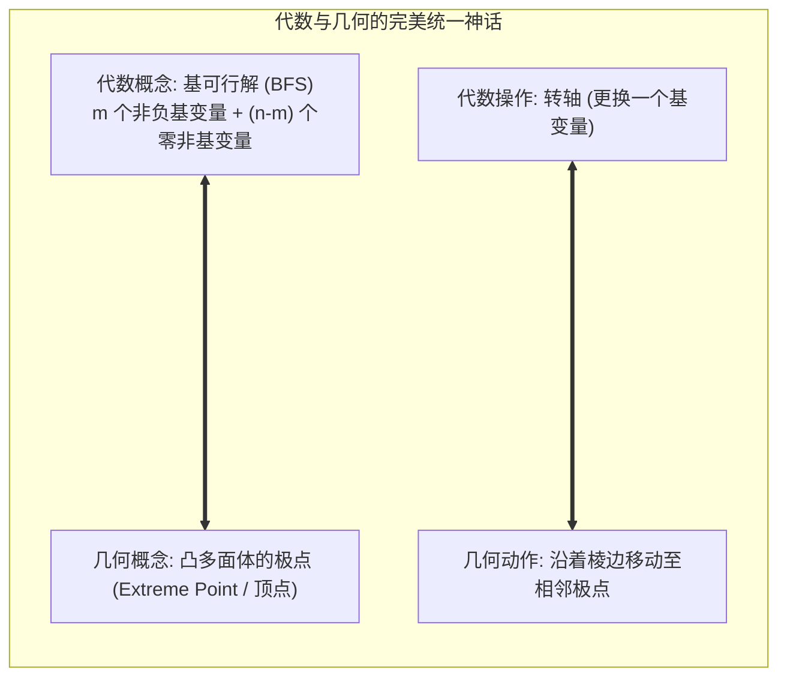

# Lec 4 单纯形算法 I：代数基础、标准型与转轴操作 (The Simplex Method I: Standard Form & Pivoting)

> MIT Sloan 15.053 · Optimization Methods in Management Science · 主讲 Prof. James Orlin

## TL;DR

- 单纯形算法（Simplex Method）是 20 世纪对人类计算与管理影响最深远的十大算法之一。
- 必须首先将任意形式的线性规划转化为数学**标准型（Standard Form）**。
- 建立代数基解（Basic Solutions）与几何极点（Extreme Points）之间的严密 1:1 映射。
- 转轴操作（Pivoting）的本质：在保证可行性的前提下，沿着相邻极点的多面体棱边单调攀升。

## 丹齐格的伟大发明：单纯形算法的诞生

尽管线性规划基本定理证明了最优解必然位于凸多面体的极点之上，但在高维空间中，极点的总数量依然是极其恐怖的天文数字。对于一个拥有 $m$ 个约束、从 $n$ 个变量中选取基变量的系统，极点数量上限高达组合数 $inom{n}{m} = rac{n!}{m!(n-m)!}$。

如果采用暴力枚举极点的方法，当 $n=50, m=10$ 时，极点数量超过 100 亿个，计算依然无法承受。1947 年，乔治·丹齐格（George Dantzig）提出了震惊世界的**单纯形法（Simplex Method）**：它不盲目穷举所有极点，而是从一个初始极点出发，**沿着多面体的棱边（Edge），每一次只走向一个目标函数值更优的相邻极点（Adjacent Extreme Point）**，直至没有任何相邻极点比当前极点更好，从而在极短的步数内（通常仅为 $2m$ 到 $3m$ 步）精准锁定全局最优解！

如上流程图所示，单纯形法是一部极其优雅的“爬山机器”。它将多维凸多面体的遍历问题，转化为了纯粹线性的高斯消元代数演进。

## 线性规划的标准型转化（Standard Form Transformation）

在运行单纯形算法之前，所有的不等式、极小化目标与无约束变量，必须通过统一的标准代数规则进行预处理：

::: definition 线性规划标准型（Standard Form）
$$\max \quad z = c^T x = \sum_{j=1}^{n} c_j x_j$$
$$	ext{subject to} \quad A x = b$$
$$x \ge 0$$
其中约束右端常数项向量必须满足 **$b \ge 0$**（若 $b_i < 0$，两边同乘以 $-1$ 反转不等号）。
:::

任何非标准线性规划均可通过以下四大技巧等价标准化：

| 原始非标特征 | 标准化代数转换手术 | 数学转换原理与引入的新变量 |
| :--- | :--- | :--- |
| **极小化目标 $\min z$** | $\max (-z) = \max (-c^T x)$ | 极大化相反数等价于极小化原函数，求得解向量完全相同 |
| **“$\le$” 型不等式约束** | $\sum a_{ij} x_j \le b_i \iff \sum a_{ij} x_j + s_i = b_i$ | 引入**松弛变量（Slack Variable）$s_i \ge 0$**，表示未被消耗的剩余资源闲置量 |
| **“$\ge$” 型不等式约束** | $\sum a_{ij} x_j \ge b_i \iff \sum a_{ij} x_j - e_i = b_i$ | 引入**剩余变量（Surplus Variable）$e_i \ge 0$**，表示超出最低需求的超额量 |
| **无符号约束变量 $x_k \in \mathbb{R}$** | 令 $x_k = x_k^+ - x_k^-$ | 拆解为两个非负变量之差，其中 $x_k^+ \ge 0, x_k^- \ge 0$ |

## 代数基解与几何极点的 1:1 映射

设标准化后的系数矩阵 $A$ 大小为 $m 	imes n$（通常约束数 $m <$ 变量数 $n$），且矩阵 $A$ 满行秩（$	ext{rank}(A) = m$）。

从 $A$ 的 $n$ 个列向量中任选 $m$ 个线性无关的列，组成一个 $m 	imes m$ 的非奇异方阵，称为**基矩阵（Basis Matrix, $B$）**；剩余的 $n - m$ 列组成**非基矩阵（Non-basic Matrix, $N$）**。相应地，决策变量被分割为**基变量（Basic Variables, $x_B$）**与**非基变量（Non-basic Variables, $x_N$）**。

$$A x = B x_B + N x_N = b \implies B x_B = b - N x_N$$

::: definition 基解与基可行解（Basic Feasible Solution, BFS）
1. **基解（Basic Solution）**：强制令所有 $n - m$ 个非基变量为 0（即 $x_N = 0$），解线性方程组求出唯一的基变量值：
   $$x_B = B^{-1} b, \quad x_N = 0$$
2. **基可行解（Basic Feasible Solution, BFS）**：如果基解不仅满足方程组，还满足**非负约束**（即 $x_B \ge 0$），则该解称为基可行解！
:::

这个等价性定理是单纯形法的灵魂：**代数上求解一个线性方程组的基可行解，在几何上精确对应着高维多面体上的一个实体顶点！**

## 转轴操作的两大裁判法则：检验数与最小比值测试

在转轴过程中，算法必须精确回答两个核心问题：(1) 哪个非基变量应该被请进基（入基）？(2) 哪个原基变量必须被踢出基（离基）？

### 1. 入基变量选择：判别式与检验数（Reduced Costs）
将目标函数完全用非基变量表达：
$$z = c_B^T x_B + c_N^T x_N = c_B^T (B^{-1} b - B^{-1} N x_N) + c_N^T x_N = c_B^T B^{-1} b + (c_N^T - c_B^T B^{-1} N) x_N$$
令 $r_N^T = c_N^T - c_B^T B^{-1} N$ 为**检验数向量（Reduced Cost Vector）**。
- 对于非基变量 $x_j$，其检验数 $r_j$ 表示：**当变量 $x_j$ 从 0 每微增 1 个单位时，总目标函数值 $z$ 所带来的边际净增长额**；
- **最优性准则**：若所有非基变量的检验数均满足 **$r_j \le 0$**，说明增大任何非基变量都无法再增加利润，**当前 BFS 即为全局最优解！**
- **入基规则（Dantzig 规则）**：若存在 $r_j > 0$，挑选其中**正值最大（最陡峭攀升）**的非基变量 $x_k$ 作为入基变量。

### 2. 离基变量选择：最小比值测试（Minimum Ratio Test）
入基变量 $x_k$ 从 0 开始不断增大，会导致现有基变量 $x_B = B^{-1} b - B^{-1} A_k x_k$ 发生改变。为了不冲出可行域（维持 $x_B \ge 0$），$x_k$ 能够增大的最大极限受到最先降低到 0 的那个基变量的封锁：

$$	heta = \min_{i: ar{a}_{ik} > 0} \left\{ rac{ar{b}_i}{ar{a}_{ik}} 
ight\}$$

取得该最小比值的行对应的基变量，就是被强制削减为 0 的**离基变量（Leaving Variable）**。随后以位置 $(i, k)$ 作为主元，执行一次标准高斯消元，全新的相邻极点便计算完毕！

::: pitfall 最小比值测试中分母全小于等于 0 意味着什么？
在寻找离基变量时，若发现入基变量所在列的所有系数全部满足 $ar{a}_{ik} \le 0$，这意味着什么？这意味着无论入基变量 $x_k$ 增大到多大（哪怕到正无穷），现有的所有基变量不仅不会变小，反而会一直增加或保持不变，非负约束永远不会被打破！在几何上，这说明可行域沿着该方向存在一条向无穷远处延伸的开放射线，**算法即可立即宣告：该线性规划存在无界解（Unbounded Solution）！**
:::

::: insight 单纯形法是代数机械与几何美学的终极共舞
单纯形算法的迷人之处，在于它用极其质朴的初等代数行变换，在数以万维的多面体迷宫中优雅穿梭。它不依赖晦涩的高深泛函分析，仅仅依靠“判别正负、除法取小、高斯消元”三部曲，就驯服了全人类工业界最庞大的资源调度巨兽。理解了单纯形转轴的每一步代数推导，才算真正领略了运筹学作为“算法工程奇迹”的硬核魅力。
:::
