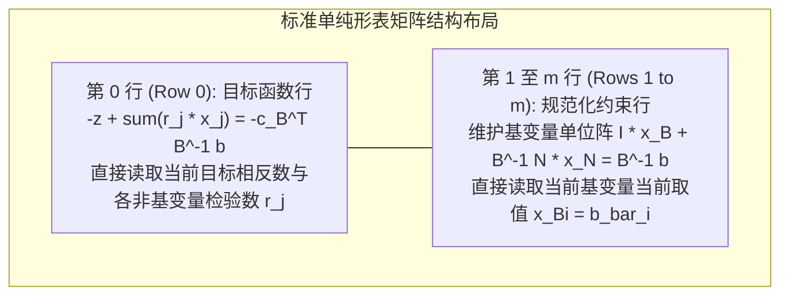
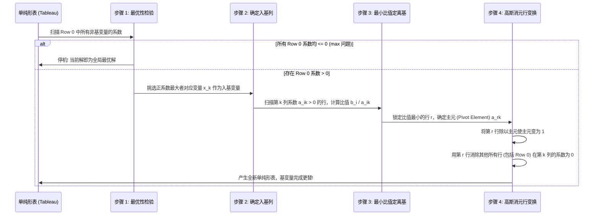

# Lec 5 单纯形算法 II：单纯形表与退化循环治理 (The Simplex Method II: Tableaus & Degeneracy)

> MIT Sloan 15.053 · Optimization Methods in Management Science · 主讲 Prof. James Orlin

## TL;DR

- 单纯形表（Simplex Tableau）是手动与教学演算单纯形算法的高度紧凑表格矩阵工具。
- 深度解析单纯形表的行变换法则：第 0 行直接读取目标值与检验数，第 1 至 $m$ 行维护字典解。
- 退化（Degeneracy）是基变量取值为 0 的数学现象，在几何上对应多个超平面过度相交。
- 勃兰特反循环规则（Bland's Rule / 最小下标法）在数学上严格证明了消除死循环的终极收敛性。

## 单纯形表（Simplex Tableau）的紧凑代数架构

在计算机底层，单纯形法依靠稀疏矩阵逆矩阵更新来运转；而在手工演算与教学理解中，最直观的表达方式是**单纯形表（Simplex Tableau）**。

单纯形表将目标函数方程与约束方程联立整合为一个统一的增广矩阵，使得转轴操作可以直接通过矩阵行初等变换机械化完成：

一个典型的标准单纯形表布局如下：

| 行 | 基变量 | $z$ | $x_1$ | $x_2$ | $\dots$ | $s_1$ | $s_2$ | $\dots$ | 右端常数项 (RHS) |
| :---: | :---: | :---: | :---: | :---: | :---: | :---: | :---: | :---: | :---: |
| **Row 0** | $z$ | 1 | $-ar{c}_1$ | $-ar{c}_2$ | $\dots$ | $-ar{c}_{n-1}$ | $-ar{c}_n$ | $\dots$ | $ar{z}$ (当前目标值) |
| **Row 1** | $x_{B_1}$ | 0 | $ar{a}_{11}$ | $ar{a}_{12}$ | $\dots$ | 1 | 0 | $\dots$ | $ar{b}_1$ |
| **Row 2** | $x_{B_2}$ | 0 | $ar{a}_{21}$ | $ar{a}_{22}$ | $\dots$ | 0 | 1 | $\dots$ | $ar{b}_2$ |

在 Row 0 中，各变量下方的系数反映了将该变量引入基变量后对总目标的边际贡献度；而在第 1 到 $m$ 行中，基变量所在列构成一个完美的**单位矩阵（Identity Matrix）**，右端常数项可以直接无计算读取当前基变量的实际取值。

## 单纯形表转轴四步迭代实战

给定一个初始可行的单纯形表，标准的转轴迭代遵循严格的四步机械流程：

在深入剖析具体的代数行初等变换之前，我们必须建立对单纯形表作为“动态坐标变换系统”的高维物理直觉。整个增广表格本质上是在多维凸多面体的局部切空间中，以当前基变量所构成的斜角坐标系来重新投影表达整个几何体。Row 0 中的检验数向量，实际上就是目标梯度向量在该局部基底坐标轴上的投影分量。

只要投影分量中仍有正值存在，就意味着沿着该坐标轴正方向前进可以进一步拉高目标函数的海拔高度。而最小比值测试，则如同一部精密的几何雷达，在算法向着高海拔山峰冲刺时，实时监测多面体的边界墙体距离，并在即将撞墙冲出可行域的前一瞬间果断制动刹车，完成转轴变轨。正是这种代数消元与几何约束的严丝合缝，才使得整个迭代过程展现出近乎机械钟表般的精密之美。

每一次高斯行消元操作，本质上是在用线性代数的工具，强制将入基列刷成新的单位矩阵列向量，同时保持其他旧基变量的单位阵结构不变，从而使得新的基变量取值依然可以直接从右端常数项中直观读出。

## 退化现象（Degeneracy）与几何死循环（Cycling）

在理想状态下，每一次转轴操作后，入基变量取值为 $	heta > 0$，目标函数值严格递增：
$$z_{	ext{new}} = z_{	ext{old}} + 	heta \cdot r_k > z_{	ext{old}}$$
由于极点总数是有限的，且目标值严格单调递增，算法必然在有限步内终止，绝不可能重复访问已经访问过的极点。

然而，在工业界的真实大型模型中，高度普遍地存在着一种被称为**退化（Degeneracy）**的异常病态：

::: definition 退化基可行解（Degenerate BFS）
如果某个基可行解中，**至少存在一个基变量的取值精确等于 0**（即某个 $ar{b}_i = 0$），则称该基可行解为退化解。
:::

### 退化带来的致命后果：死循环（Cycling）
当退化发生时，在执行最小比值测试时，最小比值计算结果为：
$$	heta = \min \left\{ rac{0}{a_{ik}} 
ight\} = 0$$
这意味着：
1. **入基变量只能取值为 0**，无法真正增大；
2. **目标函数值完全没有发生任何改变（$z_{	ext{new}} = z_{	ext{old}}$）**；
3. **在几何上，算法根本没有移动到任何新的顶点，而是困在同一个几何顶点处打转**，仅仅是更换了定义该顶点的代数基底矩阵组合！

如果连续发生数次步长为 0 的退化转轴，算法极有可能在经过 6 步或 8 步代数基替换之后，**完全复原到了数步之前的初始基矩阵组合！**算法由此陷入了无休止的“死循环（Cycling）”，计算永远无法收敛终止。

## 反死循环的终极法则：勃兰特法则（Bland's Rule）

为了在数学上彻底征服退化死循环的幽灵，1977 年罗伯特·勃兰特（Robert Bland）提出了运筹学史上著名的**最小下标优先法则（Bland's Rule）**：

::: theorem 勃兰特反循环法则（Bland's Anti-cycling Rule）
在单纯形算法迭代过程中，只要遇到平局或存在多个选择时，严格恪守“**下标最小者优先（Smallest Subscript Rule）**”：
1. **入基变量选择规则**：在所有检验数满足 $r_j > 0$ 的非基变量中，**挑选变量下标序号最小的那个变量入基**：
   $$k = \min \{ j : r_j > 0 \}$$
   （放弃传统的“挑选 $r_j$ 最大者”的最陡下降原则）；
2. **离基变量选择规则**：若在最小比值测试中出现多个行平局（Tie-breaking），**挑选其中基变量下标序号最小的那个变量离基**：
   $$r = \min \{ B_i : i \in 	ext{argmin} \left( rac{ar{b}_i}{ar{a}_{ik}} 
ight) \}$$
:::

勃兰特在数学上完成了极其优美的严格证明：**只要在转轴中无条件执行最小下标法则，单纯形算法就绝对不可能产生任何循环，算法必然在有限步内收敛！**

现代商业优化求解器（如 CPLEX、Gurobi）除了内置反循环规则外，通常还会引入轻微的**随机微扰技术（Perturbation Technique）**：向右端常数项 $b_i$ 随机叠加极度微小的噪声 $\epsilon_i$（如 $10^{-9}$），人为打破几何上的多线过度相交，使得退化在物理上彻底消解，求解完成后再将微扰抹去。

::: pitfall 忽视单纯形表 Row 0 中符号的流派差异
在查阅不同教材或使用不同求解库源码时，初学者最常被 Row 0 的正负号搞得头晕眼花。某些教科书将目标函数写为 $z - \sum c_j x_j = 0$，此时检验数正负含义与标准代数完全相反！务必在阅读单纯形表前首先确认：**当前表格的 Row 0 维护的是“实际检验数 $r_j$”还是其相反数“$-r_j$”**，切勿生搬硬套最优性判决条件。
:::

::: insight 面对退化的从容，是数学理性对自然混沌的终极规训
退化现象的存在，展现了现实商业系统最真实的一面——冗余、重叠与维度的过度交织。一个看似无法收敛的死循环，在纯粹数学家眼中并非死局，而是激发更精妙规则的契机。勃兰特法则仅仅依靠一条质朴的“从小到大排队”规则，就以四两拨千斤的优雅彻底驯服了死循环的梦魇。在规则中孕育确定性，正是人类算法智慧的最高尊严。
:::
