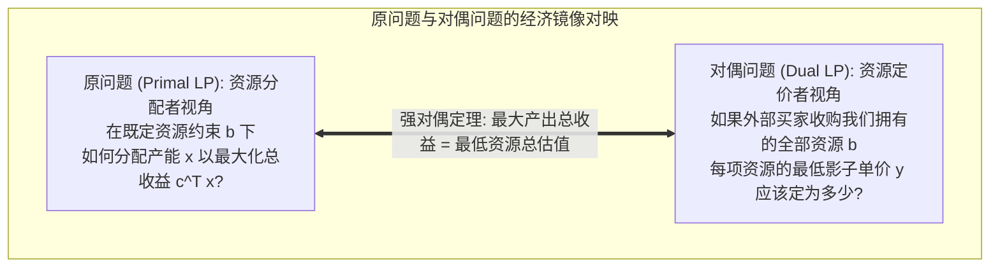
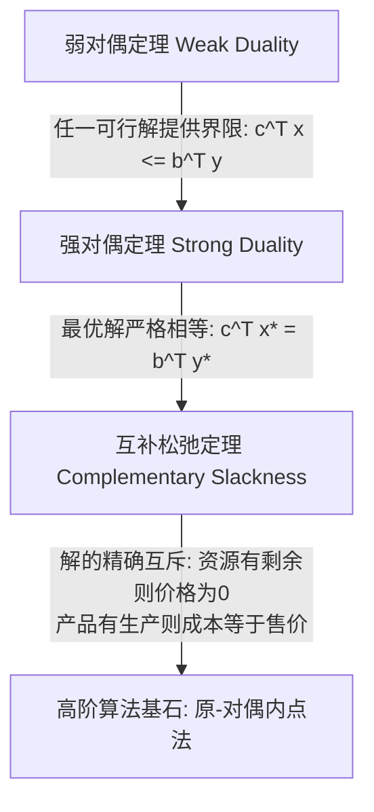

# Lec 6 对偶理论、影子价格与灵敏度分析 (Sensitivity Analysis, Shadow Prices & Duality)

> MIT Sloan 15.053 · Optimization Methods in Management Science · 主讲 Prof. James Orlin

## TL;DR

- 对偶理论（Duality Theory）是线性规划最深刻的数学与经济学支柱，每个原问题均天然伴生一个对偶问题。
- **影子价格（Shadow Price）**度量了右端资源约束放宽 1 个单位时，总目标函数最优值的边际增长额。
- 弱对偶性确立目标界限，强对偶性证明原问题与对偶问题最优目标值严格绝对相等。
- 互补松弛定理（Complementary Slackness）架起了原问题决策变量与对偶资源定价之间的零和桥梁。

## 商业视角：不仅仅是算出一个最优数字

在商业高管的决策桌前，单纯给出一个“下季度应生产 200 台 A 产品、500 台 B 产品”的确定性数字，价值其实极其有限。现实世界永远充满动态变动：
- 如果供应商提议将某种紧缺原材料的供货价格提高 5 美元，我们是否应当追加采购？
- 如果某台核心机床发生故障导致可用工时缩水 10%，总营业利润将缩水多少？
- 某款处于研发末期的新产品，其市场定价至少要达到多少，才值得工厂为其开辟生产线？

回答上述高阶战略管理问题的核心工具，就是线性规划体系中含金量最高的法宝——**灵敏度分析（Sensitivity Analysis）与对偶理论（Duality Theory）**。

## 原问题与对偶问题的标准转换映射

每一个线性规划原问题（Primal Problem），都存在一个与之呈严格镜像对称的**对偶问题（Dual Problem）**：

| 维度 | 原问题 (Primal Problem, 资源分配) | 对偶问题 (Dual Problem, 影子定价) |
| :--- | :--- | :--- |
| **目标函数方向** | $\max z = \mathbf{c}^T \mathbf{x}$ | $\min w = \mathbf{b}^T \mathbf{y}$ |
| **变量数量与含义** | $n$ 个决策变量 $x_j$（产品生产活动水平） | **$m$ 个对偶变量 $y_i$（每项资源的边际影子价格）** |
| **约束条件数量** | $m$ 个资源物理约束（矩阵 $A$ 的 $m$ 行） | **$n$ 个经济机会成本约束（矩阵 $A^T$ 的 $n$ 行）** |
| **约束条件形式** | $\sum_{j=1}^n a_{ij} x_j \le b_i \quad (i=1,\dots,m)$ | $\sum_{i=1}^m a_{ij} y_i \ge c_j \quad (j=1,\dots,n)$ |
| **右端常数项与价值** | 资源上限向量 $\mathbf{b}$ 充当约束右端项 | **产品利润向量 $\mathbf{c}$ 充当对偶约束右端项** |
| **变量非负性** | $x_j \ge 0$ | $y_i \ge 0$ |

::: definition 对偶约束的经济学直觉
原问题中制造一单位产品 $j$ 需要消耗各项资源 $a_{1j}, a_{2j}, \dots, a_{mj}$。
在对偶问题中，约束条件为：
$$\sum_{i=1}^{m} a_{ij} y_i \ge c_j$$
其经济内涵极其深刻：**制造该产品所消耗的所有资源的边际影子价值总和（机会成本），必须至少不低于该产品在市场上能够直接卖出的净利润 $c_j$！**如果消耗资源的影子价值高于市场售价，理性的企业绝不会投产该产品。
:::

## 对偶理论的三大基石定理

对偶理论之所以被称为近代应用数学最伟大的成就之一，源于以下三条无懈可击的核心定理：

### 1. 弱对偶定理（Weak Duality Theorem）
若 $x$ 是原问题的任意可行解，$y$ 是对偶问题的任意可行解，则必有：
$$c^T x \le y^T A x \le b^T y$$
**管理推论**：任何一个对偶可行解的目标函数值 $b^T y$，都为原问题的最大可能利润提供了一个绝对可靠的**理论上限（Upper Bound）**！

### 2. 强对偶定理（Strong Duality Theorem）
若原问题具有最优解 $x^*$，则对偶问题也必然具有最优解 $y^*$，且**两者的最优目标函数值严格完全相等**：
$$c^T x^* = b^T y^*$$
这意味着：**企业运用这些资源所能创造的最大经济利润，在数学上不偏不倚、丝毫不差地等于这些资源按影子价格估算的总资产内在价值！**

### 3. 互补松弛定理（Complementary Slackness Theorem）
设 $x^*$ 与 $y^*$ 分别为原问题与对偶问题的可行解，它们分别是最优解的充要条件是：
1. **原问题约束松弛性与对偶变量互补**：
   $$y_i^* \cdot \left( b_i - \sum_{j=1}^n a_{ij} x_j^* 
ight) = 0, \quad orall i = 1, \dots, m$$
   **经济含义**：若某项资源在最优排产中**尚未耗尽（存在闲置松弛，Slack $>0$）**，则该资源的边际影子价格必然为 **0**！再花钱增加该资源的库存对利润没有任何帮助；反之，若该资源的影子价格 $y_i^* > 0$，则该资源必然被 **100% 彻底耗尽（紧约束）**！
2. **对偶约束松弛性与原问题变量互补**：
   $$x_j^* \cdot \left( \sum_{i=1}^m a_{ij} y_i^* - c_j 
ight) = 0, \quad orall j = 1, \dots, n$$
   **经济含义**：若某项产品在最优方案中被正式投产（$x_j^* > 0$），则生产它消耗的资源影子成本必须**恰好严格等于其销售利润**；若生产该产品的影子成本高于市场利润，则该产品产量必然为 **0**（坚决不予生产）！

## 灵敏度分析与管理决策仪表盘

运行商业求解器后输出的灵敏度报告（Sensitivity Report），为高管提供了两类关键的管理指标：

### 1. 影子价格与资源可用区（Allowable Range for RHS）
- **影子价格（Shadow Price）**：该项资源每增加 1 个单位所带来的最优总利润的边际改变量；
- **允许增减区间（Allowable Increase / Decrease）**：在该区间内，当前的基矩阵 $B$ 保持不变，**影子价格维持恒定常数**；一旦资源变动幅度越过该区间，当前的瓶颈结构将发生重组，影子价格将发生阶跃跳变。

### 2. 检验数与利润允许变动区（Allowable Range for Objective Coefficients）
- **检验数（Reduced Cost）**：对于当前未投产（产量为 0）的非基变量，其检验数表示**该产品的单位利润至少需要提高多少美元，才值得企业将其纳入生产计划**；
- **目标系数允许区间**：在该范围内调整现有产品的市场单价，**最优生产决策方案（各产品具体生产吨数）保持绝对岿然不动**，仅总利润总额随价格呈线性变化。

::: pitfall 误以为“在允许区间内多个参数同时改变，影子价格依然有效”
求解器报告给出的允许增减区间严格遵循“**单变量变动假定（One-at-a-time / Ceteris Paribus）**”。如果市场上钢材、电力、人工工时三种资源的价格同时发生浮动，单变量区间立即失效！此时必须运用所谓的“100% 规则（100% Rule）”检验所有相对变动百分比之和是否小于 100%，否则必须重新提交求解器求解。
:::

::: insight 影子价格是深锁在企业资产负债表下的隐形黄金
平庸的财务会计只能看到资产购买时的历史记账成本，而卓越的运筹学家能通过影子价格看穿每一项资源在当下的“未来盈利潜能”。对偶理论打破了物理资源与货币价值的隔阂，它用精湛的数学证明：利润不是凭空产生的，而是被消耗资源的内在价值在市场中的真实映射。掌握了对偶思维，才算真正拿到了打开现代企业资源最优配置圣殿的钥匙。
:::
