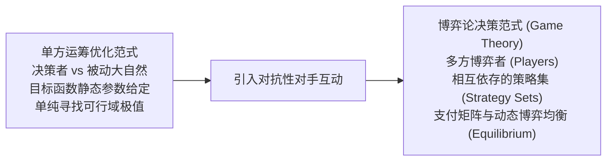
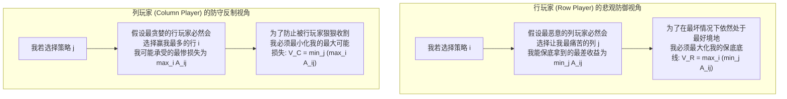

# Lec 7 博弈论 I：二人零和博弈与鞍点 (Game Theory I: 2-Person Zero-Sum Games)

> MIT Sloan 15.053 · Optimization Methods in Management Science · 主讲 Prof. James Orlin

## TL;DR

- 引入对抗性决策环境：博弈论研究多个自利决策主体在策略互动下的理性均衡。
- 二人零和博弈（2-Person Zero-Sum Games）中，一方之所得严格等于另一方之所失，利益完全互斥。
- 纯策略（Pure Strategies）下的安全水平分析：最大化最小收益（Maximin）与最小化最大损失（Minimax）。
- 鞍点（Saddle Point）存在性判定：当 Maximin 等于 Minimax 时，博弈达到稳定的纯策略纳什均衡。

## 从单方优化到多方战略互动

在前六讲的线性规划中，我们假定决策者身处一个“被动的中立环境”：原材料价格、市场需求上限都是给定的静态常数，大自然不会故意针对我们的决策采取恶意的对抗行动。

然而，在商业竞争、地缘政治与金融对抗的现实丛林中，决策者往往面对的是充满心智与策略反制的**理性竞争对手**：
- 百事可乐调整促销价格，可口可乐绝不会坐视不理；
- 科技巨头投入数十亿研发下一代芯片，竞争对手正在暗中布局颠覆性专利包围圈；
- 军事实战中，防空导弹部署的地点必然取决于敌方轰炸机最可能选择的突防航线。

这种**收益不仅取决于自己的行动、更同时取决于对手策略反制**的对抗环境，由**博弈论（Game Theory）**负责给出严密的数学解答。

## 二人零和博弈的标准形式化定义

在博弈论的所有分支中，最基础也是与线性规划对偶理论结合得最完美的分支，就是**二人零和博弈（Two-Person Zero-Sum Game）**：

::: definition 二人零和博弈（2-Person Zero-Sum Game）
博弈系统包含两个纯粹自利的参与者：
1. **行博弈者（Row Player / 玩家 1）**：拥有 $m$ 种可选策略，记为行 $i \in \{1, \dots, m\}$；
2. **列博弈者（Column Player / 玩家 2）**：拥有 $n$ 种可选策略，记为列 $j \in \{1, \dots, n\}$；
3. **支付矩阵（Payoff Matrix, $A$）**：若玩家 1 选择策略 $i$，玩家 2 选择策略 $j$，则**玩家 1 从玩家 2 手中赢取 $A_{ij}$ 的收益**，而玩家 2 相应承受 $-A_{ij}$ 的损失。
:::

双方利益总和严格恒等于 0（$A_{ij} + (-A_{ij}) = 0$）。因此，行玩家极力追求最大化自己的收益，而列玩家则极力追求最小化自己的损失（即最小化行玩家的得分）。

## 安全水平哲学：Maximin vs Minimax

在互不信任的对抗环境中，一个理性的博弈者应该持有什么样的防守哲学？约翰·冯·诺伊曼（John von Neumann）提出了现代博弈论的核心基石——**安全策略原则（Security Level Principle）**：

从哲学与行为决策学的深层维度审视这一博弈原则，安全水平分析代表了一种极度理性且冷酷的防御思维。在高度不确定的商业战场或地缘对抗中，许多平庸的决策者容易陷入盲目乐观的认知偏差，误以为对手会按照对我方最有利的方式行动。冯·诺伊曼的极大极小哲学彻底击碎了这种幻想：它迫使决策者在制定任何战略规划时，首先清醒地预设对手具备看穿一切底牌的能力。

因此，追求最大化最小保底收益（Maximin），绝不是消极悲观的懦弱妥协，而是一种构筑无法被击穿的战略护城河的积极智慧。当一个企业在最极端的市场围剿、最恶劣的价格战以及最严厉的监管夹击下，依然能够在数学上向自身保证不低于 $V_R$ 的底线生存收益时，它便事实上立于了不败之地。这种将最坏情况进行理性量化并最优化的思维，构成了现代运筹学与博弈论最深刻的精神内核。

### 极小极大基本不等式
在任意给定的实数矩阵 $A$ 中，以下不等式在数学上永远恒成立：
$$\max_{i} \min_{j} A_{ij} \le \min_{j} \max_{i} A_{ij}$$
也就是说：**行玩家能向自己保证的最低保底收益 $V_R$，永远不可能超越列玩家所设定的最高损失上限 $V_C$！**

## 纯策略均衡与鞍点（Saddle Point）

当上述不等式的等号严格成立时，博弈进入了一种极其罕见且完美的纯策略稳定状态：

::: definition 鞍点（Saddle Point / 纯策略纳什均衡）
如果在支付矩阵 $A$ 中存在某个位置 $(i^*, j^*)$，使得该元素**在所在行中是严格最小的，同时在所在列中是严格最大的**：
$$\max_k A_{k j^*} = A_{i^* j^*} = \min_l A_{i^* l}$$
则称该位置 $(i^*, j^*)$ 为该博弈的一个**鞍点（Saddle Point）**。
此时，双方的安全水平完全重合：
$$\max_i \min_j A_{ij} = \min_j \max_i A_{ij} = A_{i^* j^*} = V^*$$
数值 $V^*$ 称为该博弈的**博弈值（Value of the Game）**。
:::

### 鞍点判别实战示例
考察以下 $3 	imes 3$ 支付矩阵：

| 行玩家策略 | 列策略 1 | 列策略 2 | 列策略 3 | 行极小值 ($\min_j A_{ij}$) |
| :---: | :---: | :---: | :---: | :---: |
| **策略 1** | 2 | 4 | 5 | 2 |
| **策略 2** | **3** | **6** | **3** | **3** $
ightarrow \mathbf{\max_i}$ |
| **策略 3** | -1 | 2 | 2 | -1 |
| **列极大值 ($\max_i A_{ij}$)** | **3** $
ightarrow \mathbf{\min_j}$ | 6 | 5 | — |

- 行玩家分析：各行最差保底分别为 $2, \mathbf{3}, -1$；最大保底收益为 **$V_R = 3$**（选择策略 2）；
- 列玩家分析：各列最惨损失分别为 $\mathbf{3}, 6, 5$；最小可能受损上限为 **$V_C = 3$**（选择策略 1）；
- **结论**：$V_R = V_C = 3$！位置 $(2, 1)$ 是一个完美的鞍点。
- **稳定性检验**：如果行玩家坚定选择策略 2，列玩家若改选策略 2 或 3，自身损失将从 3 飙升至 6 或 3，列玩家绝无单方偏离动机；若列玩家坚定选择策略 1，行玩家若改选策略 1 或 3，收益将从 3 下跌至 2 或 -1，行玩家同样绝无单方偏离动机！双方锁定在纯策略均衡之中。

## 缺乏鞍点的博弈僵局：为何必须走向混合策略？

然而，现实商业与对抗中绝大多数博弈并不存在纯策略鞍点。最经典的代表就是**剪刀石头布（Matching Pennies）**：

| 行玩家（猜方） | 猜正面 (H) | 猜反面 (T) | 行极小 |
| :---: | :---: | :---: | :---: |
| **出正面 (H)** | +1 | -1 | -1 |
| **出反面 (T)** | -1 | +1 | -1 |
| **列极大** | +1 | +1 | — |

- 行玩家最大保底：$V_R = \max\{-1, -1\} = -1$；
- 列玩家最小损失：$V_C = \min\{+1, +1\} = +1$；
- $V_R = -1 < V_C = +1$！两端撕裂，**不存在任何纯策略鞍点！**

一旦任何一方固定选择某个确定的纯策略（比如永远出正面），对手只要探知该意图，立即就能反制使其彻底惨败。为了在不可预测的博弈中打破这种被针对的被动局面，博弈者必须引入**概率随机化（Randomization）——即混合策略（Mixed Strategies）**。

::: pitfall 误以为“在零和博弈中必须隐瞒自己的最优策略”
在存在鞍点或已知混合最优策略的零和博弈中，很多初学者认为“必须将自己的策略严格作为商业秘密深锁，绝不能让对手知道”。冯·诺伊曼的极大极小定理给出了颠覆直觉的回答：**只要你按照最优极小极大策略行动，哪怕你把整份策略计划书公开打印贴在脑门上让对手通盘知晓，对手在数学上也绝无任何手段能将你的收益压低到博弈值之下！**这正是现代稳健优化与博弈论最震撼人心的数学力量。
:::

::: insight 战略的最高境界，是让对手即便看穿底牌也无可奈何
平庸的赌徒依赖欺骗与偷袭，而顶级的战略家依靠坚不可摧的数学结构。二人零和博弈的安全水平分析深刻揭示了理性的本质：在危机四伏的竞争格局中，不要指望对手会犯蠢，而要假定对手拥有全知全能的最高智慧。唯有建立在最严酷防御底线之上的策略，才能在硝烟散尽后岿然屹立。
:::
