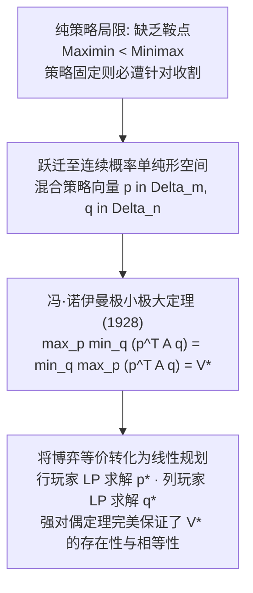
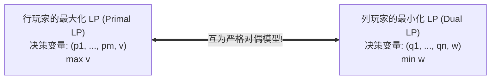

# Lec 8 博弈论 II：极小极大定理与线性规划求解 (Game Theory II: Minimax Theorem & LP Formulations)

> MIT Sloan 15.053 · Optimization Methods in Management Science · 主讲 Prof. James Orlin

## TL;DR

- 当二人零和博弈缺乏纯策略鞍点时，博弈者必须采用**混合策略（Mixed Strategies）**通过概率随机化化解被动。
- 约翰·冯·诺伊曼 1928 年确立的极小极大定理（Minimax Theorem）证明：在混合策略空间中博弈值恒等式必然成立。
- 深刻证明零和博弈与线性规划对偶理论的等价性：行玩家的最大化 LP 恰好是列玩家最小化 LP 的对偶问题。
- 掌握严格劣势策略迭代消除法（IESDS）与 2×n 博弈的二维几何图解法。

## 随机化的力量：混合策略（Mixed Strategies）

在第七讲中，我们看到像“猜硬币”或“剪刀石头布”这样的博弈，根本不存在任何纯策略鞍点。若你确定性地出石头，对手只要掌握这一规律，就会 100% 针对性出布使你遭受灭顶之灾。

为了在对抗中防止被对手摸清套路，理性的博弈者必须引入**概率随机化（Randomization）**：

::: definition 混合策略（Mixed Strategy）
设行玩家拥有 $m$ 种可选纯策略，列玩家拥有 $n$ 种可选纯策略：
- **行玩家的混合策略**是一个概率分布向量 $\mathbf{p} = (p_1, p_2, \dots, p_m)^T$，满足 $\sum_{i=1}^m p_i = 1$ 且 $p_i \ge 0$；
- **列玩家的混合策略**是一个概率分布向量 $\mathbf{q} = (q_1, q_2, \dots, q_n)^T$，满足 $\sum_{j=1}^n q_j = 1$ 且 $q_j \ge 0$；
- **博弈的期望收益（Expected Payoff）**：
  $$E(\mathbf{p}, \mathbf{q}) = \sum_{i=1}^m \sum_{j=1}^n p_i A_{ij} q_j = \mathbf{p}^T A \mathbf{q}$$
:::

如上图所示，当我们将决策变量从离散的纯策略扩充到连续的概率单纯形时，现代数学史上最伟大的定理之一便水到渠成。

## 冯·诺伊曼极小极大定理（The Minimax Theorem）

1928 年，25 岁的约翰·冯·诺伊曼发表了奠定现代博弈论基础的传世论文，证明了如下基本定理：

::: theorem 冯·诺伊曼极小极大定理（Minimax Theorem, 1928）
对于任意有限策略维度的二人零和博弈（支付矩阵为 $m 	imes n$ 实矩阵 $A$）：
1. 必然存在行玩家的最优混合策略 $\mathbf{p}^*$ 与列玩家的最优混合策略 $\mathbf{q}^*$；
2. 双方在混合策略下的安全水平必然**严格完全相等**：
   $$\max_{\mathbf{p}} \min_{\mathbf{q}} \mathbf{p}^T A \mathbf{q} = \min_{\mathbf{q}} \max_{\mathbf{p}} \mathbf{p}^T A \mathbf{q} = V^*$$
3. 数值 $V^*$ 称为该博弈的唯一**博弈值（Value of the Game）**；策略对 $(\mathbf{p}^*, \mathbf{q}^*)$ 构成混合策略下的纳什均衡。
:::

这意味着：**在混合策略的世界里，所有的二人零和博弈都必然存在鞍点！**

## 零和博弈与线性规划对偶性的神圣等价

极小极大定理最初是冯·诺伊曼运用复杂的布劳威尔不动点定理证明的。二十年后，当丹齐格发明线性规划后，数学家惊喜地发现：**极小极大定理在数学上完全等价于线性规划的强对偶定理！**

### 1. 行玩家的线性规划建模（寻找最大保底收益 $v$）
行玩家希望选择一组概率权重 $p_1, \dots, p_m$，使得无论列玩家出哪一列 $j$，行玩家获得的期望收益均**至少不低于**某个保底数值 $v$：
$$\sum_{i=1}^m p_i A_{ij} \ge v, \quad orall j = 1, \dots, n$$
行玩家的目标是让这个保底值 $v$ 尽可能大：
$$\max \quad v$$
$$	ext{subject to} \quad v - \sum_{i=1}^m p_i A_{ij} \le 0, \quad orall j = 1, \dots, n$$
$$\sum_{i=1}^m p_i = 1, \quad p_i \ge 0 \quad (i=1,\dots,m), \quad v \in \mathbb{R}$$

### 2. 列玩家的对偶线性规划建模（寻找最小损失上限 $w$）
反过来，列玩家希望选择一组概率权重 $q_1, \dots, q_n$，使得无论行玩家出哪一行 $i$，列玩家承担的期望赔付均**绝不高于**某个上限数值 $w$：
$$\sum_{j=1}^n A_{ij} q_j \le w, \quad orall i = 1, \dots, m$$
列玩家的目标是让这个最大损失 $w$ 尽可能小：
$$\min \quad w$$
$$	ext{subject to} \quad w - \sum_{j=1}^n A_{ij} q_j \ge 0, \quad orall i = 1, \dots, m$$
$$\sum_{j=1}^n q_j = 1, \quad q_j \ge 0 \quad (j=1,\dots,n), \quad w \in \mathbb{R}$$

根据强对偶定理，若原问题有最优解，对偶问题必有最优解且最优值完全相等：$v^* = w^* = V^*$！**我们只需在求解器中运行任意一方的线性规划，求解器给出的原问题最优解就是行玩家的最优策略 $\mathbf{p}^*$，而输出的对偶影子价格向量，恰好直接就是列玩家的最优策略 $\mathbf{q}^*$！**

## 简化实战：严格劣势策略迭代消除（IESDS）

在构建复杂的 LP 模型之前，经验丰富的博弈分析师通常首先运用**严格劣势策略消除法（Iterated Elimination of Strictly Dominated Strategies, IESDS）**进行预处理降维：

::: definition 严格劣势策略（Strictly Dominated Strategy）
- 对于行玩家：若纯策略 $i_1$ 在面对列玩家的任意选择时，带来的收益均**严格小于**另一纯策略 $i_2$（即 $orall j, A_{i_1 j} < A_{i_2 j}$），则称策略 $i_1$ 是被策略 $i_2$ 严格劣势的；
- 理性的行玩家**绝不可能以任何正概率选择严格劣势策略**，因此可以直接将矩阵的第 $i_1$ 行**彻底删除**！
- 类似地，若某列给列玩家带来的赔付在所有行中均严格大于另一列，列玩家绝不可能选它，直接将该列**彻底删除**。
:::

通过交替删除被劣势支配的行与列，庞大的复杂博弈矩阵往往能被闪电降维为极小的 $2 	imes 2$ 核心博弈，从而使得手工几秒内即可解析求解。

::: pitfall 误以为“弱劣势策略（Weakly Dominated）也可以随意随意删除”
在进行矩阵化简时，初学者极易混淆“严格劣势（$<$）”与“弱劣势（$\le$）”。如果策略 $A$ 在某几项与策略 $B$ 相等、其他项较差，则称为弱劣势。**任意删除弱劣势策略可能会无意中抹杀掉其他的纳什均衡点，甚至改变博弈的最终解集结构！**因此在预处理中，务必严格仅剔除严格劣势行与列。
:::

::: insight 概率不是无奈的盲猜，而是构建不可战胜性的数学盾牌
在通俗观念中，人们常常把抛硬币或随机选择视为缺乏判断力的儿戏。但在博弈论的至高殿堂中，混合策略向全人类揭示了一种颠覆性的智慧：面对充满恶意的顶级对手，任何确定性的完美计划都是破绽，而精确校准的概率随机化才是终极的防护铠甲。让对手摸不透你的下一步，同时在数学期望上牢牢锁死自身的胜利底线，是理性智慧在对抗世界中的最高胜利。
:::
