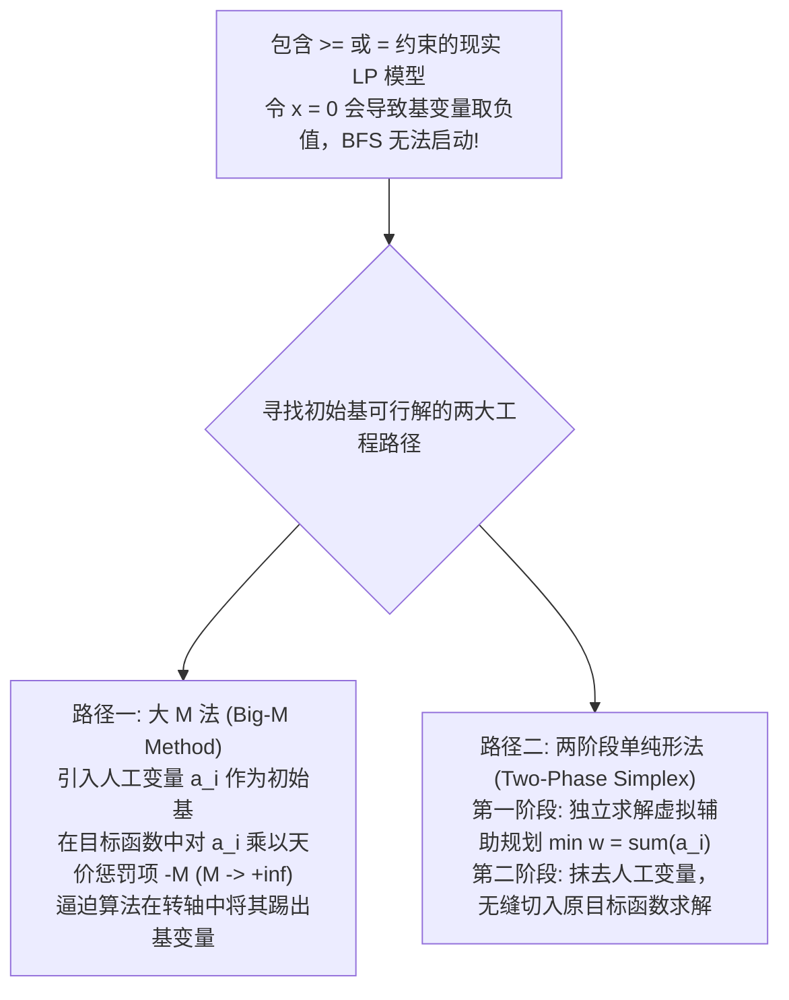
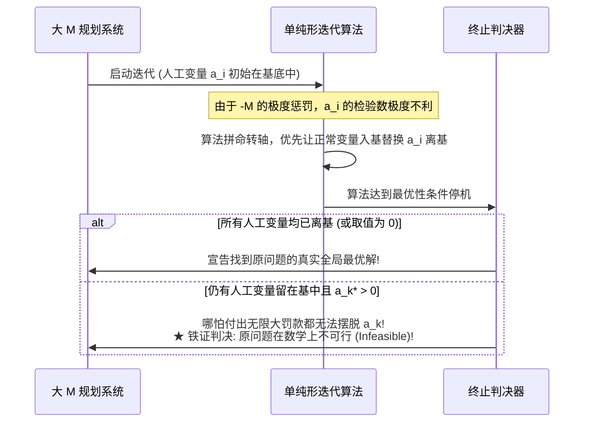
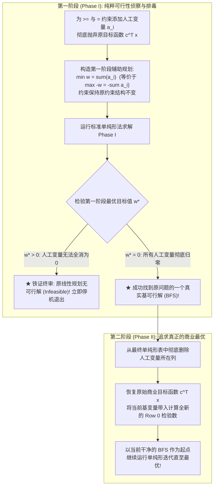

# Lec 9 实用线性规划实务：人工变量、大 M 法与两阶段单纯形 (Practical LP: Big-M & Two-Phase Simplex)

> MIT Sloan 15.053 · Optimization Methods in Management Science · 主讲 Prof. James Orlin

## TL;DR

- 当约束条件包含“$\ge$”或“$=$”时，$x=0$ 不再是可行解，单纯形算法面临无法启动初始基可行解的困境。
- **人工变量（Artificial Variables）**是纯粹的数学桥梁，无任何现实物理含义，必须在最终解中被强制驱逐为 0。
- **大 M 法（Big-M Method）**在目标函数中对人工变量施加惩罚系数 $M 	o +\infty$，但极易诱发严重的浮点精度数值病态。
- **两阶段单纯形法（Two-Phase Simplex Method）**以严谨的两阶段分步法，完美规避了数值溢出，是工业求解器的标准范式。

## 现实世界的冷酷：初始基可行解从何而来？

在第四讲与第五讲讨论单纯形法时，我们假定所有的约束都是“$\sum a_{ij} x_j \le b_i$”（且 $b_i \ge 0$）。在这种温室般的环境下，我们只需为每个约束引入一个松弛变量 $s_i$，并令所有决策变量 $x_j = 0$，松弛变量便天然构成一个现成的初始基可行解（$s = b \ge 0$），单纯形法可以立即挂挡起跑。

然而，在工业界的真实建模中，绝大多数模型都充斥着如下约束：
1. **最低需求约束（“$\ge$”型）**：例如“蛋白质摄入量至少要达到 80 克”（$\sum a_{ij} x_j \ge 80$）；
2. **严格守恒方程（“$=$”型）**：例如“网络节点流入总量必须精确等于流出总量”（$\sum x_{	ext{in}} - \sum x_{	ext{out}} = 0$）。

当我们减去剩余变量 $e_i \ge 0$ 将其转化为标准型时：$\sum a_{ij} x_j - e_i = b_i$。若令 $x = 0$，则得到 $e_i = -b_i < 0$！**这严重违背了非负约束，根本无法作为合法的初始基可行解！**

从计算工程的角度审视，无论哪种路径，其核心机制都是引入一组**人工变量（Artificial Variables）**作为过桥支架，待算法平稳渡过初始启动难关后，再以严厉的数学惩罚将其彻底拆除。

## 人工变量的数学解剖学

必须建立对两类辅助变量的清晰物理边界认知：

| 变量类别 | 变量数学形式 | 现实物理与商业含义 | 最终最优解中的允许状态 |
| :--- | :--- | :--- | :--- |
| **松弛/剩余变量 (Slack / Surplus)** | $s_i \ge 0, \quad e_i \ge 0$ | **具有明确的物理意义**：闲置未用的工厂工时、超出最低要求的富余库存 | **完全允许为正数**；正值反映了资源的充裕度与非紧约束状态 |
| **人工变量 (Artificial Variables)** | $a_i \ge 0$ | **没有任何物理意义**；纯粹是帮助单纯形法拼凑初始单位矩阵的“临时脚手架” | **必须强制全部压缩归零！**若最优解中 $a_i^* > 0$，则宣告**原问题不可行（Infeasible）** |

## 大 M 法的机制与工程隐患

在大 M 法中，我们在每一个缺乏初始基变量的约束行中人为强塞一个人工变量 $a_i \ge 0$，使其构成单位矩阵：
$$\sum_{j=1}^n a_{ij} x_j + a_i = b_i$$
为了让算法在单纯形迭代中像躲避瘟疫一样尽快将 $a_i$ 逐出基变量，我们在目标函数中强加天价罚款：
$$\max \quad z = \sum_{j=1}^n c_j x_j - M \sum_{i} a_i \quad (M > 0 	ext{ 为天文数字})$$

### 工业界的痛点：大 M 带来的数值病态灾难
在纸面手算中，我们可以将 $M$ 当作无穷大符号处理；但在现代计算机的 64 位浮点数系统（IEEE 754）中，必须赋予 $M$ 一个具体的常数（如 $M = 10^7$）。这会引发致命的**浮点舍入灾难（Ill-conditioning / Round-off Errors）**：
- 如果技术系数 $a_{ij} = 0.001$，而惩罚项 $M = 1,000,000$，两者相加会导致极度严重的有效数字截断丢失；
- 求解器会因精度丢失而产生误判，将一个完全可行的商业方案误报为不可行，或者由于数值噪声陷入无限假死。

## 工业黄金标准：两阶段单纯形法（Two-Phase Simplex）

为了彻底根除浮点截断灾难，运筹学家发明了纯粹基于精确数字代数的**两阶段单纯形法（Two-Phase Simplex Method）**：

两阶段法的无比优越性在于：**在整个求解生命周期中，完全不需要引入任何主观臆造的虚构参数 $M$**，所有的矩阵行变换全部在原本的技术系数上展开，具有极其稳定的数值鲁棒性与理论纯洁性。

::: pitfall 第一阶段结束时若有人工变量仍留在基中（但取值为 0）怎么办？
这是一种极其微妙的退化情形（Degenerate BFS）：虽然人工变量的数值等于 0（因此 $w^* = 0$，可行性成立），但它的名字依然占着一个基变量的名额。在进入第二阶段前，**必须执行一次特殊的退化转轴操作**，寻找该行中任意一个非人工变量系数不为 0 的列将其换出，或者直接强行将该冗余约束行从矩阵中彻底划掉，否则第二阶段的 Row 0 重构将发生奇异性故障。
:::

::: insight 解决复杂问题的最高智慧，是把目标与路径严格拆解
两阶段单纯形法展现了一种深刻的系统工程哲学：当你同时面临“寻找可行立足点”与“追求最高经济利益”两重压力时，切忌混为一谈、仓促上马。先暂时放下对繁华目标的执念，集中全盘资源完成第一阶段——哪怕历经波折，先在多维荒野中稳固地踩下一个合法的脚印；一旦站稳脚跟，再全力以赴开启第二阶段向着最高峰冲刺。这种分阶段治理的从容，是顶级架构师最宝贵的心智力量。
:::
