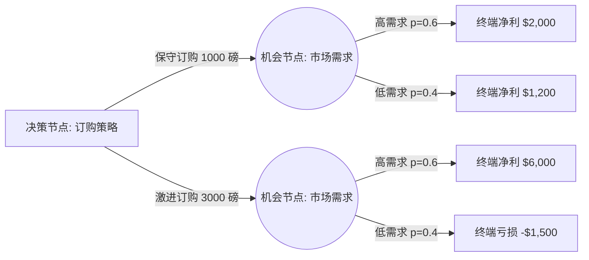

# Lec 1 决策分析 I：肯德尔龙虾案例与不确定性决策树 (Decision Analysis I: Kendall Crab & Lobster Case)

> MIT 15.060 数据、模型与决策 · 讲义 1 · 授课教师：Prof. Dimitris Bertsimas / Prof. Robert Freund

## TL;DR

- 决策分析提供了一种在风险与信息不完全条件下，结构化拆解复杂商业选择的形式化方法。
- 决策树通过决策节点、机会节点与终端收益节点的树状拓扑，厘清决策者控制范围与外部随机事件。
- 反向归纳法（Rollback Analysis）依据期望货币价值（EMV）从未来终端收益反向回溯推导最优当下行动。
- 敏感性分析测算外部概率与关键收益变动的临界阈值，揭示管理策略的稳健性边界。

## 1. 结构化决策的本质与挑战

现代管理决策的核心困境并非缺乏数据，而是如何在信息不完全、时间滞后且充满外部随机扰动的环境中做出一致性承诺。传统管理者往往依赖直觉、个人经验或事后理性化，容易落入损失厌恶、沉没成本绑定或锚定效应等认知偏差。

决策分析（Decision Analysis）是一套规范性理论（Normative Framework），其目的不是预测不可控的未来，而是通过建立显式模型，将决策者的**可控选择（Choices）**、**外部不可控事件（Uncertainties）**与**最终经济后果（Consequences）**进行逻辑解耦与形式化表达。

::: definition [决策树 (Decision Tree)]
决策树是一种有向树状拓扑图，用以描述具有时间先后顺序的序列决策过程。其标准图元包括：
1. **决策节点（Decision Node，记为方块 $\square$）**：表示决策者拥有完全控制权的选择分叉。每个分支对应一个可行备选方案。
2. **机会节点（Event/Chance Node，记为圆圈 $\bigcirc$）**：表示不由决策者意志转移的客观随机事件。每个分支对应一种互斥且完备的可能自然状态，附带发生概率 $p_i \ge 0$ 且 $\sum p_i = 1$。
3. **终端节点（Terminal/Payoff Node，记为三角形 $\triangle$ 或末端数值）**：表示沿特定决策与状态路径达成的最终净收益（Net Payoff）或效用值。
:::

决策树的画法遵循“从左至右”的时间演进逻辑，但其求解过程则遵循完全相反的“从右至左”反向归纳逻辑。

在商业实践中，树状图不仅是一种数学计算工具，更是一份供管理层沟通共识的“决策地图”。它迫使跨职能团队将隐性的商业假设转化为显性的分支与概率。

## 2. 肯德尔龙虾案例（Kendall Crab & Lobster Case）剖析

肯德尔龙虾公司总裁杰夫·丹尼尔斯（Jeff Daniels）面临每年元旦前夕的关键活龙虾采购抉择。波士顿海鲜市场的活龙虾进货成本与年末零售价格高度联动，但年末暴风雪、渔船出海率与节日宴会需求的组合引发了剧烈的市场波动。

### 2.1 案例情境与关键参数设定

假设当前批发市场存在两种主要提货策略，结合元旦期间的天气状况与客户需求，构成经典的管理困境：

| 决策方案 | 采购成本 ($/磅) | 订货数量 (磅) | 固定冷链储运支出 ($) | 残值处置价 ($/磅) |
| :--- | :--- | :--- | :--- | :--- |
| **方案 A：提前锁量直采** | 6.50 | 2,000 | 1,000 | 3.00 |
| **方案 B：现货按需调拔** | 8.20 | 随订随提（上限 2,500） | 200 | 不涉及滞销 |

市场需求受到元旦期间波士顿天气状况的显著影响：
- **暴风雪（恶劣天气，概率 $P(\text{Storm}) = 0.35$）**：餐饮业外食需求锐减，零售需求仅为 1,000 磅；若自采则剩余 1,000 磅必须按 $3.00 残值削价抛售。
- **晴朗正常天气（概率 $P(\text{Clear}) = 0.65$）**：零售需求高达 2,400 磅，终端售价可达每磅 $11.00。

### 2.2 损益计算与反向归纳法（Rollback Analysis）

对于方案 A（提前直采 2,000 磅）：
1. **晴朗天气分支**：
   $$\text{售出数量} = \min(2000, 2400) = 2000 \text{ 磅}$$
   $$\text{总收入} = 2000 \times 11.00 = 22,000 \text{ 美元}$$
   $$\text{总成本} = 2000 \times 6.50 + 1000 = 14,000 \text{ 美元}$$
   $$\text{净利润} \Pi_{A,\text{Clear}} = 22,000 - 14,000 = 8,000 \text{ 美元}$$
2. **暴风雪分支**：
   $$\text{正价售出} = 1000 \text{ 磅} \implies 1000 \times 11.00 = 11,000 \text{ 美元}$$
   $$\text{折价处置} = 1000 \text{ 磅} \implies 1000 \times 3.00 = 3,000 \text{ 美元}$$
   $$\text{净利润} \Pi_{A,\text{Storm}} = (11,000 + 3,000) - 14,000 = 0 \text{ 美元}$$

对于机会节点 $C_A$，其期望货币价值（Expected Monetary Value, EMV）为：
$$EMV(C_A) = 0.65 \times 8,000 + 0.35 \times 0 = 5,200 \text{ 美元}$$

对于方案 B（现货调拔）：
1. **晴朗天气**：提货 2,400 磅，单磅毛利 $11.00 - 8.20 = 2.80$ 美元，扣除储运支出 200 美元：
   $$\Pi_{B,\text{Clear}} = 2400 \times 2.80 - 200 = 6,520 \text{ 美元}$$
2. **暴风雪**：提货 1,000 磅：
   $$\Pi_{B,\text{Storm}} = 1000 \times 2.80 - 200 = 2,600 \text{ 美元}$$

机会节点 $C_B$ 的期望收益：
$$EMV(C_B) = 0.65 \times 6,520 + 0.35 \times 2,600 = 4,238 + 910 = 5,148 \text{ 美元}$$

::: example [反向归纳比较与决策选择]
比较决策节点 $\square$ 下两个可行方案的期望净值：
$$EMV(A) = \$5,200 > EMV(B) = \$5,148$$
若决策者属于**风险中性（Risk Neutral）**，反向归纳法建议选择方案 A（提前直采），预期溢价优势为 $52 美元。
:::

## 3. 敏感性分析与概率无差异点

在商业现实中，暴风雪的先验概率 $0.35$ 并非固定物理常数，而是气象学估计。决策者必须检验：暴风雪概率上升到什么程度时，保守灵活的现货方案 B 会反超提前直采方案 A？

令 $p$ 为暴风雪发生的概率，则晴朗概率为 $1-p$。两方案关于 $p$ 的 EMV 线性方程为：
$$EMV_A(p) = (1-p) \times 8,000 + p \times 0 = 8,000 - 8,000p$$
$$EMV_B(p) = (1-p) \times 6,520 + p \times 2,600 = 6,520 - 3,920p$$

令 $EMV_A(p^*) = EMV_B(p^*)$，求无差异临界概率 $p^*$：
$$8,000 - 8,000p^* = 6,520 - 3,920p^*$$
$$4,080p^* = 1,480 \implies p^* = \frac{1,480}{4,080} \approx 0.3627 \quad (36.27\%)$$

敏感性分析揭示了非常脆弱的优势结构：暴风雪发生概率只要从 $35\%$ 微升 $1.3\%$ 至 $36.3\%$，方案 B 就成为绝对优选方案。这提示管理者：仅凭 $52 美元的微弱期望收益优势去承担全部滞销风险，在策略层面上极其不稳健。

::: pitfall [决策陷阱：均值幻觉与沉没成本]
许多初级分析师容易将外部变量取均值代入单点模型计算。例如取需求均值 $\bar{D} = 0.65 \times 2400 + 0.35 \times 1000 = 1910$ 磅，随后基于该确定性需求计算收益。这种“平均数缺陷（Flaw of Averages）”严重忽略了非线性损益结构（滞销折价与缺货惩罚的不对称性），导致完全错误的决策。
:::

::: insight [我的理解：决策树是组织共识与风险溢价的显影液]
反向归纳法和 EMV 在商学院常被当成纯粹的算术练习，但它的真谛在于将“模糊的焦虑”转化为“量化的交换比率”。方案 A 与方案 B 的本质对决是：你是否愿意为了 $52 美元的预期增益，去承受暴风雪来临时利润完全归零（从 $2,600 跌至 $0）的下行冲击？

在真实组织中，若公司现金流濒临断裂，生存才是硬约束，此时即使 $p=0.20$，管理者也会选择方差更小的方案 B。决策树的伟大之处不是替领导者敲定答案，而是清晰展现了每一种风险背后的隐性代价。
:::
