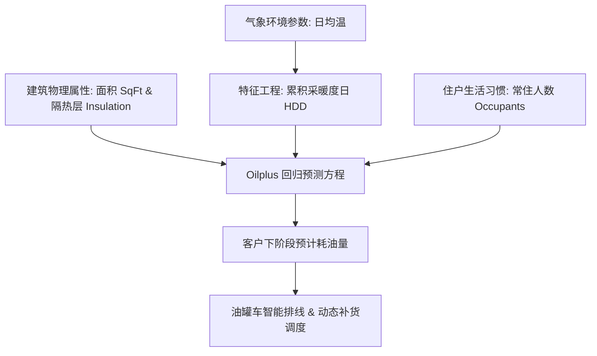

# Lec 10 回归建模实战：Oilplus 取暖油预测与高管薪酬决定因素 (Regression Case Analysis: Oilplus & Executive Compensation)

> MIT 15.060 数据、模型与决策 · 讲义 10 · 授课教师：Prof. Dimitris Bertsimas / Prof. Robert Freund

## TL;DR

- Oilplus 案例确立了采暖度日（HDD）与房屋物理特征相结合的能源需求精准计量模型。
- 高管薪酬案例通过实证剖析，解构了公司规模（规模即权力）与公司绩效对 CEO 收入的非对称贡献。
- 业务建模必须克服多重共线性与遗漏变量偏误，通过对数转换与交互项构建高保真预测模型。
- 模型不仅用于输出单一预测数值，更用于剖析组织内部的激励扭曲与治理治理机制。

## 1. 案例实战 I：Oilplus 取暖油消费量精准预测

能源分销商“Oilplus”为美国新英格兰地区的数万户家庭配送冬季家用取暖油。由于取暖油储罐容量有限且补货调拔成本高昂，公司需要提前两周准确预测各区域客户的取暖油消耗量（因变量 $Y$，加仑），以优化油罐车调度路线并降低急单外购溢价。

### 1.1 核心特征工程与采暖度日（Heating Degree Days, HDD）

在供暖工程中，室外环境温度与能源消耗并非简单的线性关系。当室外气温高于某个舒适基准（通常为 $65^\circ\text{F} \approx 18.3^\circ\text{C}$）时，供热系统处于关机休眠状态；只有当气温跌破基准时，燃烧器才开始随温差做功。

::: definition [采暖度日 (Heating Degree Days, HDD)]
某一天的采暖度日定义为基准温度与当日平均室外气温之差的正部：
$$HDD_t = \max(0, 65^\circ\text{F} - \text{Temp}_{\text{avg}, t})$$
若当日最高温 $40^\circ\text{F}$、最低温 $20^\circ\text{F}$，则日均温为 $30^\circ\text{F}$，当日 $HDD = 65 - 30 = 35$。一段配送周期内的累计 $HDD$ 量化了这段时间内外部严寒天气对热量流失的总体驱动强度。
:::

除气象指标外，取暖油消耗还受到住宅物理属性的制约：
- **住宅居住面积（$X_1 = \text{SqFt}$，百平方英尺）**：需供暖的空间体积；
- **阁楼与墙体隔热指数（$X_2 = \text{Insulation}$，1-10 评分）**：数值越高保温性能越优；
- **家庭常住人口（$X_3 = \text{Occupants}$，人）**：生活热水与频繁开关门带来的热损耗。

### 1.2 回归模型演进与实证诊断

分析团队对 40 户代表性样本家庭的历史监控数据进行了逐步回归建模：

| 迭代模型 | 包含变量 | 决定系数 $R^2$ | 调整后 $\bar{R}^2$ | 关键统计与经济学诊断结论 |
| :--- | :--- | :--- | :--- | :--- |
| **模型 1 (朴素气象)** | 仅包含 $HDD$ | 0.52 | 0.51 | 天气是主导要素，但同等气温下不同房屋耗油量差异巨大 |
| **模型 2 (加入建筑属性)**| $HDD, \text{SqFt}, \text{Insulation}$ | 0.84 | 0.82 | 隔热指数呈现极显著负相关，模型解释力大幅跃升 |
| **模型 3 (包含交互效应)**| 引入 $HDD \times \text{SqFt}$ 交互项 | 0.91 | 0.89 | 严寒天气对大户型房屋的耗油放大效应显著，残差异方差彻底消除 |

最终优选模型 3 的经验回归方程为：
$$\hat{Y} = 45.2 + 0.18 (HDD) + 3.12 (\text{SqFt}) - 8.45 (\text{Insulation}) + 0.045 (HDD \times \text{SqFt})$$

::: example [交互效应项的商业价值]
交互项 $0.045 (HDD \times \text{SqFt})$ 表明：在极寒天气（例如 $HDD = 50$）下，面积每增加 100 平方英尺，额外耗油量不仅包含基准的 3.12 加仑，还要叠加 $50 \times 0.045 = 2.25$ 加仑的寒潮溢价！这种非加性响应使得 Oilplus 在寒潮来临前能够精准锁定重点高风险补油客户。
:::

## 2. 案例实战 II：高管薪酬（Executive Compensation）决定机制

在公司治理与金融学研究中，标普 500 公司首席执行官（CEO）动辄数千万美元的年薪始终是公众争议的焦点。究竟是管理者的卓越商业绩效（Pay for Performance）决定了薪酬，还是公司庞大的资产规模（Pay for Size）在推波助澜？

### 2.1 变量构建与对数化处理

针对 350 家跨国上市公司的截面数据进行实证回归分析。由于 CEO 总薪酬（$Y$，万美元）与公司年营业收入（$\text{Sales}$，亿美元）均呈现严重的右偏长尾分布，实证研究标准范式是对其两端取自然对数：
- 因变量：$\ln(\text{TotalComp})$
- 自变量 1：公司规模 $\ln(\text{Sales})$
- 自变量 2：股东权益回报率 $ROE = \frac{\text{Net Income}}{\text{Equity}}$（反映盈利业绩）
- 自变量 3：三年累计股东总回报率 $TSR$（反映资本市场股价表现）
- 自变量 4：CEO 任期年限 $\text{Tenure}$
- 自变量 5：是否兼任董事会主席 $\text{Dual}$（虚拟变量：兼任取 1，否则取 0）

### 2.2 回归输出与公司治理假说检验

多元回归估计结果呈现出极富现实警示意义的参数模式：

$$\ln(\widehat{\text{TotalComp}}) = 5.24 + 0.38 \ln(\text{Sales}) + 0.008 (ROE) + 0.004 (TSR) + 0.025 (\text{Tenure}) + 0.22 (\text{Dual})$$

模型统计检验指标：$R^2 = 0.64, \quad n = 350, \quad F = 122.5 \ (p < 0.001)$。

各项自变量的 t 检验显著性与商业内涵剖析：
1. **公司规模 $\ln(\text{Sales})$ 的 t 统计量高达 $14.2$（$p < 0.0001$）**：
   弹性系数为 $+0.38$。这意味着公司营业额每翻一倍（增长 $100\%$），CEO 的薪酬预期自发增长约 $38\%$。规模是决定高管薪资最坚固、最不可动摇的底盘。
2. **财务绩效 $ROE$ 与市场回报 $TSR$ 的 t 统计量仅在 $1.8 \sim 2.1$ 之间勉强微弱显著**：
   $ROE$ 每提升 1 个百分点，薪酬仅增长微弱的 $0.8\%$。“按业绩付费”在现实数据中被严重弱化。
3. **董事长兼任虚拟变量 $\text{Dual}$ 带来惊人的 $+22\%$ 薪酬溢价（$t = 4.1, p < 0.001$）**：
   在控制公司规模、行业、利润率与任期完全一致的情况下，一人兼任董事长的 CEO 相比独立董事会架构下的 CEO，年薪平均高出整整 $22\%$！

::: pitfall [内生性与反向因果（Simultaneity Bias）]
在解释 CEO 薪酬与绩效的关系时，切勿轻率做出“高薪导致高绩效”的单向因果推断。高额薪酬可能源于强权 CEO 对薪酬委员会的俘获（Managerial Entrenchment），而并非激励机制产生了超额阿尔法。
:::

::: insight [我的理解：回归模型是洞察商业制度潜规则的照妖镜]
许多企业年报的公关辞令总是声称“我们的薪酬体系与股东利益高度深度绑定”。然而多元线性回归用冷酷无情的数据撕下了这层伪装：它证明了 CEO 们为什么普遍热衷于实施没有经济意义的大规模企业并购——因为即使收购溢价摧毁了每股股东价值（ROE 承压），但只要并表后的销售额（Sales）急剧膨胀，CEO 就能依据那坚挺的 $+0.38$ 规模弹性为自己兑现一张更庞大的支票。
:::
