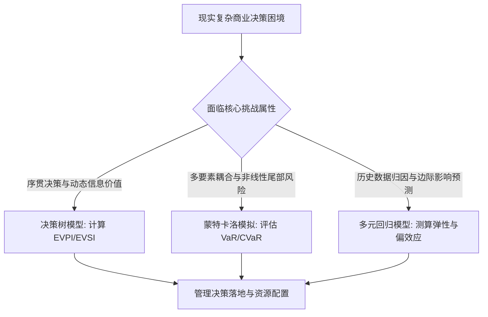

# Lec 11 前半程量化决策方法综合评估与误差治理 (Midterm Methodological Synthesis & Error Governance)

> MIT 15.060 数据、模型与决策 · 讲义 11 · 授课教师：Prof. Dimitris Bertsimas / Prof. Robert Freund

## TL;DR

- 前半程四大方法体系构成了应对不确定性世界的逻辑闭环。
- 决策树聚焦离散时序抉择，概率分布锚定参数信念，蒙特卡洛遍历非线性尾部，线性回归解构关联杠杆。
- 建模误差源于数据测量噪声、结构形式误设与人类行为认知偏差的三重交织。
- 优秀管理者不迷信复杂模型的绝对输出，而是通过跨方法交叉验证防范战略黑天鹅。

## 1. 量化决策四大基石的方法论映射

在 15.060 的前半程学习中，我们系统性构建了面向不确定性商业世界的四套量化分析武器：
1. **决策树分析（Decision Trees）**：用于时间先后序贯决策，权衡信息收集成本与即时行动净收益；
2. **概率论与分布理论（Probability Distributions）**：用于对不可控事件的发生机理进行严谨的数学形式化表征；
3. **蒙特卡洛模拟（Monte Carlo Simulation）**：用于当解析公式在复杂非线性损益面前失效时，通过数值抽样全景扫描破产风险；
4. **多元回归模型（Multiple Regression）**：用于从海量杂乱的历史业务观测数据中提炼自变量与因变量的偏边际因果效应。

为了在真实复杂的战略管理情境中准确选型，必须建立清晰的**方法选择决策矩阵**：

| 分析维度 | 决策分析与决策树 | 概率与数理统计 | 蒙特卡洛模拟 | 多元回归分析 |
| :--- | :--- | :--- | :--- | :--- |
| **核心问题导向** | “当下我该选择 A 还是 B？” | “该事件发生的内在概率几何？” | “最坏情况下系统会亏多少钱？” | “X 对 Y 的真实边际驱动系数是多少？” |
| **核心数学机制** | 反向归纳法 (Rollback) & EMV | 贝叶斯反转、PMF/PDF、CLT | 逆变换伪随机数采样与经验分布 | 最小二乘优化 (min SSE)、BLUE |
| **典型决策输入** | 方案树、离散状态概率、终端收益 | 样本数据、先验参数、分布假定 | 业务结构方程、关联随机变量 | 历史观测矩阵 $(X, Y)$ |
| **关键局限与盲区** | 容易陷入“状态组合维度灾难” | 极端尾部事件常违背经典分布假定 | 极度依赖输入变量间相关性的设定 | 无法自动证明严格因果，易受内生性干扰 |

## 2. 商业建模中的三重误差治理体系

数据驱动的决策并不天然等同于正确的决策。无数在黑板上和 Excel 测算中极其完美的模型，在投入真实商业实战后迅速崩塌。要成为卓越的量化领导者，必须学会诊断并治理以下**三重建模误差**：

### 2.1 第一重：数据生成过程中的测量与抽样误差（Data Noise）

任何模型输入的数据都不可避免地伴随着噪声。常见数据病灶包括：
- **幸存者偏差（Survivorship Bias）**：仅分析当前依然存续的明星企业，忽视了死于同一策略的成千上万家破产公司；
- **非随机抽样（Selection Bias）**：客户调研问卷往往只有极度不满或极度热情的用户填写，中间沉默的大多数被系统性过滤；
- **测量时滞（Measurement Lag）**：用上一季度的滞后财务指标去指导实时波动的供应链采购。

### 2.2 第二重：模型形式的结构性误设（Specification Error）

形式误设源自分析师对真实世界复杂机制的粗暴简化：
- **线性强加**：对具有明显规模收益递减或倒 U 型关系的现象机械使用一元一次回归；
- **平均数陷阱**：在存在硬性物理产能或法律底线的环节，将随机变量简单取均值代入；
- **遗漏变量混淆（Omitted Variable Bias）**：漏掉了支配自变量与因变量的核心潜变量，导致回归系数符号颠倒（辛普森悖论）。

### 2.3 第三重：认知与行为心理学偏差（Cognitive Biases）

再客观的数学工具也是由具有心理弱点的人类操作与解读的：
- **确认偏误（Confirmation Bias）**：先下达管理结论，随后指示分析师反复调整参数与变量，直到回归输出“想要”的显著星号；
- **过度自信与锚定（Overconfidence & Anchoring）**：在设定模拟概率分布时，将最悲观区间的下限设定得过于乐观，严重低估尾部风险；
- **古德哈特定律（Goodhart's Law）**：“当一个指标变成管理考核的目标时，它就不再是一个好的指标。”代理人会针对优化模型进行逆向寻租与博弈。

## 3. 综合案例演练：多阶段新药研发与商业化投产决策

某跨国生物医药企业面临一款新型抗肿瘤免疫药物的商业化推进抉择。该决策深刻融合了前半程的全部四大方法体系：

1. **第一阶段：历史临床与市场数据回归分析（Regression）**：
   通过对过去 15 年 80 款同类肿瘤药的全球销售数据拟合多元回归，确定临床疗效提升幅度（$\Delta PFS$）、副作用等级与靶点竞争对手数量对首年销售峰值的对数边际弹性系数。
2. **第二阶段：临床试验与监管审批决策树（Decision Tree）**：
   构建三期临床试验推进决策树。计算若额外支付 4,000 万美元开展针对特定生物标志物的伴随诊断测试，其降低三期临床失败概率的样本信息价值（EVSI）。
3. **第三阶段：动态量产与医保准入蒙特卡洛仿真（Monte Carlo）**：
   在获批上市节点，针对未来 10 年医保谈判砍价幅度、竞品专利挑战胜诉率以及工厂发酵纯化产能利用率，建立全要素贴现现金流仿真模型，输出商业净现值的 5% 风险价值与破产概率。

::: example [综合框架下的协同威力]
单一方法无法独立承担如此昂贵的战略抉择。回归模型提供了合理的宏观弹性基准；决策树给出了严谨的试验门槛止损线；蒙特卡洛则守护住了集团不因单点研发爆雷而导致流动性枯竭的财务底线。
:::

::: pitfall [将量化工具退化为权力博弈的道具]
在很多大型官僚化企业中，复杂的量化模型被异化成了高管推卸政治责任的“合规遮羞布”。项目成功归功于个人英明领导，项目失败则推脱为“随机概率抽到了小概率事件”。对量化方法的真诚审视必须建立在透明的假设复盘与责任溯源机制之上。
:::

::: insight [我的理解：模型的真正使命不是提供确定性，而是管理谦卑]
未经科学训练的管理者往往在盲目自信与彻底虚无之间摇摆：要么迷信自己的草莽直觉，要么把未来交给黑箱算法。前半程的四套理论实际上是一剂深沉的清醒剂：它让我们明白，未来在本质上是充满未知的，但我们完全可以通过科学的结构化拆解，将不可知的恐惧转化为清晰的期望值与有边界的风险暴露。敬畏随机性，拥抱理性框架，是商业决策者一生的修行。
:::
