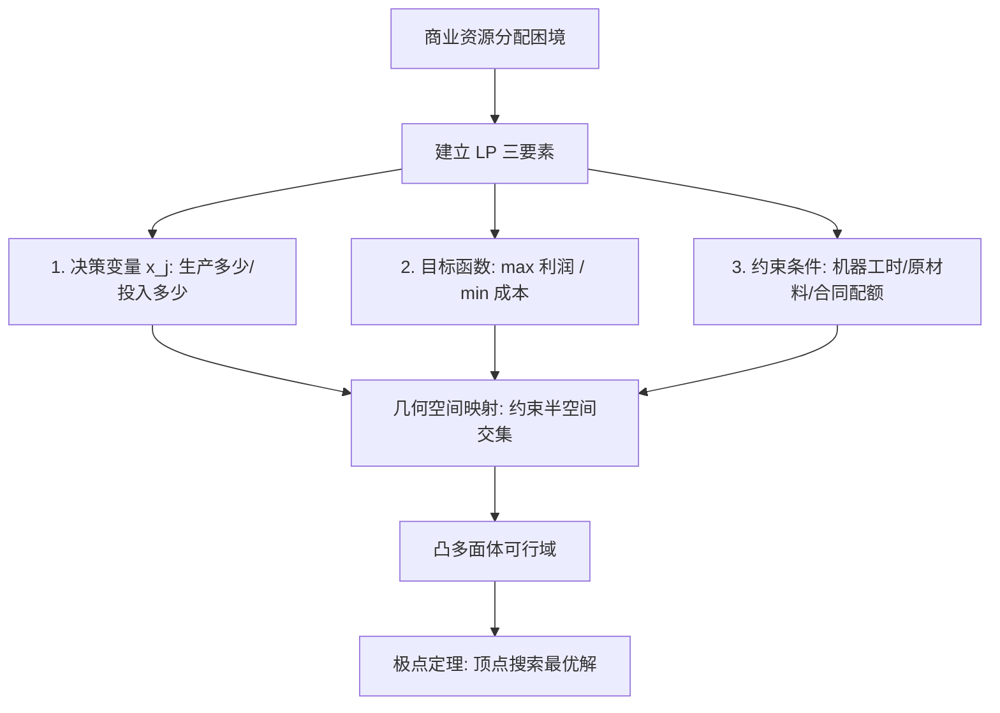

# Lec 12 线性规划导论：管理决策建模、可行域与几何极点 (Introduction to Linear Programming & Geometry)

> MIT 15.060 数据、模型与决策 · 讲义 12 · 授课教师：Prof. Dimitris Bertsimas / Prof. Robert Freund

## TL;DR

- 线性规划（LP）是管理科学中应用最为广泛的确定性资源最优配置工具。
- 优化模型由决策变量、线性目标函数与一系列线性等式或不等式硬约束严谨构成。
- 线性规划的可行域在几何上是一个凸多面体（Convex Polyhedron）。
- 极点定理确立了线性规划的最优解必然能够在可行域的某个凸极点（顶点）上取得。

## 1. 从描述与预测走向规范性优化

在 15.060 的前半程，我们专注于描述不确定性（概率与分布）与预测因果趋势（回归模型）。然而，管理者不仅需要知道“未来可能发生什么”，更迫切需要回答的是规范性（Prescriptive）终极问题：“**在所有可行的方案中，究竟哪一个能让企业实现利润最大化或成本最低化？**”

优化理论（Optimization Theory）为这一挑战提供了通用且无可替代的数学范式。在所有优化模型中，**线性规划（Linear Programming, LP）**因其优雅的数学结构和高效的算法求解能力，成为现代商业运筹的基石。

::: definition [线性规划的标准代数形式 (Linear Program in Standard Form)]
一个目标为极大化的线性规划问题可形式化表示为：
$$\max_{x} \quad Z = \sum_{j=1}^n c_j x_j = c^T x$$
$$\text{s.t.} \quad \sum_{j=1}^n a_{ij} x_j \le b_i, \quad i = 1, 2, \dots, m \quad (A x \le b)$$
$$x_j \ge 0, \quad j = 1, 2, \dots, n \quad (x \ge 0)$$
其中：
- $x = (x_1, x_2, \dots, x_n)^T$ 为待决定的**决策变量向量**；
- $c = (c_1, c_2, \dots, c_n)^T$ 为**目标函数系数向量**（单位收益或单位毛利）；
- $A \in \mathbb{R}^{m \times n}$ 为**技术消耗系数矩阵**（第 $j$ 项业务消耗第 $i$ 种资源的强度）；
- $b = (b_1, b_2, \dots, b_m)^T$ 为**资源供给可用上限向量（Right-Hand Side, RHS）**；
- $x \ge 0$ 为变量非负约束（现实中产量、工时等物理量不可能为负）。
:::

线性规划的“线性”特征包含两层不可妥协的数学假定：
1. **可加性（Additivity）**：总产出与总资源消耗严格等于各项独立活动之代数和，无交叉协同或互斥效应；
2. **比例性（Proportionality）**：活动的贡献与资源占用与决策变量呈严格正比，不存在规模收益递增或边际成本递减。

## 2. 几何图解法与可行域的拓扑结构

对于仅包含两个决策变量（$x_1, x_2$）的模型，我们可以在二维直角坐标系中直观展现线性规划求解的全部几何精髓。

### 2.1 经典双产品生产计划案例

某高档定制家具工坊生产两种手工实木家具：**餐桌（Table, $x_1$）**与**扶手椅（Chair, $x_2$）**。
- 单件餐桌净利润贡献为 160 美元，单件扶手椅为 100 美元；
- 生产受到三项关键车间产能的硬性限制：
  1. **木工雕刻车间工时**：制造一张餐桌需 4 小时，一把椅子需 2 小时；工坊每周最多可提供 120 小时雕刻工时；
  2. **打磨油漆车间工时**：制造一张餐桌需 2 小时，一把椅子需 2 小时；每周最多提供 80 小时油漆工时；
  3. **高端橡木板材配额**：制造一张餐桌需 8 板尺，一把椅子需 2 板尺；每周供应商最多配给 160 板尺优质板材。

数学规划模型构建如下：
$$\max \quad Z = 160 x_1 + 100 x_2$$
$$\text{s.t.} \quad 4 x_1 + 2 x_2 \le 120 \quad (\text{木工约束})$$
$$2 x_1 + 2 x_2 \le 80 \quad (\text{油漆约束})$$
$$8 x_1 + 2 x_2 \le 160 \quad (\text{板材约束})$$
$$x_1 \ge 0, \quad x_2 \ge 0$$

### 2.2 可行域与等利润线（Isoprofit Lines）

每个线性不等式在几何上都定义了一个闭半空间（Closed Half-space）。所有半空间以及非负第一象限的交集构成了**可行域（Feasible Region）**：

1. 木工约束线 $4x_1 + 2x_2 = 120$：截距为 $(30, 0)$ 与 $(0, 60)$；
2. 油漆约束线 $2x_1 + 2x_2 = 80$：截距为 $(40, 0)$ 与 $(0, 40)$；
3. 板材约束线 $8x_1 + 2x_2 = 160$：截距为 $(20, 0)$ 与 $(0, 80)$。

取三条直线在第一象限下方的公共交集，得到一个封闭的**五边形凸多面体**，其顶点（极点）坐标分别为：
- $A(0, 0)$：原点，收益 $Z = 0$；
- $B(20, 0)$：板材线与 x 轴交点，收益 $Z = 160(20) + 0 = 3,200$；
- $C(10, 30)$：板材线 $8x_1 + 2x_2 = 160$ 与油漆线 $2x_1 + 2x_2 = 80$ 的联立交点：
  $$6x_1 = 80 \implies x_1 = 13.33 \dots$$（检验木工约束：$4(10)+2(30)=100 \le 120$ 满足）；
  联立求得精确交点 $C(13.33, 26.67)$ 时木工约束是否松弛？验证：$4(13.33) + 2(26.67) = 53.33 + 53.33 = 106.66 \le 120$ 成立！收益 $Z = 160(13.33) + 100(26.67) = 2,133 + 2,667 = 4,800$。
- $D(0, 40)$：油漆线与 y 轴交点（因 $40 < 60$，木工线在外侧），收益 $Z = 100(40) = 4,000$。

令目标函数 $160 x_1 + 100 x_2 = C$ 绘制等利润直线，斜率为 $-\frac{160}{100} = -1.6$。将等利润线沿梯度方向向东北方平移，最后离开凸多面体的接触点正是点 $C$！

## 3. 凸性与线性规划基本定理

为什么我们只需检查有限个顶点，而完全不必理会多面体内部无限多的内部点？

::: theorem [线性规划基本极点定理 (Fundamental Theorem of LP)]
设线性规划问题的可行域 $K = \{x \in \mathbb{R}^n \mid A x \le b, x \ge 0\}$ 非空且有界。则：
1. 可行域 $K$ 是一个**凸集（Convex Set）**；
2. 线性目标函数 $c^T x$ 在 $K$ 上的全局最优值必然可以在 $K$ 的至少一个**极点（Extreme Point / Vertex）**处取得；
3. 若目标函数在两个不同的极点上同时取得相同的最优值，则连接这两个极点的线段上的任意凸组合点均为最优解（无穷多最优解情形）。
:::

线性规划的可能求解结局仅有四种：
- **唯一最优解（Unique Optimal Solution）**：等利润面仅与单一极点相切；
- **无穷多最优解（Alternative / Multiple Optima）**：等利润面与可行域的某条边界线（或高维边界超平面）完全平行；
- **无界解（Unbounded Solution）**：可行域在目标改善方向上无限延伸，理论利润可达无穷大（现实中通常是遗漏了关键产能约束）；
- **无可行解（Infeasible Solution）**：各项硬性约束相互冲突，交集为空集。

::: pitfall [非凸性与局部最优陷阱]
初学者常以为极点定理适用于所有优化问题。若目标函数存在非线性乘积项（如规模折扣价格 $P(x) \cdot x$），或可行域包含不连续断点，凸性将被彻底破坏，系统将充斥着大量伪装的“局部最优陷阱（Local Optima）”，标准单纯形极点搜索将彻底失效。
:::

::: insight [我的理解：凸性是人类计算科学所能奢求的最慷慨礼物]
在广袤的高维数学宇宙中，寻找全局最优解本质上是极其绝望的“大海捞针”。如果没有凸性保障，即便动用全球所有超级计算机算到宇宙终结，也无法确认是否遗漏了某处更深的洼地。而线性规划的伟大之处就在于：凸性彻底抹杀了局部最优与全局最优的鸿沟。只要你在山顶的边缘顺着山脊向上走，到达局部顶点的那一刻，数学就已为你签署了君临天下的全局最优保证书。
:::
