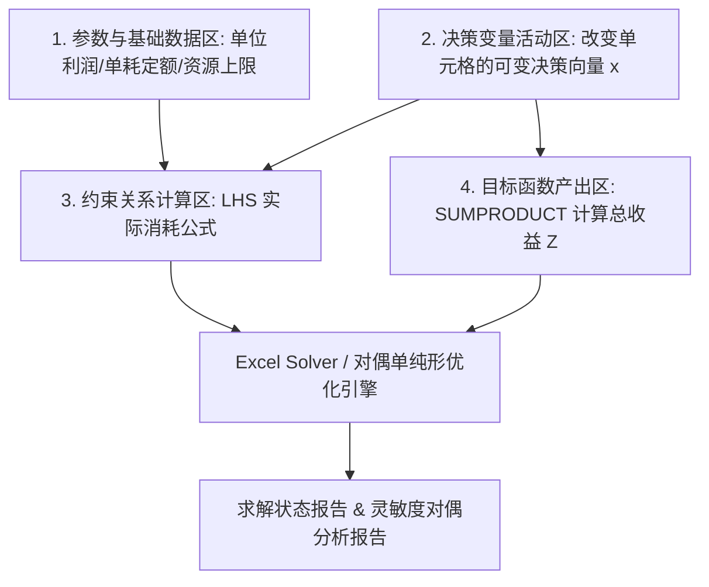

# Lec 13 线性规划求解实务：电子表格建模、影子价格与对偶灵敏度 (Linear Optimization: Solvers, Shadow Prices & Sensitivity)

> MIT 15.060 数据、模型与决策 · 讲义 13 · 授课教师：Prof. Dimitris Bertsimas / Prof. Robert Freund

## TL;DR

- 电子表格求解器通过将数据区、决策变量区、约束逻辑区解耦，实现工业级 LP 敏捷求解。
- 影子价格（Shadow Price）量化了当外部资源约束放宽 1 个单位时，最优目标利润的边际增量。
- 紧约束（Binding Constraints）具有非零影子价格，直接锁定系统吞吐瓶颈；松弛约束的影子价格恒为零。
- 可允许增减范围（Allowable Range）严格限定了当前影子价格保持恒定不变的有效资源边界。

## 1. 工业级优化建模规范与求解器架构

在商业实战中，极少有人会手算二维图解法。管理决策者通常依托 Excel Solver、OpenSolver 或 Python 优化库（PuLP / Gurobi）求解包含数百个变量与上千条约束的大型模型。

为了保证模型的可读性、可维护性与抗错能力，必须遵循**结构化电子表格建模四分法（Four-Block Layout）**：

规范建模的核心禁忌是：**严禁在目标公式或约束公式中硬编码任何具体数值常数**！所有经济参数必须存放在独立的单元格中，由公式进行动态引用。

## 2. 影子价格（Shadow Price）的深刻经济学内涵

线性规划求解器在输出最优决策变量解向量 $x^*$ 的同时，会附赠一份信息量巨大的副产品——**灵敏度报告（Sensitivity Report）**。其中最核心的指标即为约束条件的**影子价格（Shadow Price，对偶变量值）**。

::: definition [影子价格 (Shadow Price / Dual Value)]
设线性规划的原问题最优目标值为 $Z^*(b)$。对于第 $i$ 个资源约束 $\sum_{j=1}^n a_{ij} x_j \le b_i$，其影子价格 $y_i^*$ 定义为最优目标值关于资源供给量 $b_i$ 的一阶偏导数：
$$y_i^* = \frac{\partial Z^*}{\partial b_i}$$
在离散商业语境中，影子价格代表：**在其他所有内外部条件保持不变的前提下，若该项资源的可用配额 $b_i$ 增加 1 个单位，系统能够获得的最大额外超额利润**。
:::

### 2.1 互补松弛定理（Complementary Slackness）与资源瓶颈识别

影子价格与约束的满足状态遵循严格的二元对立规律：

::: theorem [互补松弛性法则]
对于任意最优解向量 $x^*$ 与对偶影子价格向量 $y^*$：
$$y_i^* \cdot \left( b_i - \sum_{j=1}^n a_{ij} x_j^* \right) = 0, \quad \forall i$$
1. **若约束为非紧约束（Non-binding / Slack $> 0$）**：
   说明现有资源尚未被充分利用，系统内部尚存闲置（例如仓库还空余 50 平米）。此时，额外再向系统补充 1 单位闲置资源，无法创造任何新增利润，其**影子价格必然严格为零（$y_i^* = 0$）**！
2. **若约束为紧约束（Binding / Slack $= 0$）**：
   说明该项资源已经被彻底消耗完毕，构成了限制企业继续扩大生产的“卡脖子瓶颈”。此时其**影子价格通常严格大于零（$y_i^* > 0$）**。
:::

### 2.2 商业实战：加班费与外购溢价的决策标尺

回到讲义 12 的家具工坊案例，求解器输出的灵敏度报告如下：

| 约束条件 | 最终消耗值 (LHS) | 资源可用上限 (RHS) | 松弛量 (Slack) | 状态 | 影子价格 ($/单位) | 允许增加量 | 允许减少量 |
| :--- | :--- | :--- | :--- | :--- | :--- | :--- | :--- |
| **木工工时 (小时)**| 106.67 | 120.0 | 13.33 | 松弛 | **$0.00** | 无穷大 ($\infty$) | 13.33 |
| **油漆工时 (小时)**| 80.00 | 80.0 | 0.00 | **紧约束** | **$33.33** | 40.00 | 20.00 |
| **板材配额 (板尺)**| 160.00 | 160.0 | 0.00 | **紧约束** | **$13.33** | 80.00 | 40.00 |

::: example [运用影子价格做高管审批决策]
1. **场景 A**：油漆车间工长申请安排周末有偿加班，工人要求每小时额外支付 25 美元的加班津贴。厂长是否应该批准？
   - **决策推导**：油漆工时的影子价格为 33.33 美元/小时，代表每多获得 1 小时油漆工时，工坊总毛利净增 33.33 美元。额外支付 25 美元加班费后，工坊仍可净赚 $33.33 - 25.00 = +8.33$ 美元/小时！只要加班时长不超过允许增加量 40 小时，**应当坚决批准**！
2. **场景 B**：木工车间工长同样申请周末加班，要求 15 美元/小时津贴。
   - **决策推导**：木工工时当前尚有 13.33 小时闲置（松弛量），其影子价格为 $0 美元。批准加班只会增加毫无用处的闲置工时，净亏 15 美元/小时，**必须断然否决**！
:::

## 3. 可允许变动范围（Allowable Range）的有效性边界

高管在使用影子价格时最容易犯的错误是“无限线性外推”：既然油漆工时能带来 33.33 美元/小时的增量毛利，那我们一口气买入 10,000 个小时岂不是暴富？

这是完全错误的。因为随着某项瓶颈资源的持续注入，该资源的稀缺性会迅速缓解，直到另一个原本充裕的资源（如木工工时或板材）被全部榨干，沦为新的系统瓶颈。一旦瓶颈发生转移，原有的最优极点几何结构瞬间解体，旧的影子价格彻底作废！

::: definition [允许变动范围 (Allowable Increase / Decrease)]
允许变动范围是指：**在保持当前最优基变量集合（即最优决策所对应的极点几何交点组合）不变的前提下，单一参数允许变动的最大上下限**。
只要 RHS 的变动幅度落在 $[b_i - \text{Decrease}, \quad b_i + \text{Increase}]$ 区间内：
1. 当前的影子价格数值严格保持恒定；
2. 新的最优目标收益变化量精确等于：$\Delta Z^* = y_i^* \times \Delta b_i$。
:::

若油漆工时增加超过 40 小时（总工时达到 120 小时以上），木工工时就会被同时耗尽，油漆工时的影子价格将发生断崖式下跌。

::: pitfall [同时改变多个参数时的“百分之百法则”破坏]
灵敏度报告中的允许变动范围仅针对**单变量变动（One-at-a-time）**。如果管理层同时调整了两个或多个资源的配额（例如既增加了油漆工时，又削减了板材），必须应用“100% 法则（100% Rule）”：
$$\sum_{i} \frac{|\Delta b_i|}{\text{Allowable Limit}_i} \le 100\%$$
若各变动比率之和超过 $100\%$，原影子价格失效，必须重新运行求解器。
:::

::: insight [我的理解：影子价格是组织内部协同的最优内部结算货币]
在大企业中，不同事业部之间常常为了争抢有限的公用资源（如 IT 算力、法务审批、机床产能）争吵不休，科层制下的部门博弈效率极低。线性规划的影子价格，从数学底层为管理层提供了一套“完全客观的内部计价机制”。它不偏袒任何部门，而是用对全集团总目标的边际贡献说话。谁能产生超过影子价格的边际效益，资源就该分配给谁。这才是用算法替代官僚主义的真谛。
:::
