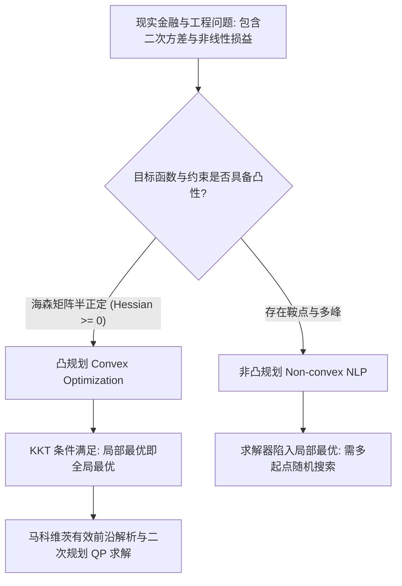
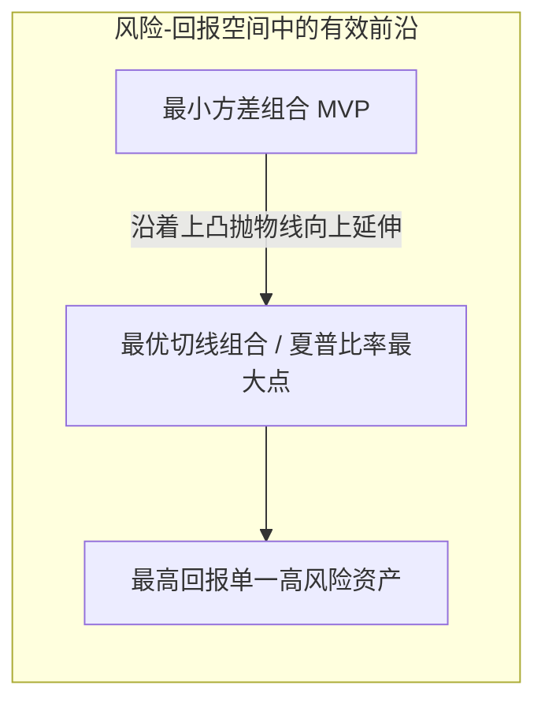

# Lec 15 非线性规划与现代资产组合理论（Markowitz 均值-方差模型）(Nonlinear Optimization & Modern Portfolio Theory)

> MIT 15.060 数据、模型与决策 · 讲义 15 · 授课教师：Prof. Dimitris Bertsimas / Prof. Robert Freund

## TL;DR

- 非线性规划（NLP）打破了线性规划的比例与可加假定，用于刻画收益递减与风险二次方关系。
- 凸优化问题保证了局部极值与全局极值的统一，其判断依赖于目标函数与约束的海森矩阵半正定性。
- 马科维茨（Markowitz）模型将投资组合风险形式化为二次协方差矩阵，开创了现代资产配置范式。
- 有效前沿（Efficient Frontier）描绘了给定预期回报下方差最小、或给定风险下回报最大的资产边界。

## 1. 非线性规划的数学结构与凸性检验

在现实商业与金融世界中，许多物理规律与经济行为本质上是非线性的。例如：生产过程中的规模报酬递减（Diminishing Returns）、价格下降引发需求非线性扩大的弹性曲线、以及金融资产投资组合中由相关系数交叉项构成的波动率方差。

::: definition [非线性规划的一般形式 (Nonlinear Programming, NLP)]
一个非线性规划问题可形式化表示为：
$$\min_{x \in \mathbb{R}^n} \quad f(x)$$
$$\text{s.t.} \quad g_i(x) \le 0, \quad i = 1, 2, \dots, m$$
$$h_j(x) = 0, \quad j = 1, 2, \dots, p$$
其中目标函数 $f(x)$ 或约束函数 $g_i(x), h_j(x)$ 中至少有一个为非线性函数。
:::

与线性规划不同，非线性规划的核心挑战在于**局部最优（Local Minimum）与全局最优（Global Minimum）的背离**。若优化问题不具备凸性，算法容易困在局部的“洼地”中无法自拔。

### 1.1 判定凸性的数学听诊器：海森矩阵（Hessian Matrix）

对于二次连续可微函数 $f(x)$，其曲率特性由二阶偏导数矩阵（海森矩阵）决定：
$$H(x) = \nabla^2 f(x) = \begin{bmatrix} \frac{\partial^2 f}{\partial x_1^2} & \frac{\partial^2 f}{\partial x_1 \partial x_2} & \dots & \frac{\partial^2 f}{\partial x_1 \partial x_n} \\ \frac{\partial^2 f}{\partial x_2 \partial x_1} & \frac{\partial^2 f}{\partial x_2^2} & \dots & \frac{\partial^2 f}{\partial x_2 \partial x_n} \\ \vdots & \vdots & \ddots & \vdots \\ \frac{\partial^2 f}{\partial x_n \partial x_1} & \frac{\partial^2 f}{\partial x_n \partial x_2} & \dots & \frac{\partial^2 f}{\partial x_n^2} \end{bmatrix}$$

::: theorem [凸函数的充要条件]
设集合 $C \subseteq \mathbb{R}^n$ 为非空开凸集，函数 $f: C \to \mathbb{R}$ 二阶连续可微。则：
1. $f(x)$ 在 $C$ 上为凸函数，当且仅当其海森矩阵 $H(x)$ 在 $C$ 内处处为**半正定矩阵（Positive Semi-Definite, PSD）**，即对任意非零向量 $v \in \mathbb{R}^n$，恒有 $v^T H(x) v \ge 0$。
2. 若 $f(x)$ 为凸函数且可行域为凸集，则其任意局部最优解必然是全域全局最优解。
:::

## 2. 马科维茨现代投资组合理论（MPT）

1952 年，哈里·马科维茨（Harry Markowitz）在《金融学杂志》发表奠基性论文，首次将非线性规划引入金融资产管理，将原本依赖经验直觉的股票挑选转变为严密的均值-方差优化工程。

### 2.1 二次规划模型构建

假设市场上存在 $n$ 种风险资产。资产的回报率向量记为随机向量 $R = (R_1, R_2, \dots, R_n)^T$：
- 资产预期回报率向量：$\mu = E[R] = (\mu_1, \mu_2, \dots, \mu_n)^T$；
- 资产收益率的协方差矩阵：$\Sigma \in \mathbb{R}^{n \times n}$，其中对角线元素 $\Sigma_{ii} = \sigma_i^2$ 为方差，非对角线元素 $\Sigma_{ij} = Cov(R_i, R_j) = \rho_{ij} \sigma_i \sigma_j$。
- 投资者的决策变量为各资产的资金配置权重向量 $w = (w_1, w_2, \dots, w_n)^T$。

投资组合的预期回报率与总方差为：
$$E[R_p] = \sum_{i=1}^n w_i \mu_i = \mu^T w$$
$$\sigma_p^2 = Var(R_p) = \sum_{i=1}^n \sum_{j=1}^n w_i w_j \Sigma_{ij} = w^T \Sigma w$$

马科维茨投资组合优化模型设定为：**在满足给定期望最低目标回报率 $R_{\text{target}}$ 的前提下，极小化组合的整体风险（方差）**：

$$\min_{w} \quad \frac{1}{2} w^T \Sigma w$$
$$\text{s.t.} \quad \mu^T w \ge R_{\text{target}} \quad (\text{预期回报底线})$$
$$\sum_{i=1}^n w_i = 1 \quad (\text{资本预算完全配置})$$
$$w_i \ge 0, \quad \forall i \quad (\text{禁止卖空约束})$$

由于协方差矩阵 $\Sigma$ 依据概率论公理必然是半正定的（$w^T \Sigma w = Var(R_p) \ge 0$），因此该二次目标函数是一个严格的凸函数，且约束全部为线性约束。这是一个典型的**凸二次规划问题（Convex Quadratic Program, QP）**，能够被高效且精确地求得全局唯一最优解。

### 2.2 有效前沿（Efficient Frontier）的几何与经济学形态

通过在合理区间内连续改变目标期望回报率 $R_{\text{target}}$，重复求解上述二次规划模型，将每组最优解对应的标准差 $\sigma_p$ 与期望回报 $E[R_p]$ 绘制在二维坐标系上，便得到了著名的**有效前沿（Efficient Frontier）**：

有效前沿具有以下至关重要的经济学性质：
1. **单调上凸性（Monotonic Concavity）**：由于分散化对冲效应，曲线向左上方突出。在相同风险水平下，前沿之上的组合提供了最高回报；在相同回报水平下，前沿组合提供了最低风险。
2. **全局最小方差组合（Global Minimum Variance Portfolio, GMVP）**：前沿最左端的顶点代表市场上不考虑回报时所能达到的绝对最低波动极限。
3. **夏普比率（Sharpe Ratio）最大化切线**：当引入无风险利率 $R_f$ 时，从 $(0, R_f)$ 出发与有效前沿相切的射线斜率最大，该切点组合即为全市场夏普比率最优的风险资产配置。

## 3. 商业实战：三资产投资组合优化求解

考虑某主权财富基金分配资金于三类代表性资产：美国标普 500 指数（$A$）、新兴市场股票（$B$）、长期美国国债（$C$）。基础参数如下表：

| 资产类别 | 预期年化回报率 $\mu_i$ | 年化波动率 $\sigma_i$ | 与标普 500 相关系数 | 与新兴市场相关系数 | 与美债相关系数 |
| :--- | :--- | :--- | :--- | :--- | :--- |
| **资产 A (S&P 500)** | $10.0\%$ | $16.0\%$ | 1.00 | 0.65 | -0.15 |
| **资产 B (Emerging)** | $14.0\%$ | $24.0\%$ | 0.65 | 1.00 | -0.05 |
| **资产 C (US Bonds)** | $4.0\%$ | $6.0\%$ | -0.15 | -0.05 | 1.00 |

若基金投资委员会设定目标年化投资回报率不得低于 $9.0\%$（$R_{\text{target}} = 0.09$）：

::: example [二次规划求解最优权重配置]
使用 Excel Solver（选择 GRG Nonlinear 引擎）或 Python `scipy.optimize` 求解，得到最优权重为：
$$w_A^* = 42.5\%, \quad w_B^* = 26.8\%, \quad w_C^* = 30.7\%$$
组合综合特征：
- 组合预期回报率：$E[R_p] = 0.425(10\%) + 0.268(14\%) + 0.307(4\%) = 4.25\% + 3.75\% + 1.23\% = 9.23\%$；
- 组合年化波动率：$\sigma_p = \sqrt{w^T \Sigma w} = \mathbf{9.85\%}$！
注意：高风险资产 B 单体波动率高达 $24\%$，资产 A 达 $16\%$，但在配置了 $30.7\%$ 与股票呈负相关的长期国债后，整个组合以 $9.23\%$ 的较高回报率实现了低于 $10\%$ 的极低波动率！
:::

::: pitfall [参数估计误差放大器（Error Maximizer）]
马科维茨模型在学术上极其优雅，但在华尔街被称为“误差放大器”。因为优化求解器会对输入数据中微小的估计偏差进行极致套利：若某只股票的历史均值回报率仅仅由于幸运抽样被高估了 $1\%$，优化器就会给它分配极度荒谬的巨额权重。在实操中必须结合贝叶斯收缩（Black-Litterman 模型）或鲁棒优化对期望回报施加先验正则化约束。
:::

::: insight [我的理解：非线性规划直面风险的真实曲率]
线性规划的世界是平坦的，单位边际成本恒定不变，最优解永远被逼在多面体的尖锐顶角上，往往导致“要么全买、要么全不买”的极端全仓策略。而马科维茨模型引入了方差这个二次非线性曲面，空间的弯曲使得最优解优雅地停留在曲面的平滑切点上。非线性规划不仅是一次数学维度的跃迁，更在投资哲学上确立了多元制衡与均值回归的谦卑智慧。
:::
