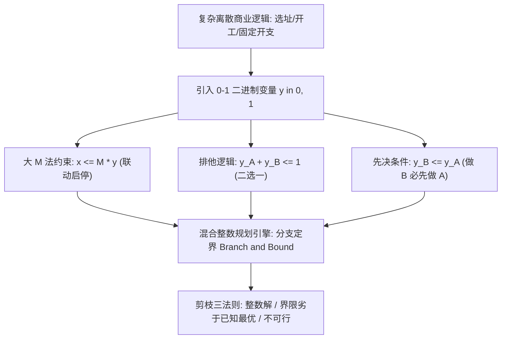

# Lec 16 整数与混合整数规划：0-1 决策变量、固定成本与逻辑约束 (Integer & Combinatorial Optimization: 0-1 Variables & Logic)

> MIT 15.060 数据、模型与决策 · 讲义 16 · 授课教师：Prof. Dimitris Bertsimas / Prof. Robert Freund

## TL;DR

- 混合整数线性规划（MILP）通过引入离散与 0-1 二进制变量，极大拓展了管理决策的表达边界。
- 简单将连续 LP 松弛解四舍五入是极其危险的做法，常导致不可行性或严重次优。
- 0-1 二进制变量能够精确建模固定建设成本、先决条件、逻辑互斥排他与分段阶梯定价。
- 分支定界法（Branch and Bound）通过系统性空间树状划分与界限剪枝，提供了求解组合爆炸的标准范式。

## 1. 离散现实与四舍五入陷阱（Rounding Pitfall）

在之前的线性规划中，我们假定所有决策变量可以在实数轴上连续取值（Divisibility Assumption）。然而，在现实商业管理中，海量关键抉择在本质上是不可分割的“离散”或“二元”状态：
- 我们不能建造 0.65 座半导体晶圆代工厂；
- 航空公司不能开通 2.3 条波士顿至巴黎的跨洋航线；
- 风险投资基金要么全资投资项目 A（$y=1$），要么彻底放弃（$y=0$）。

许多未经严格训练的分析师常采取“捷径”：先忽略整数限制，按连续线性规划求解，随后将解四舍五入到最近的整数。这种做法暗藏着**双重致命风险**：

::: pitfall [四舍五入法的双重灾难]
1. **可行性破产（Infeasibility）**：四舍五入后的整数点往往被挤出可行域边界之外。例如约束为 $3x_1 + 2x_2 \le 11$，连续解为 $(1.5, 3.25)$，总和为 11。若向上取整为 $(2, 3)$，则 $3(2)+2(3)=12 > 11$，直接违背硬性约束！
2. **严重次优（Severe Suboptimality）**：由于高维凸多面体的形状极度陡峭，真正的最优整数点可能离连续松弛极点非常遥远，朴素四舍五入会错失高额商业价值。
:::

::: definition [混合整数线性规划 (Mixed Integer Linear Program, MILP)]
设决策变量部分为整数、部分为连续变量：
$$\max \quad Z = c^T x + d^T y$$
$$\text{s.t.} \quad A x + B y \le b$$
$$x \ge 0 \quad (\text{连续变量向量}), \quad y \in \{0, 1\}^p \text{ 或 } y \in \mathbb{Z}_+^p \quad (\text{离散/二进制变量向量})$$
若所有变量均为整数，则称为纯整数规划（Pure IP）；若离散变量仅取 0 或 1，则称为 0-1 整数规划（Binary IP）。
:::

## 2. 0-1 逻辑约束建模的“语法手册”

0-1 变量是管理科学中最强大的“数字乐高积木”。通过巧妙的线性代数构造，它可以将人类自然语言中复杂的管理制度规则，精准转译为计算机可求解的线性约束：

### 2.1 固定成本（Fixed Charge）与“大 M 法”

在制造业中，开机生产某种产品往往需要支付一笔高昂的模具调校固定开销（Fixed Cost $F$），只有开机后才有每件的变动边际成本 $c$。总成本为非连续的跳跃函数：
$$C(x) = \begin{cases} 0, & x = 0 \\ F + c x, & x > 0 \end{cases}$$

引入 0-1 指示变量 $y \in \{0, 1\}$（$y=1$ 表示开机生产，$y=0$ 表示停产关闭）。目标函数加入固定成本项：$F \cdot y + c \cdot x$。
为了强制约束“只要 $x > 0$ 则 $y$ 必须被激活为 1”，建立**大 M 联动约束（Big-M Constraint）**：
$$x \le M \cdot y \quad \iff \quad x - M y \le 0$$
其中 $M$ 是一个足够大的正数，代表该生产线物理可能的最大产量上限。
- 若 $y = 0$，不等式迫使 $x \le 0$，因非负约束必有 $x = 0$；
- 若 $x > 0$，为满足不等式，$y$ 必须被推升为 1，从而成功触发固定成本扣减。

### 2.2 战略逻辑关系的代数表述

设 $y_j \in \{0, 1\}$ 分别表示对候选项目 $j$ 的投资决策（$1$ 投资，$0$ 放弃）：

| 现实管理约束业务表述 | 线性整数代数约束方程 | 约束机制深度原理解释 |
| :--- | :--- | :--- |
| **互斥排他（二选一或均不选）** | $y_1 + y_2 \le 1$ | 两个项目至多选一个，允许都不选 |
| **强制二选一（必须选一个）** | $y_1 + y_2 = 1$ | 严格二选一，排除全部放弃与同时选择 |
| **先决条件（做 B 必须先做 A）** | $y_2 \le y_1$ 或 $y_2 - y_1 \le 0$ | 若 $y_1 = 0$（未建 A），则强制 $y_2 \le 0$（无法做 B） |
| **共进退捆绑（要么全做，要么全不做）**| $y_1 = y_2$ 或 $y_1 - y_2 = 0$ | 两者决策状态严格同步 |
| **$k$ 出之 $m$ 组合（必须且仅选 $k$ 个）**| $\sum_{j=1}^m y_j = k$ | 从 $m$ 个候选战略方向中精准遴选 $k$ 个 |

## 3. 分支定界法（Branch and Bound）的求解哲学

纯线性规划可以在多项式时间内通过内点法或单纯形法快速求解，但整数规划在计算复杂度理论中被证明为 **NP-hard 问题**。在最坏情况下，枚举 $n$ 个 0-1 变量需要遍历 $2^n$ 种组合。当 $n = 50$ 时，$2^{50} \approx 1.12 \times 10^{15}$，即使全球最快的超级计算机也无法暴力穷举。

分支定界法（由 Land and Doig 于 1960 年提出）通过“聪明地排除不可能的分支”，征服了组合爆炸：

::: definition [分支定界三法则 (Branch & Bound Pruning Rules)]
在树状搜索过程中，对任意节点求解其**线性松弛问题（LP Relaxation）**，得到松弛目标值 $Z_{\text{LP}}$。若出现以下三种情况之一，该子树节点被立即**剪枝（Prune / Fathom）**，无需继续向下探索：
1. **界限剪枝（Pruned by Bound）**：该子节点的连续松弛上界 $Z_{\text{LP}}$ 已经小于或等于当前全局已知的最好整数解（Incumbent Best Integer Solution）；
2. **可行性剪枝（Pruned by Infeasibility）**：该节点的连续 LP 松弛问题本身无可行解；
3. **整数性剪枝（Pruned by Integrality）**：该节点的连续 LP 松弛解恰好自动全部满足整数约束。此时更新全局最优整数解 $Z^* \leftarrow \max(Z^*, Z_{\text{LP}})$。
:::

::: example [大 M 值选取的工程智慧]
在构建 $x \le M y$ 时，理论上 $M$ 只要足够大（如设为 $10^9$）即可保证逻辑成立。但在工程实务中，**过大的 $M$ 值是求解器的头号杀手**！
若 $M$ 设定过大，当 $x = 100$ 时，松弛求解器只需给 $y$ 分配微小的浮点数 $\epsilon = \frac{100}{10^9} = 10^{-7}$，即可满足约束，导致 LP 松弛界限极其松弛，分支定界树规模呈指数级爆炸。因此，$M$ 必须取**满足物理现实的最紧上界（Tight Upper Bound）**。
:::

::: insight [我的理解：整数规划是离散商业世界与连续数学的契约]
大自然是连续的（时间、距离、速度），但人类创造的商业世界却是高度离散的（合同、产权、法人资格）。0-1 变量不仅是数学运算符号，它就是人类意志在数字世界的“开关”。一旦我们拥有了混合整数规划，我们就获得了把复杂的法律条文、排他协议、战略承诺全部转化为线性约束的能力。它让计算机不仅能做算术，更能理解战略博弈的规则底线。
:::
