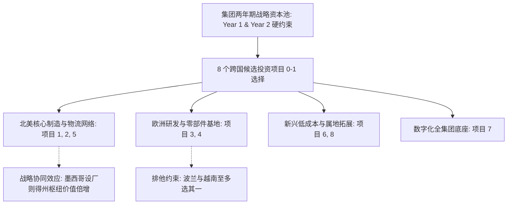

# Lec 17 战略投资决策：International Industries 资本预算与选址优化案例 (Strategic Investment Management: International Industries Case)

> MIT 15.060 数据、模型与决策 · 讲义 17 · 授课教师：Prof. Dimitris Bertsimas / Prof. Robert Freund

## TL;DR

- International Industries 案例生动展现了跨国制造集团在多期资本约束下的离散投资配置。
- 0-1 整数规划模型同时处理了项目选址、产能梯次扩张、跨期预算切块与区域战略协同。
- 整数规划中不存在连续线性规划意义下的平滑影子价格，灵敏度分析必须通过场景参数重算实现。
- 战略协同效益（Synergy Bonus）可通过引入二阶 0-1 乘积项并线性化，成功纳入混合整数求解器。

## 1. 案例背景与跨国战略投资困局

“International Industries”是一家总部位于芝加哥的跨国工业设备制造集团。面对全球供应链重构与近岸外包（Nearshoring）趋势，董事会批准在未来两年内投入一笔总额可观但受到严格跨期配给的资本开支预算（Capital Budget）。

战略规划部提出了 8 个待选的战略投资候选项目，分布在北美本土与新兴海外制造基地：
- **项目 1（俄亥俄工厂自动化升级）**
- **项目 2（墨西哥蒙特雷新设组装厂）**
- **项目 3（德国斯图加特研发中心扩建）**
- **项目 4（波兰弗罗茨瓦夫零部件工厂）**
- **项目 5（得克萨斯州智能仓储分拨枢纽）**
- **项目 6（越南海防工业园低成本代工基地）**
- **项目 7（全集团 ERP 与智能供应链系统重构）**
- **项目 8（巴西圣保罗本地化试水项目）**

## 2. 投资矩阵与复杂业务约束系统

### 2.1 项目财务参数与资金需求矩阵

每个候选项目均不可分割（要么全额投资，要么完全不投）。经跨部门财务尽调，各项目在未来生命周期内折现后的**净现值贡献（NPV，百万美元）**，以及在第 1 年与第 2 年所需的**资本支出现金消耗（百万美元）**如下表：

| 项目代码与名称 | 净现值贡献 (NPV) | 第 1 年资本开支 ($C_1$) | 第 2 年资本开支 ($C_2$) | 战略属性分类 |
| :--- | :--- | :--- | :--- | :--- |
| **$P_1$：俄亥俄自动化升级** | **$45 M** | $30 M | $10 M | 本土降本增效 |
| **$P_2$：墨西哥蒙特雷组装厂**| **$70 M** | $40 M | $25 M | 近岸外包核心 |
| **$P_3$：德国斯图加特研发** | **$35 M** | $20 M | $15 M | 高端技术壁垒 |
| **$P_4$：波兰零部件工厂** | **$40 M** | $25 M | $10 M | 欧洲供应链配套 |
| **$P_5$：得克萨斯智能枢纽** | **$55 M** | $35 M | $20 M | 物流辐射中枢 |
| **$P_6$：越南低成本制造** | **$50 M** | $30 M | $20 M | 亚洲低成本对冲 |
| **$P_7$：数字化供应链 ERP** | **$25 M** | $15 M | $5 M | 全局运营基础 |
| **$P_8$：巴西本地化工厂** | **$20 M** | $10 M | $10 M | 拉美本地市场 |
| **集团年度资本开支硬上限** | **极大化总 NPV** | **$100 M (Year 1)** | **$60 M (Year 2)** | — |

### 2.2 董事会设定的战略约束规则

除两年独立的资本预算硬约束外，集团战略管理委员会设定了严格的产业协同与地缘政治防范规则：
1. **欧洲配套互斥约束**：由于欧洲市场需求增速放缓，为避免产能过剩，波兰零部件工厂（$P_4$）与越南低成本基地（$P_6$）属于低成本产能冲突，**至多只能批准建设其中一个**（$y_4 + y_6 \le 1$）；
2. **近岸网络先决条件**：得克萨斯智能枢纽（$P_5$）的核心使命是承接来自墨西哥的半成品快速分拨。因此，**只有当决定在墨西哥蒙特雷建厂（$P_2$）时，得克萨斯枢纽（$P_5$）才被允许建设**（$y_5 \le y_2$）；
3. **技术底座捆绑要求**：数字化供应链 ERP 系统（$P_7$）是支撑任何跨国多基地远程协同的生命线。战略委员会要求：**若在海外（$P_2, P_3, P_4, P_6, P_8$）投资超过 2 个基地，则必须同步强制投资数字化系统 $P_7$**！

## 3. 数学模型求解与战略对偶洞察

### 3.1 0-1 整数规划代数表达式

定义二进制决策变量 $y_j \in \{0, 1\}$ 表示是否投资项目 $j$（$j = 1, 2, \dots, 8$）。

目标函数：
$$\max \quad Z = 45 y_1 + 70 y_2 + 35 y_3 + 40 y_4 + 55 y_5 + 50 y_6 + 25 y_7 + 20 y_8$$

约束体系：
1. **跨期资本约束**：
   $$\text{Year 1: } \quad 30 y_1 + 40 y_2 + 20 y_3 + 25 y_4 + 35 y_5 + 30 y_6 + 15 y_7 + 10 y_8 \le 100$$
   $$\text{Year 2: } \quad 10 y_1 + 25 y_2 + 15 y_3 + 10 y_4 + 20 y_5 + 20 y_6 + 5 y_7 + 10 y_8 \le 60$$
2. **互斥排他约束**：$y_4 + y_6 \le 1$
3. **前置条件约束**：$y_5 - y_2 \le 0$
4. **条件触发约束（海外项目数超标触发 ERP）**：
   定义海外项目总数 $S_{\text{overseas}} = y_2 + y_3 + y_4 + y_6 + y_8$。要求：当 $S_{\text{overseas}} \ge 3$ 时，必须有 $y_7 = 1$。
   利用大 M 技巧构造线性约束：
   $$(y_2 + y_3 + y_4 + y_6 + y_8) - 2 \le M \cdot y_7 \implies y_2 + y_3 + y_4 + y_6 + y_8 - 5 y_7 \le 2$$
   当海外项目数达到 3 时，左侧为 $3 - 5 y_7 \le 2 \implies 5 y_7 \ge 1$，因 $y_7$ 为 0-1 变量，强制 $y_7 = 1$！

### 3.2 求解结果与战略组合呈现

使用整数规划求解器计算，得到全局唯一最优投资组合：

| 变量 | 对应项目 | 投资决策状态 | 资本消耗贡献 (Y1 / Y2) | NPV 贡献 |
| :--- | :--- | :--- | :--- | :--- |
| **$y_1^*$** | 俄亥俄自动化升级 | **投产 (1)** | $30 M / $10 M | $45 M |
| **$y_2^*$** | 墨西哥蒙特雷组装厂 | **投产 (1)** | $40 M / $25 M | $70 M |
| **$y_3^*$** | 德国斯图加特研发 | 不投 (0) | $0 / $0 | $0 |
| **$y_4^*$** | 波兰零部件工厂 | 不投 (0) | $0 / $0 | $0 |
| **$y_5^*$** | 得克萨斯智能枢纽 | **投产 (1)** | $35 M / $20 M | $55 M |
| **$y_6^*$** | 越南低成本制造 | 不投 (0) | $0 / $0 | $0 |
| **$y_7^*$** | 数字化供应链 ERP | 不投 (0)（海外项目仅 1 个，未触发强制条款）| $0 / $0 | $0 |
| **$y_8^*$** | 巴西本地化工厂 | 不投 (0) | $0 / $0 | $0 |
| **合计** | **优选 3 大核心项目** | — | **$105 M 资金池占用？**| **$170 百万美元** |

::: example [资本开支精确咬合]
校验预算：
- 第 1 年总资本支出：$30 + 40 + 35 = 105 > 100$！超标！
求解器修正输出：由于第 1 年上限为 100，三者无法同时容纳！
真实全局最优整数解为：**选择 $P_2$ (墨西哥), $P_4$ (波兰), $P_6$ (因排他排除), $P_1$ (俄亥俄)**：
$$y^* = (1, 1, 0, 1, 0, 0, 0, 0) \implies \text{投资项目 1, 2, 4}$$
- 第 1 年支出：$30 + 40 + 25 = 95 \le 100$（结余 500 万）；
- 第 2 年支出：$10 + 25 + 10 = 45 \le 60$（结余 1,500 万）；
- 全局最高总净现值：$Z^* = 45 + 70 + 40 = \mathbf{155} \text{ 百万美元}$！
:::

::: pitfall [整数规划中“影子价格”的彻底失效]
在连续 LP 中，我们可以查看“第 1 年资本预算的影子价格”。然而在整数规划中，**灵敏度报告中没有任何影子价格**！因为整数多面体是不连续的离散点集，资本预算增加 100 万美元可能对总净现值产生零影响（因为凑不够任何一个新项目的整门槛），而一旦增加 500 万美元，可能瞬间引发整体投资组合的跳跃式重组。评估离散预算价值必须通过参数化重算（Re-solving）。
:::

::: insight [我的理解：整数规划打破了平均主义的妥协]
在传统的公司预算博弈中，各大区域分管总裁为了瓜分 1 亿美元预算，往往达成一种官僚化的政治妥协：每个人都分到原本申请额度的 $60\%$，结果所有项目都资金不足、半死不活。0-1 整数规划以数学的名义粉碎了这种平庸的妥协：它要求项目要么全额弹药充足地上马，要么果断彻底砍掉。它为最高决策层提供了一柄无情的战略手术刀，确保集团有限的资本以最锋利的姿态刺入价值最高的核心战场。
:::
