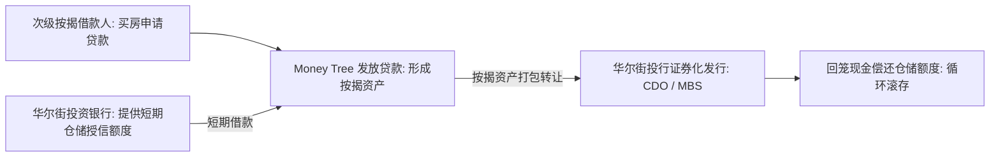

# Lec 18 次贷危机综合案例：Money Tree 抵押贷款机构流动性与违约建模 (Integrative Case: Money Tree Mortgage Distress)

> MIT 15.060 数据、模型与决策 · 讲义 18 · 授课教师：Prof. Dimitris Bertsimas / Prof. Robert Freund

## TL;DR

- Money Tree 案例完整串联了数据回归、违约概率预测、贴现模拟与资产负债匹配优化。
- 逻辑回归（Logistic）与生存分析量化了借款人 FICO 信用分与贷款价值比（LTV）对违约率的非线性驱动。
- 仓储信贷额度（Warehouse Lines）与资产证券化通道受阻，构成了诱发非银金融机构猝死的流动性陷阱。
- 综合优化模型在系统性危机蔓延时，为机构清算折价处置与生存资本维持提供了严密防线。

## 1. 2008 年金融危机与非银机构的资产负债表断裂

2007 至 2008 年爆发的全球次贷危机（Subprime Mortgage Crisis）是现代金融史上最惨烈的系统性危机。在这场浩劫中，首当其冲倒闭的并非传统商业银行，而是被称为“影子银行（Shadow Banking System）”的大型独立非银抵押贷款发放机构（如 New Century Financial、Countrywide 以及案例中的 **Money Tree Mortgage**）。

这些机构的核心商业模式并非依靠长期吸收零售储蓄存款，而是依靠**高杠杆资产负债表极速周转**：

这套飞轮高效运转的前提是两个基础假定：
1. 房地产价格永远上涨，次级借款人的违约率处于低位；
2. 华尔街二级市场的资产证券化（Securitization）收购通道始终保持充沛的流动性。
一旦房价拐头下跌，双重假定同时破灭，整个商业飞轮在数周内彻底解体。

## 2. 模块 I：按揭贷款违约概率与回归预测建模

Money Tree 积累了过去 5 年发放的 50,000 笔次级与准优级（Alt-A）住房抵押贷款历史数据。为了预测当前资产负债表上留存的 12 亿美元未售出贷款的违约风险，分析团队构建了二元违约预测回归模型。

因变量为二值分类变量：借款人在贷款发放后 18 个月内是否发生严重违约停供（$Y = 1$ 违约，$Y = 0$ 正常履约）。

### 2.1 违约逻辑回归方程（Logistic Regression）

对违约发生比率（Odds Ratio）取对数（Logit 变换）：
$$\ln\left(\frac{P(\text{Default})}{1 - P(\text{Default})}\right) = \beta_0 + \beta_1 (\text{FICO}) + \beta_2 (\text{LTV}) + \beta_3 (\text{DTI}) + \beta_4 (\text{ArmDummy})$$
其中关键自变量：
- **FICO（个人信用分）**：数值在 300 至 850 分之间；
- **LTV（贷款价值比，Loan-to-Value）**：贷款金额除以房屋评估价值，例如 $95\%$ 代表首付仅 $5\%$；
- **DTI（债务收入比，Debt-to-Income）**：借款人月供占月收入比重；
- **ArmDummy（浮动利率抵押贷款，ARM）**：虚拟变量，1 为两年后重置利率的“诱饵利率贷款（Teaser Rate）”，0 为固定利率贷款。

实证回归输出估计系数如下：
$$\text{Logit}(p) = 2.15 - 0.012 (\text{FICO}) + 3.85 (\text{LTV}) + 2.10 (\text{DTI}) + 0.95 (\text{ArmDummy})$$

::: example [违约概率的非线性跃迁]
考虑两位借款人：
1. **借款人 A (标准次级)**：FICO $= 580$, LTV $= 0.90$, DTI $= 0.45$, ARM $= 1$：
   $$\text{Logit} = 2.15 - 0.012(580) + 3.85(0.9) + 2.10(0.45) + 0.95(1) = 2.15 - 6.96 + 3.465 + 0.945 + 0.95 = 0.55$$
   $$P(\text{Default}) = \frac{e^{0.55}}{1 + e^{0.55}} = \frac{1.733}{2.733} \approx \mathbf{37.1\%}$$
2. **借款人 B (零首付极度高危)**：FICO $= 540$, LTV $= 1.05$（房价下跌后资不抵债“水下房”），DTI $= 0.55$, ARM $= 1$：
   $$\text{Logit} = 2.15 - 6.48 + 4.04 + 1.155 + 0.95 = 1.815 \implies P(\text{Default}) = \frac{e^{1.815}}{1 + e^{1.815}} \approx \mathbf{86.0\%}$$
模型清晰揭示：一旦宏观房价下跌导致 LTV 突破 $100\%$，战略性违约（Strategic Default）概率将呈现断崖式暴增！
:::

## 3. 模块 II：流动性挤兑与全要素资产负债清偿优化

2008 年秋，危机全面引爆。华尔街三大投行由于自身次级债巨亏，单方面终止了对 Money Tree 按揭贷款的常态化打包收购，并向 Money Tree 发出**追缴保证金通知（Margin Calls）**，要求其在 30 天内归还 4.5 亿美元的到期短期仓储借款。

### 3.1 资产负债盘点与可行动用资产

Money Tree 面临破产重整，当前资产负债表可处置资产池如下：
1. **高品质优级按揭资产包（Pool A, 价值 2.0 亿美元）**：违约率低，对冲基金愿意按面值 $92\%$ 的折价现金收购；
2. **中等风险 Alt-A 按揭资产包（Pool B, 价值 3.5 亿美元）**：当前市场极度恐慌，急售折价深达 $78\%$；
3. **高危次贷资产包（Pool C, 价值 5.0 亿美元）**：市场流动性枯竭，买方出价仅为面值 $52\%$（贱卖损失惨重）；
4. **自留高息次级房贷留存分级（Residual Equity Tranche, 1.2 亿美元）**：无任何外部二级市场报价，按月产生息税现金流；
5. **银行紧急备用信贷额度（Emergency Credit Facility）**：最多可提款 8,000 万美元，但需支付年化 $18\%$ 的惩罚性高利息。

### 3.2 机构生存优化模型（Survival LP Model）

首席风险官（CRO）的目标是构建一个线性规划，**在确保 30 天内筹集 4.5 亿美元刚性兑付现金以避免立即清算破产的前提下，极小化全公司长期净资产权益（Equity Value）的永久性减记损失**：

定义决策变量：
- $x_A, x_B, x_C$：分别向折价市场抛售各资产包的面额比例（$0 \le x_i \le 1$）；
- $E_{\text{draw}}$：动用紧急高成本信贷额度的金额（百万美元）。

目标函数（极小化资产处置折价损失与高额利息惩罚）：
$$\min \quad \text{Loss} = (1 - 0.92) \cdot 200 x_A + (1 - 0.78) \cdot 350 x_B + (1 - 0.52) \cdot 500 x_C + 0.18 E_{\text{draw}}$$
$$\min \quad \text{Loss} = 16 x_A + 77 x_B + 240 x_C + 0.18 E_{\text{draw}}$$

硬性流动性现金约束（筹集至少 4.5 亿美元）：
$$200(0.92) x_A + 350(0.78) x_B + 500(0.52) x_C + E_{\text{draw}} \ge 450$$
$$184 x_A + 273 x_B + 260 x_C + E_{\text{draw}} \ge 450$$

额度与物理界限约束：
$$0 \le x_A \le 1, \quad 0 \le x_B \le 1, \quad 0 \le x_C \le 1, \quad 0 \le E_{\text{draw}} \le 80$$

### 3.3 优化求解与危机处置序列

通过单纯形法求解，系统给出了极具纪律性的最优清偿阶梯：
- **第一优先级（单位筹资损失率最小）**：
  - 抛售 Pool A：每筹集 1 美元现金的损失代价为 $\frac{0.08}{0.92} \approx 0.087$ 美元；
  - 动用紧急授信 $E_{\text{draw}}$：每筹集 1 美元的利息代价为 $0.18$ 美元；
  - 抛售 Pool B：每筹集 1 美元现金的损失代价为 $\frac{0.22}{0.78} \approx 0.282$ 美元；
  - 抛售 Pool C：每筹集 1 美元现金的损失代价为 $\frac{0.48}{0.52} \approx 0.923$ 美元（近乎腰斩！）。

::: example [危机清偿全局最优方案]
求解器输出：
1. **全部清空 Pool A**：$x_A^* = 1.0 \implies$ 回笼现金 $184$ 百万美元，确认损失 1,600 万；
2. **全部打满紧急授信**：$E_{\text{draw}}^* = 80 \implies$ 回笼现金 $80$ 百万美元，利息支出 1,440 万；
3. **部分抛售 Pool B**：剩余现金缺口 $450 - 184 - 80 = 186$ 百万美元。
   令 $273 x_B^* = 186 \implies x_B^* = \frac{186}{273} \approx 68.13\%$ 面值资产，确认损失 $77 \times 0.6813 = 5,246$ 万；
4. **坚决不出售 Pool C**：$x_C^* = 0.0$！完整保全了这部分深度折价资产，避免了高达 2.4 亿美元的致命毁灭性亏损！
:::

::: pitfall [流动性错配的黑天鹅自欺]
在金融机构资产负债管理（ALM）中，许多风险主管误以为资产端的数学期望回报能覆盖负债成本。但 Money Tree 的悲剧证明：**资产是长期的（30 年），而负债是短期的（30 天）**。在流动性枯竭的挤兑风暴中，企业根本活不到资产价值均值回归的那一天。
:::

::: insight [我的理解：综合案例是对四套量化工具的实战熔炉]
孤立地看，逻辑回归只是统计包里的一个函数，线性规划只是一张静态的工作表。但在次贷危机的狂风暴雨中，这些工具化作了金融诺亚方舟上的生命测量仪。逻辑回归准确告警了哪部分资产正在渗水，而线性规划则冷静、冷血地指挥着船长抛弃哪些次要压舱物，去换取宝贵的生存现金。这就是数据、模型与决策融会贯通后的终极力量。
:::
