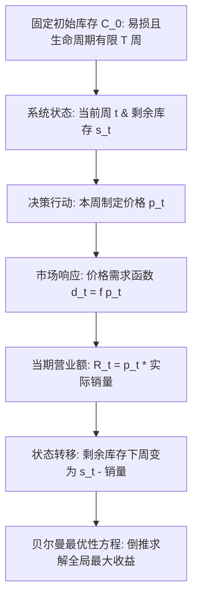

# Lec 19 动态规划与收益管理：零售与航空动态定价策略 (Dynamic Optimization & Retail Pricing Strategies)

> MIT 15.060 数据、模型与决策 · 讲义 19 · 授课教师：Prof. Dimitris Bertsimas / Prof. Robert Freund

## TL;DR

- 收益管理（Revenue Management）针对固定不可恢复产能与易损资产，通过动态差别定价实现总收益最大化。
- 动态规划（Dynamic Programming）基于贝尔曼最优性原理，将复杂跨期长程决策拆解为后向递归子问题。
- Power-Pro 案例剖析了时装与消费电子在生命周期不同阶段的价格弹性演变与清仓降价节奏。
- 超额预订（Overbooking）与存量配额控制构成了现代航空、酒店与云计算算力调度的算法核心。

## 1. 易损资产与收益管理的经济学范式

在商业世界中，存在大量具有“时间一过、价值归零”特性的商品与服务——这些被称为**易损资产（Perishable Assets）**：
- 航班一旦起飞，机舱内空置的经济舱座位将永远无法产生任何收入；
- 希尔顿酒店今晚未售出的海景客房，其今日边际价值在午夜后归零；
- 搭载最新处理器的旗舰笔记本电脑或当季潮流服饰，在销售季结束后将面临残酷的削价甩卖。

面对固定的物理容量（Capacity）和高度不确定的市场需求，若实行单一的静态固定价格（Fixed Price），要么会在旺季早早售罄而错失超额溢价，要么会在淡季大面积滞销。**收益管理（Revenue Management / Yield Management）**的核心使命是：**在正确的时间，将正确的资源，以正确的价格，卖给正确的客户**。

## 2. 动态规划与贝尔曼最优性原理（Bellman's Equation）

为了求解跨越多个时间阶段的连贯最优定价策略，必须引入运筹学大师理查德·贝尔曼（Richard Bellman）创立的**动态规划（Dynamic Programming, DP）**理论。

::: definition [贝尔曼最优性原理 (Bellman's Principle of Optimality)]
一个最优策略具有这样的性质：无论初始状态和初始决策是什么，其余的决策对于由初始决策所形成的后续状态而言，都必须构成最优策略。
:::

### 2.1 倒序递归方程构造

设销售生命周期包含 $T$ 个离散决策阶段（$t = 1, 2, \dots, T$）：
- **状态变量 $s$**：在第 $t$ 阶段开始时，仓库中剩余的物理库存数量（$s \in \{0, 1, \dots, C\}$）；
- **决策变量 $p$**：在第 $t$ 阶段设定的销售价格（属于可行定价集合 $\mathcal{P}$）；
- **需求函数 $D_t(p)$**：在价格 $p$ 下第 $t$ 阶段的预期需求量；由于受库存上限约束，实际销量为 $S_t = \min(s, D_t(p))$；
- **值函数 $V_t(s)$**：从第 $t$ 阶段开始，在当前剩余库存为 $s$ 的最优后续累积总收益。

在最后一个阶段结束时（边界条件）：
$$V_{T+1}(s) = \text{Salvage}(s) \quad (\text{期末残值折价回收函数})$$

从最后一周向前反向倒推（Backward Induction）的**贝尔曼递归方程**为：
$$V_t(s) = \max_{p \in \mathcal{P}} \left\{ p \cdot \min(s, D_t(p)) + V_{t+1}(s - \min(s, D_t(p))) \right\}$$

该方程完美体现了动态定价的核心权衡：**当下定低价虽然能多赚当期现金，但会消耗宝贵的库存，从而剥夺了未来阶段以更高价格售出这件商品的机会（机会成本）**。

## 3. Power-Pro MBA 电脑包案例：零售动态定价实战

专为商学院学生设计的高端品牌“Power-Pro”采购了 $C_0 = 2,000$ 个防水防震豪华笔记本电脑背包，准备在秋季开学前后的 3 个月（共计 12 周）周期内销售完毕。期末未能售出的背包只能按残值 $20 美元交由折扣奥特莱斯处理。

### 3.1 生命周期各阶段需求函数演进

根据历史营销数据分析，消费者的支付意愿随着时间推移呈现三段式动态变化：

1. **第一阶段（开学季前奏，第 1-4 周）**：
   新生入学准备期，对高品质装备需求旺盛，属于**价格不敏感阶段**。每周需求函数为：
   $$D_1(p) = 450 - 2.0 p, \quad p \in [80, 150]$$
2. **第二阶段（学期平稳期，第 5-9 周）**：
   开学采购热潮消退，普通学生开始关注性价比，**需求价格弹性显著上升**。每周需求函数为：
   $$D_2(p) = 600 - 4.5 p, \quad p \in [60, 110]$$
3. **第三阶段（学期末尾清仓季，第 10-12 周）**：
   尾盘客流稀少，主要是寻找大减价的挑剔型顾客，**弹性极大**。每周需求函数为：
   $$D_3(p) = 800 - 8.0 p, \quad p \in [40, 80]$$

### 3.2 动态优化求解与静态定价策略对照

若企业采取传统的“单一定价”模式：
- 静态最佳固定零售价约为 $95 美元；
- 整个 12 周累计总销售额约为 **$148,200 美元**，且在第 12 周末沉淀了近 450 个背包未能售出，严重挤占流动资金。

运用动态规划算法反向求解，输出的**分阶段动态价格与库存消化路径**如下表：

| 销售阶段与周次 | 推荐最优定价 $p_t^*$ | 预期周销量 (件) | 阶段末剩余库存 (件) | 阶段销售额贡献 | 策略意图与经济学机理解析 |
| :--- | :--- | :--- | :--- | :--- | :--- |
| **阶段 1：第 1-4 周 (开学高价)**| **$120.00** | 210 件/周 (共 840) | 1,160 件 | $100,800 | 撇脂定价（Price Skimming），最大化榨取高支付意愿早鸟客群剩余 |
| **阶段 2：第 5-9 周 (中段促销)**| **$80.00** | 240 件/周 (共 1,200? 受库存截断 960) | 200 件 | $76,800 | 适度降价驱动走量，平滑库存消化曲线 |
| **阶段 3：第 10-12 周 (尾季清仓)**| **$55.00** | 全额清空 200 件 | **0 件 (完美零库存)**| $11,000 | 赶在期末残值归零前，以略高于残值的价格彻底清盘 |
| **动态优化总业绩** | **三段动态阶梯** | **全额售罄 2,000 件** | **0 件** | **$188,600** | **相比静态固定价增收达 +27.3%！** |

::: example [库存影子价值的时间递减规律]
在动态规划的反向递推中，每个阶段的偏导数 $\frac{\partial V_t(s)}{\partial s}$ 恰恰是库存的**边际机会成本（Marginal Opportunity Cost）**。在第 1 周，多一个背包的边际价值高达 $90 美元；而到了第 11 周，多一个背包的边际价值已经暴跌至 $25 美元。动态调价的本质，就是让终端零售价实时追平当期的边际机会成本。
:::

::: pitfall [战略性等待顾客（Strategic Consumers）的博弈反噬]
上述经典动态规划假定消费者是短视的（Myopic），看到当前价格合适就立即购买。然而在当今社交网络与价格比价插件盛行的时代，大量精明顾客掌握了零售商“越往后越打折”的规律，故意战略性推迟购买以等待清仓降价。忽视消费者跨期博弈会导致中早期销量急剧萎缩，破坏动态定价根基。
:::

::: insight [我的理解：收益管理是与时间流逝达成的妥协艺术]
时间是商业世界中最冷酷的维度。一瓶红酒可以存上十年越陈越香，但一张今晚的机票离开起飞时刻每近一分，其作为商品的生命就在加速凋亡。动态规划赋予了管理者一种“时间折现的魔力”：它教导我们不要抱残守缺于虚妄的“高毛利”，而是顺应时间衰减的不可逆律动，在流动性与溢价之间找到最精妙的动态平衡。
:::
