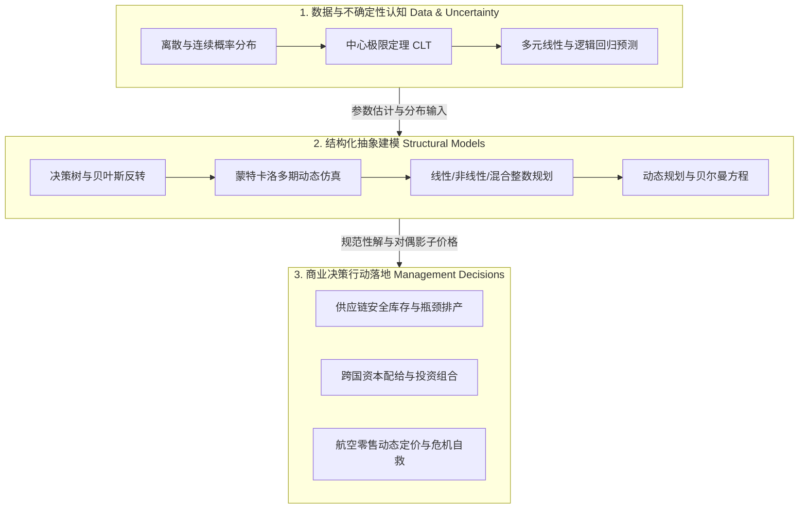

# Lec 20 数据模型决策贯通：从确定性优化到随机动态决策的前沿全景 (Course Synthesis & Frontiers in Analytical Decision-Making)

> MIT 15.060 数据、模型与决策 · 讲义 20 · 授课教师：Prof. Dimitris Bertsimas / Prof. Robert Freund

## TL;DR

- 15.060 构建了从数据理解（统计回归）、系统抽象（仿真与优化）到行动落地（动态决策）的完整闭环。
- 预测性分析（Predictive Analytics）回答“未来如何”，规范性分析（Prescriptive Analytics）决定“当下何为”。
- 鲁棒优化（Robust Optimization）突破了对精确概率分布的依赖，面向不确定性集合寻求最坏情况免疫解。
- 优秀分析师不仅精通算法求解，更在人类伦理、商业直觉与算法黑箱之间恪守审慎底线。

## 1. 15.060 知识图谱全景融会贯通

经过整整一个学期的淬炼，我们走过了从微观概率统计到宏观战略运筹的宏伟旅程。在开课伊始，面对充满不确定性的商业世界，我们通过肯德尔龙虾与 Great Apps 案例建立了对决策树与贝叶斯后验更新的直觉；随后，借助离散与连续概率分布、中心极限定理以及蒙特卡洛模拟，我们将不可见的操作风险具象化为清晰的置信区间与风险价值（VaR）。进入中盘，普通最小二乘法与多元回归分析让我们拥有了从嘈杂历史数据中剥离混淆变量、提炼偏边际杠杆的听诊器；而在后半程，线性规划、对偶影子价格、非线性投资组合以及混合整数规划，则彻底将我们武装成了具备规范性资源配置能力的系统架构师。

回望全课，看似零散的各个章节实际上严丝合缝地扣合在一套**数据-模型-决策（Data-Models-Decisions）三元大厦**之中。这套体系绝非单向孤立的工具堆砌，而是一个相互滋养、层层递进的有机生态系统：

全课的方法论演进清晰展现了现代数据分析学赋能管理决策的三大核心阶梯：
1. **描述性阶段（Descriptive Analytics）**：
   以均值、方差、标准差与协方差矩阵为基石，诚实客观地测算系统现状、资源消耗与协同关联，回答“客观现实是什么”；
2. **预测性阶段（Predictive Analytics）**：
   依托多元线性回归、对数变换、虚拟变量与 Logistic 分类器，从历史截面与时间序列中洞察因果弹性，回答“如果环境变化，未来可能发生什么”；
3. **规范性阶段（Prescriptive Analytics）**：
   运筹学与数学规划的真正主场。通过构建严格的目标函数与多维约束超平面，利用单纯形法、分支定界法与贝尔曼动态递归，在天文数字般的可行解集合中精准锁定“为了实现战略目标，当下究竟应当采取什么行动”。三者的有机融合，构成了管理科学应对不确定性的完整防线。

## 2. 现代分析学前沿：从随机规划到鲁棒优化

在 15.060 的传统章节中，优化模型主要处理确定性参数（如确定的工时、固定的毛利），而不确定性主要留给模拟与决策树处理。而在麻省理工学院运筹学中心（ORC），由 Dimitris Bertsimas 教授等领衔的现代优化前沿正在将两者的边界彻底融通：

### 2.1 两阶段随机规划（Two-Stage Stochastic Programming）

考虑“先决策、后观测自然状态、再采取补救行动（Recourse）”的时序系统：
$$\min_{x} \quad c^T x + \mathbb{E}_{\omega} [Q(x, \omega)]$$
$$\text{s.t.} \quad A x \le b, \quad x \ge 0$$
第一阶段决策 $x$（如提前建厂的规模）必须在不确定性 $\omega$ 揭晓前确定；当需求 $\omega$ 爆发后，启动第二阶段补救措施 $Q(x, \omega)$（如外协赶工或折价抛售）。

### 2.2 鲁棒优化（Robust Optimization）：摆脱概率先验的枷锁

随机规划极度依赖于“真实概率分布已知”的假定。但在现实中，罕见黑天鹅事件根本没有足够的数据来拟合分布。**鲁棒优化**开创了全新的范式：它不假设具体的概率密度函数，而是定义一个包含所有可能偏差的**不确定性集合（Uncertainty Set, $\mathcal{U}$）**，寻找在集合内“最坏情况”下依然可行且最优的免疫解：

::: definition [鲁棒线性规划一般形式]
$$\min_{x} \quad c^T x$$
$$\text{s.t.} \quad a_i^T x \le b_i, \quad \forall a_i \in \mathcal{U}_i, \quad \forall i = 1, 2, \dots, m$$
其中 $\mathcal{U}_i$ 可以是多面体集合（Polyhedral Set）或椭球集合（Ellipsoidal Set）。通过凸对偶理论，原本包含无限多约束的极值问题，可以神奇地精确转化为一个确定性的标准线性规划或二阶锥规划（SOCP）！
:::

鲁棒优化被广泛应用于放疗放疗剂量照射规划、航空机组调度以及主权财富基金防穿仓配置中，展现出极强的工程抗震能力。

## 3. 卓越商业分析师的素养准则与反思

在数据算力与大模型狂飙突进的今天，掌握优化工具的技术门槛在不断降低，但对模型的审慎判断力却愈发稀缺。作为从 MIT 15.060 走出的决策者，必须时刻牢记以下三条法则：

### 3.1 法则一：永远不要爱上你的模型

所有模型都是现实的拙劣玩具。正如统计学家乔治·博克斯（George Box）的警句：“**所有模型都是错的，但有些是有用的（All models are wrong, but some are useful）**。”模型从来不是为了完美复刻现实，而是为了在混乱的迷雾中建立一个坐标系。当现实的观测数据与你的模型结论发生严重冲突时，永远是模型错了，而不是现实错了。

### 3.2 法则二：警惕对偶价格背后的权力幻觉

线性规划的影子价格非常迷人，它给每个变量贴上了看似客观理性的价格标签。但永远不要忘记：**影子价格完全由你输入的约束条件所决定**。如果你在设定模型时遗漏了对碳排放的惩罚、忽略了劳工福利的底线、抹杀了对长远研发的扶持，优化器就会以惊人的算力效率，帮你在现实中制造出一座毫无社会责任的灾难性血汗工厂。

### 3.3 法则三：最高级的分析素养是知止

规范性算法可以告诉你最优的排产吨数、最佳的打折周次、最小化方差的持仓比例。但算法永远无法告诉你：这家公司究竟为什么而存在？这个品牌的灵魂何在？什么是值得我们坚守的价值观？在冰冷的约束方程与目标函数之外，永远保留人类的同理心、战略想象力与道德直觉。

::: example [从算法走向领导力]
在 Filatoi Riuniti 案例中，算法冷酷地建议将本地传统手工业工人遣散并全额外包以最大化利润；但在现实中，老厂长选择保留加捻车间的核心老师傅，转型为高定私人手工体验工坊。多年后，正是这项“在 LP 模型中极其次优”的非理性决定，成为了该品牌被法国奢侈品集团以数十倍溢价收购的核心文化护城河。
:::

::: insight [我的理解：量化思维不是替代人性，而是释放人性]
很多人误以为学好 15.060 是为了让自己变成一台算无遗策的超级计算机。恰恰相反，我们学习数据、模型与决策，是为了把人类大脑从成千上万个繁琐的算术平衡、排班表格与低级直觉偏差中解救出来。把机械的逻辑交给算法，把宝贵的人类灵魂留给远见、同理心与那些真正需要承担风险的重大决断——这才是管理科学赋予我们最庄严的自由。
:::
