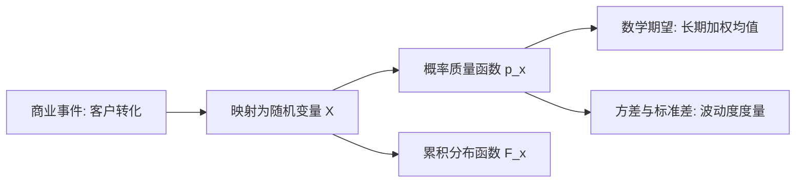

# Lec 3 离散概率分布、期望值与二项模型 (Discrete Probability Distributions & Binomial Models)

> MIT 15.060 数据、模型与决策 · 讲义 3 · 授课教师：Prof. Dimitris Bertsimas / Prof. Robert Freund

## TL;DR

- 随机变量将现实世界的不确定事件抽象映射为严格的实数轴变量。
- 期望值表征离散分布的加权重心，方差与标准差量化结果围绕均值的离散程度与操作风险。
- 二项分布刻画固定试验次数、二元结果与恒定独立概率下的成功发生频次。
- 业务建模中必须严格审视二项过程的同质性与独立性假定，防范集聚破缺风险。

## 1. 离散随机变量及其数学表征

在数据驱动的商业建模中，最基础的抽象是将现实业务现象转化为**随机变量（Random Variable, RV）**。随机变量本质上是一个实值函数，它为样本空间中的每个基本事件赋予唯一的数值。

::: definition [离散随机变量与概率质量函数 (PMF)]
若随机变量 $X$ 的取值集合是有限集或可数无穷集 $\{x_1, x_2, \dots, x_k\}$，则称 $X$ 为离散随机变量。
其概率质量函数（Probability Mass Function, PMF）记为 $p(x) = P(X = x)$，满足公理化约束：
1. 非负性：$0 \le p(x_i) \le 1, \quad \forall i$
2. 规范性：$\sum_{i} p(x_i) = 1$
累积分布函数（Cumulative Distribution Function, CDF）定义为：
$$F(x) = P(X \le x) = \sum_{x_i \le x} p(x_i)$$
:::

累积分布函数是单调不减、右连续的阶梯函数，它直接对应于商业中诸如“排队等待时间不超过 10 分钟的概率”或“备件库存能够覆盖需求的保障率”。

## 2. 统计特征数：期望、方差与线性运算规则

期望值是分布的“物理质心”，方差则是分布的“转动惯量”。两者构成了管理决策中权衡“预期产出”与“不确定波动”的双核心坐标。

### 2.1 期望值与方差定义

对于离散随机变量 $X$：
$$\mu_X = E[X] = \sum_{i} x_i p(x_i)$$
方差衡量变量与其均值偏离的平方加权和：
$$\sigma_X^2 = Var(X) = E\left[(X - E[X])^2\right] = \sum_{i} (x_i - \mu_X)^2 p(x_i) = E[X^2] - (E[X])^2$$
标准差 $\sigma_X = \sqrt{Var(X)}$ 与原变量拥有相同的物理量纲（如美元、件数、小时），具有直接的业务解读意义。

### 2.2 线性变换性质

管理模型中常涉及线性加成、固定补贴与费率折算。设 $a, b$ 为常数：
$$E[aX + b] = a E[X] + b$$
$$Var(aX + b) = a^2 Var(X)$$
$$\sigma_{aX + b} = |a| \sigma_X$$

常数平移 $b$ 会改变均值位置，但完全不改变数据的离散程度（$Var(X+b) = Var(X)$）；而比例缩放系数 $a$ 对波动度的放大呈现二次方效应。

## 3. 伯努利试验与二项分布模型

在质量控制、销售转化、信贷违约与呼叫中心座席管理中，最普遍的离散模型当属二项分布。

::: definition [二项分布 (Binomial Distribution)]
考虑满足以下四个伯努利条件的计数过程：
1. 试验次数 $n$ 预先固定；
2. 每次试验仅有两种对立结果（成功 / 失败）；
3. 每次试验成功的概率恒定为 $p$（失败概率为 $1-p$）；
4. 各次试验相互独立。

记 $X$ 为 $n$ 次试验中的成功总次数，则 $X \sim B(n, p)$，其 PMF 为：
$$P(X = k) = \binom{n}{k} p^k (1-p)^{n-k} = \frac{n!}{k!(n-k)!} p^k (1-p)^{n-k}, \quad k = 0, 1, \dots, n$$
其数学特征为：
$$E[X] = np, \quad Var(X) = np(1-p), \quad \sigma_X = \sqrt{np(1-p)}$$
:::

### 3.1 管理应用实战：Sloan 呼叫中心坐席超载分析

某银行信用卡中心在早间高峰期拥有 20 条服务线路。根据系统监测，任何时刻单个持卡人打入电话咨询的概率为 $p = 0.15$。若当前同时有 50 位客户处于活动状态，求线路被打满（发生呼损阻塞）的概率。

设定随机变量 $X$ 为同时呼入的客户数，则 $X \sim B(n=50, p=0.15)$。
- 期望同时呼入量：$\mu = 50 \times 0.15 = 7.5$ 人。
- 方差：$\sigma^2 = 50 \times 0.15 \times 0.85 = 6.375$，标准差 $\sigma \approx 2.52$。

虽然平均呼入量仅为 7.5 人，远低于 20 条线路容量，但管理者必须评估极端容量超载概率：
$$P(X > 20) = 1 - P(X \le 20) = 1 - \sum_{k=0}^{20} \binom{50}{k} (0.15)^k (0.85)^{50-k}$$
通过数值累计计算：
$$P(X \le 20) \approx 0.999997 \implies P(X > 20) \approx 3 \times 10^{-6}$$
此时容量充裕度极高。若活动客户数激增至 $n = 150$，则期望呼入上升至 $22.5$ 人，系统将有超过 $70\%$ 的概率处于严重拥堵状态，需动态调度备用线路。

::: pitfall [二项分布的独立性假定在现实中的破裂]
在金融信贷风控中，许多次贷产品早期违约模型错误地假设每位借款人的违约行为遵循独立同分布的伯努利试验。当系统性宏观经济危机爆发或房价普跌时，借款人违约呈现强烈的横向空间相关性与联动传染，导致实际极端违约概率比二项模型预测高出数个数量级。
:::

::: insight [我的理解：期望值管长期，方差管生存]
在商学教学中，学生往往热衷于计算净现值（NPV）的期望值。然而在企业现实中，如果一个项目的期望收益是正的 1 亿元，但有 $10\%$ 的概率亏损 5000 万元，而公司当前的净资产只有 3000 万元，那么这个项目的真实期望值对于这家企业而言毫无意义——因为一旦踩中那 $10\%$ 的尾部区间，企业就已经在破产清算程序中了。方差不仅是数学指标，更是企业的“破产防火墙厚度”。
:::
