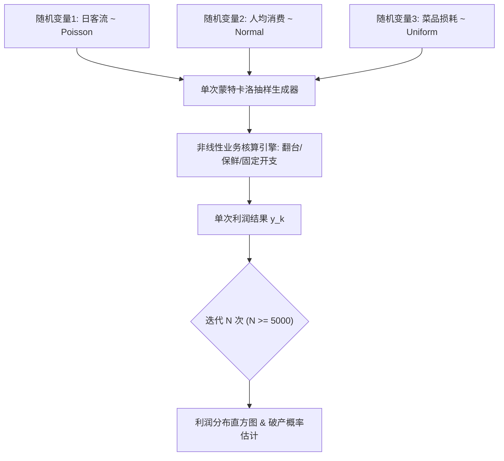

# Lec 6 蒙特卡洛模拟 I：Gentle Lentil 餐厅不确定性收益建模 (Simulation I: The Gentle Lentil Case)

> MIT 15.060 数据、模型与决策 · 讲义 6 · 授课教师：Prof. Dimitris Bertsimas / Prof. Robert Freund

## TL;DR

- 当商业系统中耦合了多个非正态分布与非线性损益逻辑时，蒙特卡洛模拟提供了破除解析求解困境的有力武器。
- 模拟通过伪随机数采样与逆累积变换，复现成千上万次逼真的业务运行场景。
- 平均数缺陷（Flaw of Averages）表明：将不确定变量简单替换为平均值代入模型，会系统性高估收益并隐匿破产风险。
- 输出分布提供了均值期望、VaR 风险价值与破产概率的完整概率透视，为风险投资决策定锚。

## 1. 模拟的必要性与“平均数缺陷”

在商业建模的早期阶段，决策者往往倾向于在 Excel 表格中输入各项指标的“最佳估计值（Best Guess）”或“数学期望值”，随后通过确定的算术公式计算投资净现值（NPV）或利润。

这种看似理性的静态建模暗藏着致命的数学陷阱——**平均数缺陷（Flaw of Averages）**：
$$E[f(X_1, X_2, \dots, X_k)] \ne f(E[X_1], E[X_2], \dots, E[X_k])$$
当函数 $f$ 存在非线性约束（例如：产能上限 $\min(\text{Demand}, \text{Capacity})$、期权赔付 $\max(S - K, 0)$ 或税率累进分级）时，等号严格不成立。

::: definition [蒙特卡洛模拟 (Monte Carlo Simulation)]
蒙特卡洛模拟是一种通过大量重复随机抽样，逼近复杂系统概率特征的数值计算技术。其标准执行工作流：
1. **建立结构方程**：明确输入外生变量与最终输出绩效指标之间的显式数学或逻辑映射 $Y = g(X_1, X_2, \dots, X_p)$；
2. **定义概率分布**：依据历史数据与业务专家经验，为每个输入变量 $X_i$ 指定相称的概率分布（离散、均匀、正态、三角等）；
3. **独立随机抽样**：利用随机数生成器产生一组伪随机数，代入模型生成一组试验结果 $y_k$；
4. **大规模迭代**：重复执行该过程 $N$ 次（通常 $N \ge 1,000 \sim 10,000$）；
5. **统计输出推断**：对 $N$ 个结果构建经验分布、直方图、百分位数（Percentiles）与敏感性龙卷风图。
:::

## 2. Gentle Lentil 餐厅商业决策案例

“Gentle Lentil”是一家计划在剑桥市哈佛广场附近开业的高端有机素食餐厅。创始人需要向天使投资人提交一份详尽的风险收益评估报告，以决定是否签署为期三年的昂贵商业租赁合约。

### 2.1 业务变量与不确定性定义

经过市场调研，餐厅运营的核心财务模型包含以下耦合不确定变量：

1. **工作日午餐客流潜量（$D_{\text{lunch}}$）**：
   受大学排课与周边办公白领影响，假定服从均值为 250 人、标准差为 50 人的正态分布：$D_{\text{lunch}} \sim N(250, 50^2)$。
   餐厅物理座位上限为 80 个，午餐有效翻台批次为 2.5 轮，故**午餐最大有效接待容量为 $C_{\text{lunch}} = 80 \times 2.5 = 200$ 人**。
   实际午餐就餐人数受产能硬约束拦截：
   $$A_{\text{lunch}} = \min(D_{\text{lunch}}, 200)$$
2. **人均消费金额（$S$）**：
   菜品组合导致人均账单波动，服从 $[16, 26]$ 美元的连续均匀分布：$S \sim U(16, 26)$。
3. **食品原材料变动成本率（$c$）**：
   受有机农场产地采购价波动影响，三角分布：最乐观 $28\%$，最可能 $33\%$，最悲观 $42\%$。
4. **晚餐客流与固定成本**：
   晚餐日就餐人数 $A_{\text{dinner}} \sim N(120, 25^2)$（未触及容量上限）；晚餐人均账单服从 $U(28, 42)$；每日店铺租金、员工薪酬与折旧固定开支为 $F = 4,200$ 美元。

### 2.2 单次试验（Trial）与逆累积变换采样

计算机如何从连续分布中抽样？最经典的方法是**逆变换采样法（Inverse Transform Sampling）**。
设目标变量累积分布函数为 $F(x)$，计算机生成标准均匀伪随机数 $U \sim U(0, 1)$，则：
$$X = F^{-1}(U)$$

例如，对于人均午餐消费 $S \sim U(16, 26)$，其公式为：
$$S = 16 + (26 - 16) \times U_1 = 16 + 10 U_1$$
若某次抽样 $U_1 = 0.724$，则该次模拟的人均消费为 $16 + 7.24 = 23.24$ 美元。

单日净经营利润结构方程为：
$$\Pi = \left( A_{\text{lunch}} \cdot S_{\text{lunch}} + A_{\text{dinner}} \cdot S_{\text{dinner}} \right) \times (1 - c) - F$$

### 2.3 模拟结果对比：静态均值 vs 蒙特卡洛全景

若采用传统静态“平均数法”估算：
- 错误均值午餐人数：取均值 $E[D_{\text{lunch}}] = 250$ 人。但在截断后直接取 200 人。
- 均值人均消费：$(16+26)/2 = 21$ 美元。
- 均值变动成本率：取最可能值 $33\%$。
- 静态估算日利润：
  $$\Pi_{\text{static}} = [200 \times 21 + 120 \times 35] \times (1 - 0.33) - 4,200 = [4,200 + 4,200] \times 0.67 - 4,200 = 5,628 - 4,200 = +1,428 \text{ 美元}$$
基于静态测算，餐厅显得暴利且无风险，年化净收益十分可观。

然而运行 10,000 次蒙特卡洛模拟后，输出的经验统计数据展现了完全不同的画卷：

| 统计指标 | 静态均值估算 | 蒙特卡洛模拟真实经验分布 (N=10,000) |
| :--- | :--- | :--- |
| **平均日利润 $E[\Pi]$** | **+$1,428** | **+$912**（被产能削顶与成本不对称大幅拉低）|
| **标准差 $\sigma_{\Pi}$** | $0$ (假装无风险) | **$684** |
| **单日亏损概率 $P(\Pi < 0)$** | **0%** | **11.4%** |
| **5% 风险价值 (5th Percentile)**| +$1,428 | **-$245** (极端情况下单日失血严重) |
| **95% 优良表现 (95th Percentile)**| +$1,428 | +$2,010 |

::: example [产能刚性约束引发的收益削顶]
为何真实平均利润（$912）比静态预估（$1,428）低了整整 $36\%$？
因为午餐需求具有波动性：当需求只有 150 人时，餐厅承担了全额低需求损失；而当需求爆发至 320 人时，受制于 200 人的物理容量，超额的 120 位顾客全部流失。这种“下行全吃、上行封顶”的凸性破缺（Jensen 不等式体现），使得平均利润必然大幅受挫。
:::

::: pitfall [伪随机数的相关性陷阱]
在构建模拟模型时，若直接为每个变量独立调用 `RAND()`，必须确认变量间是否存在客观协方差。例如，暴雨天气可能同时导致午餐进店客流骤降，且使进店顾客停留时间拉长、翻台率下降。如果忽略输入变量之间的正相关性，模拟得到的组合方差将被严重低估。
:::

::: insight [我的理解：模拟是从单维点估计向高维分布认知的心智跃迁]
传统商业计划书中最具欺骗性的幻觉，就是把未来的成功描绘成一条精准的直线。投资人之所以经常遭遇意外爆雷，就是因为被静态均值蒙蔽了双眼。蒙特卡洛模拟的最大功绩，不在于预测具体某一天能赚多少钱，而是把“风险”具象化为一张完整的资产负债表压力图。它让企业家在投入真金白银之前，就看清那隐藏在水面之下的 $11.4\%$ 破产暗礁。
:::
