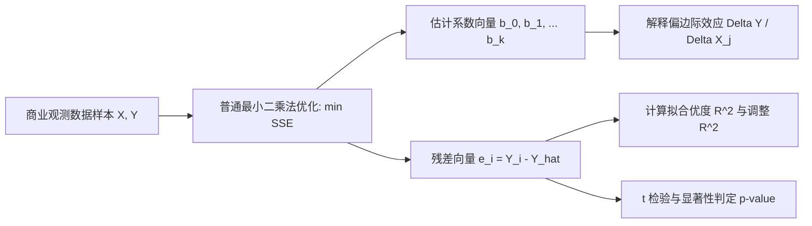

# Lec 7 回归模型 I：普通最小二乘法（OLS）与多元线性回归预测 (Regression Models I: OLS & Multiple Linear Regression)

> MIT 15.060 数据、模型与决策 · 讲义 7 · 授课教师：Prof. Dimitris Bertsimas / Prof. Robert Freund

## TL;DR

- 线性回归模型构建了自变量（驱动要素）与因变量（预测目标）之间的量化函数关系。
- 普通最小二乘法（OLS）通过极小化残差平方和（SSE），求解最优线性无偏估计量。
- 多元回归系数的经济学本质是偏边际效应：在控制其余协变量不变条件下的增量变动。
- 决定系数 $R^2$ 与调整后 $\bar{R}^2$ 量化了模型对系统总方差的解释比例，是初筛模型有效性的重要指标。

## 1. 预测建模与线性回归结构

企业管理每天都在回答预测性问题：投入 500 万元数字营销广告能带动多少当季销售额？高管团队的股权激励比例如何影响企业未来的 ROE？仓库距港口的距离怎样决定物流运费？

回归分析（Regression Analysis）是数据科学中应用最广泛的统计方法，它旨在探索一个因变量（Dependent Variable, $Y$）与一个或多个自变量（Independent Variables, $X_1, X_2, \dots, X_k$）之间的因果或相关依赖模式。

::: definition [总体多元线性回归模型 (Population Regression Model)]
设数据生成过程遵循以下线性方程：
$$Y_i = \beta_0 + \beta_1 X_{1i} + \beta_2 X_{2i} + \dots + \beta_k X_{ki} + \epsilon_i, \quad i = 1, 2, \dots, n$$
其中：
- $Y_i$：第 $i$ 个观测样本的因变量响应值；
- $\beta_0$：截距项（Intercept）；
- $\beta_j$：第 $j$ 个解释变量的总体偏回归系数（Partial Regression Coefficient）；
- $\epsilon_i$：不可观测的随机误差项（Error Term），反映了遗漏变量、测量误差与纯粹的自然随机性。
:::

样本估计回归方程表示为：
$$\hat{Y}_i = b_0 + b_1 X_{1i} + b_2 X_{2i} + \dots + b_k X_{ki}$$
第 $i$ 个样本点的观测残差（Residual）定义为实际值与拟合值之差：
$$e_i = Y_i - \hat{Y}_i$$

## 2. 普通最小二乘法（Ordinary Least Squares, OLS）原理

如何从无限多的超平面中挑选出“最佳拟合线”？高斯与勒让德提出了最小二乘准则：寻找一组参数估计值 $(b_0, b_1, \dots, b_k)$，使得样本残差平方和（Sum of Squared Errors, SSE）达到全局极小。

::: definition [最小二乘准则 (OLS Criterion)]
极小化目标函数：
$$\min_{b_0, b_1, \dots, b_k} SSE = \sum_{i=1}^n e_i^2 = \sum_{i=1}^n \left( Y_i - (b_0 + b_1 X_{1i} + \dots + b_k X_{ki}) \right)^2$$
:::

### 2.1 一元回归解析解推导

对于简单一元线性回归 $Y = \beta_0 + \beta_1 X + \epsilon$，分别对 $b_0$ 与 $b_1$ 求一阶偏导数并令其为 0：
$$\frac{\partial SSE}{\partial b_0} = -2 \sum_{i=1}^n (Y_i - b_0 - b_1 X_i) = 0 \implies \sum e_i = 0$$
$$\frac{\partial SSE}{\partial b_1} = -2 \sum_{i=1}^n X_i (Y_i - b_0 - b_1 X_i) = 0 \implies \sum X_i e_i = 0$$

由此解得著名的正规方程组（Normal Equations）解析解：
$$b_1 = \frac{\sum_{i=1}^n (X_i - \bar{X})(Y_i - \bar{Y})}{\sum_{i=1}^n (X_i - \bar{X})^2} = \frac{Cov(X, Y)}{Var(X)} = r_{XY} \frac{s_Y}{s_X}$$
$$b_0 = \bar{Y} - b_1 \bar{X}$$

这意味着拟合直线**必然恒过样本均值重心点 $(\bar{X}, \bar{Y})$**，且残差代数和严格为零（$\sum e_i = 0$）。

### 2.2 高斯-马尔可夫假定与 BLUE 特性

::: theorem [高斯-马尔可夫定理 (Gauss-Markov Theorem)]
在以下核心假定成立时：
1. **参数线性假定**：模型形式关于参数 $\beta$ 呈线性；
2. **严格外生性**：条件均值为零，$E[\epsilon_i \mid X] = 0$；
3. **同方差性与无自相关**：$Var(\epsilon_i \mid X) = \sigma^2$，且当 $i \ne j$ 时 $Cov(\epsilon_i, \epsilon_j \mid X) = 0$；
4. **无完全多重共线性**：自变量之间不存在完全精确的线性替代关系。

OLS 估计量 $b$ 是所有线性无偏估计量中最优的（Best Linear Unbiased Estimator, BLUE），即在所有无偏估计中拥有严格最小的方差矩阵。
:::

## 3. 方差分解与拟合优度评估

为了量化回归模型对因变量波动的捕捉效能，我们将因变量的总波动进行方差分解（ANOVA）：

$$\sum_{i=1}^n (Y_i - \bar{Y})^2 = \sum_{i=1}^n (\hat{Y}_i - \bar{Y})^2 + \sum_{i=1}^n (Y_i - \hat{Y}_i)^2$$
$$SST = SSR + SSE$$
- **SST（总平方和）**：原始数据围绕均值的总波动；
- **SSR（回归平方和）**：模型中自变量成功解释的波动部分；
- **SSE（残差平方和）**：模型未能捕获的未解随机扰动。

::: definition [决定系数 $R^2$ 与调整后 $\bar{R}^2$]
决定系数（Coefficient of Determination）定义为被解释方差占总方差的比例：
$$R^2 = \frac{SSR}{SST} = 1 - \frac{SSE}{SST}, \quad 0 \le R^2 \le 1$$
在一元回归中，决定系数精确等于皮尔逊相关系数的平方：$R^2 = r_{XY}^2$。

由于向模型中添加任意无意义的新变量都会使 $SSE$ 单调不增，从而人为推高 $R^2$。为此引入惩罚自变量自由度的**调整后决定系数（Adjusted $R^2$）**：
$$\bar{R}^2 = 1 - \frac{SSE / (n - k - 1)}{SST / (n - 1)}$$
其中 $k$ 为解释变量个数，$n$ 为样本容量。若加入的新变量对预测的边际贡献无法抵消自由度损失，$\bar{R}^2$ 将发生回落。
:::

### 3.2 商业实例：零售门店销售额多元回归解析

某连锁超市分析 50 家分店的月度销售额（$Y$，千美元），引入两个核心解释变量：店铺营业面积（$X_1$，千平方英尺）与当地商圈常住人口（$X_2$，万人）。回归输出结果如下：

$$\hat{Y} = 35.2 + 14.8 X_1 + 6.5 X_2, \quad (R^2 = 0.78, \quad \bar{R}^2 = 0.77)$$

::: example [偏回归系数的经济学解释]
- 截距 $b_0 = 35.2$：无现实物理意义（零面积零人口时的基准常数）；
- 系数 $b_1 = 14.8$：**偏边际效应**。在保持商圈人口 $X_2$ 恒定不变的前提下，店铺面积每增加 1,000 平方英尺，月均销售额预期增长 14,800 美元；
- 系数 $b_2 = 6.5$：在保持店铺面积 $X_1$ 不变的前提下，商圈人口每增加 1 万人，月均销售额预期增长 6,500 美元。
:::

::: pitfall [将统计相关性误判为业务因果性]
高 $R^2$ 仅代表数据曲线在数学形态上的紧密吻合。若遗漏了关键混淆变量（如商圈富裕程度或竞争对手数量），回归系数可能产生严重的内生性偏误（Endogeneity Bias）。例如，冰淇淋销量与溺水事故数呈强正相关，但盲目通过禁止销售冰淇淋来防范溺水，是典型的因果错置。
:::

::: insight [我的理解：多元回归是在非受控世界中创造受控实验]
自然科学家可以在无尘实验室里严密控制温度、气压，单变量观察物理反应；但管理学者面对的是喧嚣、杂乱且无法暂停的真实商业社会。多元回归的伟大之处，在于它提供了一台“数学离心机”：通过偏导数机制，它在数据层面虚拟冻结了其他成百上千个干扰要素，让管理者能够看清某项特定商业策略真实的边际杠杆。
:::
