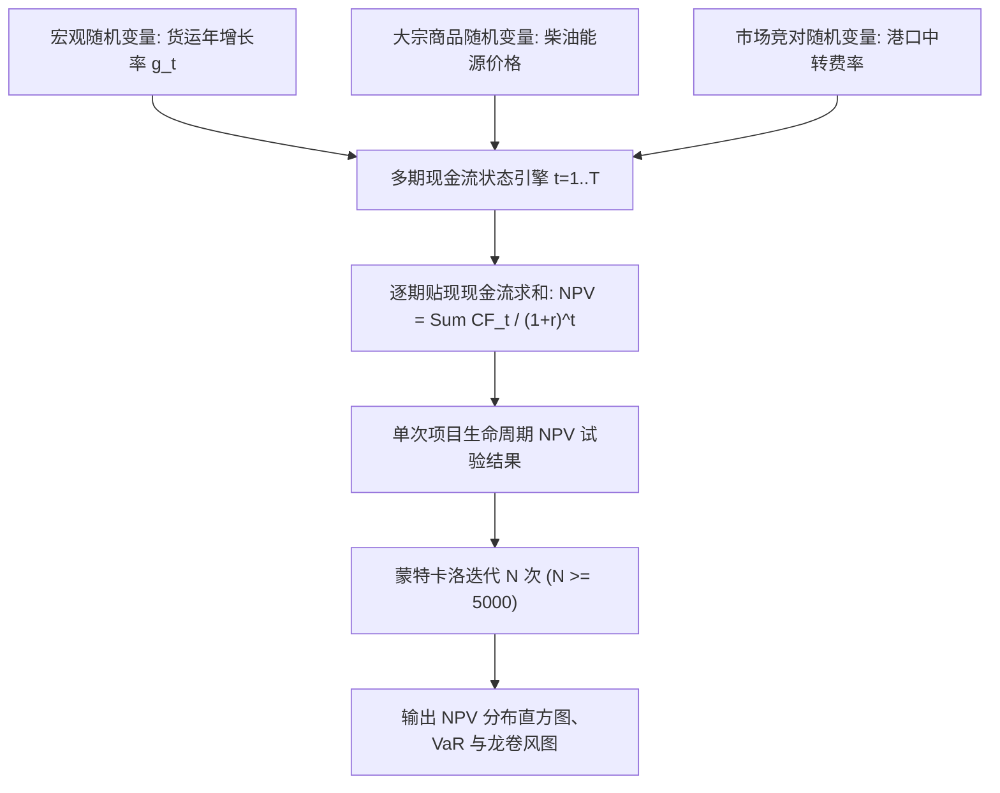
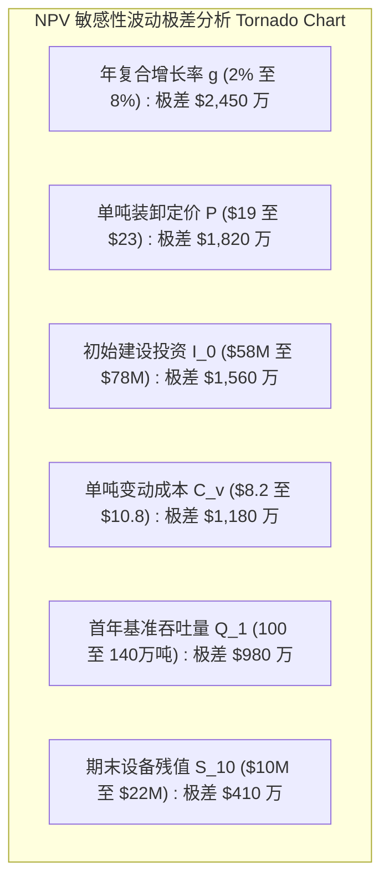

# Lec 8 蒙特卡洛模拟 II：Ontario Gateway 物流枢纽资本预算仿真 (Simulation II: The Ontario Gateway Case)

> MIT 15.060 数据、模型与决策 · 讲义 8 · 授课教师：Prof. Dimitris Bertsimas / Prof. Robert Freund

## TL;DR

- 长期大型基础设施投资必须借助动态贴现现金流（DCF）与蒙特卡洛模拟评估不可逆资本风险。
- Ontario Gateway 物流案例揭示了宏观货运增长率、燃油能源成本与拆除残值波动的复利放大效应。
- 龙卷风图（Tornado Diagram）通过单因子扰动测算敏感性极差，定位主导项目 NPV 波动的第一责任要素。
- 风险价值（VaR）与下行期望亏损（CVaR）为董事会提供了超越单一基准收益率的资本下行防御指标。

## 1. 复杂资本预算中的动态风险建模

企业在推进重资产基础设施建设、港口航运枢纽扩建或跨国能源管道铺设等跨周期项目时，面临着高度不对称的资本承诺风险。一旦上马投资，巨额固定资本即刻沉没，而未来的运营净现金流（Net Cash Flow）往往跨越 10 至 30 年。

传统的静态净现值分析法（Static Discounted Cash Flow, DCF）通常假设各项指标按固定复利年增长率平稳递推：
$$NPV = -I_0 + \sum_{t=1}^T \frac{E[CF_t]}{(1 + r)^t}$$
然而，现实中的贴现现金流是一个强非线性系统，不仅包含利率贴现的时间衰减，还涵盖通胀传导、大宗能源波动以及宏观经济周期的自相关冲击。静态 DCF 模型在面对尾部系统性衰退时表现出极强的脆弱性。

::: definition [动态蒙特卡洛资本预算 (Dynamic Capital Budgeting Simulation)]
动态资本预算仿真是一种将贴现现金流（DCF）模型中的确定性参数替换为关联随机过程的仿真范式。其核心在于：
1. **多期随机动态方程**：对关键财务驱动变量（如年吞吐量 $Q_t$、单位服务定价 $P_t$、单位可变成本 $C_t$）建立递推时间序列或参数化分布；
2. **净现值经验分布生成**：针对每次完整运行抽样出未来 $T$ 年的完整现金流路径，贴现求得当次模拟的净现值 $NPV_k$；
3. **下行破产与资本回撤测算**：统计所有模拟路径中 $NPV < 0$ 的发生概率，以及在发生净亏损前提下的平均下行亏损深度（条件风险价值 CVaR）。
:::

## 2. Ontario Gateway 国际货运枢纽案例分析

位于美加边境五大湖流域的 Ontario Gateway 是一家多式联运大型货运仓储集散中心。为了应对北美自由贸易协定深化带来的跨境物流洪峰，董事会正审议一项耗资 6,500 万美元的自动化智能枢纽扩建方案。

### 2.1 案例核心参数与不确定性分布

该项目预期运营期为 10 年，基准加权平均资本成本（WACC）设定为 $11\%$。经技术与市场专家论证，项目净现金流的关键不确定性来源如下：

| 变量类别 | 变量名称 | 概率分布设定 | 业务与经济逻辑阐释 |
| :--- | :--- | :--- | :--- |
| **资本支出** | 初始建设投资 $I_0$ | 三角分布：$(55, 65, 85)$ 百万美元 | 工程地质条件不确定性与钢结构材料通胀风险 |
| **市场规模** | 首年基准货运吞吐量 $Q_1$ | 正态分布：$N(120, 15^2)$ 万吨 | 现有大客户转移订单潜量 |
| **增长动态** | 年吞吐量复合增长率 $g$ | 正态分布：$N(5\%, 2.5\%^2)$ | 北美跨境贸易关税政策与 GDP 联动效应 |
| **商业定价** | 单吨综合中转装卸费 $P$ | 连续均匀分布：$U(18.0, 24.0)$ 美元 | 临近港口与铁路货运场站的价格竞争博弈 |
| **变动成本** | 单吨能源与搬运电力成本 $C_v$ | 连续均匀分布：$U(7.5, 11.5)$ 美元 | 柴油价格与绿色电网峰谷电价波动 |
| **资产残值** | 第 10 年末固定资产变现残值 $S_{10}$ | 三角分布：$(8, 15, 25)$ 百万美元 | 二手重型龙门吊与地块重新招拍挂估值 |

每年的经营税前净现金流结构方程为：
$$CF_t = Q_t \times (P - C_v) - F_{\text{fixed}} - \text{Taxes}_t$$
其中 $Q_t = Q_1 \times (1 + g)^{t-1}$，固定年度维护与管理开支 $F_{\text{fixed}} = 650$ 万美元，企业有效所得税率为 $28\%$。

### 2.2 仿真运行结果与经验统计分析

在 Excel 中通过 Monte Carlo 引擎（运行 10,000 次独立抽样），将传统的“确定性静态基准情景（Base Case）”与“全景随机分布”进行对照：

1. **静态基准情景（取所有参数最可能值或均值）**：
   - 初始投资：6,500 万美元；
   - 首年需求：120 万吨，年均平稳增长 $5\%$；
   - 净吨毛利：$21.0 - 9.5 = 11.5$ 美元/吨；
   - 静态测算得到第 1-10 年各期现金流总现值约为 8,240 万美元；
   - **静态基准 $NPV_{\text{static}} = 8,240 - 6,500 = +1,740$ 万美元，静态内部收益率 $IRR = 16.8\%$**。
   若仅依据静态报告，管理层将毫不犹豫地全票通过该投资方案。

2. **蒙特卡洛模拟真实经验分布指标**：
   - **平均期望净现值 $E[NPV]$**：**+1,085 万美元**（低于静态基准近 $38\%$）；
   - **$NPV$ 标准差 $\sigma_{NPV}$**：**1,420 万美元**（项目波动剧烈）；
   - **项目净现值亏损概率 $P(NPV < 0)$**：**22.6%**！
   - **5% 风险价值（VaR at 95% 信心水平）**：**-1,280 万美元**；
   - **期望亏损（CVaR / Expected Shortfall）**：在发生净亏损的那 $22.6\%$ 情形下，平均净亏损额高达 **-1,850 万美元**。

::: example [下行风险与资本承载力极限]
虽然项目期望收益依然为正（+1,085 万美元），但高达 $22.6\%$ 的亏损概率与超过 1,800 万美元的下行敞口，构成了重大的治理分歧。若 Ontario Gateway 属于高负债运营企业，一旦出现连续 3 年现金流失血，项目亏损将直接击穿其银行银团贷款的流动性契约（Debt Covenants），引发破产清算。
:::

## 3. 敏感性分析与龙卷风图（Tornado Diagram）

为了厘清究竟是哪些外部因素在主导 Ontario Gateway 的命运，分析师实施了全要素确定性敏感性剖析（Deterministic Sensitivity Analysis）。其方法为：将其余变量固定在基准水平，逐一令单一变量在其 $10\%$ 与 $90\%$ 分位数之间变动，记录由此引发的 $NPV$ 摆动区间：

通过龙卷风图的层级排布，管理团队获得了极高价值的战略洞见：
1. **年复合增长率 $g$ 的杠杆率位居榜首**：因为增长率具有 10 年期的复利乘数效应，增长率轻微下挫 $2\%$ 就会在远期造成数千万美元的现金流蒸发。
2. **设备残值的影响微不足道**：由于第 10 年末的现金流在 $11\%$ 贴现率下折算回当下的现值因子仅为 $\frac{1}{(1.11)^{10}} \approx 0.352$，残值的大幅波动被时间价值严重稀释。

::: pitfall [自相关性缺失导致的“随机平抑”伪象]
在多期模拟中，很多分析师独立抽取每年的增长率 $g_t$。例如第 1 年抽到 $-5\%$，第 2 年抽到 $+8\%$。这种独立抽样在数学上会导致大数定律的平滑效应，使得 10 年累计波动被人为缩小。在现实经济中，宏观衰退具有强自相关性（一旦陷入萧条往往持续数年），忽视一阶自回归自相关过程（AR(1)）会严重低估长期极端下行风险。
:::

::: insight [我的理解：资本预算仿真把被动的赌博变为主动的契约设计]
没有经过模拟的投资提案就像是一场盲目的掷骰子，汇报者把 $16.8\%$ 的高回报挂在嘴边，却把 $22.6\%$ 的致命悬崖隐藏在附录里。通过 Ontario Gateway 案例，聪明的管理者绝不是因为看到 $22.6\%$ 的亏损率就简单否定项目，而是拿着龙卷风图去找政府或战略客户谈判：既然增长率是最大风险源，我们是否可以在立项前与跨国物流巨头签署“照付不议（Take-or-Pay）”的最低保底货量协议？用结构化的商业契约剪掉左侧的厚尾风险，才是管理科学的最高境界。
:::
