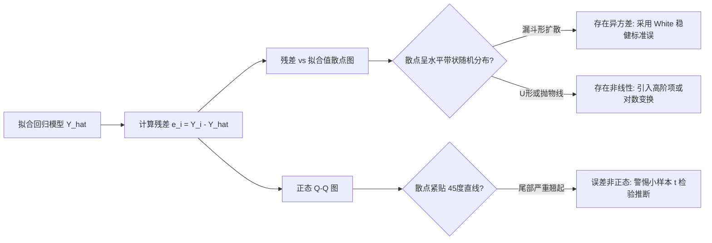

# Lec 9 回归模型 II：模型检验、交互项、虚拟变量与非线性转换 (Regression Models II: Diagnostics, Dummies & Transformations)

> MIT 15.060 数据、模型与决策 · 讲义 9 · 授课教师：Prof. Dimitris Bertsimas / Prof. Robert Freund

## TL;DR

- 残差诊断是识别异方差、非线性关联与自回归遗漏变量的科学听诊器。
- 多重共线性不会破坏 OLS 的无偏性，但会急剧膨胀回归系数方差，导致统计显著性失真。
- 虚拟变量（Dummy Variables）将定性属性编码入回归模型，必须遵循 $k-1$ 原则以规避虚拟变量陷阱。
- 乘积交互项捕捉调节效应，对数变换将绝对增量回归转换为直观的经济学弹性度量。

## 1. 经典回归模型的严谨诊断工作流

在运行最小二乘回归时，软件总能输出一组漂亮的系数与较高的 $R^2$。然而，若数据生成过程违背了高斯-马尔可夫（Gauss-Markov）基础假定，模型产出的标准误与 p 值将完全失效，导致严峻的误导性结论。

完整的回归审计工作流必须从**残差图（Residual Plots）**开始：

### 1.1 异方差（Heteroscedasticity）的经济机制与矫正

当误差项的方差随解释变量水平的扩大而系统性扩张时（例如：高收入家庭的储蓄额波动范围远大于低收入家庭），即发生异方差现象：
$$Var(\epsilon_i \mid X_i) = \sigma_i^2 \ne \text{Constant}$$
- **后果**：OLS 系数仍具有线性无偏性，但不再具备“最小方差”（失去 BLUE 特性）；更致命的是，软件默认计算的 $SE(b_j)$ 存在系统偏误，导致 t 检验失效。
- **治理**：采用**怀特稳健标准误（White / Huber-White Robust Standard Errors）**，或对因变量实施方差稳定变换（如取自然对数 $\ln Y$）。

### 1.2 多重共线性（Multicollinearity）与方差膨胀

当两个或多个自变量之间存在高度线性相关（例如模型中同时包含“员工工龄”与“员工年龄”，或“家庭总支出”与“各项分类支出和”）时，即引发严重共线性。

::: definition [方差膨胀因子 (Variance Inflation Factor, VIF)]
自变量 $X_j$ 的方差膨胀因子定义为：
$$VIF_j = \frac{1}{1 - R_j^2}$$
其中 $R_j^2$ 是将 $X_j$ 作为因变量、对模型中其余所有自变量进行辅助辅助回归得到的决定系数。
判别经验准则：
- $VIF_j < 5$：共线性处于安全可控区间；
- $VIF_j \ge 10$：严重多重共线性，系数估计方差被放大 10 倍以上。
:::

多重共线性的直观症状是：**全模型 F 检验极度显著（$R^2$ 很高），但大部分核心变量的 t 检验却都不显著（p 值很大），且系数符号与实际商业常识严重违背**。

## 2. 定性属性与虚拟变量（Dummy Variables）建模

在商业管理中，海量关键信息是以分类标签形式存在的：地区（美东、美西、中西部）、性别、是否拥有 MBA 学位、行业分类等。

::: definition [虚拟变量与基准组原则 (Dummy Variable Principle)]
若某个定性属性具有 $k$ 个互斥分类水平，模型中只能引入 $k - 1$ 个 0-1 虚拟变量：
$$D_i = \begin{cases} 1, & \text{样本属于该分类} \\ 0, & \text{样本不属于该分类} \end{cases}$$
未被引入虚拟变量的那个分类被称为**基准组（Base / Reference Category）**。截距项 $\beta_0$ 反映基准组的期望响应值，每个虚拟变量的系数 $\beta_j$ 精确反映该类别相对于基准组的**平均溢价或差距**。
:::

::: pitfall [虚拟变量陷阱 (Dummy Variable Trap)]
若分析师为 $k$ 个类别设定了完整的 $k$ 个虚拟变量，且方程中同时保留了常数截距项 $\beta_0$，由于 $\sum_{j=1}^k D_{ji} = 1$ 与常数项完全重合，自变量数据矩阵的列向量存在严格线性相关，导致矩阵奇异无法求逆，软件将直接报错。
:::

## 3. 高级扩展：交互效应项与对数弹性模型

现实中的管理因果链条很少是孤立叠加的。营销学常识表明，降价促销的效果会受到品牌知名度的极大调节；薪酬激励的边际效果受制于员工的资历。

### 3.1 乘积交互项（Interaction Terms）

考虑将两个自变量的乘积作为新变量加入模型：
$$Y = \beta_0 + \beta_1 X_1 + \beta_2 X_2 + \beta_3 (X_1 \cdot X_2) + \epsilon$$
对 $X_1$ 求偏导数，得到 $X_1$ 的偏边际效应：
$$\frac{\partial Y}{\partial X_1} = \beta_1 + \beta_3 X_2$$

此时，$\beta_1$ 不再是 $X_1$ 的全域边际效应，而是当 $X_2 = 0$ 时的特殊边际值；交互项系数 $\beta_3$ 刻画了 $X_2$ 每增加一个单位，$X_1$ 对因变量的拉动杠杆发生何种增减（**调节效应 Moderation Effect**）。

### 3.2 经济学对数模型与弹性解读

在经济学与商业预测中，绝对量的加性关系往往不如百分比变化具有稳定性。通过引入自然对数变换，可构建经典的三类对数回归模型：

| 模型类型 | 代数形式 | 斜率系数 $\beta_1$ 的数学与经济学内涵 | 典型商业应用场景 |
| :--- | :--- | :--- | :--- |
| **对数-对数 (Log-Log)** | $\ln Y = \beta_0 + \beta_1 \ln X$ | **价格需求弹性 (Elasticity)**：$X$ 增加 $1\%$，$Y$ 预期变动 $\beta_1\%$ | 需求曲线、规模经济报酬测算 |
| **对数-线性 (Log-Lin)** | $\ln Y = \beta_0 + \beta_1 X$ | **半弹性 (Semi-elasticity)**：$X$ 增加 1 单位，$Y$ 预期相对变动 $100 \times \beta_1\%$ | 明瑟工资方程（工龄对收入百分比溢价）|
| **线性-对数 (Lin-Log)** | $Y = \beta_0 + \beta_1 \ln X$ | $X$ 增加 $1\%$，$Y$ 预期绝对变动 $0.01 \times \beta_1$ 单位 | 边际效用递减、广告预算边际递减效应 |

::: example [零售定价弹性实证解析]
某电商平台拟合某旗舰咖啡豆的周度销售方程：
$$\ln(\text{Quantity}) = 8.52 - 1.85 \ln(\text{Price}) + 0.42 \ln(\text{AdSpend})$$
回归结果清晰显示：
- 需求的价格弹性为 $-1.85$：价格每上调 $1\%$，采购需求量预期剧烈萎缩 $1.85\%$（属于强价格敏感品类，单边提价将导致总收入下跌）；
- 广告投入弹性为 $+0.42$：数字广告预算每翻倍（增长 $100\%$），销量预期拉动约 $42\%$。
:::

::: insight [我的理解：虚拟变量与交互项是数学模型连接人性的桥梁]
纯数学公式只懂冷冰冰的实数加减，但真实世界充满了制度安排、文化圈层与认知偏好。虚拟变量让原本不可捉摸的“MBA 光环”、“品牌声誉”或“地域壁垒”获得了精确到美元的定价标尺；而交互项则打破了机械的单兵推进，捕捉到了协同作战的乘数魔力。一个懂得利用对数与交互项的分析师，才能真正把商业的复杂张力翻译成优雅的代数结构。
:::
