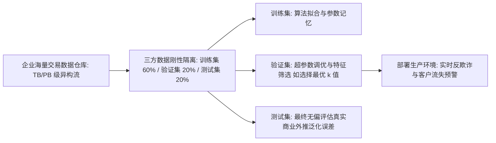

# Lec 1 数据挖掘概论与 k-近邻分类预测 (Data Mining Overview & k-Nearest Neighbors)

> MIT 15.062J 数据挖掘 · 讲义 1 · 授课教师：Prof. Roy Welsch / Nitin Patel

## TL;DR

- 数据挖掘通过从海量企业数据仓库中自动化提取未知、有效且可执行的模式，驱动管理决策。
- 区别于传统假设检验统计学，数据挖掘以预测效能（Predictive Accuracy）为首要评价标尺。
- k-近邻（k-NN）算法是一种基于局部实例的非参数记忆型学习器，依赖距离度量实施类比推断。
- 特征标准化与参数 $k$ 的交叉验证选择是决定 k-NN 分类与回归表现的核心生命线。

## 1. 数据爆炸与现代数据挖掘的范式转移

在传统的管理统计学中，经典的研究范式是“假设驱动（Hypothesis-Driven）”：研究者根据经济学理论提出先验假设（如“广告投入增加会带动销售增长”），随后精心设计小样本随机抽样实验，收集数十到数百个数据点，利用 t 检验或 F 检验验证原假设是否在 $5\%$ 的显著性水平下被拒绝。

然而，随着互联网、电子商务、POS 机条码扫描、企业 ERP 数据库与自动化传感器的普及，人类社会积累的数据量呈指数级暴增。管理者面对的是动辄数千万条交易记录、成百上千个维度的**数据仓库（Data Warehouses）**。

在海量高维数据面前，传统统计学遇到了“维数灾难”与“样本过大导致所有微小差异都在 p 值上极其显著”的理论困境。**数据挖掘（Data Mining / Knowledge Discovery in Databases, KDD）**应运而生。

::: definition [数据挖掘 (Data Mining)]
数据挖掘是从海量、不完全、有噪声、模糊的实际应用数据中，提取隐含在其中、人们事先未知但又潜在有用的信息和知识的过程。
其与传统统计学的核心本质区别在于：
1. **目标导向**：传统统计侧重于**解释性（Inference & Explanation）**；数据挖掘以**未见样本的外推预测准确率（Generalization Predictive Performance）**为唯一最高仲裁准则；
2. **算法属性**：传统统计偏好参数化线性模型；数据挖掘融合了计算机科学、人工智能、运筹优化与统计学，广泛拥抱高度灵活的非参数黑盒与非线性结构；
3. **样本划分铁律**：严密实行训练集（Training Set）、验证集（Validation Set）与独立测试集（Test Set）隔离，防范死记硬背式过拟合。
:::

## 2. k-近邻（k-Nearest Neighbors, k-NN）算法原理

在所有预测性挖掘算法中，**k-近邻算法（k-NN）**是最符合人类直觉经验、也是数学结构最质朴的一种方法。其核心思想被称为“**懒惰学习（Lazy Learning）**”或“**基于实例的学习（Instance-Based Learning）**”。

k-NN 在训练阶段几乎不做任何显式的模型方程拟合，它仅仅是将所有的训练样本及其标签完整保存在内存中。当一个新的未标注样本输入时，算法在几何空间中寻找与其“长相最接近”的 $k$ 个邻居，通过邻居的投票表决来决定新样本的归属。

### 2.1 距离度量与几何空间定义

设样本点由 $p$ 维连续数值特征构成：$x = (x_1, x_2, \dots, x_p)$。
衡量两个样本点 $x_i$ 与 $x_j$ 之间相似度的最标准度量是**欧几里得距离（Euclidean Distance）**：
$$d(x_i, x_j) = \sqrt{\sum_{l=1}^p (x_{il} - x_{jl})^2} = \|x_i - x_j\|_2$$
在某些对离群值敏感或属性维数极高的情境下，也可以采用**曼哈顿距离（Manhattan Distance）**：
$$d_1(x_i, x_j) = \sum_{l=1}^p |x_{il} - x_{jl}|$$

### 2.2 决策规则：多数表决与加权平均

1. **分类任务（Classification）**：
   找出距离待测样本 $x_{\text{new}}$ 最近的 $k$ 个已知样本点集合 $\mathcal{N}_k(x_{\text{new}})$。新样本属于类别 $c$ 的后验概率为这 $k$ 个邻居中属于该类的比例：
   $$P(Y = c \mid x_{\text{new}}) = \frac{1}{k} \sum_{i \in \mathcal{N}_k(x_{\text{new}})} \mathbb{I}(y_i = c)$$
   按**多数票决原则（Majority Voting）**将新样本划归票数最多的类别。
2. **回归任务（Regression）**：
   新样本的连续数值预测值为这 $k$ 个邻居实际响应值的算术均值（或基于距离反比的加权均值）：
   $$\hat{y}_{\text{new}} = \frac{1}{k} \sum_{i \in \mathcal{N}_k(x_{\text{new}})} y_i$$

## 3. 经典案例剖析：乘骑式割草机（Riding Mowers）购买预测

在 15.062J 的经典案例中，某园林机械制造商希望识别哪些郊区家庭具有购买昂贵“乘骑式大型割草机（Riding Mower）”的潜质。
样本包含 24 户家庭的两个核心特征：
- $X_1$：家庭年收入（Income，千美元）；
- $X_2$：住宅草坪占地面积（Lot Size，千平方英尺）；
- 目标标签 $Y \in \{\text{Owner}, \text{Non-owner}\}$（割草机拥有者 vs 非拥有者）。

### 3.1 变量标准化（Normalization）的生死线

观察特征量纲：
- 家庭年收入通常在 40 至 110 千美元之间波动（极差约为 70）；
- 草坪占地面积通常在 14 至 24 千平方英尺之间波动（极差仅为 10）。
若未经标准化直接计算欧氏距离，年收入的离散程度是草坪面积的 7 倍，距离计算将完全被收入主宰，草坪面积这一物理硬约束（没有大草坪谁会买乘骑割草机？）的贡献将被严重稀释。

::: theorem [特征标准化转换公式]
在运行 k-NN 之前，必须对每个自变量实施 **Z-score 标准化**：
$$z_{il} = \frac{x_{il} - \bar{x}_l}{s_l}$$
将所有维度的特征均值平移为 0、标准差缩放为 1，确保每一个特征在距离度量中享有完全公平的几何发言权。
:::

### 3.2 超参数 $k$ 的权衡：偏差-方差博弈（Bias-Variance Tradeoff）

超参数 $k$ 的选取直接决定了模型的复杂度与泛化能力：

| 邻居数量 $k$ 选取 | 决策边界几何形态 | 偏差 (Bias) | 方差 (Variance) | 拟合风险 |
| :--- | :--- | :--- | :--- | :--- |
| **$k = 1$ (极小)** | 极度破碎、曲折且高度环绕孤立点 | 极低（训练集准确率 100%）| **极大（极度敏感）** | **严重过拟合**（把噪声当规律）|
| **$k = N$ (极大)** | 全域恒定单一平面，永远预测全样本主导类 | **极大（彻底丧失局部辨识度）** | 极低（零波动） | **严重欠拟合** |
| **$k \approx 3 \sim 7$ (适中)**| 平滑连续、符合物理常识的弹性曲面 | 适中可控 | 适中可控 | **验证集最优泛化边界** |

::: example [割草机新客户分类推断]
某新客户家庭年收入 60 千美元，草坪面积 20 千平方英尺。标准化后在空间中检索最近的 $k = 3$ 个邻居：
- 邻居 1：收入 62，草坪 20.5，标签为 **Owner**（距离 0.22）；
- 邻居 2：收入 58，草坪 19.8，标签为 **Owner**（距离 0.31）；
- 邻居 3：收入 59，草坪 17.5，标签为 **Non-owner**（距离 0.45）。
在 3 个最近邻居中，拥有者占据 2 票（$66.7\%$）。k-NN 模型建议销售团队向该客户寄送高规格割草机促销手册。
:::

::: pitfall [高维空间的“维数灾难（Curse of Dimensionality）”]
当特征维度 $p$ 增加到几十甚至上百维时，空间的体积呈指数级爆炸。高维空间中的所有样本点都变得彼此极度稀疏且距离几乎完全相等（任何两点的距离之差相比平均距离微不足道）。此时，“最近邻”的概念彻底失效，k-NN 必须配合主成分分析（PCA）或特征选择等降维工序方能发挥作用。
:::

::: insight [我的理解：k-NN 是人类类比推理的数学化身]
古希腊哲学家常说：“物以类聚，人以群分。”人类在面对一个完全陌生的人或事物时，大脑最本能的认知策略从来不是调用某条复杂的微分方程，而是在记忆库里搜索：“他长得像我以前认识的谁？他在行为举止上和我记忆里的哪类人最接近？”k-NN 的伟大之处，正在于用最简单的几何距离，完美复刻了人类这种基于案例类比（Case-Based Reasoning）的古老智慧。
:::
