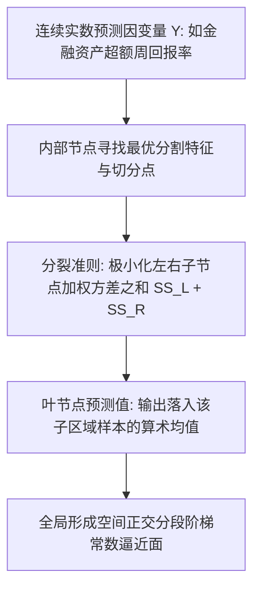
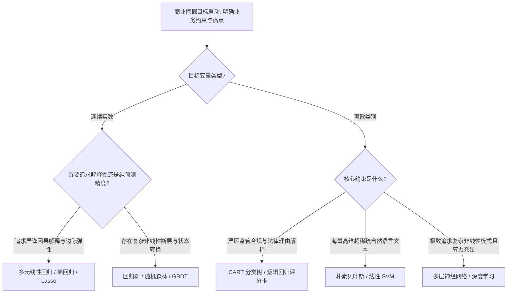

# Lec 10 回归树算法、金融收益预测与模型横向综合对比 (Regression Trees, Financial Returns & Technique Comparison)

> MIT 15.062J 数据挖掘 · 讲义 10 · 授课教师：Prof. Roy Welsch / Nitin Patel

## TL;DR

- 回归树通过最小化方差下降准则，将连续目标变量切分为分段阶梯常数函数。
- IBM 与通用汽车（GM）金融资产周度收益率案例揭示了回归树在捕捉非线性市场 regime 转换中的独特优势。
- 监督学习技术选型必须综合权衡样本容量、特征维度、非线性复杂度、计算速度与监管可解释性。
- 不存在全知全能的银弹模型，优秀架构师的核心素养在于根据现实业务边界实现最优工具匹配。

## 1. 连续预测的另一种范式：回归树（Regression Trees）

在前面的讲义中，我们深入学习了多元线性回归及其正则化变体。线性回归默认因变量与自变量之间存在全局连续平滑的线性或对数多项式关系。

然而，在诸如金融资本市场资产定价、电力峰谷负荷预测、大宗商品供求阶梯等高风险领域，客观现实往往表现为**制度转换（Regime Switching）与突发性断裂**：
- 当市场波动率低于临界阈值时，股票回报率紧密跟随宏观流动性；
- 一旦波动率或信用利差击穿某一安全红线，全市场瞬间切换至流动性抽逃与踩踏恐慌模式，原有的线性资产定价模型（CAPM）瞬间失效。

**回归树（Regression Trees）**通过自适应分段阶梯逼近，提供了一种完全摆脱线性与正态假定的非参数预测武器。

### 1.1 节点分裂数学准则：方差极小化

设父节点包含样本集 $D$。若依据特征 $j$ 与阈值 $s$ 将样本切分为 $D_L$ 与 $D_R$：
- 左子集样本均值：$\bar{y}_L = \frac{1}{|D_L|} \sum_{i \in D_L} y_i$；
- 右子集样本均值：$\bar{y}_R = \frac{1}{|D_R|} \sum_{i \in D_R} y_i$。

算法通过遍历所有特征与切分点，极小化切分后的**总残差平方和（Total Sum of Squared Deviations）**：
$$\min_{j, s} \left[ \sum_{i \in D_L} (y_i - \bar{y}_L)^2 + \sum_{i \in D_R} (y_i - \bar{y}_R)^2 \right]$$

这等价于最大化父节点方差与两个子节点加权方差之差（方差缩减量 Variance Reduction）。

## 2. 案例实战：IBM 与通用汽车（GM）资产周收益率预测

在 15.062J 的金融数据挖掘实验中，我们获取了国际商业机器公司（IBM）与通用汽车（GM）长达数百周的真实高频交易数据。目标是利用标普 500 指数回报（Market Return）、无风险国债利率、美元汇率指数以及前期自回归滞后项，预测个股的未来周度收益率。

### 2.1 线性 CAPM 模型 vs 回归树对决

1. **资本资产定价模型（Linear CAPM）**：
   $$R_{\text{IBM}} - R_f = \alpha + \beta (R_M - R_f) + \epsilon$$
   拟合出一条固定的 Beta 直线（$\beta \approx 0.85$）。在平稳时期拟合优良，但一旦遭遇宏观熊市崩盘，真实亏损幅度远超线性预期（残差分布呈现极其严重的肥尾与异方差）。
2. **回归树自适应捕捉市场状态转换（Market Regimes）**：
   回归树的第一道根节点切分立刻落在了**标普 500 指数大盘单周跌幅是否超过 $-3.2\%$** 之上：
   - 当大盘平稳（$R_M \ge -3.2\%$）时，叶节点呈现适度温和的正收益均值；
   - 当大盘暴跌（$R_M < -3.2\%$）时，子节点次级分裂规则迅速聚焦于**短期国债收益率的异常飙升**，直接将个股预测值锁定在深幅负收益区间。
回归树无需分析师手动设定复杂的交互项，自动完成了金融计量学中需要依靠马尔可夫机制转换模型（Markov Regime Switching）才能勉强拟合的非线性异质结构。

## 3. 全局技术大比武：监督学习模型横向多维选型矩阵

经过前 10 讲的系统淬炼，我们已经掌握了数据挖掘领域最核心的 7 大监督学习主力算法。在面对一个真实未知的商业挑战时，究竟该如何选择最称手的武器？

下表总结了 15.062J 经典教学大纲中的**监督学习全要素决策矩阵（Master Selection Guide）**：

| 分析维度与性能表现 | 多元线性回归 (MLR) | 逻辑回归 (Logistic) | k-近邻算法 (k-NN) | 朴素贝叶斯 (Naive Bayes) | 费希尔判别分析 (LDA) | 分类与回归树 (CART) | 人工神经网络 (ANN) |
| :--- | :--- | :--- | :--- | :--- | :--- | :--- | :--- |
| **主要目标类型** | 连续数值预测 | 二元/多分类概率 | 分类与连续回归 | 高维离散文本分类 | 降维与多分类 | 分类与连续回归 | 通用复杂模式逼近 |
| **模型可解释性 (白盒度)**| **极高**（偏边际系数）| **极高**（几率比 OR）| 低（基于个案类比） | 中等（条件概率乘积）| 高（判别投影权重）| **极高**（IF-THEN 规则）| **极低（黑箱算力）** |
| **对非线性关系适应力** | 差（需人工构造项） | 差（需人工构造项） | 强（局部弹性逼近） | 弱至中等 | 弱（假设高斯同方差）| **极强（阶梯台阶划分）**| **极强（万能函数逼近）**|
| **高维特征抗压能力** | 差（易多重共线性） | 差（需配合正则化） | 极差（维数灾难） | **极强（独立性解耦）**| 差（小样本奇异矩阵）| 强（单变量贪心筛选）| 强（需海量算力样本）|
| **训练与求解计算速度** | **极快**（闭式解析解）| 快（牛顿迭代收敛） | **零训练（懒惰记忆）**| **极快**（仅频次统计）| **极快**（特征值分解）| 快（递归二分查找）| **极慢（大规模反向传播）**|
| **在线实时预测推理延迟**| 极低（微秒级） | 极低（微秒级） | **极高（需全库遍历）**| 极低（微秒级） | 极低（微秒级） | 极低（微秒级树查找）| 适中 |
| **对缺失值与异常值鲁棒性**| 极敏感（残差平方放大）| 较敏感 | 敏感（扭曲欧式距离） | 较强（自动跳过空项）| 较敏感 | **极强（排序统计免疫）**| 较敏感 |

::: pitfall [算法原教旨主义（Algorithm Dogmatism）]
许多年轻数据科学家往往落入“算法崇拜陷阱”：认为最新的神经网络必定碾压古老的线性回归或决策树。在大量真实企业征信与小额零售信贷场景中，经过精心特征工程清洗后的逻辑回归，其测试集 AUC 与数十层的复杂深度网络相比，差距往往不到 $0.5\%$，而逻辑回归带来的透明合规、秒级推断与极低维护成本，在商业综合投入产出比（ROI）上全面胜出。
:::

::: insight [我的理解：算法没有高低贵贱，只有场景的适配与克制]
一个蹩脚的工匠总是抱怨自己的工具不够先进，而真正的宗师甚至能用一把生锈的柴刀削出惊世之作。多元回归是精准的手术刀，决策树是干脆的裁纸机，朴素贝叶斯是狂暴的分拣传送带，而神经网络则是熔铸一切的重型电炉。商业数据挖掘的核心魅力，从来不是用最昂贵的算力炫技，而是在混杂着成本、算力、法律、时间与人性的现实约束下，用最克制的模型，解决最致命的问题。
:::
