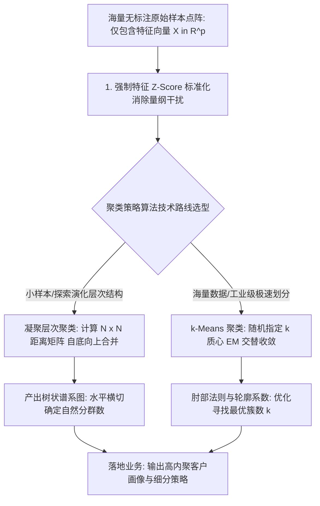

# Lec 11 聚类分析体系：k-Means 与层次凝聚聚类 (k-Means & Hierarchical Clustering)

> MIT 15.062J 数据挖掘 · 讲义 11 · 授课教师：Prof. Roy Welsch / Nitin Patel

## TL;DR

- 无监督聚类旨在揭示无标注数据集内部潜藏的自然分组结构与微观高内聚几何形态。
- 凝聚层次聚类（Agglomerative Hierarchical）通过自底向上合并距离矩阵，产出包含全生命周期演化的树状谱系图。
- k-Means 聚类依托质心重塑与样本分配交替迭代，在超大规模数据集上实现了高效的线性计算扩展。
- 变量量纲标准化与最优簇数量 $k$ 的科学标定是规避虚假聚类幻象的核心防线。

## 1. 无监督学习的本质与挑战

在之前的 10 讲中，我们探讨的全部属于**监督学习（Supervised Learning）**范畴：每一个样本不仅包含特征向量 $X$，更包含一个由人类或客观事实赋予的明确目标答案 $Y$（标签 Label 或连续值）。模型的任务是寻找从 $X$ 到 $Y$ 的最优映射函数。

然而在现实商业社会中，海量积累的数据绝大多数是**完全没有任何先验标签的（Unlabeled Data）**：
- 信用卡中心只记录了数百万持卡人每一笔消费的时间、商户类型与金额，但没有人预先标注“这位客户属于哪种生活方式”；
- 基因测序仪输出了数万个碱基对的表达丰度，但医生无法提前获知是否存在未被定义的新亚型疾病；
- 电商平台积累了数十亿条浏览点击日志，但无法通过简单的下拉菜单界定复杂的消费心理圈层。

**聚类分析（Cluster Analysis）**作为无监督学习的核心支柱，其根本使命是：**在全无外界导师指导的黑箱状态下，仅依靠样本之间的多维空间几何距离或相似性测度，将相似的样本自发凝聚为簇（Clusters），使得同一个簇内部的样本相似度极高，而不同簇之间的样本差异极大**。

## 2. 凝聚层次聚类（Agglomerative Hierarchical Clustering）

凝聚层次聚类是一种自底向上的确定性贪心算法，其最大魅力在于不需要预先人为指定最终的聚类数量 $k$。

### 2.1 簇间距离的四种主流链接法则（Linkage Criteria）

设簇 $A$ 包含样本点 $x_i$，簇 $B$ 包含样本点 $x_j$。衡量两个多样本簇之间的距离定义：
1. **单链接（Single Linkage / Nearest Neighbor）**：
   $$D_{\text{single}}(A, B) = \min_{x_i \in A, \ x_j \in B} d(x_i, x_j)$$
   容易受到离群噪点的桥接牵引，产生细长弯曲的“链状效应（Chaining Effect）”；
2. **全链接（Complete Linkage / Furthest Neighbor）**：
   $$D_{\text{complete}}(A, B) = \max_{x_i \in A, \ x_j \in B} d(x_i, x_j)$$
   对噪点极其敏感，倾向于生成直径紧凑的球状紧密簇；
3. **平均链接（Average Linkage）**：
   $$D_{\text{average}}(A, B) = \frac{1}{|A| |B|} \sum_{x_i \in A} \sum_{x_j \in B} d(x_i, x_j)$$
   在单链接与全链接之间达成极佳的稳健妥协；
4. **沃德最小方差法（Ward's Minimum Variance Method）**：
   工业界最广泛采用的黄金法则。计算合并簇 $A$ 与 $B$ 所引发的**全系统总误差平方和（ESS）的增量**：
   $$\Delta ESS_{AB} = \frac{|A| |B|}{|A| + |B|} \|\mu_A - \mu_B\|^2$$
   Ward 法倾向于生成样本量高度均衡、内部极其紧凑的高密度球形簇。

## 3. k-均值聚类（k-Means Clustering）与计算可扩展性

对于包含上百万条数据的工业级场景，存储一个 $N \times N$ 的距离矩阵需要几百吉字节（GB）的内存，层次聚类彻底瘫痪。**k-Means** 通过直接优化目标函数，将空间复杂度压缩至 $\mathcal{O}(N \cdot p)$：

### 3.1 目标函数与交替优化

极小化全系统的簇内平方和（Within-Cluster Sum of Squares, WCSS）：
$$\min_{S} \quad WCSS = \sum_{j=1}^k \sum_{x_i \in S_j} \|x_i - \mu_j\|^2$$

劳埃德两步交替迭代法（Lloyd's EM Algorithm）：
1. **分配步（Expectation Step）**：固定各簇质心 $\mu_j$，将每个样本 $x_i$ 划归至距离最近的质心所在簇；
2. **更新步（Maximization Step）**：固定划分，将质心 $\mu_j$ 重新计算为该簇内所有样本向量的算术均值重心：
   $$\mu_j \leftarrow \frac{1}{|S_j|} \sum_{x_i \in S_j} x_i$$
由于有限个划分的 WCSS 在每一步严格单调递减，算法在有限步内必然收敛。

### 3.2 最优簇数 $k$ 的科学决断：肘部法则与轮廓分析

如何客观敲定最合理的聚类数量 $k$？
- **肘部法则（The Elbow Method）**：
  随着 $k$ 从 1 逐步增加，系统的 $WCSS$ 必然单调下降（当 $k = N$ 时，$WCSS = 0$）。绘制 $WCSS$ 随 $k$ 变化的折线图，寻找曲线由“陡峭急速下降”突然转为“平缓稳定”的拐点（**肘部 Elbow**）。该拐点意味着再继续增加新簇所能获得的方差解释边际收益急剧衰减；
- **轮廓系数（Silhouette Coefficient）**：
  度量单个样本与其所属簇的紧密度与其与邻近簇的分离度之比，值域在 $[-1.0, +1.0]$ 之间，全局平均轮廓系数越大代表聚类结构越扎实。

::: theorem [标准化在无监督聚类中的绝对统治权]
在监督学习中，某些算法（如决策树）不受特征量纲影响。而在聚类分析中，由于底层完全依托多维欧氏几何距离：
$$d(x_i, x_j) = \sqrt{\sum_{l=1}^p (x_{il} - x_{jl})^2}$$
若未对变量实施标准化，数值绝对值大的变量（如年薪数十万）将以平方倍数绝对主宰距离公式，直接导致数值较小但业务极其关键的特征（如负债比率 $0.2 \sim 0.8$）被彻底淹没！**任何未经标准化的聚类结果，都是纯粹的数值假象**。
:::

::: example [跨国企业财务健康度聚类诊断演练]
对 100 家跨国制造业上市公司展开无监督聚类。输入指标涵盖流动比率、资产负债率、净资产收益率（ROE）与利息保障倍数：
- 先运行 Ward 凝聚层次聚类，树状谱系图在纵轴距离截断处清晰分化为 3 大主干枝桠；
- 将 $k = 3$ 注入 k-Means 算法进行全量快速划分：
  - **Cluster 1（高杠杆高盈利激进组）**：资产负债率高达 $75\%$，但 ROE 突破 $25\%$；
  - **Cluster 2（稳健防御型现金奶牛组）**：现金储备深厚，负债率极低，增速平缓；
  - **Cluster 3（高危财务失血困境组）**：利息保障倍数跌破 1.0，流动比率告急。
银行信贷审批委员会无需人工逐一审读百家企业财报，即可依据聚类标签自动定制差别化授信风控政策。
:::

::: pitfall [对随机初始质心陷入局部极小的脆弱性]
k-Means 算法的目标函数高度非凸，极易困在糟糕的局部极小值死胡同中。工业实操中必须采用 **k-Means++ 算法**（使得初始质心之间的相互距离尽可能最大化），并强制要求求解器执行至少 25 次以上的独立随机重启（`nstart = 25`），取全局 WCSS 最小的运行结果。
:::

::: insight [我的理解：聚类分析是人类认知模式的纯粹投射]
在没有标签的混沌数据面前，聚类算法就像是在漆黑的夜空里连线星座。大自然并没有在天上画出猎户座或大熊座，但人类大脑天生具有在离散星光中寻找聚集形态与叙事秩序的本能。聚类分析没有所谓的“绝对标准答案”，每一个簇的划分，都是数学距离测度与人类商业理解力深度共谋的产物。好的聚类，是在冰冷的点阵中为混乱的现实赋予意义的开端。
:::
