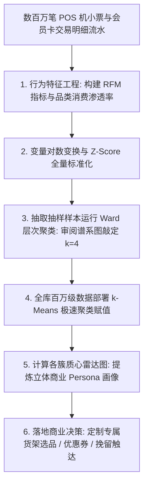
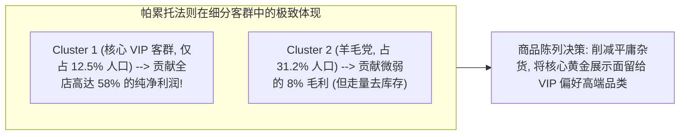

# Lec 12 零售商品规划案例：客户细分与购买行为特征画像 (Case: Retail Merchandising & Customer Profiling)

> MIT 15.062J 数据挖掘 · 讲义 12 · 授课教师：Prof. Roy Welsch / Nitin Patel

## TL;DR

- 零售商品规划（Retail Merchandising）与品类管理的核心基石在于对多维海量客户进行科学分群。
- RFM 行为模型超越静态人口统计学标签，精准刻画消费者的活跃度、忠诚度与资本变现潜力。
- 层次聚类与 k-Means 协同作战：利用谱系图锁定自然客群数，利用 k-Means 实施工业级全量归类。
- 业务落地必须将数学质心映射为立体生动的人格画像（Persona），驱动精准营销与货架选品。

## 1. 现代零售业的精细化运营危机

在传统的百货商场与连锁超市时代，采购总监与品类经理（Merchandising Managers）在进行季节性选品陈列与促销策划时，主要依赖历史经验与粗线条的静态人口统计学特征（如“年龄 25-35 岁、女性、居住在市区”）。

然而，随着电商平台、会员积分卡与全渠道零售的演进，这种粗糙的标签遭遇了严重的商业破产：
- 两个同样是 30 岁、年收入相同的白领女性，在实际消费行为上可能存在极其剧烈的分化：一位每隔三天就来采购有机婴儿食品与天然护肤品，对价格完全不敏感；另一位则只在黑色星期五大减价时狂刷低折扣尾货服饰；
- 如果对全量会员实行无差别的“一刀切全场打折”或群发短信轰炸，不仅会造成数以千万元计的毛利白白流失，还会引发高端高净值客户因反感垃圾信息而大规模退订会员。

**客户细分（Customer Segmentation）与行为画像（Profiling）**的核心使命是：**让数据自己说话，从成千上万条杂乱的交易小票流水中，提炼出真正驱动消费者打开钱包的深层行为基因**。

## 2. 特征工程核心支柱：RFM 行为模型与品类偏好

在 15.062J 经典零售商业案例中，某全国性大型连锁生活百货集团调取了过去两年的会员交易核心数据库。

### 2.1 经典 RFM 模型三要素

在零售数据挖掘中，最经典的黄金行为指标当属 **RFM 框架**：
1. **最近一次消费间隔（Recency, $R$）**：距离最后一次进店产生交易的天数。天数越小，代表客户与品牌的交互处于鲜活的“活跃期”，流失风险低；
2. **消费频次（Frequency, $F$）**：在过去观测周期内的总消费账单笔数，量化了客户的品牌依赖与进店习惯黏性；
3. **消费总金额（Monetary Value, $M$）**：累计贡献的客单净收入，量化了客户的真实商业现金流价值。

### 2.2 扩展品类渗透率与价格弹性特征

除 RFM 外，现代零售分析师深度引入了反映**品类偏好与促销敏感度**的复合衍生指标：
- **高毛利轻奢品类占比（Luxury Share）**：美妆、高端母婴、进口生鲜消费金额占其总消费的比重；
- **促销折价敏感度（Discount Ratio）**：购买特价促销商品的金额占比（$> 60\%$ 代表重度薅羊毛党）；
- **全渠道交互行为（Omnichannel Index）**：线下门店刷卡次数与线上移动端 App 下单次数的比率。

## 3. 聚类实战与多维画像（Persona）提炼

由于原始 RFM 指标往往呈现极端的长尾右偏分布（少数超级 VIP 客户消费数十万美元，而大多数客户在几十美元徘徊），在进入聚类前：
1. 对金额与频次特征进行**自然对数变换（$\ln(X + 1)$）**以抚平长尾偏度；
2. 实施严格的 **Z-score 标准化**。

采用“两阶段聚类战法”：
- **阶段一**：抽取 2,000 个随机分层样本运行 Ward 凝聚层次聚类，树状谱系图（Dendrogram）在高度截断时展现出极其稳定的 **$k = 4$ 大主干**；
- **阶段二**：将全库 50 万名客户数据输入 k-Means 引擎，设置 $k = 4$ 极速迭代收敛。

### 3.1 四大核心商业客群质心对比表

通过逆向还原质心原始物理数值，提炼出具有极高商业辨识度的四大**消费者人格画像（Persona）**：

| 客群代码与商业画像命名 | 客户规模占比 | RFM 综合行为特征 | 品类偏好与折扣倾向 | 零售集团专属落地运营策略 |
| :--- | :--- | :--- | :--- | :--- |
| **Cluster 1：超级尊贵高净值忠诚客 (Core VIPs)** | **$12.5\%$** | $R < 7$ 天（极度活跃）、年均进店 45 次、$M > \$8,500$ | 独爱进口生鲜与设计师服饰，对促销完全不看 | 专属私人导购、免排队收银、新品私密品鉴会，坚决不打折 |
| **Cluster 2：精打细算促销羊毛党 (Bargain Hunters)** | **$31.2\%$** | $R \approx 30$ 天、年均进店 12 次、总消费 $\$1,200$ | 折扣占比高达 $85\%$，主攻临期食品与打折日化 | 精准定向推送临期清仓特价券，作为快速去库存的清道夫渠道 |
| **Cluster 3：高潜力都市年轻新贵 (Rising Stars)** | **$22.8\%$** | 入会不满 3 个月、$R < 14$ 天、单均消费客单价极高 | 疯狂偏好网红美妆、咖啡轻食、数码潮玩 | 引导下载官方 App 绑定联名信用卡，派发第二件半价券培养进店黏性 |
| **Cluster 4：濒临沉睡流失边缘客 (At-Risk Churn)** | **$33.5\%$** | $R > 180$ 天（半年未进店）、历史消费中等 | 过去偏好大众日用品，最近无任何交互记录 | 算法自动触发“唤醒召回礼包”（无门槛 50 元代金券），短信激活防流失 |

## 4. 商业闭环：从客群画像到货架空间规划

零售数据挖掘的真正价值，绝不仅仅是把客户分完组后写一份漂亮的 PPT 报告，而是直接反哺实体门店的**货架空间分配与商品规划（Space Allocation & Merchandising）**：

在分析了 Cluster 1（核心高价值 VIP）的购物篮关联路径后，数据科学团队提出了革命性的门店重构方案：
1. **动线打破与场景化混搭**：传统百货将“高级红酒”放在地下一层超市，将“高档牛排”放在冷鲜区，将“进口水晶高脚杯”放在四楼家居馆。数据证明 VIP 客户经常在周末全家烹饪聚会，商场在生鲜区正中央直接设立了“法式家宴微型场景馆”，将牛排、红酒、海盐与水晶杯同台场景化陈列，连带购买率暴增 **$38\%$**；
2. **冷门高端选品保留决策**：某些超高单价的欧洲手工铸铁锅在全店月销量仅有两三口，传统财务会计多次建议下架腾出空间给畅销薯片。然而聚类分析显示：买这款铸铁锅的客户 $100\%$ 属于全店前 $1\%$ 的核心超级 VIP，他们在商场的年消费超过数万美元。保留这款象征品牌格调的高端选品，是留住高净值人群的关键视觉图腾。

::: pitfall [将静态客群视为终身不变的死标签]
客户在不同的生命周期阶段是在各个聚类之间**动态迁移（Dynamic Migration）**的。当一位单身年轻新贵（Cluster 3）结婚生子后，其消费行为会在数月内快速向家庭母婴核心 VIP（Cluster 1）转变；若遭遇宏观经济失业下行，可能会降级为价格敏感型羊毛党（Cluster 2）。系统必须按月或按季度重新计算 RFM 动态滑移矩阵，防范过时画像造成的错配骚扰。
:::

::: insight [我的理解：商业智能是用算法还原每一个鲜活的人]
工业化流水线最擅长的就是把所有东西标准化、批量化，把活生生的人简化成一张张冰冷的条形码；而零售数据挖掘的伟大复兴，恰恰是用数学算法重新找回了传统乡村集市杂货铺老掌柜的人情味。老掌柜之所以能做好生意，是因为他脑子里清楚地记着哪位大妈买菜挑剔要送根葱、哪位少爷讲究排场要留最好的茶叶。现代算法用聚类质心替代了老掌柜的记忆力，在跨越百万人的庞大商业帝国中，重新唤醒了因人而异、因需而动的尊重与温度。
:::
