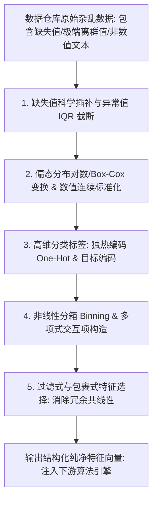

# Lec 13 数据挖掘方法论期中盘点与特征工程治理 (Midterm Methodological Synthesis & Feature Engineering)

> MIT 15.062J 数据挖掘 · 讲义 13 · 授课教师：Prof. Roy Welsch / Nitin Patel

## TL;DR

- 数据挖掘的业界格言：数据和特征决定了机器学习的上限，而模型和算法只是逼近这个上限。
- 系统化特征工程治理涵盖缺失值插补、异常值截断、分箱离散化、非线性幂变换与类别编码。
- 类别特征高基数困局通过目标编码（Target Encoding）与频次加权得到优雅化解。
- 严防数据泄露（Data Leakage）：所有特征清洗与统计参数必须严格计算自训练集，禁止全局污染。

## 1. 机器学习的真正瓶颈：垃圾进，垃圾出（GIGO）

在数据科学竞赛（如 Kaggle）或学术研究中，初学者往往将绝大多数心力倾注在对比各种前沿算法架构之上（是在树模型上堆叠参数，还是调用更深的多层神经网络）。

然而，工业界真实数据挖掘项目的血泪经验表明：**决定一个商业模型最终成败的，往往有 $80\%$ 取决于前端特征工程（Feature Engineering）的深度与质量，算法本身只贡献了剩余的 $20\%$**。
如果输入给模型的是充斥着脏数据、异常录入值、未经清洗的缺失值以及粗糙未转化的原始字段，无论后端部署多么高深复杂的算法，产出的也只能是高保真的毒瘤。

特征工程是将未经雕琢的原始业务数据，转化为能够被机器学习算法高效理解、且充分暴露深层因果关联的**优质输入表示的艺术与工程**。

## 2. 特征工程全流程核心治理工具箱

### 2.1 缺失值（Missing Values）的四重治理策略

在真实企业数据中，字段缺失是普遍常态（用户拒填收入、传感器临时掉线）。粗暴地删除包含缺失值的样本行（Listwise Deletion）不仅会丢失高达数半数以上的珍贵数据，还会引发严重的样本选择偏倚。
1. **单一统计量插补（Simple Imputation）**：对连续数值填入中位数（防止均值受离群点拉偏），对分类变量填入众数；
2. **多重近邻插补（k-NN Imputation）**：基于样本在其他完整特征上的欧氏距离，寻找最相似的 $k$ 个邻居的加权均值进行局部智能推断；
3. **缺失指示虚拟变量（Missing Indicator Dummy）**：
   在很多商业场景中，“数据发生缺失”本身就是一个极其强劲的预测特征！例如在信用卡申请中，故意不填写“固定住宅座机电话”的客户，其欺诈违约风险显著高于正常填写者。创建辅助 0-1 变量 $D_{\text{missing}}$，往往能带来惊人的额外信息增益；
4. **模型内置容错**：某些高级树模型（如 XGBoost / LightGBM）支持将缺失值自动分配到能够最大化纯度增益的最优子分枝中，实现原生容错。

### 2.2 偏态分布的方差稳定变换（Variance Stabilizing Transformations）

金融资产金额、用户停留时长、网站访问页面数等商业指标，几乎无一例外呈现严重的**右偏厚尾分布（Right-skewed / Log-normal）**：少数超级大户数值高达数百万，而 $95\%$ 的普通用户挤在零附近。

这种分布会导致最小二乘残差严重异方差，且极易被少数大数值绝对主宰。必须引入数学变换将其拉回近似正态钟形对称：
- **自然对数变换**：$y' = \ln(x + 1)$（加 1 确保对零点有定义）；
- **平方根变换**：$y' = \sqrt{x}$（适用于泊松计数过程数据）；
- **广义 Box-Cox 幂变换**：
  $$y^{(\lambda)} = \begin{cases} \frac{y^\lambda - 1}{\lambda}, & \lambda \ne 0 \\ \ln(y), & \lambda = 0 \end{cases}$$
  通过最大似然估计自动寻找最优幂参数 $\lambda$，使变换后的分布达到最佳对称性。

### 2.3 类别特征编码：从独热到目标编码（Target Encoding）

- **独热编码（One-Hot Encoding）**：
  为具有 $k$ 个水平的分类变量生成 $k$ 个二值指示列。仅适用于基数较低的离散特征（如性别、星期几、四大地理大区）；
- **高基数灾难与目标编码（Target / Mean Encoding）**：
  若分类变量基数极高（例如“邮政编码 ZipCode”包含数千个取值，或“商户分类 MCC 码”包含上千种），独热编码会导致特征维度暴增数千维，稀疏度突破天际。
  **目标编码**将每个类别的取值，直接替换为该类别对应的**目标因变量的历史统计均值（或平滑后验概率）**：
  $$\hat{x}_c = \frac{n_c \cdot \bar{y}_c + m \cdot \bar{y}_{\text{global}}}{n_c + m}$$
  其中 $m$ 为平滑权重参数。该方法以优雅的单一实数轴维度，完美凝聚了高基数标签背后的全部预测强度。

## 3. 数据挖掘方法论全局技术图谱

经过半个学期的淬炼，我们建立了涵盖数据挖掘两大分支的完整知识体系：

| 数据挖掘核心分支 | 核心算法与模型 | 典型商业与工业场景 |
| :--- | :--- | :--- |
| **有监督学习：数值预测 (Regression)** | 多元线性回归、回归树、Lasso/Ridge 正则化、MLP 神经网络 | 资产定价、工程寿命预测、零售需求弹性分析 |
| **有监督学习：离散分类 (Classification)**| 逻辑回归、CART 分类树、k-NN、朴素贝叶斯、判别分析 (LDA) | 违约风控、疾病诊断、垃圾邮件过滤、法律电子取证 |
| **无监督学习：模式发现 (Clustering)** | k-Means 聚类、凝聚层次聚类、高斯混合模型 (GMM) | 客户细分画像、图像语义分割、市场异常行为探查 |

## 4. 工程底线：数据穿越与防污染红线（Data Leakage）

在特征工程流水线中，分析师最容易犯下的隐蔽致命错误是**数据穿越（Data Leakage）**：

::: pitfall [数据泄露的隐形毒药]
在进行特征标准化（$Z = \frac{X - \mu}{\sigma}$）或缺失值均值插补时，很多程序员习惯在切分数据集**之前**，对全量数据集运行 `scale()` 函数！
这在统计学上是严重的舞弊：测试集中的样本均值 $\mu_{\text{test}}$ 与波动率 $\sigma_{\text{test}}$（代表未发生的未来信息），通过全集计算悄悄渗透进了训练集特征中。模型在实验室离线测试时表现极度完美，但在生产环境中由于失去了对未来的偷窥能力，准确率瞬间暴跌。
**铁律：所有的均值、方差、中位数、分箱切分点以及目标编码参数，必须且只能完全基于训练集（Training Set）独立计算；在处理测试集时，只能机械调用训练集保留下来的参数！**
:::

::: insight [我的理解：特征工程是人类向算法传递领域智慧的接口]
算法是普适的、抽象的数学公式，它不知道什么是“现金流”，也不知道什么是“复购率”。真正让通用算法在医疗、金融或零售的特定土壤中长成参天大树的，是数据分析师对具体行业机理的深刻洞察。通过特征工程，我们把几十年来人类在这个行业摸索出的规律、门道与常识，精心提炼成一列列拥有极高信噪比的特征。特征工程不是死板的数据清洗，它是人类领域专家向算法赋予智慧的仪式。
:::
