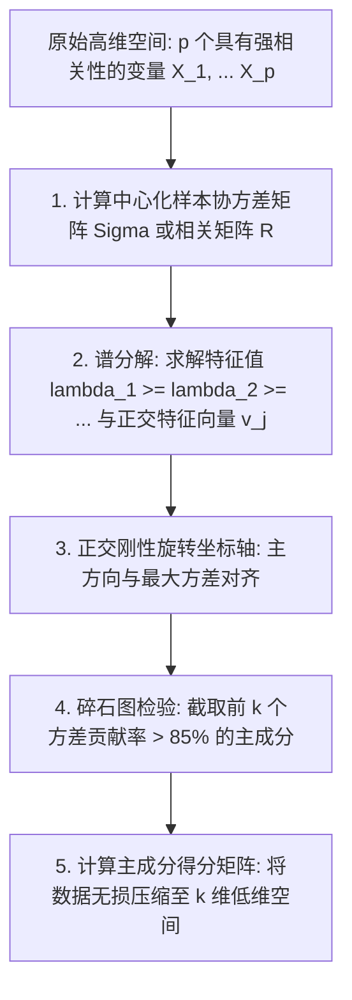
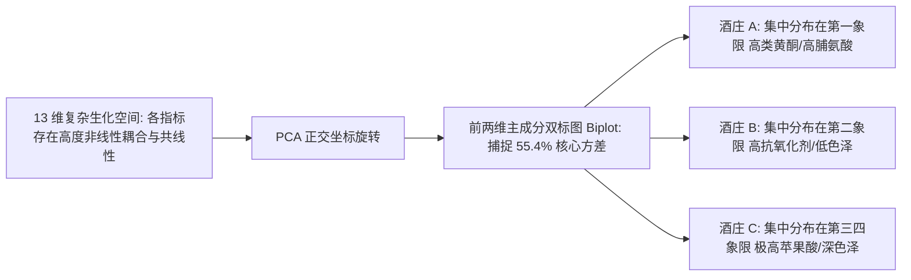

# Lec 14 主成分分析（PCA）：正交坐标旋转与高维数据降维 (Principal Component Analysis & Dimensionality Reduction)

> MIT 15.062J 数据挖掘 · 讲义 14 · 授课教师：Prof. Roy Welsch / Nitin Patel

## TL;DR

- 主成分分析（PCA）通过正交线性坐标系旋转，将具有相关性的高维变量投影为互不相关的主成分。
- 样本协方差矩阵的特征值分解（Spectral Decomposition）锁定了方差最大化的主投影轴。
- 碎石图（Scree Plot）与累计方差贡献率（$> 85\%$）为保留最少维度的降维决策提供了客观依据。
- 葡萄酒生化数据库案例直观展示了从 13 维原始指标向二维潜变量空间的高保真投影与载荷分析。

## 1. 维数灾难与无监督降维的诉求

在现代数据挖掘实战中，分析师常常面对数百甚至上千个自变量（如人脸图像中数千个像素点、金融市场上数百只成分股的联运波动、生物医学中数万个基因芯片表达谱）。

高维特征空间带来了可怕的**“维数灾难（Curse of Dimensionality）”**：
- 几何空间的体积随着维度呈指数级爆炸，数据点变得彼此极度稀疏；
- 变量之间存在大量高度重叠、互为表里的冗余共线性信息；
- 绝大多数监督学习模型（回归、决策树、近邻算法）在高维噪声冲刷下发生严重的过拟合与方差失控；
- 人类大脑和二维显示屏幕完全无法直接可视化三维以上的空间形态。

**主成分分析（Principal Component Analysis, PCA）**由卡尔·皮尔逊（Karl Pearson）于 1901 年创立，并由哈罗德·霍特林（Harold Hotelling）独立发展为随机变量形式。它不仅是全人类无监督学习中最核心的降维武器，更是数据降噪与数据压缩的理论基石。

## 2. PCA 的数学机制：协方差矩阵与谱分解

PCA 的核心优化哲学极其纯粹：**信息量等价于方差（Variance）**。
如果一个特征在所有样本上的取值完全恒定不变（方差为 0），则该特征不传达任何可辨识的信息；相反，在空间中样本离散分布最舒展、波动方差最大的方向，正是保留了系统最多本质结构的主干轴。

### 2.1 第一主成分的数学推导

设已中心化的特征向量为 $X \in \mathbb{R}^p$（均值已平移为 0），其样本协方差矩阵为 $\Sigma \in \mathbb{R}^{p \times p}$。
寻找一个单位投影方向向量 $v_1 \in \mathbb{R}^p$（满足 $\|v_1\|_2^2 = v_1^T v_1 = 1$），使得样本投影到该方向上的标量得分 $z_1 = v_1^T X$ 的方差达到全局最大：

$$\max_{v_1} \quad Var(z_1) = Var(v_1^T X) = v_1^T \Sigma v_1$$
$$\text{s.t.} \quad v_1^T v_1 = 1$$

构造拉格朗日乘子函数：
$$\mathcal{L}(v_1, \lambda_1) = v_1^T \Sigma v_1 - \lambda_1 (v_1^T v_1 - 1)$$
对向量 $v_1$ 求梯度并令其为零：
$$\frac{\partial \mathcal{L}}{\partial v_1} = 2 \Sigma v_1 - 2 \lambda_1 v_1 = 0 \implies \Sigma v_1 = \lambda_1 v_1$$

::: theorem [主成分与特征向量严格等价定理]
上述推导得出了极其震撼的数学恒等式：
1. **最优投影方向向量 $v_1$ 精确等于协方差矩阵 $\Sigma$ 的第一主特征向量（Principal Eigenvector）**！
2. 此时第一主成分的方差大小，精确等于其对应的**最大特征值 $\lambda_1$**：
   $$Var(z_1) = v_1^T \Sigma v_1 = v_1^T (\lambda_1 v_1) = \lambda_1 (v_1^T v_1) = \lambda_1$$
3. 第二主成分 $v_2$ 在与 $v_1$ 严格空间正交（$v_2^T v_1 = 0$）的约束下，对应第二大特征值 $\lambda_2$ 的特征向量；以此类推，全系统共导出 $p$ 个两两互不相关（零协方差）的正交主成分。
:::

### 2.2 谱分解与正交坐标旋转

协方差矩阵可由**谱分解定理（Spectral Theorem）**唯一分解为：
$$\Sigma = V \Lambda V^T$$
其中 $V = [v_1, v_2, \dots, v_p]$ 为由正交单位特征向量构成的旋转正交矩阵（$V^T V = I$），$\Lambda = \text{diag}(\lambda_1, \lambda_2, \dots, \lambda_p)$ 为按降序排列的特征值对角矩阵。
每个样本点的新坐标（主成分得分 Principal Component Scores）即为正交投影映射：
$$Z = X V$$

## 3. 经典案例剖析：葡萄酒生化品质数据库（Wine Recognition Data）

在 15.062J 的实战中，我们使用经典的意大利葡萄酒化学成分数据集（Wine Dataset）。样本包含来自同一产区三个不同葡萄品种酿造的 178 瓶葡萄酒，在实验室测定了 **13 项理化生化特征**：
- 酒精浓度（Alcohol）、苹果酸含量（Malic Acid）、灰分（Ash）、总酚（Total Phenols）、类黄酮（Flavanoids）、原花青素（Proanthocyanins）、色泽深度（Color Intensity）、脯氨酸（Proline）等。

要在 13 维空间中区分三个酒庄品种是无法想象的。

### 3.1 碎石图（Scree Plot）与方差贡献率截断

在进行主成分分析时，定义前 $k$ 个主成分的**累计方差解释比例（Cumulative Proportion of Variance Explained）**：
$$\text{Cumulative PVE}_k = \frac{\sum_{j=1}^k \lambda_j}{\sum_{l=1}^p \lambda_l} = \frac{\sum_{j=1}^k \lambda_j}{\text{Tr}(\Sigma)}$$

绘制各特征值大小随主成分序数递减的**碎石图（Scree Plot）**：
- 第一主成分 $PC_1$ 独自解释了全系统 **$36.2\%$** 的总方差；
- 第二主成分 $PC_2$ 解释了 **$19.2\%$** 的总方差；
- 前两个主成分累计解释了超过 **$55.4\%$** 的全部信息；若保留前 4 个主成分，累计方差贡献率达到 **$73.6\%$**。

### 3.2 载荷分析（Loadings）与变量物理现实意义解读

通过检查特征向量 $v_1$ 与 $v_2$ 的分量系数（被称为**载荷 Loadings**），我们可以清晰看穿抽象数学主成分背后承载的真实物质内涵：
- **$PC_1$ 轴的载荷**：类黄酮（Flavanoids, $+0.42$）、总酚（$+0.39$）以及脯氨酸（$+0.29$）具有极大正载荷。这意味着：**$PC_1$ 水平轴本质上是衡量葡萄酒“抗氧化酚类物质丰富度与陈酿醇厚度”的综合品质指标**！
- **$PC_2$ 轴的载荷**：色泽深度（Color, $-0.53$）与酒精浓度（$-0.32$）呈现极大的负载荷。这意味着：**$PC_2$ 垂直轴主要区分了酒体的“深色重单宁重度风格”与“清亮浅色轻盈风格”**！

在二维 $PC_1 - PC_2$ 投影平面上绘制样本点散点图：三个不同酒庄的葡萄酒呈现出如同刀刻般分明的空间聚类聚集，原本复杂的 13 维分类难题瞬间退化为极简的二维几何划分。

::: pitfall [未标准化的相关矩阵灾难]
如果输入数据未经过标准化，直接使用原始协方差矩阵：
由于脯氨酸（Proline）的测量数值在 500 至 1,500 之间波动，其单项方差高达上万；而某些微量酚类物质数值在 0.1 至 0.5 之间波动，方差不足 0.1。原始 PCA 会将第一主成分完全与脯氨酸强行重合（贡献率伪高达到 $99\%$），导致其余 12 项生化特征被全部清零。**除非所有特征具有完全相同的物理量纲，否则 PCA 必须严格在相关系数矩阵（Correlation Matrix $R$）上运行**！
:::

::: insight [我的理解：PCA 是数据科学世界的奥卡姆剃刀]
面对一个纷繁复杂的高维系统，平庸的研究者总是试图为每一个微小的变量编造一套独立的解释叙事；而 PCA 像一道强有力的正交强光，穿透了海量伪指标制造的烟雾弹。它无情地告诉我们：你所记录的那十三个貌似精深的化学指标，其实底子里不过就是两股最核心的力量在交相辉映——一股是抗氧化的丰度，另一股是酒精与色素的沉淀。把复杂的世界折叠进最舒展的维度，这就是数学赋予人类的最顶级的清醒。
:::
