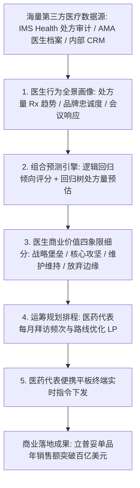
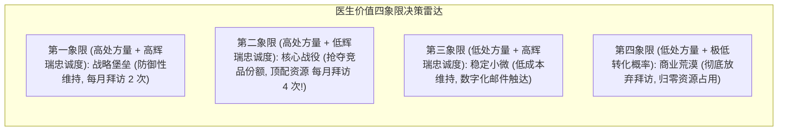

# Lec 15 辉瑞制药客户关系管理（CRM）数据挖掘实战 (Data Mining and CRM at Pfizer)

> MIT 15.062J 数据挖掘 · 讲义 15 · 授课教师：Prof. Roy Welsch / Nitin Patel

## TL;DR

- 医药健康产业客户关系管理（CRM）面对着以处方医师为核心决策者的特殊商业决策链。
- 辉瑞制药（Pfizer）通过挖掘全美处方药审计流水，建立医生层级的用药潜力与品牌忠诚度预测模型。
- 闭环营销系统（Closed-Loop Marketing）将预测得分与销售代表排程优化深度闭环整合。
- 工业级数据挖掘的成败关键在于将黑盒算法无缝封装进一线销售人员的日常业务工作流。

## 1. 跨国制药巨头的营销困局与范式跃迁

辉瑞制药（Pfizer Inc.）是全球研发管线最庞大、年营业额数百亿美元的跨国生物制药巨头。其旗下的超级重磅炸药级药物——例如降血脂药立普妥（Lipitor）、抗真菌药大扶康（Diflucan）以及心血管抗高血压药物络活喜（Norvasc），每年贡献数十亿甚至上百亿美元的现金流。

然而，处方药市场具有全球所有消费品行业中最独特的**“决策权、消费权与支付权三权分立”商业特征**：
1. **终端使用者（患者）无权决定买什么**：根据严苛的医药法规，患者必须严格凭执业医师开具的处方取药；
2. **实际付款方不是决策者**：药品费用的大头主要由商业健康保险公司或国家公共医保支付；
3. **唯一的真正核心决策者是医生（Physicians / Doctors）**：全美数十万名拥有处方权的门诊与住院主治大夫，决定了哪一家药企的药品能被写在处方单上。

传统跨国药企的营销模式完全依靠“人海战术”：辉瑞雇佣了超过 **10,000 名医药代表（Sales Representatives）**，每天开着车在全美各大医院与私人诊所奔波，向医生递送学术资料、邀请参加学术研讨会并赠送药品试用装。
随着竞争白热化与各国医保控费政策出台，传统人海扫街模式遇到了严峻的瓶颈：
- 一位顶级心脏科名医每周被数十家不同药企的销售代表排队围堵，每次会面时间被无情压缩到仅剩不足 **90 秒**；
- 医药代表如果把宝贵的拜访时间浪费在那些“只开竞争对手竞品药、且观念固执无法转化”的医生身上，单次拜访成本高达数百美元却颗粒无收；
- 药企必须在放号前准确预判：**究竟哪位医生具有巨大的处方潜力？哪位医生正处于处方品牌转换的临界摇摆期？**

辉瑞全球商业智能与 CRM 高级总监艾拉·海莫维茨博士（Dr. Ira Haimowitz）率领团队，开启了一场载入哈佛商业评论的工业级数据挖掘实战。

## 2. 外部大数据融合与医生特征工程

制药巨头的数据挖掘不同于电商公司，因为药企无法直接在患者身上安装监控探针。辉瑞通过斥巨资采购第三方医疗审计数据源，构建了一座跨越全美 80 万名注册医师的高维特征湖：

### 2.1 三大核心异构数据源融合

1. **IMS Health（现 IQVIA）全美处方药审计数据（NRP Streams）**：
   通过与全美各大连锁药房（CVS、Walgreens）以及药品分销商结算系统的脱敏数据对接，追踪到具体某一位执业医师在过去 24 个月内，针对特定适应症（如高胆固醇血症）开具的**每周总处方量（Total Rx, TRx）**以及**新处方量（New Rx, NRx）**；
2. **美国医学会（AMA）医师主档案（Physician Masterfile）**：
   医生的毕业医学院校、行医执照年限、专科认证类型（介入心脏科 vs 普通全科）、是否属于医院科室主任（KOL 意见领袖）；
3. **辉瑞内部销售代表历史接触日志（Internal Call Activity Logs）**：
   过去一年医药代表对该医生的拜访历史频次、医生在拜访时的反馈评级、是否出席过辉瑞赞助的国家级学术年会、是否申领过样品。

### 2.2 核心预测因变量设定

建模团队针对不同商业战役设定了双重核心预测目标：
- **目标 A（连续数值预测模型）**：预测该医生在未来 6 个月内，开具辉瑞降脂药立普妥的**预期总处方盒数（Forecasted TRx）**（使用多元回归与回归树模型）；
- **目标 B（二元转换概率分类模型）**：预测一位当前主要开具竞争对手药物（如默沙东的舒降之 Zocor）的摇摆医生，在接收高频学术拜访后，**发生处方品牌转移（Brand Switching）的后验概率 $P(\text{Switch} = 1)$**（使用逻辑回归与神经网络模型）。

## 3. 商业价值矩阵与销售代表资源动态调度

模型训练完成并经过严格的独立样本测试集验证后，输出的并不是一个干巴巴的概率，而是一张直接指导全美万名医药代表行动路线的**“商业优先级决策矩阵（Physician Decile Matrix）”**：

通过这一套量化矩阵，辉瑞管理层彻底终结了销售代表过去凭个人喜好“只去拜访态度和蔼但开不出几张处方的老好人医生”的无效出勤：
- 医药代表的平板电脑（当时为便携式 PDA 终端）每周自动更新专属于其片区的**高价值优先拜访清单（Target Call List）**；
- 资源被极其凶悍地向“第二象限（高处方量、高竞品份额但模型判定具有高转换倾向）”的名医集中轰炸；
- 系统根据医生的学术偏好标签，在屏幕上直接提示代表在 90 秒的会面中应当重点展示哪一篇临床试验的权威论文对比图表。

## 4. 商业战果与工业级数据挖掘成功哲学

在部署该数据挖掘 CRM 系统后的首个完整财年，辉瑞取得了令华尔街瞩目的战绩：
- 在全美降血脂药品市场整体增速平缓的背景下，辉瑞核心产品立普妥（Lipitor）的处方转化率提升了近 **$28\%$**；
- 单次医药代表拜访的平均处方拉动产出翻了一倍以上；
- 立普妥最终成长为人类制药史上第一款年销售额突破 **130 亿美元**的超级商业传奇。

::: example [数据挖掘赋能非营利公共卫生管理]
同样的医生画像与处方挖掘技术，被辉瑞与世界卫生组织（WHO）无偿应用于贫困国家抗真菌药物大扶康（Diflucan）的公益捐赠援助计划中：
算法通过分析各欠发达地区诊所历史抗感染药品的消耗速度与库存周转率，精准预测哪家基层偏远诊所正在爆发隐球菌脑膜炎疫情，提前自动启动跨国药品冷链空运调拨，将关键救命药在断药前 48 小时精准送达前线医生手中。
:::

::: pitfall [把医生当成提线木偶的行为反弹]
医药代表在早期使用系统时曾产生强烈的抵触情绪，认为算法剥夺了他们作为资深销售的灵活性与尊严；部分名医在遭遇连续定点轰炸后产生被“围猎”的反感。数据挖掘团队必须清醒认识到：**算法给出的永远是概率期望，而面对面的沟通是人与人之间信任的建立**。系统最终必须允许医药代表保留至少 $15\%$ 的自主微调权限。
:::

::: insight [我的理解：工业级挖掘的生命力在于跑通商业闭环]
在学术界，一个算法只要在测试集上把误差降低 $0.01$，就可以撰写出一篇漂亮的学术论文；但在残酷的真实商业世界里，一个无法落地成生产力的算法连一分钱都不值。海莫维茨博士的伟大，不是因为他发明了某种全新的微分方程，而是因为他把数据挖掘改造成了一条畅通无阻的工业传送带。从几百张光盘的第三方处方流水，到医药代表公文包里的平板电脑，再到医生指尖开出的一张张处方单——每一个环节都在兑现着数据的经济学价值。这才是数据科学真正的成人礼。
:::
