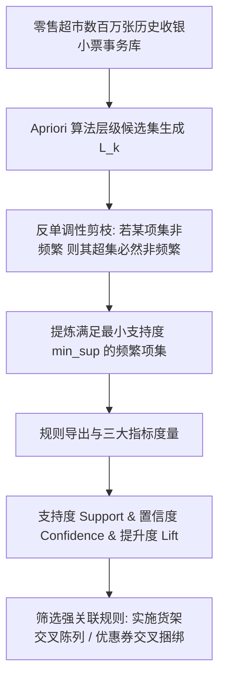

# Lec 16 关联规则挖掘与购物篮分析（Apriori 算法）(Association Rules & Market Basket Analysis)

> MIT 15.062J 数据挖掘 · 讲义 16 · 授课教师：Prof. Roy Welsch / Nitin Patel

## TL;DR

- 关联规则挖掘旨在从海量离散事务数据库中发现商品项集之间高频共现的依赖规律。
- 支持度（Support）、置信度（Confidence）与提升度（Lift）构成了过滤有价值强规则的三大标尺。
- 提升度剥离了单个商品自身的高频自然发生基率，是识别真正因果联动关联的关键。
- Apriori 算法基于先验反单调性性质，通过层级剪枝奇迹般攻克了候选项集的组合爆炸难题。

## 1. 购物篮分析与“啤酒与尿布”的商业传奇

在零售超市、便利店与电子商务的日常运营中，收银机每扫描一张购物清单，系统就会记录一笔**事务（Transaction）**。一笔事务本质上是一个由顾客选购的商品构成的离散集合（Itemset）：
- 事务 1：`{面包, 牛奶, 鸡蛋}`
- 事务 2：`{啤酒, 尿布, 薯片}`
- 事务 3：`{可乐, 爆米花}`

在数据挖掘诞生之前，超市店长对商品摆放的认知主要基于直觉与常识（牙膏旁边摆牙刷，洗发水旁边摆沐浴露）。然而，由沃尔玛（Walmart）等零售巨头在数据仓库中挖掘出的著名商业传说——**“啤酒与尿布（Beer and Diapers）”**，彻底颠覆了商业陈列逻辑：
数据分析显示，在每周五傍晚的年轻父亲客户群中，“购买婴儿纸尿裤”与“购买罐装啤酒”呈现出极高的伴随连带购买行为。年轻奶爸在下班被太太指派去买尿布时，顺手为自己周末看球犒劳几罐啤酒。超市随即把尿布货架与啤酒展位紧紧贴合摆放，两者的连带销售额瞬间暴涨。

**购物篮分析（Market Basket Analysis）**的核心使命是：**从数以千万计的交易小票中，系统性挖掘诸如“若顾客购买了物品集 A，则极大概率会购买物品 B”的强关联规则（Association Rules）**。



## 2. 关联规则的三大核心评估标尺

设全店所有商品集合为 $I = \{i_1, i_2, \dots, i_m\}$，交易数据库包含 $N$ 笔事务。
一条关联规则的形式化表达为：
$$X \implies Y$$
其中前件（Antecedent）$X \subset I$，后件（Consequent）$Y \subset I$，且 $X \cap Y = \emptyset$。

### 2.1 支持度（Support）——频率与商业规模底线
项集在数据库中所有交易中出现的相对比例：
$$\text{Support}(X) = P(X) = \frac{\text{包含项集 } X \text{ 的事务总数}}{N}$$
$$\text{Support}(X \implies Y) = P(X \cup Y) = \frac{\text{同时包含 } X \text{ 与 } Y \text{ 的事务总数}}{N}$$
- 支持度确保了规则的**普遍性与统计显著性**。若某条规则的支持度只有万分之一（全店一年只发生两次），即使关联性再高，也不值得超市为此调整昂贵的实体货架。通常设定最小支持度门槛（`min_support`）。

### 2.2 置信度（Confidence）——条件确定性概率
在已经购买了项集 $X$ 的所有顾客中，同时购买项集 $Y$ 的条件概率：
$$\text{Confidence}(X \implies Y) = P(Y \mid X) = \frac{\text{Support}(X \cup Y)}{\text{Support}(X)}$$
- 置信度度量了规则的**推断可信度**。置信度高达 $80\%$，意味着十个买了 $X$ 的人里有八个会顺手带走 $Y$。

### 2.3 提升度（Lift）——剔除伪关联的核心试金石

如果仅看置信度，分析师极容易落入致命的**伪关联陷阱（Spurious Association）**！
假设某超市的“矿泉水”本身是极度畅销的超级大单品，全店 $90\%$ 的顾客都会买一瓶矿泉水（$P(Y) = 0.90$）。此时无论顾客在购物车里装了什么冷门商品 $X$（如一把雨伞），计算出的置信度必然极高：$P(Y \mid X) \approx 0.90$。这并不代表雨伞带动了矿泉水，而是矿泉水自身的高基率假象！

为此引入**提升度（Lift）**：
$$\text{Lift}(X \implies Y) = \frac{P(Y \mid X)}{P(Y)} = \frac{\text{Support}(X \cup Y)}{\text{Support}(X) \times \text{Support}(Y)}$$

::: theorem [提升度三大区间的商业判决]
- **$\text{Lift} = 1.0$（相互独立）**：购买 $X$ 对购买 $Y$ 没有产生任何增量拉动，$X$ 与 $Y$ 完全随机共现；
- **$\text{Lift} > 1.0$（正强关联，互补品）**：购买 $X$ 显著**推升**了购买 $Y$ 的几率！提升度为 3.0 代表在买了 $X$ 的人中，买 $Y$ 的比例是自然人群的整整 **3 倍**！这是最有价值的交叉营销目标；
- **$\text{Lift} < 1.0$（负关联，替代排他品）**：购买 $X$ 导致购买 $Y$ 的几率显著下降（如买了百事可乐通常就不会买可口可乐）。
:::

## 3. Apriori 算法：利用反单调性击碎组合爆炸

若超市拥有 $m = 10,000$ 种独立条码商品（SKU），潜在的可能商品组合总数为 $2^m - 1 \approx 2^{10000}$，这是一个在物理宇宙中绝对不可能暴力穷举的天文数字。

1994 年，阿格拉瓦尔（Rakesh Agrawal）与斯里坎特（Ramakrishnan Srikant）提出了划时代的 **Apriori 算法**。其核心灵魂在于发现并严格证明了项集支持度的**反单调先验性质（Apriori Property / Anti-monotonicity）**：

::: theorem [Apriori 反单调性先验定理]
1. **频繁项集的任何非空子集，必然也属于频繁项集**；
2. **反之亦然（核心剪枝准则）：如果一个项集是非频繁的（即其支持度低于最小阈值），那么它的所有超集（Supersets）必然也全都是非频繁的！**
:::

根据该定理，算法采取**逐层宽度优先搜索（Level-wise Search）**：
- **$k=1$ 步**：扫描全量数据库一次，统计所有单个商品支持度，过滤出频繁 1-项集 $L_1$；
- **$k=2$ 步**：仅利用 $L_1$ 中的频繁单品进行两两组合，生成候选 2-项集 $C_2$。若某商品在 $L_1$ 中已被淘汰，它与任何其他商品的组合被**直接在内存中剪枝抹杀，根本无需二次扫描数据库**！
- 逐层递推，直到再也无法生成更高阶的频繁项集为止。

```mermaid
flowchart TD
    subgraph Pruning [Apriori 巨大剪枝力量展示]
        A[单个商品: 鱼竿 (支持度极低, 被淘汰)] -.-> AB[候选组合: {鱼竿, 鱼饵} 直接剪枝抹杀!]
        AB -.-> ABC[候选组合: {鱼竿, 鱼饵, 帐篷} 彻底免于计算!]
    end
    Pruning --> Speedup[搜索空间压缩高达 99.999% 以上, 算法极速收敛]
```

## 4. 商业实战演练：真实超市强规则挖掘

设某生鲜超市扫描了 10,000 笔早间收银小票。经 Apriori 算法挖掘，输出了以下三条规则：

| 关联规则 | 支持度 Support | 置信度 Confidence | 提升度 Lift | 商业品类分析与管理行动建议 |
| :--- | :--- | :--- | :--- | :--- |
| **规则 1：{意面} $\implies$ {意面番茄酱}** | $4.5\%$ (450笔) | **$75.0\%$** | **$4.2$** | **典型天然互补品**：将意面酱摆在意面货架正下方，买意面送番茄酱 9 折券 |
| **规则 2：{红酒, 优质牛排} $\implies$ {海盐}** | $1.8\%$ (180笔) | **$82.0\%$** | **$5.8$** | **高端品质生活画像**：高客单价高毛利黄金规则，陈列在精品生鲜端头 |
| **规则 3：{法棍面包} $\implies$ {全脂牛奶}** | $12.0\%$ | $30.0\%$ | **$1.02$** | **伪强关联**：虽然置信度有 30%，但提升度仅 1.02（完全独立随手带买），无需浪费促销资源 |

::: pitfall [规则泛滥与因果错觉]
运行 Apriori 算法时，如果将 `min_support` 设得太低，求解器会吐出数以万计的碎片化细琐规则。更致命的是，**关联绝对不等于因果**：买了手电筒的人常常同时买电池，并不代表“买手电筒”是“买电池”的唯一原因。盲目将低频巧合规则转化为昂贵的供应链备货，会导致滞销库存积压。
:::

::: insight [我的理解：关联规则是商品世界里的潜意识浮现]
当一位顾客推着购物车穿行在琳琅满目的货架之间时，他的每一次伸手取物，都在无意识地编织着自己生活的切面。关联规则算法没有问过任何一个顾客的个人隐私，但那些静静躺在数据库底层的事务清单，却以一种比人类口头叙述更诚实、更坚固的方式，勾勒出了人类家庭生活的隐秘节律。它是商业数据挖掘中一道最质朴、却最富烟火气的亮光。
:::
