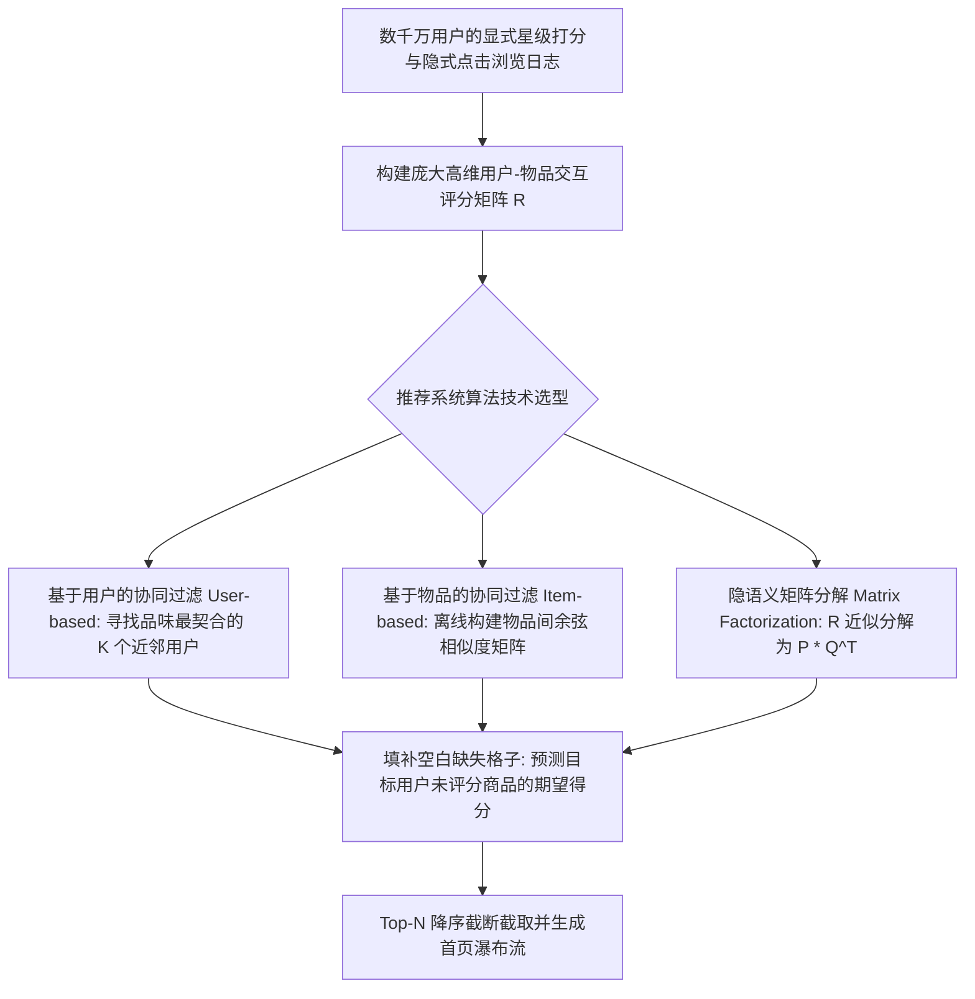
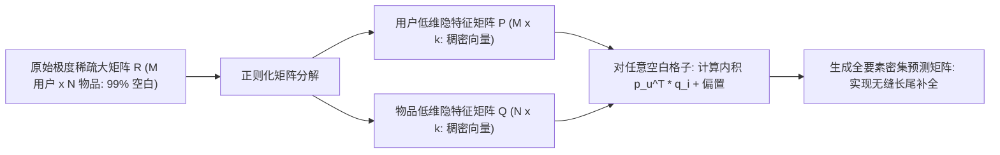

# Lec 17 现代推荐系统：基于物品与用户的协同过滤 (Recommendation Systems & Collaborative Filtering)

> MIT 15.062J 数据挖掘 · 讲义 17 · 授课教师：Prof. Roy Welsch / Nitin Patel

## TL;DR

- 现代个性化推荐引擎已从早期的基于内容检索演化为深度利用群体智慧的协同过滤架构。
- 基于用户的协同过滤（User-based CF）在邻居空间中度量用户品味相似度实现打分预测。
- 基于物品的协同过滤（Item-based CF）通过离线计算物品静态关联矩阵，攻克了实时高并发性能瓶颈。
- 矩阵分解（Matrix Factorization）将极度稀疏的评分大矩阵投影至隐语义低维向量空间，实现平滑补全。

## 1. 货架无限时代的注意力稀缺与信息过载

在数字经济与流媒体时代，人类社会彻底告别了实物商品匮乏的旧世界：
- 亚马逊（Amazon）在线销售超过数亿件商品；
- Spotify 与 Apple Music 拥有超过 8,000 万首音乐曲库；
- 抖音与 YouTube 每分钟上传数千小时的全新短视频。

面对天文数字般的商品与内容洪流，人类最宝贵的核心资产——**注意力（Attention）与时间**，沦为极端稀缺的瓶颈。如果一个用户在 App 首屏滑动了 3 秒钟依然找不到让自己心动的内容，他会毫不犹豫地彻底卸载应用。

传统的分类目录导航（Browse）与关键词搜索（Search）已经无法应对这一挑战：因为**用户往往根本不知道自己下一秒想看什么、甚至无法用精确的词汇描述自己的潜在渴望**。
**推荐系统（Recommender Systems）**的伟大之处，正在于实现从“人找货”向“货找人”的历史性跨越。

## 2. 内存型协同过滤（Memory-Based Collaborative Filtering）

协同过滤（Collaborative Filtering, CF）的核心哲学极其精妙：**完全不依赖商品本身的文本标签或元数据属性，仅仅依靠用户群体历史行为所交织出的社交网络拓扑进行相互印证**。

设全平台包含 $M$ 位用户（Users）与 $N$ 件物品（Items）。构建评分矩阵 $R \in \mathbb{R}^{M \times N}$，其中 $r_{ui}$ 代表用户 $u$ 对物品 $i$ 的历史真实打分。

### 2.1 基于用户的协同过滤（User-based CF）

核心直觉：“**那些在过去和我给相同电影打出相似高分的人，极大概率在未来也会喜欢我不曾看过的电影**。”

1. **计算用户间的皮尔逊相关相似度（Pearson Correlation Similarity）**：
   $$s(u, v) = \frac{\sum_{i \in I_{uv}} (r_{ui} - \bar{r}_u)(r_{vi} - \bar{r}_v)}{\sqrt{\sum_{i \in I_{uv}} (r_{ui} - \bar{r}_u)^2} \sqrt{\sum_{i \in I_{uv}} (r_{vi} - \bar{r}_v)^2}}$$
   其中 $I_{uv}$ 为用户 $u$ 与用户 $v$ 共同打过分的物品集合，$\bar{r}_u$ 为用户 $u$ 的平均打分（扣除个人打分习惯偏苛刻或偏宽松的基准偏置）；
2. **近邻加权打分预测**：
   检索与用户 $u$ 相似度最高的前 $K$ 个近邻用户集合 $\mathcal{N}_K(u)$，预测用户 $u$ 对未接触物品 $i$ 的期望得分：
   $$\hat{r}_{ui} = \bar{r}_u + \frac{\sum_{v \in \mathcal{N}_K(u)} s(u, v) \cdot (r_{vi} - \bar{r}_v)}{\sum_{v \in \mathcal{N}_K(u)} |s(u, v)|}$$

### 2.2 基于物品的协同过滤（Item-based CF）与工业工程飞跃

在亚马逊等大型电商平台的实战中，User-based CF 遭遇了灾难性的算力挑战：
- 平台拥有上亿用户，每秒钟产生海量并发点击，用户画像极其动态且极度活跃；计算所有用户两两之间的相似度矩阵复杂度高达 $\mathcal{O}(M^2)$，在线实时计算彻底瘫痪。

2003 年，亚马逊首席科学家格雷格·林登（Greg Linden）发表了里程碑论文，提出了**基于物品的协同过滤（Item-to-Item CF）**：
核心直觉：“**两件物品的相似度，取决于同时喜欢这两件物品的用户群体重合度**。”

因为在现实商业中：
- 商品目录（如 10 万本畅销书）的规模远小于用户规模，且书籍本身的相对属性在物理上极其稳定；
- 物品两两之间的**调整后余弦相似度（Adjusted Cosine Similarity）**完全可以在深夜通过离线批处理计算并静态缓存进数据库！
- 当用户白天浏览商品 $i$ 时，服务器只需耗费 **0.001 毫秒**从内存中读出预先算好的邻近商品清单，即可实现秒级响应！

## 3. 模型型协同过滤：隐语义矩阵分解（Matrix Factorization）

在 Netflix 百万大奖挑战赛中，以耶胡达·科伦（Yehuda Koren）为首的 BellKor 冠军团队证明：纯邻域方法的精度上限受制于数据的极端稀疏性（矩阵中超过 $99\%$ 为空白）。必须引入**低秩矩阵分解（Low-Rank Matrix Factorization / SVD）**。

### 3.1 潜在特征空间（Latent Factor Space）映射

将用户与物品同时投影到一个共享的 $k$ 维低维抽象隐语义空间（通常取 $k \approx 50 \sim 200$）：
- 每个用户 $u$ 由一个隐特征向量 $p_u \in \mathbb{R}^k$ 表征（例如代表其对喜剧、烧脑科幻、动作场面的潜在偏好强度）；
- 每个物品 $i$ 由一个隐特征向量 $q_i \in \mathbb{R}^k$ 表征（代表该电影在上述潜在风格维度上的含量因子）。

用户 $u$ 对物品 $i$ 的期望偏好预测，形式化为两个低维潜向量的**欧氏内积（Dot Product）**：
$$\hat{r}_{ui} = \mu + b_u + b_i + p_u^T q_i$$
其中 $\mu$ 为全局全网平均分，$b_u$ 为用户个人打分习惯偏置，$b_i$ 为物品自身质量口碑偏置。

### 3.2 损失函数与随机梯度下降（SGD）求解

在所有已观测到的评分集合 $\mathcal{K} = \{(u, i) \mid r_{ui} \ne \text{null}\}$ 上，极小化正则化平方预测误差：
$$\min_{P, Q, b} \quad \sum_{(u, i) \in \mathcal{K}} \left( r_{ui} - (\mu + b_u + b_i + p_u^T q_i) \right)^2 + \lambda \left( \|p_u\|_2^2 + \|q_i\|_2^2 + b_u^2 + b_i^2 \right)$$

利用**随机梯度下降（Stochastic Gradient Descent, SGD）**对每一个样本高效更新参数：
$$\text{误差：} \quad e_{ui} = r_{ui} - \hat{r}_{ui}$$
$$p_u \leftarrow p_u + \gamma (e_{ui} q_i - \lambda p_u)$$
$$q_i \leftarrow q_i + \gamma (e_{ui} p_u - \lambda q_i)$$
其中 $\gamma$ 为学习率，$\lambda$ 为防过拟合正则化超参数。

::: example [矩阵分解如何捕捉隐性审美共鸣]
在电影推荐实战中，算法自动发现的第一主隐维度 $k_1$，两端恰好是“轻松爆笑商业爆米花大片”与“沉重深奥欧洲艺术电影”；第二隐维度 $k_2$ 则是“好莱坞阖家欢大团圆”与“反乌托邦残酷暗黑现实”。
用户甚至不需要给自己打上任何文青或死宅的标签，几部历史电影的打分在向量点积的交错下，系统就已经在潜意识层面比他自己更懂他的精神品味。
:::

::: pitfall [冷启动危机（The Cold-Start Problem）]
纯粹基于行为矩阵的协同过滤具有一个无法自愈的原罪：**新注册的用户**没有任何历史评分记录，系统无法为其定位向量 $p_u$；**新上架的冷门商品**没有任何人点击，其向量 $q_i$ 无法更新，永远无法被系统推荐出去。现代工业级系统必须采用“混合架构（Hybrid Systems）”：在新用户和新商品冷启动阶段，依赖基于内容的文本标签、社交图谱与流行度热榜进行平滑过渡。
:::

::: insight [我的理解：推荐系统是赛博空间里的引力透镜]
在这个无限庞大的数字化宇宙中，每一件商品、每一首歌曲都如同一颗冰冷的行星，孤零零地漂浮在黑暗中。协同过滤算法的伟大之处，在于它用数以亿计普通人的真实喜怒哀乐，在虚空中编织出了一张看不见的重力场。当两颗星球因被同一个人凝视过而产生共鸣时，算法便将它们的引力轻轻相连。它不仅仅是一项驱动 GMV 增长的商业技术，更是一座在孤独的人海中引渡同频心灵的数字桥梁。
:::
