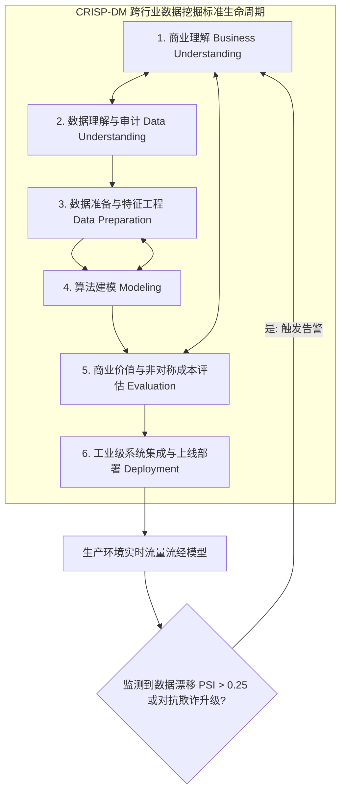
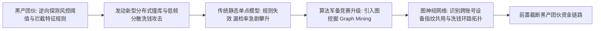

# Lec 18 数据挖掘前沿工程实践、数据漂移与反欺诈演进 (The Practice of Data Mining & Anti-Cheat Evolution)

> MIT 15.062J 数据挖掘 · 讲义 18 · 授课教师：Prof. Roy Welsch / Nitin Patel

## TL;DR

- CRISP-DM 确立了从商业理解到数据准备、建模、审计与工业化部署的标准工程生命周期。
- 概念漂移（Concept Drift）是模型上线后必然遭遇的自然熵增，必须通过群体稳定性指标（PSI）严密监控。
- 金融反欺诈与网络黑产是一场动态对抗博弈，攻击者的逆向工程迫使算法从单点静态升级为图拓扑挖掘。
- 卓越数据科学家的最高修养，是在算力与模型之外恪守对现实复杂性与业务因果的深度敬畏。

## 1. 实验室成功到工业级落地的“死亡之谷”

在大学课堂与学术实验室里，数据挖掘项目往往拥有一个极其干净的终点：下载一个封装良好的静态 CSV 数据集，清洗后拟合模型，在测试集上跑出一个漂亮的 AUC 或 RMSE，撰写论文或汇报幻灯片，项目即告圆满结束。这种脱离真实生产环境的受限实验，极易让初入工业界的工程师产生一种虚假的安全感，误以为算力、超参数微调与复杂的深度集成模型是解决商业难题的全部钥匙。

然而，全球权威咨询机构 Gartner 与波士顿咨询（BCG）的长期跟踪调研表明：**全美乃至全球范围内，超过 $85\%$ 的企业级数据挖掘与人工智能项目，最终从未能够真正跨越“死亡之谷”在生产环境中成功上线；而在侥幸上线的模型中，亦有超过半数的系统在部署后的三到六个月内，因无力应对外部世界的结构性突变而彻底沦为废铁**。造成这种普遍悲剧的核心根源在于：现实商业系统不仅存在高维噪声和极端稀疏性，更存在难以消除的隐性管道债务（Pipeline Debt）、系统反馈回路污染（Feedback Loops）以及上下游系统的隐式耦合。

因此，工业级数据挖掘绝不是一次性的离线算法练习，而是一个贯穿“业务理解—数据审计—管道构建—动态评估—工业集成—持续对抗与重训”的**长周期有机生命系统**。算法工程师必须从单一的建模视角跃迁至全局工程生命周期视角，建立全链路的防御与监控体系。

在上述闭环中，任何一个阶段的脱节都会引发整个系统的雪崩式失效。例如，若商业理解未能准确捕捉决策者的非对称损失偏好，算法团队耗费数月训练出的极高精度模型可能因频繁拒绝高净值核心客户而被业务部门直接下线；若数据准备管道未与线上实时特征引擎完全同构，离线训练与线上推理之间的“特征穿越（Feature Leakage）”与分布不一致将在模型上线首日导致剧烈穿仓。真正的工程成熟度，正是体现在对这一宏观生命周期的全流程把控能力上。

## 2. CRISP-DM：跨行业数据挖掘标准流程

为了规范这一混沌过程，由戴姆勒-克莱斯勒、SPSS 与 NCR 等国际工业巨头联合发起了 **CRISP-DM 协议（Cross-Industry Standard Process for Data Mining）**，确立了六大核心迭代阶段：

1. **商业理解（Business Understanding）**：
   严禁直接写代码！首先与业务一线负责人对齐核心商业痛点、非对称损失矩阵、投资回报率（ROI）底线与可落地的行动杠杆（Actionable Levers）；
2. **数据理解（Data Understanding）**：
   探查企业数据仓库的历史全貌，审计是否存在数据断流、系统迁移引发的口径不一致与幸存者偏差；
3. **数据准备（Data Preparation）**：
   特征工程、清洗、变换、长宽表重构，严格固化训练集与测试集的防火墙隔离；
4. **建模（Modeling）**：
   依据问题属性在多维技术选型矩阵中选择合适的基准模型与集成模型，交叉验证调优超参数；
5. **评估（Evaluation）**：
   脱离技术指标，依据商业提升图（Lift）、混淆矩阵成本期望与监管合规透明度进行综合验收；
6. **部署与运维（Deployment & MLOps）**：
   将模型封装为高吞吐、低延迟的 RESTful API 微服务，嵌入企业生产流水线并搭建自动化监控看板。

## 3. 生产环境的无情杀手：概念漂移（Concept Drift）

模型在上线部署的瞬间，其预测能力就开启了一场不可逆的**“半衰期折旧”**。因为真实世界是流动的，数据背后的物理与经济环境处于永恒的变迁之中：

::: definition [两类核心漂移机制]
1. **数据协变量漂移（Covariate Drift / Feature Drift）**：
   输入特征的边际概率分布发生剧烈形变：$P(X_{\text{deploy}}) \ne P(X_{\text{train}})$，但真实的因果判定机制保持不变。例如：宏观突发通胀导致所有申请人的名义月收入整体右移上浮；
2. **概念漂移（Concept Drift）**：
   特征分布表面未变，但特征与目标标签之间的深层映射关系发生了根本性逆转：$P(Y \mid X_{\text{deploy}}) \ne P(Y \mid X_{\text{train}})$。例如：突发公共卫生疫情导致原本被判定为稳健优质客户的民航与餐饮小微企业，其违约概率在一夜之间飙升数倍！
:::

### 3.1 工业级监控哨兵：群体稳定性指标（PSI）

为了在模型失效导致巨额业务坏账前发出自动化熔断警报，风控工程界引入了基于 KL 散度（Kullback-Leibler Divergence）的**群体稳定性指标（Population Stability Index, PSI）**：

$$PSI = \sum_{b=1}^B \left( \text{Actual}_b - \text{Expected}_b \right) \times \ln\left( \frac{\text{Actual}_b}{\text{Expected}_b} \right)$$
其中 $\text{Expected}_b$ 为模型训练基线时第 $b$ 个分箱内的样本比例，$\text{Actual}_b$ 为当前生产环境最新监控周期内的实际样本比例。

::: theorem [PSI 工业报警阈值金标准]
- **$PSI < 0.10$**：特征分布高度稳定，模型运行健康良好；
- **$0.10 \le PSI < 0.25$**：发生轻度至中度漂移，系统触发黄色预警，排查业务外部变化；
- **$PSI \ge 0.25$**：发生严重漂移！**系统自动触发红字熔断告警，立即降级为保守兜底策略，并启动基于最新滑动时间窗口数据的模型自动化全量再训练（Auto Retraining）**！
:::

## 4. 动态博弈对抗演进：现代金融反欺诈的前沿战场

在所有数据挖掘应用中，**反欺诈与网络黑产防御（Fraud Detection）**是竞争最激烈、进化速度最残酷的无尽战场。因为与普通的图像识别或自然语言翻译不同——猫和狗不会因为人类发明了卷积神经网络就故意伪装成一只鸟；**但电信诈骗犯与信用卡黑灰产团伙，每时每刻都在主动研究风控模型的特征规则，并以惊人的算力实施逆向工程对抗（Adversarial Gaming）**！

### 4.1 从单点特征向图拓扑挖掘（Graph Mining）跃迁

早期基于单笔交易特征（如“异地大额刷卡”）的逻辑回归与决策树模型，在面对现代专业黑产团伙时彻底失效：
- 欺诈团伙利用接码平台与模拟器，批量注册成千上万个“正常养号”的傀儡账户；
- 每笔交易金额故意控制在 50 元以下（避开大额阈值监控），但通过高度精密的分布式链条在几秒钟内完成资金的百次转手洗白。

为了击穿这一伪装，现代顶尖反欺诈体系全面升级为**大规模异构图图挖掘（Heterogeneous Graph Analytics）**：
- 将每一个银行卡号、手机号、手机设备 IMEI 码、WiFi 路由器 MAC 地址与 IP 代理服务器抽象为图谱中的**节点（Nodes）**；
- 将转账、设备共用、人脸认证关联抽象为**有向加权边（Edges）**；
- 运用 **PageRank、连通分量分析与图神经网络（Graph Convolutional Networks, GCN）**：
  即使单个账户表面行为完美伪装成普通良民，但只要它在网络拓扑结构中与某个已知的欺诈集群存在深层跳数关联（High Closeness Centrality），或参与了闭环资金循环回路，算法就能在网络空间中将其团伙一网打尽！

## 5. 15.062J 全课终极大总结与数据科学家的道统

走过整整 18 讲严谨而深邃的旅程，我们从最简单的 k-NN 类比推断起步，历经贝叶斯决策论的纯粹、分类树的清晰、判别分析的几何旋转、逻辑回归的几率标尺、神经网络的反向传播、多元回归的正交投影、主成分分析的坐标降维、关联规则的购物篮碰撞、协同过滤的隐语义分解，最终伫立在现代 MLOps 工业化与动态对抗博弈的前沿悬崖之巅。

回顾全课，技术在短短数十年间经历了翻天覆地的剧变，但数据挖掘的底层精髓永远如一：

::: insight [我的理解：数据挖掘不仅是一门技术，它是人类理性与未知的永恒对话]
在数据科学的狂飙突进中，最危险的陷阱是陷入对算力与高深算法的自我感动。一个真正成熟的数据科学家，永远不会自负地宣称自己的模型掌握了终极真理。

真实世界是粗糙的、喧嚣的、充满偏见与随机扰动的。我们写下的每一行特征工程代码、每一次正则化惩罚、每一场对抗反欺诈的较量，本质上都是在用人类有限的理性，为这个充满不确定性的世界搭建起一座座暂时能避风遮雨的庇护所。

保持对业务因果的清醒洞察，恪守对数据伦理与个人隐私的敬畏底线，在数据流淌的星河中永不迷失对真实人性的温情凝视——这，才是麻省理工学院赋予每一位数据科学探索者最崇高的精神火种。
:::
