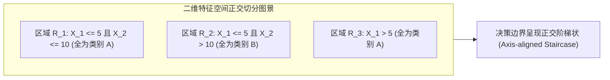

# Lec 3 分类树算法（CART）与决策边界剖析 (Classification Trees & Decision Boundaries)

> MIT 15.062J 数据挖掘 · 讲义 3 · 授课教师：Prof. Roy Welsch / Nitin Patel

## TL;DR

- 分类树（Classification Trees）通过正交轴递归二分，将高维特征空间自顶向下分割为局部同质的决策区域。
- 信息熵（Entropy）与基尼不纯度（Gini）是衡量节点集合混乱程度的两种等价信息论度量。
- 决策树天然支持离散分类与连续数值的混合输入，对单调特征变换与异常极值具有天生的免疫力。
- 树模型的决策边界呈现阶梯状台阶形态，树深度过大将引发严重的过拟合与高方差泛化危机。

## 1. 规则归纳与白盒模型的商业吸引力

在数据挖掘走向工业化部署的早期阶段，许多高阶数学算法（如神经网络、支持向量机）常被企业管理层批评为不可理解的“黑箱（Black-box）”。特别是在涉及**银行贷款审批、医疗保险理赔核保、刑事假释风险评估**等受到严格法律监管的行业中：
监管机构要求金融机构在拒绝一名客户的按揭贷款申请时，必须给出明确、合法且无歧视的具体理由（如“负债收入比过高”或“违约逾期记录过多”），而不能仅仅回答“因为神经网络的某个隐藏神经元激活值为负”。

**分类树（Classification Trees / CART）**正是满足这一监管合规诉求的终极武器。它直接输出由 `IF-THEN` 构成的嵌套逻辑规则，与人类高管和法律顾问的思维推演路径达成完美的契合。

```mermaid
flowchart TD
    Dataset[完整训练集: 500 个样本 包含连续与离散特征] --> Root[根节点: 寻找最优特征与分割点阈值]
    Root -->|特征 X_1 <= s_1| LeftChild[左子节点: 纯度大幅提升]
    Root -->|特征 X_1 > s_1| RightChild[右子节点: 样本集中在类别 2]
    LeftChild --> Node2[第二层分裂: 特征 X_2 <= s_2]
    Node2 --> LeafA[叶节点 A: 判定为类别 1 (置信度 95%)]
    Node2 --> LeafB[叶节点 B: 判定为类别 2 (置信度 82%)]
    RightChild --> LeafC[叶节点 C: 判定为类别 2 (置信度 98%)]
```

## 2. 节点分裂不纯度准则：信息熵 vs 基尼指数

决策树向下生长的核心引擎，是在每一个内部节点寻找一个能够让分裂后子节点集合“**尽可能纯净（Pure）**”的最优特征与阈值。

### 2.1 信息论视角：香农熵（Shannon Entropy）

源自克劳德·香农（Claude Shannon）的信息论，度量系统内部包含的不确定性大小：
$$H(D) = - \sum_{k=1}^K p_k \log_2 p_k$$
其中 $p_k$ 是当前节点样本中属于类别 $k$ 的比例（规定当 $p_k = 0$ 时，$0 \log_2 0 = 0$）。
- 若集合内所有样本全部属于同一类别（$p_1 = 1$），则 $H(D) = 0$（零不确定性，完美纯净）；
- 若二分类样本各占一半（$p_1 = p_2 = 0.5$），则 $H(D) = - (0.5 \times (-1) + 0.5 \times (-1)) = 1.0 \text{ bit}$（最大混乱）。

父节点 $D$ 按照特征 $A$ 分裂为左、右两个子节点 $D_L$ 与 $D_R$ 后，**信息增益（Information Gain）**定义为熵的减少量：
$$\text{Gain}(D, A) = H(D) - \left( \frac{|D_L|}{|D|} H(D_L) + \frac{|D_R|}{|D|} H(D_R) \right)$$

### 2.2 几何视角：基尼不纯度（Gini Impurity）

CART 算法在默认设置下更偏好计算速度更快的基尼指数（无需计算对数）：
$$I_G(D) = 1 - \sum_{k=1}^K p_k^2 = \sum_{k=1}^K p_k (1 - p_k)$$
基尼不纯度具有直观的物理意义：**从该节点中随机抽取两个样本，其类别标签不一致的概率**。
在二分类问题中，基尼曲线与经过缩放的熵曲线（$\frac{1}{2} H(D)$）在几何形态上几乎完全重合，两者在绝大多数商业场景下选出的最优分割点没有任何实质差异。

## 3. 决策边界的几何拓扑剖析

为了深刻理解分类树的数学物理本质，我们必须考察其在二维特征平面上所雕刻出的**决策边界（Decision Boundaries）**：

由于标准 CART 树在每一个节点只对**单一特征 $X_j$** 进行阈值判断（$X_j \le s$）：
- 每一个分裂在二维平面上表现为一条**严格平行于坐标轴（垂直或水平）的直线超平面**；
- 经过多层嵌套切分后，整个特征空间被分割成一系列拼贴在一起的**正交超矩形区域（Hyper-rectangles）**；
- 每一个叶子节点精确对应其中的一个超矩形。



::: pitfall [对角线线性关系的阶梯拟合噩梦]
正交轴切分是分类树的优点，也是其阿喀琉斯之踵。如果真实分类边界是一条倾斜的对角线（例如 $X_1 + X_2 \ge 10$）：
- 简单线性分类器只需一条倾斜直线即可完美切割；
- 而标准 CART 决策树必须在对角线周围耗费数十层深度，画出无数个微小的“锯齿状阶梯”去逼近斜线，导致模型规模剧烈膨胀并极度容易在锯齿边缘发生严重的过拟合！
:::

## 4. 树的修剪与工程防过拟合策略

一颗未经任何约束的决策树会野蛮生长，直到每一个叶节点只包含 1 个样本（基尼指数降为 0）。在训练集上准确率达到虚假的 $100\%$，但在面对任何带有微小环境噪声的测试集时全面崩溃。

现代决策树通过双重保险遏制过拟合：
1. **预剪枝（Pre-pruning / Early Stopping）**：
   - 设定节点分裂的最小样本数（如 `min_samples_split = 20`）；
   - 设定叶节点的最小样本底线（如 `min_samples_leaf = 10`）；
   - 限制树的最大生长深度（`max_depth = 5`）；
2. **后剪枝（Post-pruning / Cost-Complexity Pruning）**：
   允许大树充分生长，随后引入复杂度惩罚参数 $\alpha$，从最底层叶节点开始评估：剪除该分枝所带来的训练误差微弱上升，是否能被模型复杂度的大幅削减所补偿。通过交叉验证自动锁定最佳剪枝点。

::: example [决策树对极值异常值的天然免疫力]
考虑一个包含极端异常值的自变量（如某位离群超级富豪的收入高达 10 亿美元，而其余样本在 5 万至 10 万之间）：
- 在普通线性回归或逻辑回归中，这个单一点的巨大残差会像杠杆一样猛烈扭曲拟合直线的斜率；
- 而在 CART 决策树中，算法只关心自变量的**排序（Order Statistics）**与阈值相对切分。无论该富豪的收入是 100 万还是 10 亿，他在分裂点右侧的位置完全不变，树模型的结构受到零扰动！
:::

::: insight [我的理解：决策树把连续的连续流打碎成离散的规章手册]
大自然充满了平滑流动的连续谱系，但人类社会的基础秩序却是建立在离散的“规则手册”之上的（法典分章节、公司立章程、医学定分期）。分类树之所以在工业界获得如此长盛不衰的生命力，不是因为它在数学上比支持向量机或神经网络拟合得更完美，而是因为它完美地模拟了人类组织运转的制度官僚化逻辑。它把混沌的连续世界，翻译成了人类管理制度最听得懂的语言。
:::
