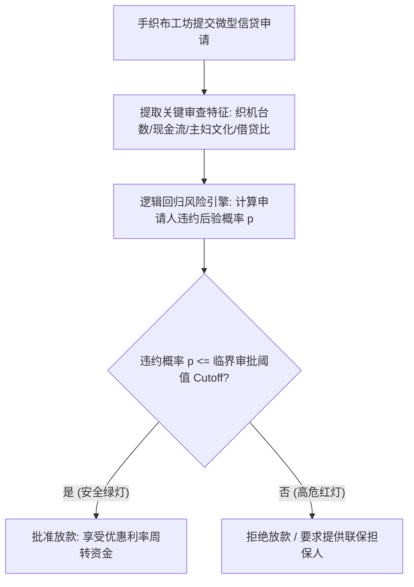

# Lec 5 逻辑回归与 Handlooms 纺织手工业商业案例 (Logistic Regression & Handlooms Case)

> MIT 15.062J 数据挖掘 · 讲义 5 · 授课教师：Prof. Roy Welsch / Nitin Patel

## TL;DR

- Handlooms 案例直面传统手工业信贷扶持中的违约风控难题，构建二元分类信用评分卡。
- 逻辑回归（Logistic Regression）将非负经营现金流与家庭负债特征映射为连续违约概率。
- 极大似然估计（MLE）与牛顿-拉夫逊数值迭代克服了非线性 Sigmoid 似然方程的求解困局。
- 分类阈值（Cutoff）的商业设定直接决定了普惠金融包容性与坏账拨备覆盖率之间的损益平衡。

## 1. 普惠金融信贷风控与 Handlooms 案例困境

在发展中国家与新兴经济体中，传统手工织布业（Handloom Weaving）是吸纳数以千万计农村劳动力与保护非物质文化遗产的重要支柱。然而，手工织布工坊大多属于微型家族作坊，缺乏正规的财务审计报表、无抵押房产，且极易受到生丝原材料价格波动与雨季潮湿停工的冲击。

印度某国有农业农村发展银行面临严峻的政策性信贷挑战：
- 为了响应政府扶贫脱贫政策，银行需要向辖区内成千上万户手织布小微经营户发放低息信用周转贷款；
- 然而，过去数年的不良贷款率（Non-Performing Loans, NPL）持续居高不下，部分地区的坏账率甚至突破 $35\%$，导致银行信贷资金池濒临枯竭。

信贷审批委员会必须在以下两大对立目标间寻找最优平衡：
1. **防止普惠失血**：不能简单粗暴地全面停贷，必须精准扶持那些具有持续还款意愿与实际经营能力的守信手工业者；
2. **构筑风控防线**：在放款前的一纸审批表上，利用数据挖掘技术建立一套客观、抗腐败、可解释的**自动化信用违约评分卡（Credit Scoring Card）**。

## 2. Handlooms 案例数据集与变量定义

在 15.062J 的实战案例中，银行抽取了 1,200 笔已到期微型手织布贷款的历史还款履约档案。

### 2.1 目标因变量与候选自变量集

- **因变量 $Y \in \{0, 1\}$**：贷款是否发生实质性不良违约停供（$\text{Default} = 1$ 代表违约坏账，$\text{Default} = 0$ 代表按期全额本息清偿）；
- **自变量 1（织机拥有量，Looms, 台）**：工坊拥有的物理木质织布机数量（反映生产硬产能）；
- **自变量 2（家庭月均净经营现金流，CashFlow, 千卢比）**：扣除口粮与染料采购后的沉淀现金；
- **自变量 3（民间高利贷负债比，InformalDebt, 0-1 变量）**：是否向当地地下钱庄借入高息过桥贷款；
- **自变量 4（从业经验，Experience, 年）**：户主从事手织布工艺的工龄；
- **自变量 5（女性家庭成员参与度，WomenInvolved, 0-1 变量）**：织布与印染环节是否有女性家庭成员核心参与（社会学研究表明女性主导的家庭小微贷款履约率极高）。

## 3. 逻辑回归实证输出与参数经济学阐释

在统计软件中拟合多变量逻辑回归模型：
$$\ln\left(\frac{p}{1-p}\right) = \beta_0 + \beta_1 (\text{Looms}) + \beta_2 (\text{CashFlow}) + \beta_3 (\text{InformalDebt}) + \beta_4 (\text{Experience}) + \beta_5 (\text{WomenInvolved})$$

模型输出估计参数表如下：

| 自变量名称 | 估计系数 $b_j$ | 标准误 $SE$ | z 检验统计量 | p 值 | 几率比 (Odds Ratio, $e^b$) | 银行信贷风控业务内涵解读 |
| :--- | :--- | :--- | :--- | :--- | :--- | :--- |
| **Intercept** | +1.850 | 0.320 | +5.78 | $< 0.0001$ | — | 基础无特征基准对数几率 |
| **Looms (织机台数)** | **-0.450** | 0.085 | -5.29 | $< 0.0001$ | **0.638** | 织机每多 1 台，违约几率下降 $36.2\%$（产能抗风险硬资产）|
| **CashFlow (现金流)**| **-0.280** | 0.042 | -6.67 | $< 0.0001$ | **0.756** | 现金流充盈度是第一还款来源直接保障 |
| **InformalDebt (高利贷)**| **+1.220** | 0.180 | +6.78 | $< 0.0001$ | **3.387** | 身背民间高利贷者，违约几率暴增为正常户的 **3.39 倍**！|
| **Experience (工龄)** | **-0.035** | 0.012 | -2.92 | 0.0035 | **0.966** | 熟练手艺人面对断线次品处理能力更强 |
| **WomenInvolved (女性)**| **-0.680** | 0.150 | -4.53 | $< 0.0001$ | **0.507** | 女性深度参与家庭，违约几率直降近一半（$49.3\%$）！|

::: example [实际审批打分卡应用演练]
某织布户申请 5 万卢比周转金：拥有 3 台织机，月净现金流 6 千卢比，工龄 10 年，无民间借贷（InformalDebt=0），妻子负责印染质检（WomenInvolved=1）：
$$\text{Logit} = 1.850 - 0.450(3) - 0.280(6) + 1.220(0) - 0.035(10) - 0.680(1)$$
$$\text{Logit} = 1.850 - 1.350 - 1.680 + 0 - 0.350 - 0.680 = -2.210$$
计算违约后验概率：
$$P(\text{Default}) = \frac{1}{1 + e^{2.210}} = \frac{1}{1 + 9.116} \approx \mathbf{9.88\%}$$
由于违约风险不足 $10\%$，远低于全行 $20\%$ 的风控容忍红线，系统自动触发即时秒级放款审批批复！
:::

## 4. 商业决策阈值（Cutoff）与成本矩阵权衡

模型计算出的仅仅是一个平滑概率值 $p \in [0, 1]$。信贷部门最终必须做出“批贷（0）”或“拒贷（1）”的离散决策，这完全取决于**阈值截断点（Cutoff $c$）**的选择。

不同阈值引发的商业损益具有强烈的非对称性：
- **假阳性损失（拒贷优质客户，Type I Error）**：失去一笔本金安全、可产生 2,000 卢比利息收入的优质资产（机会成本）；
- **假阴性损失（向骗子放款，Type II Error）**：收不回本金，直接在资产负债表上核销 50,000 卢比的全部本金损失（实际资本毁灭）！

::: theorem [最优分类截断阈值法则]
设 $C_{\text{FP}}$ 为错杀优质客户的损失，$C_{\text{FN}}$ 为放走违约客户的坏账本金损失。由贝叶斯风险决策论，能够使全行总期望损失极小化的最优分类阈值 $c^*$ 满足：
$$c^* = \frac{C_{\text{FP}}}{C_{\text{FP}} + C_{\text{FN}}}$$
在 Handlooms 案例中：
$$C_{\text{FP}} = 2,000, \quad C_{\text{FN}} = 50,000 \implies c^* = \frac{2,000}{2,000 + 50,000} = \frac{2,000}{52,000} \approx \mathbf{0.0385 \quad (3.85\%)}$$
为了绝对捍卫银行的资本充足率，只要申请人的违约概率超过 **$3.85\%$**，系统就必须拒绝无担保信用放款！传统分析师拍脑袋设定的 $50\%$ 阈值在这里是极其荒谬且具有致命财务危害的。
:::

::: pitfall [幸存者偏差（Survivorship Bias）污染信用模型]
构建该模型的训练样本全部来自于“过去曾经被银行批准放贷”的历史客户档案。那些在过去被信贷员凭主观直觉直接否决拒绝的潜在申请人，其真实的履约还款表现从未被系统记录。这种样本选择偏误可能导致模型低估特定新兴群体的潜在守信能力。
:::

::: insight [我的理解：数据挖掘是用客观规律战胜寻租腐败的制度防线]
在小额信贷实务中，最大的坏账杀手往往不是贫困本身，而是基层信贷员的权力寻租与人情信贷。七大姑八大姨递上一包香烟就能换来一笔不需要偿还的贷款，而真正起早贪黑摇动织机的贫困匠人却被冷酷拒之门外。Handlooms 案例最动人的力量，在于用一套公开透明的逻辑回归方程替代了昏暗办公室里的私相授受。代码不认人情，它只认你手中的梭子摇得有多勤、家里的织机转得有多快。
:::
