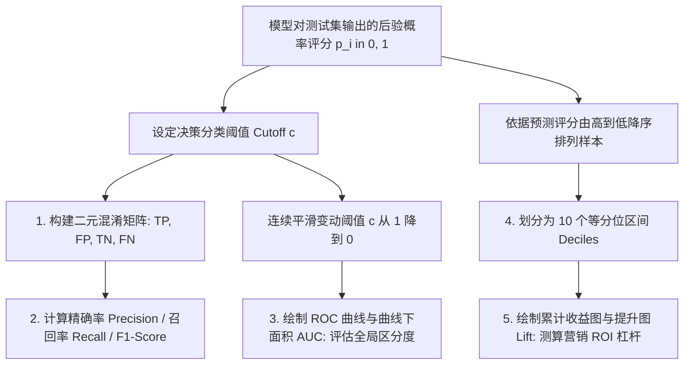
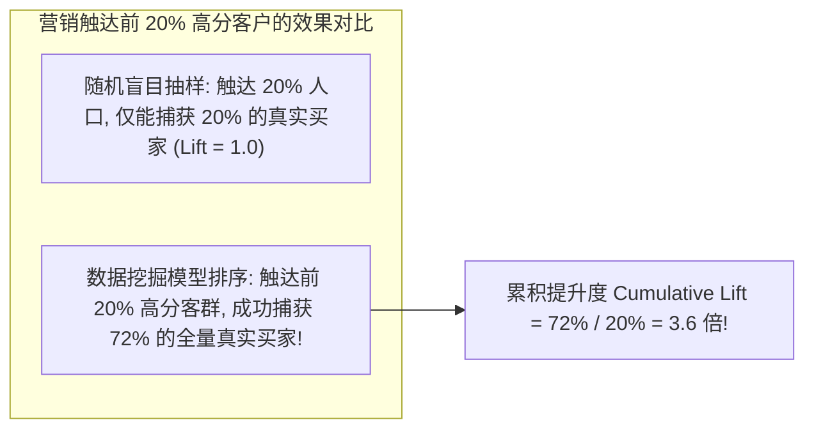

# Lec 7 模型评估准则：混淆矩阵、ROC 曲线与提升图 (Model Performance, ROC & Lift Charts)

> MIT 15.062J 数据挖掘 · 讲义 7 · 授课教师：Prof. Roy Welsch / Nitin Patel

## TL;DR

- 数据挖掘模型的优劣绝不能单纯依赖单一纸面准确率（Accuracy）进行草率评定。
- 混淆矩阵（Confusion Matrix）细分了真正例、假正例、真反例与假反例，奠定了非对称成本评估基础。
- 接收者操作特征曲线（ROC）与 AUC 提供了超越单一判决阈值的全域分类区分度评估。
- 累计收益图与提升图（Lift Chart）直接对齐企业直邮营销与风控预算，量化资源投放的真实超额回报。

## 1. 为什么“准确率”是极其危险的商业指标？

在机器学习与数据挖掘的入门教学中，初学者最习惯询问的问题是：“这个模型的准确率（Accuracy）是多少？”
如果模型准确率达到 $98\%$，管理层往往会产生一种模型极其完美的虚假安全感。

然而，在真实世界的商业数据挖掘实战中，这种朴素的准确率指标往往隐藏着**灾难性的误导与欺骗**：
- **信用卡盗刷欺诈检测**：在数千万笔交易中，真正的伪造盗刷交易可能仅占 **$0.1\%$**（极端不平衡数据集）；
  哪怕构建一个完全不看任何特征、永远输出“这笔交易是正常交易”的白痴模型，其表面准确率也能轻松达到不可思议的 **$99.9\%$**！然而这个模型在商业上毫无价值，因为它对银行最关注的盗刷交易的拦截率为严格的 **$0\%$**；
- **恶性罕见癌症早期初筛**：人群患病率仅为 $0.5\%$，一个永远诊断为“健康”的模型能达到 $99.5\%$ 的准确率，却会导致成千上万名真实患者在误诊中失去宝贵的早期手术窗口。

因此，现代数据挖掘必须建立一套多维、兼顾非对称商业成本的**全要素模型评估体系**。

## 2. 混淆矩阵与核心分类衍生指标

对于二分类问题，模型将样本划归为正类（Positive，通常为我们重点关注的高价值或高危事件，如违约、流失、购书、患病）或负类（Negative）：

| 真实状态 \ 预测结果 | 预测为正类 (Predicted Positive) | 预测为负类 (Predicted Negative) |
| :--- | :--- | :--- |
| **真实为正类 (Actual Positive)** | **真正例 (True Positive, TP)** | **假反例 (False Negative, FN / 漏报)** |
| **真实为负类 (Actual Negative)** | **假正例 (False Positive, FP / 误报)** | **真反例 (True Negative, TN)** |

基于四格表派生出的四大核心商业指标：
1. **准确率（Accuracy）**：全集被正确分类的总体比率：
   $$\text{Accuracy} = \frac{TP + TN}{TP + TN + FP + FN}$$
2. **精确率 / 查准率（Precision / Positive Predictive Value）**：在所有被模型判定为正类的样本中，真实为正类的比率：
   $$\text{Precision} = \frac{TP}{TP + FP}$$
3. **召回率 / 敏感度（Recall / Sensitivity / True Positive Rate）**：在所有真实存在的正类样本中，被模型成功识别抓取的比率：
   $$\text{Recall} = \frac{TP}{TP + FN}$$
4. **F1 综合平衡指标（F1-Score）**：精确率与召回率的调和平均数（Harmonic Mean）：
   $$F_1 = 2 \times \frac{\text{Precision} \times \text{Recall}}{\text{Precision} + \text{Recall}} = \frac{2 TP}{2 TP + FP + FN}$$

## 3. 接收者操作特征曲线（ROC）与 AUC 测定

逻辑回归、朴素贝叶斯或神经网络输出的是平滑的连续后验概率评分 $\hat{p}_i \in [0, 1]$。上述混淆矩阵的数值完全依赖于某一个特定**切分阈值（Cutoff $c$）**的选择。

为了在脱离单一特定阈值的全局视角下，综合评价模型对正负样本的固有辨别能力，引入**受试者工作特征曲线（Receiver Operating Characteristic Curve, ROC）**：
- **横坐标（X 轴）**：假正例率（False Positive Rate, FPR）$= 1 - \text{Specificity} = \frac{FP}{TN + FP}$（付出的虚惊代价）；
- **纵坐标（Y 轴）**：真正例率（True Positive Rate, TPR）$= \text{Recall} = \frac{TP}{TP + FN}$（获得的抓捕收益）。

将阈值 $c$ 从 $1.0$ 逐步降低到 $0.0$，在坐标平面上描绘出的单调上升曲线即为 ROC 曲线。
曲线下面积（Area Under Curve, AUC）量化了模型的综合排序能力：
- $AUC = 0.50$：对角线，等同于毫无预测力的盲目随机猜测；
- $0.70 \le AUC < 0.80$：一般商业可用水准；
- $0.80 \le AUC < 0.90$：优良的判别效能；
- $AUC \ge 0.90$：极高精度的顶级模型。

## 4. 数据库营销的黄金标尺：提升图（Lift Charts）

在企业数据库营销（Database Marketing / CRM）、直邮目录寄送或电销拓客中，营销预算通常是高度受限的。公司不可能向数据库中的 100 万名注册用户全量拨打电话或寄送纸质型录（单次邮寄成本高达 5 美元）。

营销总监的核心诉求是：**如果我的预算只够触达前 $10\%$ 或 $20\%$ 的用户，数据挖掘模型能帮我多锁定多少倍的真实购买客户？**
为此，工业界发明了**累积收益图（Gains Chart）与提升图（Lift Chart）**：

### 4.1 绘制算法机制

1. 使用训练好的模型对测试集所有客户进行打分，输出预测购买概率 $\hat{p}_i$；
2. 依据 $\hat{p}_i$ 从大到小降序排列所有客户；
3. 将排序后的客户等分为 10 个分位区间（Deciles，每个区间包含 $10\%$ 的客户）；
4. 统计每个十分位区间内真实响应客户的数量。

::: definition [十分位提升度 (Decile Lift)]
第 $k$ 个十分位区间的提升度定义为：该区间内的真实客户响应率，除以全量样本的自然基准响应率（Base Rate）：
$$\text{Lift}_k = \frac{\text{第 } k \text{ 个十分位区间的正类比例}}{\text{全样本正类自然比例}}$$
累积提升度（Cumulative Lift）则度量了挑选排名前 $X\%$ 的高分客户群体的综合命中倍数。
:::

::: example [真实营销活动投资回报率（ROI）跃升测算]
某信用卡中心拥有 100,000 名潜在客户，全样本开卡响应率仅为 $2.0\%$（全库共 2,000 名潜在真实买家）。单次电话营销外呼成本为 10 美元，成功获客一名带来的终身净收益为 300 美元：
1. **方案 A（全量盲目外呼）**：
   - 成本：$100,000 \times 10 = 100 \text{ 万美元}$；
   - 获客：2,000 人，收入 $2,000 \times 300 = 60 \text{ 万美元}$；
   - **净亏损：-$400,000 美元**（灾难性亏损！）。
2. **方案 B（依据模型前 20% 高分名单外呼，提升度 Lift = 3.5）**：
   - 外呼名单：仅拨打前 20,000 人，成本 $20,000 \times 10 = 20 \text{ 万美元}$；
   - 获客人数：捕获了全量买家的 $70\%$，即 $2,000 \times 0.70 = 1,400$ 人；
   - 收入：$1,400 \times 300 = 42 \text{ 万美元}$；
   - **净利润：+$220,000 美元（ROI 高达 +110%！）**。
数据挖掘模型直接将一个原本注定巨亏的业务线，扭转为高盈利的核心摇钱树！
:::

::: pitfall [测试集数据泄露（Data Leakage）导致的提升度虚高]
在构建模型时，若特征工程中不小心引入了“未来的信息”（例如在预测客户是否会流失的自变量中，包含了客户拨打注销咨询电话的特征），模型在测试集上的提升度曲线会显得如同神迹一般完美，但一旦推向生产环境盲测，提升度瞬间崩塌为 1.0。
:::

::: insight [我的理解：提升图是数据挖掘向商业常识递交的投名状]
在象牙塔里，研究者可以为了让 AUC 从 0.81 提高到 0.82 争论不休；但走进真实的商业世界，董事会只关心资产负债表。提升图的伟大之处，在于它把晦涩的对数几率和抽象的矩阵代数，完全翻译成了任何一位销售经理都能瞬间看懂的语言：告诉我，抓排名前百分之十的人，能让我多赚多少真金白银？这就是连接数学世界与商业现实的价值度量衡。
:::
