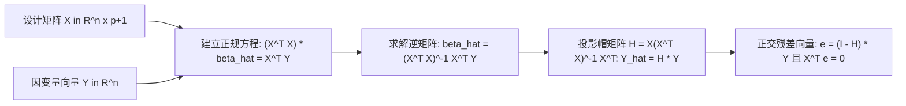

# Lec 8 多元线性回归统计基础与最小二乘性质复习 (Multiple Regression Review & Statistical Foundations)

> MIT 15.062J 数据挖掘 · 讲义 8 · 授课教师：Prof. Roy Welsch / Nitin Patel

## TL;DR

- 多元线性回归通过矩阵代数表述，将多维连续特征空间的因果依赖解构为严密的线性映射。
- 普通最小二乘法（OLS）正规方程在几何上等价于因变量在自变量列空间上的正交投影。
- 高斯-马尔可夫假定确立了估计参数的最小方差无偏性（BLUE）及其方差协方差矩阵。
- 从传统假设检验走向数据挖掘，评估重心从参数显著性 p 值转向对未见样本的测试集泛化均方误差。

## 1. 多元线性回归的矩阵代数系统

在进入高级数据挖掘复杂算法之前，必须对统计学的核心底座——**多元线性回归（Multiple Linear Regression, MLR）**进行高阶矩阵维度的严格审视。

设有 $n$ 个观测样本，每个样本包含 $p$ 个预测自变量与 1 个连续响应因变量。全系统可紧凑表示为经典矩阵形式：
$$Y = X \beta + \epsilon$$
其中：
- $Y = (y_1, y_2, \dots, y_n)^T \in \mathbb{R}^{n \times 1}$ 为因变量观测向量；
- $X \in \mathbb{R}^{n \times (p+1)}$ 为**设计矩阵（Design Matrix）**，第一列全为 1（对应截距项），其余 $p$ 列对应各个自变量的样本观测值：
  $$X = \begin{bmatrix} 1 & x_{11} & x_{12} & \dots & x_{1p} \\ 1 & x_{21} & x_{22} & \dots & x_{2p} \\ \vdots & \vdots & \vdots & \ddots & \vdots \\ 1 & x_{n1} & x_{n2} & \dots & x_{np} \end{bmatrix}$$
- $\beta = (\beta_0, \beta_1, \dots, \beta_p)^T \in \mathbb{R}^{(p+1) \times 1}$ 为待估计的总体回归系数向量；
- $\epsilon = (\epsilon_1, \epsilon_2, \dots, \epsilon_n)^T \in \mathbb{R}^{n \times 1}$ 为不可观测的随机误差向量。

## 2. 最小二乘准则与正交投影几何

如何寻找最优参数估计向量 $\hat{\beta}$？
最小二乘准则要求极小化残差向量的欧几里得范数平方（残差平方和 SSE）：
$$SSE(\beta) = \|e\|^2 = (Y - X\beta)^T (Y - X\beta) = Y^T Y - 2 \beta^T X^T Y + \beta^T X^T X \beta$$

对向量 $\beta$ 求矩阵一阶导数（梯度），并令其严格为零向量：
$$\frac{\partial SSE}{\partial \beta} = -2 X^T Y + 2 X^T X \beta = 0$$

由此推导出著名的**正规方程组（Normal Equations）**：
$$(X^T X) \hat{\beta} = X^T Y$$

若设计矩阵 $X$ 具有满列秩（即自变量之间不存在完全共线性，$X^T X$ 严格非奇异可逆），则解得全局唯一闭式解析解：
$$\hat{\beta} = (X^T X)^{-1} X^T Y$$

::: theorem [帽矩阵与空间正交投影定理]
样本预测拟合值向量为：
$$\hat{Y} = X \hat{\beta} = X (X^T X)^{-1} X^T Y = H Y$$
其中矩阵 $H = X (X^T X)^{-1} X^T \in \mathbb{R}^{n \times n}$ 被形象地称为**帽矩阵（Hat Matrix）**（因为它把帽子戴在 $Y$ 头上生成了 $\hat{Y}$）。
$H$ 具有优美的代数与几何性质：
1. **对称性与幂等性（Symmetric & Idempotent）**：$H^T = H$ 且 $H^2 = H$；
2. **几何正交投影算子**：$H$ 是将 $n$ 维欧氏空间中的任意向量 $Y$，**垂直正交投影**到由设计矩阵 $X$ 的列向量所张成的 $(p+1)$ 维线性子空间 $\text{Col}(X)$ 上的投影矩阵！
3. **残差正交性**：残差向量 $e = Y - \hat{Y} = (I - H) Y$ 严格正交于自变量子空间，即：
   $$X^T e = 0 \implies \sum_{i=1}^n e_i = 0 \text{ 且 } \sum_{i=1}^n x_{ij} e_i = 0, \quad \forall j$$
:::

## 3. 高斯-马尔可夫假定与推断统计学

为了保证 OLS 估计量具有良好的统计性质，必须引入经典的高斯-马尔可夫（Gauss-Markov）假定系统：
1. **零均值外生性**：$E[\epsilon \mid X] = 0$；
2. **同方差性与球状扰动**：$Var(\epsilon \mid X) = \sigma^2 I_n$，即所有误差方差恒定为 $\sigma^2$，且两两协方差严格为零；
3. **满秩假定**：$\text{rank}(X) = p + 1 < n$。

在此假定下，参数向量的方差-协方差矩阵为：
$$Var(\hat{\beta} \mid X) = Var\left( (X^T X)^{-1} X^T Y \right) = (X^T X)^{-1} X^T \cdot Var(Y) \cdot X (X^T X)^{-1} = \sigma^2 (X^T X)^{-1}$$

误差方差 $\sigma^2$ 的无偏估计量为均方残差（Mean Squared Error）：
$$s_e^2 = \hat{\sigma}^2 = \frac{SSE}{n - p - 1} = \frac{\sum_{i=1}^n e_i^2}{n - p - 1}$$
单个回归系数 $\hat{\beta}_j$ 的标准误估计量即为矩阵 $s_e^2 (X^T X)^{-1}$ 对应第 $j$ 个对角线元素的平方根：
$$SE(\hat{\beta}_j) = s_e \sqrt{[(X^T X)^{-1}]_{jj}}$$

### 3.1 假设检验体系：t 检验与全模型 F 检验

- **单个自变量的边缘显著性 t 检验**：
  检验原假设 $H_0: \beta_j = 0$：
  $$t = \frac{\hat{\beta}_j - 0}{SE(\hat{\beta}_j)} \sim t(n - p - 1)$$
- **联合自变量检验与方差分析 F 检验**：
  检验全模型所有自变量是否同时为零 $H_0: \beta_1 = \beta_2 = \dots = \beta_p = 0$：
  $$F = \frac{SSR / p}{SSE / (n - p - 1)} = \frac{R^2 / p}{(1 - R^2) / (n - p - 1)} \sim F(p, \ n - p - 1)$$

## 4. 统计推断与现代数据挖掘的范式冲突

在传统计量经济学课堂上，学生被灌输了对 $p < 0.05$ 星号的狂热崇拜。然而进入数据挖掘时代，这种视角遭遇了猛烈的批判：

::: example [大样本量下的“虚假显著性”陷阱]
设某互联网零售平台拥有 $n = 1,000,000$ 条用户点击数据。将某项与用户购买意愿几乎完全无关的无聊变量（例如“用户名字符串长度”）放入回归模型：
由于样本量 $n$ 极其庞大，标准误公式分母中的 $\sqrt{n}$ 使得 $SE(\hat{\beta})$ 缩减到了 $10^{-6}$ 的极端微小量级。哪怕该变量真实的偏效应仅为微弱的 $+0.00001$，计算出的 t 统计量也能轻松突破 $10.0$，软件疯狂打出三颗显著性星号（$p < 0.00001$）！
传统统计学会误判其为“极度重要变量”；但在数据挖掘中，由于其对提升未见样本预测表现的边际贡献几乎为零，算法工程师会毫不犹豫地将其直接剔除。
:::

::: pitfall [在非独立数据上盲目套用 OLS]
若数据样本具有天然的时间序列相关性（如连续股票交易日行情）或空间层级聚类（如同一所学校同一班级的学生），误差项之间存在强协方差（违背 $Cov(\epsilon_i, \epsilon_j) = 0$）。此时 OLS 输出的标准误将被严重低估高达数倍，导致检验出大量伪显著的垃圾变量。
:::

::: insight [我的理解：回归分析不仅是拟合，它是对数据空间的正交解构]
很多程序员把多元回归仅仅看作一个数值优化调包。但只要你闭上眼睛审视帽矩阵 $H = X(X^T X)^{-1} X^T$，你就会为数学的几何之美所震撼。面对一个充斥着随机扰动的多维向量 $Y$，最小二乘法没有做任何妥协和拼凑，它只是优雅地在自变量张成的超平面上，投下了一道纯粹垂直的物理阴影。阴影落下的地方，就是我们在有限已知信息下，能够对未知世界做出的最理性凝视。
:::
