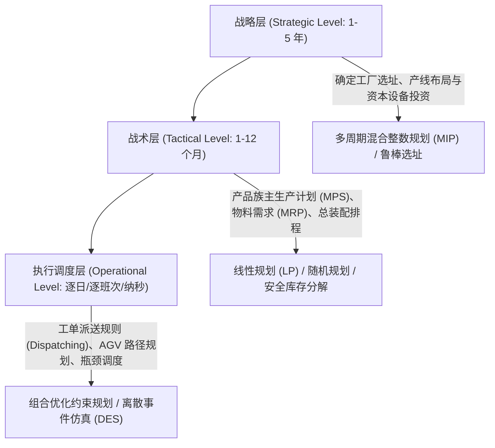

# Lec 1 制造与运营系统优化概论与决策架构 (Manufacturing Systems Optimization Overview)

> MIT 15.066J 制造与运营系统优化分析 (System Optimization and Analysis for Manufacturing) · 授课教师：Prof. Stephen Graves (MIT Sloan / LGO)

## TL;DR

- 制造与运营系统优化结合确定性数学规划、随机动态规划与离散事件仿真三位一体。
- 层级化决策架构将长周期战略产能选址、中周期主生产计划（MPS）与短周期车间调度严密嵌套。
- 在制品库存（WIP）、产出率（Throughput）与循环周期（Cycle Time）构成运营系统的核心三角平衡。

## 现代制造系统的复杂性挑战

制造与全球供应链系统是工业文明中最庞大、最复杂的离散与连续动力系统之一。从半导体晶圆制造厂、汽车总装流水线到全球消费电子供应链，运营管理者面临着极其严峻的决策权衡：
- **交期与服务水平（On-Time Delivery & Service Level）**：如何在面对高度波动的市场需求时，确保对客户订单的准时履约率达到 95% 以上？
- **资本资产利用率（Capital Asset Utilization）**：现代先进制程晶圆厂（Fab）单厂投资超百亿美元，设备停机一小时损失数十万美元，如何使瓶颈机台的稼动率逼近物理极限？
- **营运资本与库存持有成本（WIP & Inventory Carrying Costs）**：过高的在制品库存占用海量现金流且掩盖质量缺陷，而过低的库存又极易因机台宕机或供应链断供引发全线停产。

麻省理工学院联合开设的 15.066J（跨院系代码与 MIT Leaders for Global Operations, LGO 项目深度绑定）旨在运用严格的运筹优化（Optimization）、随机建模（Stochastic Modeling）与计算机仿真（Simulation），为现代制造运营系统构筑量化决策中枢。

## 层级化运营决策金字塔 (Hierarchical Decision Hierarchy)

制造系统的决策不能作为一个扁平的单体问题求解，而必须按照**时间跨度（Time Horizon）**与**聚合颗粒度（Aggregation Level）**拆解为层级决策金字塔：

::: definition [运营系统核心铁三角法则 (Operations Triangle)]
在制造系统稳态运行下，系统的三大核心宏观指标由**利特尔法则**（Little's Law）严格约束：
$$
\text{WIP} = \text{TH} \times \text{CT}
$$
其中 $\text{WIP}$ 为在制品库存（Work-in-Process），$\text{TH}$ 为系统平均有效产出率（Throughput），$\text{CT}$ 为平均制造循环周期（Cycle Time / Flow Time）。
:::

## 优化方法论矩阵

15.066J 围绕三类核心计算引擎展开：
1. **确定性数学规划（LP, IP, NLP）**：当系统参数相对稳定，或处理中长周期产能分配、网络选址与配比优化时，求解确定性数学规划模型提供理论全局最优界；
2. **随机规划与对偶风险控制（Stochastic LP & Recourse）**：将需求不确定性、设备故障与良率波动纳入决策约束，平衡预期利润与下行破产风险；
3. **离散事件仿真（Discrete-Event Simulation, DES）**：当系统包含复杂的动态交互（如排队死锁、有限缓冲区阻塞 Blocking、机器随机故障与维修工共享）导致数学解析解不可行时，借助数字孪生仿真进行场景推演与实验设计（DOE）。

::: pitfall 试图用单一全要素优化模型解决一切
工业界初学者常试图将整座工厂的每一个螺丝钉、每台叉车与每张订单打包进一个超大规模混合整数规划（MIP）中。这会导致模型变量爆炸（数亿维）、求解耗时超过决策窗口，且输入数据的微小噪声会彻底破坏最优解的可行性。真正的工业运筹大师必须熟练掌握**分层解耦（Hierarchical Decomposition）**的艺术。
:::

::: insight 运筹优化是制造实体的数字杠杆
制造系统不是冰冷的机器零件组合，而是一条动态流淌的价值河流。
优化算法的本质，就是在这条河流的每一个交汇处安插最精密的阀门与分流渠。**通过在数学模型中显式刻画物理守恒与产能边界，运筹优化使管理者能够用最理性的计算算力，替代昂贵的试错成本**，这正是现代全球工业领袖的核心护城河。
:::
