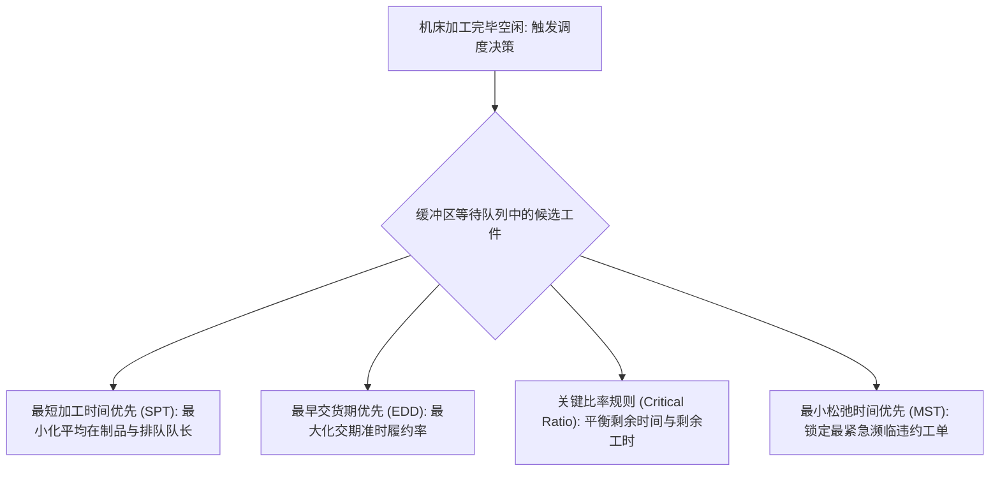

# Lec 10 组合启发式算法与车间作业调度优化 (Combinatorial Heuristics and Scheduling)

> MIT 15.066J 制造与运营系统优化分析 (System Optimization and Analysis for Manufacturing) · 授课教师：Prof. Stephen Graves (MIT Sloan / LGO)

## TL;DR

- 车间作业调度（Job Shop Scheduling）以极其复杂的析取图（Disjunctive Graph）挑战精确算法极限。
- 经典工程派遣规则（SPT, EDD, Critical Ratio）为纳秒级在线生产调度提供贪心基准。
- 元启发式算法（遗传算法、禁忌搜索、大邻域搜索 LNS）在极短时间内逼近高质量工业近似解。

## 制造车间的调度圣杯：Job Shop 复杂度深渊

在离散精密制造车间（如模具加工、航天结构件铣削、定制机床制造）中，运筹学者面临着工业界公认最艰难的组合优化难题——**流水车间调度（Flow Shop）与作业车间调度（Job Shop Scheduling Problem, JSP）**。

在 $JSP$ 问题中：
- 存在 $n$ 个工件（Jobs），每个工件包含一系列具有严格工艺先后偏序的工序（Operations）；
- 存在 $m$ 台不同的机床设备（Machines）；
- 与流水线不同，**每个工件的工艺加工路径（Routing）是完全异构的**（例如工件 1 的工艺路线是“车床 $\to$ 铣床 $\to$ 热处理”，而工件 2 的路线是“磨床 $\to$ 铣床 $\to$ 车床”）；
- 每台机床在同一时刻只能加工一个工件，且加工过程不可中断抢占（Non-preemptive）。

调度目标通常是极小化**最大完工时间**（Makespan, $C_{\max}$），即所有工件全部走完最后一道工序所需的总物理时间跨度。
历史上最著名的 $10 \times 10$ JSP Benchmark 算例（由 Fisher 和 Thompson 于 1963 年提出），仅仅包含 10 个工件和 10 台机床，却整整耗费了全球运筹学界与计算机科学家长达 26 年的算力攻关，直到 1989 年才首次证明其全局精确最优解（Makespan = 930）！这充分展示了工业调度优化的极度凶险。

## 经典车间在线派遣规则 (Priority Dispatching Rules)

当车间每天面对成千上万道工序流转时，等待离散优化求解器运行数小时是不切实际的。车间制造执行系统（MES）通常依赖于基于经验与运筹逻辑的**优先派遣规则**（Priority Rules）：

::: definition [核心优先派遣规则定义]
设当前决策时刻为 $t$。对于等待队列中的候选工件 $j$：
1. **最短加工时间规则（Shortest Processing Time, SPT）**：优先加工当前工序耗时 $p_j$ 最小的工件。根据 Smith 定理，SPT 严格保证**单机平均完工时间与在制品库存（WIP）达到全局最小**！
2. **最早交货期规则（Earliest Due Date, EDD）**：优先加工约定交付截止期 $d_j$ 最早的工件。Jackson 定理证明了 EDD 能够使**最大工期延误量（Maximum Lateness, $L_{\max}$）达到最优极小化**；
3. **关键比率规则（Critical Ratio, CR）**：定义动态指标：
$$
\text{CR}_j = \frac{d_j - t}{\text{剩余全部工序总工时 } \sum p_{jk}}
$$
  - $\text{CR}_j < 1$：说明即使该工件后面全速运转不排队，也必然延误（红色超紧急状态）；
  - $\text{CR}_j = 1$：刚好紧贴死线运行；
  - $\text{CR}_j > 1$：存在安全时间缓冲。
  MES 调度系统始终优先派遣 $\text{CR}_j$ 最小的工件。
:::

## 现代元启发式算法与局部搜索 (Metaheuristics)

派遣规则虽然运行仅需纳秒，但属于缺乏长远全局视野的近视贪心法（Myopic Heuristics），很容易在后续引发严重的机台死锁与下游大面积饥饿。为了在可接受的计算时间内（如 3-5 分钟内）输出接近理论最优界的高质量调度方案，工业界全面引入了**现代元启发式算法**。

### 1. 析取图模型 (Disjunctive Graph Representation)
JSP 的解空间在数学上可以被严密表达为**析取图** $G = (V, C \cup D)$：
- 节点集合 $V$ 代表所有工序，节点权值代表加工工时；
- 有向连通弧集合 $C$ 代表各工件内部固有的工艺偏序（连合弧 Conjunctive Arcs）；
- 无向双向边集合 $D$ 代表共享同一机床的工序对之间的机台冲突（析取边 Disjunctive Edges）。
**求解调度的本质，就是在每一对析取边上指定唯一的有向朝向（即决定机台上谁先做、谁后做），使得最终的有向图无圈（Acyclic），且关键路径（Critical Path）长度达到最短！**

### 2. 禁忌搜索与大邻域搜索 (Tabu Search & LNS)
现代高效调度算法普遍采用基于关键路径的邻域搜索：
- **Block 结构移动（Nowicki-Smutnicki 算子）**：只对关键路径上共享同一机台的工序块（Block）的端部工序进行局部对调。这在数学上保证了只有这种交换才有可能真正缩短 $C_{\max}$，避免了 99% 的无效搜索！
- **禁忌表（Tabu List）**：记录最近几十步发生过的逆转操作，防止算法在局部极值坑中发生无尽的死循环振荡；
- **自适应大邻域搜索（ALNS）**：随机“破坏（Ruin）”当前调度方案中 20%-30% 的工序排列，再使用贪心插值重构（Recreate）。通过大尺度的跳跃彻底摆脱深层局部最优陷阱。

::: pitfall 忽视车间动态扰动导致静态最优计划瞬间作废
静态排程算出的最优解极其脆弱。在真实车间里，刀具磨损破损、急单插单、工人请假和毛坯料尺寸偏差每时每刻都在发生。工业调度系统必须具备**滚动视界重排（Rolling Horizon Rescheduling）与事件驱动反应能力**。
:::

::: insight 启发式是算力与物理时间博弈的实用主义智慧
精确数学规划追求绝对真理的执着固然令人敬畏，但工业现场的机床传送带不会停下来等待你的分支定界证明对偶间距归零。
**元启发式算法代表了工业运筹中最成熟的实用主义精神：用对工件关键路径物理结构的深刻洞察，在几万步精巧的邻域跳跃中，以 98% 的优良精度换取千倍的决策时效**。这正是工程科学的真正魅力所在。
:::
