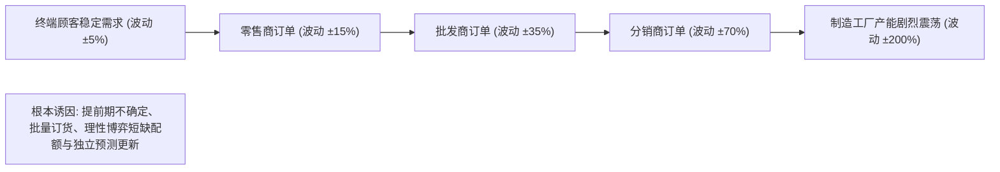

# Lec 11 多级供应链库存模拟与基本库存策略 (Inventory Simulation and Base-Stock Policies)

> MIT 15.066J 制造与运营系统优化分析 (System Optimization and Analysis for Manufacturing) · 授课教师：Prof. Stephen Graves (MIT Sloan / LGO)

## TL;DR

- 经典啤酒分销游戏（Beer Distribution Game）生动揭示了多级供应链中的牛鞭效应（Bullwhip Effect）。
- 基本库存控制策略（Base-Stock Policy）在正态需求与恒定提前期下推导出严谨的安全库存公式。
- 全网多级安全库存优化（MEIO）打破了孤立单节点库存冗余、实现了系统级极小化。

## 供应链的系统动力学灾难：牛鞭效应

在麻省理工学院斯隆管理学院著名的联合课程（与 15.761 运营管理深度协同）中，最震撼人心的体验莫过于由 Jay Forrester 教授在 1960 年代发明的**啤酒分销游戏**（The Beer Game）。

在这个模拟实验中，一条简单的线性供应链由四个独立节点串联构成：
$$
\text{零售商 (Retailer)} \to \text{批发商 (Wholesaler)} \to \text{分销商 (Distributor)} \to \text{制造工厂 (Factory)}
$$
终端消费者的真实需求仅仅发生了一次极其微小的阶跃变化（例如从每周 4 箱稳定提升至每周 8 箱）。然而，由于各级节点之间存在**信息传递延迟（Information Lag）**与**物理物料交付提前期（Physical Lead Time）**，供应链上游发生了一场剧烈的海啸：
- 批发商的订单开始翻倍波动；
- 分销商的订货量剧增数倍并出现长达数周的严重缺货；
- 到达最上游的制造工厂时，工厂收到的订单飙升至每周数十箱，引发疯狂盲目扩产；随后全网库存发生严重积压，导致工厂在后续数月内被迫彻底停工关产！

这种**沿着供应链向上游逆流而上时，需求波动被逐级急剧放大、扭曲的系统动力学现象**，被称为**牛鞭效应**（The Bullwhip Effect）。

## 基本库存策略与安全库存公式 (Base-Stock Policy)

为了遏制盲目的心理恐慌性订货，供应链必须建立在严格的**基本库存控制策略**（Base-Stock Policy / Order-Up-To Policy）之上。

设定期盘点周期为 $R$（Review Period），物料采购补充提前期为 $L$（Lead Time）。
在此机制下，管理者需要覆盖的**风险敞口暴露周期**为 $R + L$。
设每个周期的客户需求独立同分布，均值为 $\mu$，标准差为 $\sigma$。
则在长度为 $R + L$ 的风险周期内，累计需求服从分布：
$$
D_{R+L} \sim \mathcal{N}\left((R + L)\mu, (R + L)\sigma^2\right)
$$

::: definition [基本库存水平与安全库存 (Base-Stock Level & Safety Stock)]
定义**库存位置**（Inventory Position, IP）为：
$$
\text{IP} = \text{现有物理库存 (On-Hand)} + \text{在途在订库存 (On-Order)} - \text{积压延期交货 (Backorders)}
$$
在每个盘点时刻，订货策略极其简单纯粹：
$$
\text{当期订货量 } Q = S^* - \text{IP}
$$
其中目标基准库存水平 $S^*$ 由两部分构成：
$$
S^* = \text{周期均值需求} + \text{安全库存} = (R + L)\mu + z_\alpha \cdot \sigma \sqrt{R + L}
$$
$z_\alpha = \Phi^{-1}(\text{CSL})$ 为对应目标周期服务水平（Cycle Service Level, 如 95% 或 99%）的标准正态分布分位数。
:::

## 离散事件蒙特卡洛仿真验证

为什么教科书上的公式在真实工厂里经常失效？
因为解析公式依赖三大苛刻假设：需求服从平稳高斯分布、提前期 $L$ 是固定确定性常数、缺货完全允许延期交货（Backordering）。

在 15.066J 课程实验中，学生通过编写仿真脚本，引入真实世界扰动：
1. **提前期随机性**：供应商交期受港口拥堵影响，服从 Gamma 分布；
2. **缺货丢失销售（Lost Sales）**：当缺货发生时，客户直接转投竞争对手，需求永久流失；
3. **产能上限截断**：供应商单次最大发货量受限于集装箱运力。

仿真结果表明：当提前期 $L$ 自身具有方差 $\sigma_L^2$ 时，组合方差急剧修正为著名的 **Eppen-Martin 提前期风险扩张公式**：
$$
\sigma_{\text{total}} = \sqrt{(R + \mathbb{E}[L])\sigma^2 + \mu^2 \sigma_L^2}
$$
注意第二项 $\mu^2 \sigma_L^2$！由于乘以了平均需求均值的平方，**交期波动的微小增加，对安全库存需求的冲击往往比需求本身波动的冲击还要致命十倍以上**！

::: pitfall 各节点各自为政的局部安全库存优化导致全网极度臃肿
在多级供应链中，如果零售商、批发商与工厂各自独立按照 95% 服务水平计算安全库存，整条链路将沉淀出高达数倍的冗余资金占用。
现代**多级库存优化理论（Multi-Echelon Inventory Optimization, MEIO，如 Graves-Willems 保证服务时间模型）**指出：应当战略性地将安全库存集中配置在上游低成本原材料与中央枢纽节点，下游前置仓采取极轻量化运作，实现全网总持有成本削减 30% 以上。
:::

::: insight 信息共享是击碎牛鞭效应的破壁机
牛鞭效应的根源不是技术缺陷，而是组织割裂带来的“信息孤岛”。
当下游零售商的真实 POS 收银台扫描数据无法实时透明共享给制造工厂时，每一个中间节点都会将下游的订货量误判为真实的终端消费需求，并在安全边际上层层加码加保。**唯有通过打通全链条端到端数字孪生与统一协同库存补货（CPFR），人类才能真正从牛鞭效应的百年梦魇中彻底解脱**。
:::
