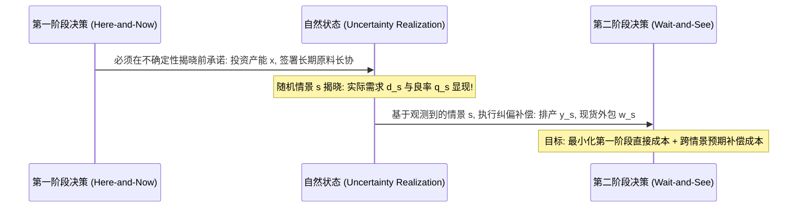

# Lec 12 随机线性规划与二阶段补偿模型 (Stochastic LP and Two-Stage Recourse Models)

> MIT 15.066J 制造与运营系统优化分析 (System Optimization and Analysis for Manufacturing) · 授课教师：Prof. Stephen Graves (MIT Sloan / LGO)

## TL;DR

- 二阶段随机规划将决策划分为事前承诺决策与事后补偿调整决策。
- 情景树（Scenario Trees）与确定性等价规划（DEP）将随机性转化为结构化超大规模 LP。
- EVPI（完全信息价值）与 VSS（随机解价值）为企业数据智能与柔性投资提供了精准估值体系。

## 走出“平均值假说”的认知误区

在传统的确定性制造优化中，工程师通常习惯采用“平均值替代法”：如果明年的市场需求预测平均为 10,000 件，我们就在模型中将需求约束硬性设置为 $D = 10,000$，然后求解最优产能配置。

然而，应用数学与运营管理中最著名的定理之一——**詹森不等式（Jensen's Inequality）**与**平均值缺陷定律（The Flaw of Averages）**严厉警告我们：
$$
\mathbb{E}[f(x, \xi)] \ne f(x, \mathbb{E}[\xi])
$$
在存在非线性成本（如缺货延误罚金、产线紧急外包、闲置折旧）的系统中：**基于平均需求设计出的最优方案，在面对真实波动世界时，平均而言几乎必然是最劣方案！**

**随机规划（Stochastic Programming）**通过显式刻画不确定性的概率分布，为企业在“不可逆的初始投资”与“灵活的事后自适应”之间构筑起坚固的数学防线。

## 二阶段补偿模型数学结构 (Two-Stage Recourse Model)

二阶段随机规划将决策流程按照信息揭晓的时间序列严格划分为两幕：

- **第一阶段（Here-and-Now 决策 $x$）**：
  必须在完全不知道未来究竟哪个情景会发生之前做出的不可逆战略承诺（如工厂建设规模、首批长周期模具采购）。
- **随机事件揭示（Random Scenario $s \in \mathcal{S}$）**：
  大自然掷出骰子，以已知概率 $p_s$（$\sum_{s \in \mathcal{S}} p_s = 1$）揭晓某一特定情景 $\xi_s = (d_s, q_s, c_s)$。
- **第二阶段（Wait-and-See / Recourse 决策 $y_s$）**：
  在观测到情景 $s$ 的真实状态后，运营管理者采取的应急纠偏补偿动作（如开动高成本柴油发电机、安排急件空运、降价促销抛售余货）。

### 大规模确定性等价规划 (Deterministic Equivalent Program, DEP)
若情景集合 $\mathcal{S}$ 是离散有限的，整个两阶段随机规划可以严密展开为一个具有**块角形结构（Block-Angular Structure）**的超级巨型确定性线性规划：
$$
\begin{aligned}
\min_{x, y_1, \dots, y_S} \quad & c^T x + \sum_{s=1}^S p_s q_s^T y_s \\
\text{s.t.} \quad & A x = b \quad (\text{第一阶段硬投资约束}) \\
& T_s x + W y_s = h_s, \quad \forall s = 1, \dots, S \quad (\text{情景 s 补偿平衡约束}) \\
& x \ge 0, \quad y_s \ge 0, \quad \forall s = 1, \dots, S
\end{aligned}
$$
其中矩阵 $T_s$ 称为技术转移矩阵（Technology Matrix），$W$ 称为补偿矩阵（Recourse Matrix，若 $W$ 独立于情景 $s$ 则称为固定补偿 Fixed Recourse）。

## 运筹学的商业价值度量衡：EVPI 与 VSS

面对复杂的不确定性，企业是否值得斥巨资采购高精度大数据预测系统？是否值得对工厂进行柔性产线升级？随机规划给出了公理化的定量度量工具。

设：
- **RP（Recourse Problem）**：完整求解上述两阶段随机规划得到的最优期望成本；
- **WS（Wait-and-See / Perfect Information）**：假设存在能够洞察未来的先知，在每个情景 $s$ 发生后再分别求解确定性最优解，所得到的理论极值期望成本：$\text{WS} = \sum_{s} p_s \min \{c^T x_s + q_s^T y_s\}$；
- **EEV（Expected Value Solution）**：偷懒地用平均需求 $\bar{\xi} = \mathbb{E}[\xi]$ 算出第一阶段决策 $\bar{x}$，将其强行代入真实随机波动中进行事后补偿计算出的实际平均表现。

::: theorem [完全信息价值 (Expected Value of Perfect Information, EVPI)]
$$
\text{EVPI} = \text{RP} - \text{WS} \ge 0
$$
$\text{EVPI}$ 衡量了：**如果市场上存在一个能够 100% 准确预知未来下一年度所有市场需求与天气的超级水晶球，企业最多愿意为这套先知信息支付的最高公允上限价格**！
:::

::: theorem [随机解价值 (Value of Stochastic Solution, VSS)]
$$
\text{VSS} = \text{EEV} - \text{RP} \ge 0
$$
$\text{VSS}$ 衡量了：**仅仅因为我们使用了二阶段随机规划模型（RP），相比于传统偷懒使用“平均值模型”（EEV），为企业直接节约的净利润或成本降幅**！
:::

若某家制造企业的计算表明 $\text{VSS} = 1500$ 万美元，这意味着如果运营团队继续按平均值排产，每年将被波动性凭空抹去 1500 万美元的真金白银。

::: pitfall 忽视情景数量维数灾难导致矩阵维度爆炸
如果系统包含 10 个独立的不确定参数，每个参数仅取 3 个可能值，离散全组合情景数将迅速膨胀为 $3^{10} = 59,049$ 个！这会导致确定性等价规划的约束数量突破千万级。工业界通常采用 **L-Shaped 算法（Benders 分解在随机规划中的专门化）** 或 **采样均值逼近法（Sample Average Approximation, SAA）** 进行高效蒙特卡洛抽样求解。
:::

::: insight 随机规划是拥抱不确定性的商业哲学
面对未知的未来，平庸的管理者寄希望于祈祷预测足够准确；
而卓越的运筹领袖懂得：**预测永远是错的，但系统的决策可以立于不败之地**。
两阶段随机规划的伟大之处，在于它逼迫我们在决策的初始时刻，就主动将未来的全部潜在风险与全部应急补偿预案，纳入当前全局最优的精密考量中。这种架构上的柔性，才是企业穿越周期迷雾的最强护甲。
:::
