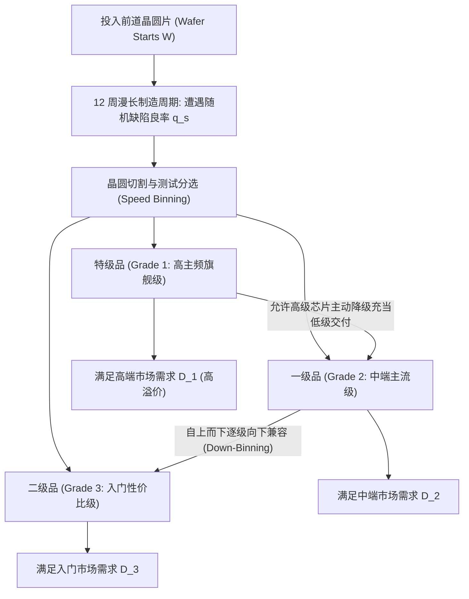

# Lec 13 英特尔芯片制造案例：良率波动与产能分配 (Intel Semiconductor Capacity Case)

> MIT 15.066J 制造与运营系统优化分析 (System Optimization and Analysis for Manufacturing) · 授课教师：Prof. Stephen Graves (MIT Sloan / LGO)

## TL;DR

- 半导体晶圆制造（Fab）面临极其严苛的物理资本折旧与纳米级芯片良率（Yield）波动。
- 芯片降级分选（Binning / Down-Binning）机制将良率离散分布转化为多品级柔性供给。
- 英特尔（Intel）两阶段混合规划展示了前道晶圆投片与后道封装测试的最佳产能分配。

## 现代制造业皇冠上的明珠：芯片制造的极度凶险

半导体先进制程制造是人类历史上技术难度最高、资本密度最大的制造体系。建造一座 3nm 先进晶圆代工厂（Fab）的初期投资高达 150-200 亿美元，光刻机与真空等离子刻蚀机台每天的折旧费用即达数百万美元。

在麻省理工学院 15.066J 的高阶工业研讨中，英特尔公司（Intel Corporation）资深运营运筹专家 John Bean 详细复盘了全球微处理器巨头如何借助数学规划，驾驭极其残酷的**良率波动（Yield Fluctuation）与分选降级（Binning）**。

## 晶圆制造的两大独特物理属性

1. **极其漫长的生产提前期（Long Cycle Time）**：
从一张高纯度硅晶圆进入无尘室，历经数百道光刻、离子注入、化学机械研磨（CMP），到最终产出晶圆圆片，物理制造周期长达 **12 到 16 周（3-4 个月）**！这意味着企业必须在不知道 4 个月后 PC 与服务器市场真实需求的情况下，提前数月下达不可逆的前道投片指令。
2. **严重的非稳态随机良率与速度分选（Speed Binning）**：
即使在同一张 12 英寸晶圆上，数百颗切割出来的微处理器芯片（Die）的物理性能也绝非均质的：
- 由于晶圆边缘光阻均匀度与微观粉尘缺陷，部分芯片由于电路短路彻底报废（致命缺陷）；
- 存活下来的芯片在出厂测试时，最高稳定运行主频各不相同：性能最强的高体质芯片被划入高端服务器至强（Xeon）级；中等主频的被划入酷睿 i7/i5 级；运行主频较低或部分内核损坏的被激光熔断降级为 i3 或奔腾级（这就是著名的 **Down-Binning 机制**）。

## 英特尔产能分选数学规划模型

设前道晶圆投片量为决策变量 $W$（单位：Wafer 片数），单片晶圆包含理论 Die 数量为 $N$。
投片单位成本为 $C_W$。
在 12 周后，实际良率向量受随机环境影响，可能落入情景 $s \in \mathcal{S}$，发生概率为 $p_s$。
在情景 $s$ 下，芯片被测试分类为 $K$ 个速度等级（Grade $k = 1, \dots, K$，其中 $k = 1$ 最高级，$K$ 最低级）。
单片晶圆产出等级 $k$ 的合格芯片数量为随机变量 $q_{s, k}$。

- **第二阶段决策变量**：
  - $x_{s, k}$：在情景 $s$ 下，以等级 $k$ 的规格在市场上实际销售的芯片数量；
  - $d_{s, k \to j}$：在情景 $s$ 下，将原本属于高等级 $k$ 的芯片**主动降级（Down-Binning）**充当低等级 $j$（$k < j$）销售的数量；
  - $r_k$：等级 $k$ 的产品销售单价（$r_1 > r_2 > \dots > r_K$）；
  - $D_{s, k}$：市场对等级 $k$ 的真实需求上限。

数学模型表述为：
$$
\begin{aligned}
\max_{W, x, d} \quad & -C_W W + \sum_{s \in \mathcal{S}} p_s \sum_{k=1}^K r_k x_{s, k} \\
\text{s.t.} \quad & W \le \text{Max\_Fab\_Capacity} \quad (\text{前道光刻机台物理产能上限}) \\
& \text{在每个情景 } s \text{ 下，各等级可供量平衡：} \\
& x_{s, k} + \sum_{j > k} d_{s, k \to j} \le q_{s, k} W + \sum_{i < k} d_{s, i \to k}, \quad \forall k = 1, \dots, K \\
& x_{s, k} \le D_{s, k}, \quad \forall k = 1, \dots, K \quad (\text{销量不可超过当期市场需求}) \\
& W \ge 0, \quad x_{s, k} \ge 0, \quad d_{s, k \to j} \ge 0
\end{aligned}
$$

## Down-Binning 机制带来的柔性套利价值

在上述模型中，最精妙的运筹杠杆在于**单向降级流变量 $d_{s, k \to j}$**。
很多传统财务人员会认为：“把一颗价值 500 美元的至强芯片，当成 150 美元的 i5 卖掉，这是不可容忍的巨额亏损！”
然而随机规划推导出的影子价格证明：
当市场对高端芯片需求低迷、而中端市场订单暴增时，如果让这颗高端芯片闲置在仓库，其残值为 0 且占用仓储成本；**将其降级作为中端产品交付，不仅能即刻变现 150 美元的净现金流，更能免受对中端客户违约的巨额商誉索赔，并彻底击溃那些必须专门生产中端芯片的竞品对手**！
这种利用物理高宽容度实现的“软件锁频降级”，构成了英特尔在微处理器市场维持长达三十年统治地位的深层运筹秘诀。

::: pitfall 忽视后道封装测试（ATP）产能瓶颈
前道晶圆制造（Fab）产出后，并不是立即变成能卖的芯片。后端芯片封装与最终功能测试（Assembly, Test and Pack, ATP）本身也是重资产瓶颈环节。若模型未将 ATP 机台工时与专用测试座（Test Sockets）容量联动纳入约束，前道堆积的大量裸片（Die）将无法在有限窗口内封测出货，造成数亿美元的在制品淤塞。
:::

::: insight 物理不确定性必须用产品架构的弹性来化解
半导体工业是物理规律不可抗力的典型代表：在 3 纳米尺度下，量子隧穿效应与光子涨落注定了良率永远处于随机震荡中。
**英特尔的伟大之处，在于其没有试图用蛮力去强行消灭良率波动，而是通过在芯片架构设计（分选降级）与制造计划（两阶段随机规划）之间建立了一套完美的吸震器**。把随机性从一种需要被消灭的灾难，逆转为一种可以创造超额柔性利润的战略资产，这正是运筹优化在世界顶级工业制造中的最高境界。
:::
