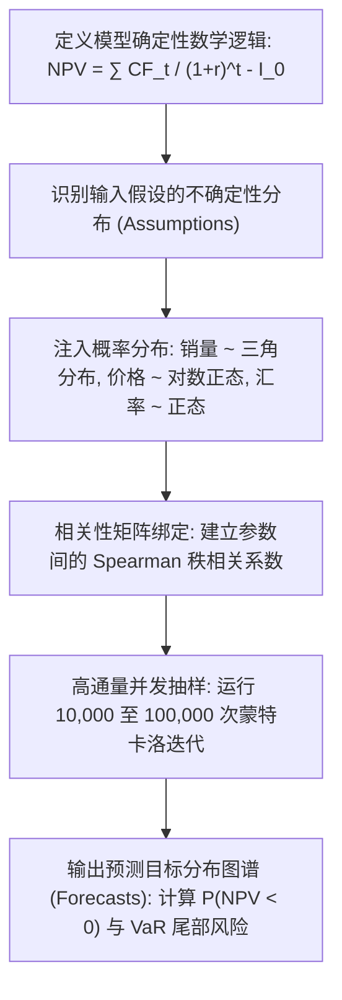

# Lec 15 蒙特卡洛仿真与风险量化分析实战 (Monte Carlo Simulation and Risk Analysis)

> MIT 15.066J 制造与运营系统优化分析 (System Optimization and Analysis for Manufacturing) · 授课教师：Prof. Stephen Graves (MIT Sloan / LGO)

## TL;DR

- 蒙特卡洛方法通过万次随机抽样将静态点估计升级为完整的概率密度分布图景。
- Crystal Ball / @RISK 工具链展示了敏感度 Tornado 图在识别关键不确定性驱动因子的威力。
- 风险价值（VaR）与条件风险价值（CVaR）为制造资本投资提供了下行尾部风险防护准则。

## 摆脱单点预测的脆弱幻觉

在传统的企业资本支出（CapEx）立项评审中，财务分析人员通常会在 Excel 中提交一份精美的“基准情景（Base Case）”现金流折现表（DCF）：
- 预计产品销售增长率：每年 8.5%；
- 原材料采购价格：42 美元/吨；
- 汇率：1 欧元兑 1.08 美元；
- 测算出项目的净现值（NPV）为 **2500 万美元**，内部收益率（IRR）为 18%，建议董事会立即批准投资。

然而，这种基于单点估计（Point Estimates）的静态财务模型是极其脆弱的。
一旦投产后原材料暴涨至 60 美元，或者由于国际局势动荡导致实际销量仅增长 2%，该项目的真实净现值可能会瞬间击穿警戒线，变成**巨亏 4000 万美元的灾难性包袱**！

麻省理工学院 15.066J 引入业界标准的 **Crystal Ball / @RISK 蒙特卡洛风险量化体系**，将静态的确定性财务预测，升华为了全维度的动态概率风险图谱。

## 蒙特卡洛风险分析建模范式

蒙特卡洛仿真绝非盲目的数值游戏，而是一套严密的四步科学分析范式：



### 1. 输入假设分布拟合（Input Distributions）
根据历史运营数据或专家共识，为每个不确定参数赋予最符合物理本质的概率分布：
- **三角分布（Triangular Distribution）**：当缺乏详尽历史数据但拥有行业专家评估的“最悲观值 $a$、最可能值 $m$、最乐观值 $b$”时，三角分布是最稳健的工程选择；
- **对数正态分布（Lognormal Distribution）**：适用于大宗原材料价格、工时耗时等天然严格为正且右侧带有长尾拉升的金融/物理变量；
- **Beta / PERT 分布**：工程项目管理中广泛用于任务工期与活动预算估算。

### 2. 避免参数独立性陷阱：相关性诱导
若两个输入变量在物理现实中高度相关（例如“钢铁原材料采购价”与“最终重型机械销售价”），若在蒙特卡洛模拟中假设它们独立随机抽样，会导致出现“钢材极高成本但售价极低”的极其荒谬的伪样本。必须在模型中引入 **Iman-Conover 秩相关变换**，强制维持预设的相关系数矩阵。

## 敏感度分析龙卷风图 (Tornado Chart)

在包含几十个不确定参数的大型制造投资模型中，管理层最关切的问题是：**在所有这些不确定变量中，究竟哪一个参数的波动对最终项目成败起到了决定性的支配作用？**

Crystal Ball 提供的**敏感度龙卷风图（Tornado Chart）**通过计算各输入假设与最终输出目标变量（如 NPV）之间的**Spearman 秩相关系数（Rank Correlation）**或**方差贡献率（Contribution to Variance）**，将所有风险因子按影响量级自上而下倒序排列：

```text
============================================================
              敏感度龙卷风分析 (对项目 NPV 的影响)
============================================================
1. 首年市场需求增长率   [========================]  48.2%
2. 核心催化剂采购单价   [==============          ]  26.5%
3. 产线投产爬坡提前期   [========                ]  14.1%
4. 人力薪酬通胀率       [===                     ]   5.8%
5. 期末残值回收比率     [=                       ]   1.4%
============================================================
```

**管理决策洞察**：
龙卷风图清晰地表明：前两项风险（需求增长与催化剂单价）合力贡献了系统超过 **74% 的方差风险**！
管理层无需在琐碎的行政开支或残值上浪费精力，而应将全部战略谈判重点聚焦于：**与催化剂供应商签订长期锁定上限的保护性长协（Hedging），以及在销售端推出灵活的保底预售协议**。

## 尾部风险量化公理：VaR 与 CVaR

单纯观察平均期望值与标准差是不够的。现代风险管理的核心在于评估**最极端恶劣情境下的毁灭性损失**。

::: definition [风险价值 (Value-at-Risk, VaR)]
设置信水平为 $1 - \alpha$（如 $\alpha = 0.05$，即 95% 置信度）。
损益分布的 $\text{VaR}_\alpha$ 定义为系统在指定概率下的最大潜在可能亏损上限：
$$
\mathbb{P}(\text{Loss} \ge \text{VaR}_\alpha) = \alpha \iff \text{VaR}_\alpha = F_{\text{Loss}}^{-1}(1 - \alpha)
$$
例如：若某制造项目的 95% $\text{VaR}$ 为 1200 万美元，这意味着：**在 95% 的正常经营年份中，项目的亏损绝不会超过 1200 万美元；只有在 5% 的极端黑天鹅事件下，亏损才会突破这一防线**。
:::

::: definition [条件风险价值 (Conditional Value-at-Risk, CVaR / Expected Shortfall)]
VaR 仅给出了尾部截断阈值，但对一旦发生穿透后的“无底洞亏损究竟有多深”毫无度量（且 VaR 不满足次可加性，不是一致性风险度量）。
**CVaR** 定义为在损失突破 VaR 警戒线之后，那极端 5% 罕见悲惨情境下的**条件期望亏损平均值**：
$$
\text{CVaR}_\alpha = \mathbb{E}[\text{Loss} \mid \text{Loss} \ge \text{VaR}_\alpha] = \frac{1}{\alpha}\int_0^\alpha \text{VaR}_{1-u} du
$$
Rockafellar 和 Uryasev（2000）严格证明了：**CVaR 是凸风险度量，可以直接无损转化为大型线性规划进行全局优化！**
:::

::: pitfall 忽视分布肥尾（Fat Tails）导致低估极端破产概率
许多分析人员图省事，将所有变量默认设为高斯正态分布。但在实际金融海啸与供应链断供中，黑天鹅事件的发生频率远远超出高斯 3-Sigma 预言的百万分之三。强行假设正态分布会严重低估尾部风险，酿成雷曼兄弟式的资本金瞬间归零。
:::

::: insight 风险量化的终极价值不是消除风险，而是理性定价
没有风险就没有超额利润。
蒙特卡洛模拟与风险分析的真正魅力，绝不是教导企业家退缩守成、放弃一切不确定投资；**它的伟大之处在于，通过精准量化最底层的下行亏损概率与 CVaR 暴露边界，赋予了工业领袖“在算力彻底算清底线之后，敢于重注未来”的极致战略定力**。
:::
