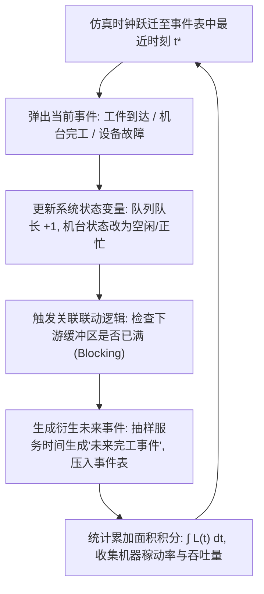

# Lec 17 离散事件仿真框架与 SIMUL8 动态建模 (Discrete-Event Simulation Frameworks and SIMUL8)

> MIT 15.066J 制造与运营系统优化分析 (System Optimization and Analysis for Manufacturing) · 授课教师：Prof. Stephen Graves (MIT Sloan / LGO)

## TL;DR

- 离散事件仿真（DES）以实体（Entities）、资源（Resources）与队列（Queues）为核心三元组。
- 下一事件时间推进机制（Next-Event Time Advance）跨越静止时段、精准捕获系统状态跃迁。
- SIMUL8 工具链揭示了缓冲区堵塞（Blocking）与工位饥饿（Starvation）在复杂流水线中的级联反应。

## 从连续时钟到离散事件跃迁

在前面的蒙特卡洛仿真中，我们处理的是静态随机变量的抽样（例如预测年终总利润分布）。然而，真实车间是一个**动态连续演进的物理过程**：工件在不同工序间移动、工人在不同机台前走动、故障在不可预知的时刻爆发。

如果采用固定时间步长法（Fixed Time-Step，例如每隔 1 秒更新一次全厂状态），计算机将浪费 99.9% 的算力在没有任何事情发生的空闲时钟上。
**离散事件仿真（Discrete-Event Simulation, DES）**通过引入**下一事件时间推进机制（Next-Event Time Advance）**，实现了运算效率的质的飞跃。

## 离散事件系统的核心四元组

任何复杂的制造离散事件模型，都可以高度抽象为以下四大基本构件：
1. **实体（Entities / Work Items）**：在系统内部流转的离散物理对象（如待加工的发动机缸体、待装配的 PCB 电路板）；
2. **队列与缓冲区（Queues / Buffers）**：当后续工位正忙时，实体排队等待服务的暂存区域（具有有限或无限容量）；
3. **活动与工作站（Activities / Work Centers）**：对实体执行增值加工操作的物理资源（如 CNC 加工中心、工人、工业机器人）；
4. **事件表与仿真时钟（Event Calendar & Simulation Clock）**：按预定发生时间严格排序的未来事件优先队列（Priority Queue）。

## 下一事件时间推进动力学

算法的运行逻辑极其严密：
- 仿真时钟 $T_{\text{now}}$ 直接从当前时刻“瞬移跳跃”到事件表中预定时间最近的事件时刻 $t^*$；
- 执行该事件对应的状态转移逻辑；
- 如果某个机台因此开始加工新工件，系统从指定的概率分布（如对数正态分布）中抽取一个服务加工时间 $S$，计算未来完工时间 $t_{\text{finish}} = T_{\text{now}} + S$，并将“工件完成事件”重新插入事件表；
- 时钟再次瞬移！没有任何无效的计算停顿。

## SIMUL8 工业级动态建模实战

在 15.066J 实验中，麻省理工学院采用工业标准级离散事件仿真平台 **SIMUL8**，对某高科技精密仪器总装车间进行全流程数字孪生建模。

车间包含三大关键工位：
- 工位 1：激光自动焊接（周期：期望 4.2 分钟，威布尔分布）；
- 缓冲栈 1：容量上限为 3 个工件；
- 工位 2：高精度气密性检测（周期：期望 3.8 分钟，正态分布）；
- 缓冲栈 2：容量上限为 2 个工件；
- 工位 3：人工最终标定与包装（周期：期望 5.0 分钟，受工人疲劳度影响）。

### 阻塞与饥饿的级联雪崩 (Blocking and Starvation)
仿真动态推演揭示了一个令人震惊的物理现象：
虽然工位 2 的平均加工速度（3.8 分钟）比工位 1（4.2 分钟）还要快，但工位 1 却频繁发生停机！
**原因分析**：
最下游的工位 3 速度最慢（5.0 分钟），是全系统的真正瓶颈（Bottleneck）。工位 3 的缓慢导致缓冲栈 2 迅速被打满（满载 2 件）。
当工位 2 完成手头工件后，发现下游缓冲栈 2 已满无处可放，工位 2 被迫停机处于**被动阻塞状态（Blocked）**！
而紧接着，工位 2 的阻塞又导致缓冲栈 1 迅速被打满，最终导致最上游的工位 1 也被强制阻塞停产！
这种由下游瓶颈引发的**逆向阻塞波（Backpressure Wave）**，是传统静态 Excel 计算完全无法察觉的隐形杀手。

::: pitfall 误将名义加工能力简单相加当做系统综合产出率
初学者常以为只要每台机床的单机日均产出为 100 件，三台串联产线日产就能达到 100 件。DES 仿真证明：由于各机台随机波动的不对称性，有限缓冲区导致的相互阻塞与饥饿，通常会使串联产线的实际综合产出率暴跌 **15% 到 30%**！
:::

::: insight 离散事件仿真是动态复杂系统的全息透镜
现实工厂是由无数相互碰撞的微观事件编织成的混沌网络。
线性规划与静态均值模型只能看到风平浪静时的海平面高度，而**离散事件仿真让管理者亲眼目睹了波涛汹涌的海浪如何在暗礁（有限缓冲区与随机停机）之间激烈激荡**。唯有看清了这些微观震荡的传播路径，我们才能在最精准的部位安插阻尼器，驯服复杂制造系统的内生混沌。
:::
