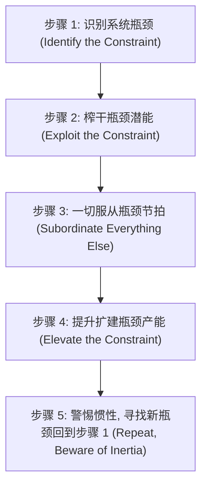

# Lec 18 约束理论 (TOC)、瓶颈调度与 DBR 控制机制 (Theory of Constraints and DBR)

> MIT 15.066J 制造与运营系统优化分析 (System Optimization and Analysis for Manufacturing) · 授课教师：Prof. Stephen Graves (MIT Sloan / LGO)

## TL;DR

- 约束理论（TOC）断言任何制造系统的有效产出率仅由唯一的根本瓶颈（Constraint）所决定。
- 鼓-缓冲-绳（Drum-Buffer-Rope, DBR）机制建立了拉动式车间投料与瓶颈保护节拍。
- 有效产出会计（Throughput Accounting）彻底破除了传统成本会计摊销制造费用的虚假利润陷阱。

## 颠覆传统制造常识的哲学革命

在 1980 年代，以色列物理学家与企业管理大师埃利亚胡·高德拉特（Eliyahu M. Goldratt）通过其划时代的名著《目标》（The Goal），向全球制造业投下了一枚思想核弹——**约束理论（Theory of Constraints, TOC）**。

在麻省理工学院 15.066J 与 15.761 的联合专题研讨中，教授们直指传统工业工程与财务会计的致命误区：
大多数工厂主管坚信：“为了提高全厂效益，我们必须让车间的每一台机床、每一名工人每一分每一秒都在全负荷忙碌（追求 100% 局部工时效率）”。
而约束理论无情地揭露：**在非瓶颈机台上盲目追求高利用率，除了制造出堆积如山的有害在制品库存（WIP）、掩盖质量缺陷并耗尽公司流动资金之外，对最终全厂净利润没有任何丝毫贡献！**

## TOC 五大核心聚焦步骤 (The 5 Focusing Steps)

约束理论提出了一套极度专注的持续改进闭环：

1. **识别（Identify）**：找到当前制约整家公司赚取更多现金的最薄弱环节（物理瓶颈、市场瓶颈或政策流程瓶颈）；
2. **榨干（Exploit）**：绝不让瓶颈浪费哪怕一分钟！瓶颈机台午休不停机（安排代班轮休）、瓶颈工件优先做质检（杜绝瓶颈加工不合格毛坯）；
3. **服从（Subordinate）**：非瓶颈工序的速度必须严格放慢，以匹配瓶颈的吞吐步调！非瓶颈工人的适度闲置是健康的系统保护机制；
4. **提升（Elevate）**：如果榨干潜能后依然无法满足市场订单，再投入真金白银进行资本开支（购买新机台、改造模具）；
5. **警惕惯性（Repeat）**：一旦原瓶颈被打破，生产瓶颈必然发生漂移转移。绝不能让旧的管控惯性成为新的制度瓶颈！

## 鼓-缓冲-绳控制机制 (Drum-Buffer-Rope, DBR)

为了在制造车间实施 TOC，高德拉特发明了极其优雅的 **DBR 车间物料拉动架构**：

- **鼓（Drum）**：系统的核心瓶颈机台（CCR, Capacity-Constrained Resource）。它就像军队行军时的发令鼓点，**它的生产节拍决定了整家工厂所有工序的理论最大前进速度**；
- **缓冲（Buffer）**：在鼓点机台正前方设置一个精确计算的**时间缓冲（Time Buffer）**。确保即使上游非瓶颈机台发生偶尔的随机故障或缺料，瓶颈机台前始终有活可干，绝不会因饥饿而停摆哪怕一秒钟；
- **绳子（Rope）**：从瓶颈机台连接至车间最前端原材料投料口的**信息拉动绳**。原材料的投放速率严格与瓶颈机台的实际下线速率强行锁定！瓶颈每加工完一个批次，前端才准许释放相应数量的新批次进厂。

通过这套机制，车间的在制品库存可以瞬间暴跌 50%-80%，制造循环周期（Lead Time）急剧缩短！

## 有效产出会计 vs 传统成本会计 (Throughput Accounting)

传统成本会计（Cost Accounting）习惯于将厂房折旧、研发与行政管理等巨额固定制造费用，按人工工时或机台工时“分摊（Absorption Costing）”到每一个生产出来的零件上。
这导致了一个极其荒谬的财务佯谬：**工厂只要疯狂开动机器、不管能不能卖掉全部堆在仓库里，报表上的单位产品账面成本就会被分摊得很低，从而在账面上凭空捏造出虚假的高额营业利润！**

有效产出会计彻底抛弃了繁琐虚假的费用分摊，仅定义三大硬核真实财务指标：
1. **有效产出（Throughput, $T$）**：通过销售产品真正收回现金的速率：
$$
T = \text{销售净收入} - \text{完全可变原材料采购成本 (TVC)}
$$
（若生产出来的东西烂在仓库里卖不出去，其 $T$ 严格为 0！）
2. **投资与库存（Investment / Inventory, $I$）**：沉淀在系统内全部尚未释放的资金（原材料采购成本、在制品、厂房设备）；
3. **运营费用（Operating Expense, $OE$）**：为了将投资 $I$ 转化为有效产出 $T$ 所支付的全部劳动力、租金与电力固定成本。

全厂底线财务目标极其明确单一：
$$
\text{净利润 (Net Profit)} = T - OE
$$
$$
\text{投资回报率 (ROI)} = \frac{T - OE}{I}
$$

::: pitfall 将提高非瓶颈机台的局部效率误判为全厂降本
车间花费数十万元对一台负荷仅为 60% 的非瓶颈冲压机进行提速改造。由于它本就不是制约全厂出货的短板，提速后只会更快地将半成品推向后道引发更严重的堵塞。这项投资不仅对提高系统有效产出 $T$ 毫无贡献，反而白白增加了投资 $I$ 与运营费用 $OE$，导致集团整体 ROI 反向恶化！
:::

::: insight 约束是系统最脆弱的命门，也是最强的杠杆
平庸的管理者试图同时抓好车间的每一个细节，结果力竭而亡；
约束理论的智慧在于**战略性的极度不平等（Strategic Inequality）**：**在由上千道工序构成的庞大网络中，在任何特定时刻，支配全局命运的唯一支点通常只有一个**。
找到那个支点，全心全意呵护它、释放它，你就能用最小的系统干预，撬动全厂净利润产生倍增式的核裂变。
:::
