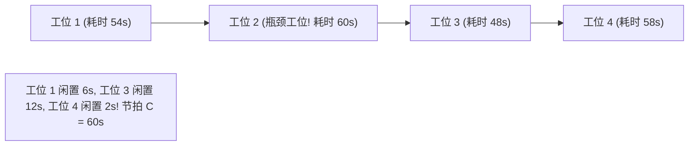

# Lec 19 离散制造产线平衡与排队网络案例研讨 (Manufacturing Line Balancing and Queuing Case)

> MIT 15.066J 制造与运营系统优化分析 (System Optimization and Analysis for Manufacturing) · 授课教师：Prof. Stephen Graves (MIT Sloan / LGO)

## TL;DR

- 装配线平衡率（Line Efficiency）与平滑系数（Smoothness Index）量化了工位间的闲置浪费。
- 开环杰克逊排队网络（Open Jackson Networks）证明了各节点在稳态下服从独立的乘积解（Product-Form）。
- 工业案例研讨揭示了动态瓶颈随产品换型、返工良率波动而频繁漂移的复杂治理策略。

## 流水线平衡的几何与统计冲突

装配流水线（Assembly Line）是现代大规模工业生产的象征。在理想的教科书模型中，工程师希望将所有装配作业完美均等地切分给每一个工位：若流水线节拍为 60 秒，则工位 1 耗时 60 秒，工位 2 耗时 60 秒，工位 3 耗时 60 秒，全线平衡率达到 100%，没有任何工时闲置浪费。

然而在现实物理世界中，由于**工序不可分割性（Task Indivisibilities）**、**严格的工艺先后依赖偏序（Precedence Diagrams）**以及**人类工人操作时间的天然随机方差**，实现完美的静态与动态平衡几乎是不可能的任务。

## 装配线平衡性能评估指标

设流水线包含 $K$ 个工位，每个工位分配的作业总耗时为 $S_k$（$k = 1, \dots, K$）。
流水线的实际工作节拍由**耗时最长的那一个工位（瓶颈工位）**绝对决定：
$$
C = \max_{1 \le k \le K} S_k
$$

::: definition [核心线平衡指标]
1. **线平衡率（Line Balancing Efficiency, $E$）**：
$$
E = \frac{\sum_{k=1}^K S_k}{K \times C} \times 100\%
$$
衡量了全线有效作业工时占总投入工位容量的百分比；
2. **总平衡闲置时间（Balance Delay, $d$）**：
$$
d = 100\% - E = \frac{K \times C - \sum_{k=1}^K S_k}{K \times C} \times 100\%
$$
3. **平滑系数（Smoothness Index, $SI$）**：衡量各工位负荷分布的方差均匀度：
$$
SI = \sqrt{\sum_{k=1}^K (C - S_k)^2}
$$
$SI$ 越小，说明各工位负荷越接近，工人的忙闲一致性越好。
:::

## 随机排队网络与 Jackson 网络乘积解定理

当工位的加工时间存在随机波动（如某些复杂汽车选装件耗时波动），流水线变成了**随机排队网络（Queuing Networks）**。

考虑由 $m$ 个服务台节点构成的开环网络。外部实体以泊松流到达节点 $i$（速率为 $\gamma_i$）。节点 $i$ 包含 $c_i$ 台相同服务器，服务时间服从参数为 $\mu_i$ 的指数分布。
工件在节点 $i$ 完工后，以转移概率 $r_{ij}$ 流向下游节点 $j$，以概率 $r_{i0} = 1 - \sum_j r_{ij}$ 离开系统。

各节点的实际总到达率 $\lambda_i$ 由**交通流平衡方程（Traffic Equations）**唯一确定：
$$
\lambda_i = \gamma_i + \sum_{j=1}^m \lambda_j r_{ji}, \quad \forall i = 1, \dots, m
$$
只要每个节点的负荷满足稳定性条件 $\rho_i = \frac{\lambda_i}{c_i \mu_i} < 1$：

::: theorem [Jackson 定理与乘积解形式 (Jackson's Theorem, 1957)]
在稳态下，开环网络中各节点的队长状态向量 $\mathbf{N} = (n_1, n_2, \dots, n_m)$ 的联合概率分布，**奇迹般地严格等于各个节点作为独立 $M/M/c_i$ 排队模型边际稳态分布的简单乘积**：
$$
\mathbb{P}(N_1 = n_1, N_2 = n_2, \dots, N_m = n_m) = \prod_{i=1}^m \mathbb{P}(N_i = n_i)
$$
:::

### Jackson 乘积解的震撼工程启示
尽管在物理上，工件在节点间的流动存在极其复杂的相互依赖（上游节点的流出是下游节点的流入），但在指数分布与泊松到达的无记忆世界中，**节点间的微观相关性在宏观稳态下被完全抹平！**
这使得我们能够对每一个工位进行独立的利特尔法则（Little's Law）计算与排队队长分析。

## 工业案例研讨：返工回路与动态瓶颈漂移 (Floating Bottlenecks)

在 15.066J 真实离散制造车间案例研讨中，学生们分析了一家医疗设备流水线的返工网络：
当工位 4 质检发现不合格品时，有 $15\%$ 的工件必须逆流返回工位 2 进行重新校正磨削（即转移概率 $r_{42} = 0.15$）。

这个看似不起眼的 15% 返工率，在车间中引发了灾难性的连锁反应：
1. **真实负荷的隐性倍增**：由交通流方程 $\lambda_2 = \gamma_2 + \lambda_4 (0.15)$，工位 2 的实际吞吐负荷被动暴涨，原本根据设计图纸属于非瓶颈的工位 2，瞬间被返工工件击穿，沦为全厂的最严重瓶颈！
2. **瓶颈的幽灵漂移**：在上午生产批次 A 时，工位 4 是瓶颈；下午由于零部件公差略微变大导致返工率上升至 25%，瓶颈瞬间前移至工位 2；而当夜班开工时，由于老员工熟练度高无返工，瓶颈又后移至包装测试工位。

这种随着批次、工人熟练度与工艺公差实时跳动的现象，被称为**漂移瓶颈（Floating Bottlenecks）**。

::: pitfall 仅以单机工艺耗时寻找瓶颈而忽视返工放大效应
车间主任常指责工位 2 的工人动作太慢。运筹分析指出：工位 2 的工人没有任何过错，是后道工位 4 的质检缺陷导致的逆流循环，使工位 2 承担了超过 130% 的额定负载。**治理漂移瓶颈的核心不在于给工位 2 加人，而在于消灭工位 4 的返工根源**。
:::

::: insight 平衡是静态的愿景，而排队是动态的现实
工业工程初学者沉迷于在图纸上用直尺画出严丝合缝的静态工位节拍；
而真正的制造大师深刻懂得：**只要系统包含工人和返工回路，方差与排队就会像水流一样在车间内部寻找最脆弱的洼地**。理解 Jackson 网络与动态瓶颈漂移机制，是让一条冰冷的生产线在随机风暴中保持呼吸与韧性的关键所在。
:::
