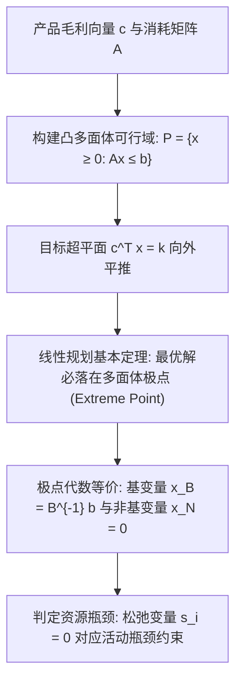

# Lec 2 线性规划在运营决策中的建模艺术与几何基础 (LP Formulations and Geometry in Operations)

> MIT 15.066J 制造与运营系统优化分析 (System Optimization and Analysis for Manufacturing) · 授课教师：Prof. Stephen Graves (MIT Sloan / LGO)

## TL;DR

- 线性规划以连续决策变量、线性目标与齐次不等式约束刻画制造资源分配。
- 标准型转换揭示了松弛变量在表征未利用闲置设备产能中的物理含义。
- 多面体几何的极点定理严格确立了最优运营决策必落在生产可行域顶点。

## 制造资源分配的线性规划原语

在离散制造与流程工业中，最经典的运营决策是**产品组合优化**（Product Mix Optimization）：工厂拥有固定数量的机床、熟练工工时、原材料配额与电力供应，如何决定各种产品的投产批量，以在满足交付约束的前提下最大化边际贡献总额？

线性规划（Linear Programming, LP）凭借其极高的计算可扩展性与完善的对偶理论，成为工业运筹中应用最广泛的基石算法。

::: definition [通用制造线性规划模型]
设企业可生产 $n$ 种产品，决策变量 $x_j \ge 0$ 表示产品 $j$ 的计划生产数量（$j = 1, \dots, n$）。
设企业拥有 $m$ 种稀缺制造资源（如冲压工时、焊接机台、注塑模具），资源 $i$ 的可用总量为 $b_i$（$i = 1, \dots, m$）。
生产单位产品 $j$ 需要消耗资源 $i$ 的定额为 $a_{ij} \ge 0$。产品 $j$ 的单位毛利润为 $c_j$。
标准利润最大化线性规划表述为：
$$
\begin{aligned}
\max_{x} \quad & Z = \sum_{j=1}^n c_j x_j \\
\text{s.t.} \quad & \sum_{j=1}^n a_{ij} x_j \le b_i, \quad \forall i = 1, \dots, m \\
& x_j \ge 0, \quad \forall j = 1, \dots, n
\end{aligned}
$$
矩阵简写形式为：$\max \{c^T x : A x \le b, x \ge 0\}$。
:::

## 松弛变量与闲置产能的物理映射

为了将不等式约束转化为单纯形法可直接处理的等式系统，我们引入非负**松弛变量**（Slack Variables）$s_i \ge 0$：
$$
\sum_{j=1}^n a_{ij} x_j + s_i = b_i \iff s_i = b_i - \sum_{j=1}^n a_{ij} x_j
$$
在制造运营的物理语境下，松弛变量 $s_i$ 具有直观的物理意义：**它精确度量了资源 $i$ 的剩余闲置产能（Unused Idle Capacity）**！
- 若最优解中 $s_i^* > 0$，说明该资源未被充分吃透，属于**非瓶颈资源**（Non-Bottleneck Resource）；
- 若最优解中 $s_i^* = 0$，说明该约束在最优解处严格取等号，属于**硬约束瓶颈资源**（Bottleneck Resource）。

## 多面体几何与极点最优性

可行解集合 $P = \{x \in \mathbb{R}^n : A x \le b, x \ge 0\}$ 是有限个闭半空间的交集，构成几何学上的**凸多面体**（Convex Polyhedron）。

::: theorem [线性规划基本定理 (Fundamental Theorem of LP)]
设线性规划问题可行且目标函数在可行域 $P$ 上存在有限上界。
则必存在一个**极点**（Extreme Point，即无法表示为多面体内任意两不同点严格凸组合的点）使得目标函数达到全局最大值。
在代数上，每个极点与一个基可行解（Basic Feasible Solution, BFS）严格一一对应。
:::

这一几何真理彻底改变了计算复杂度的格局：
虽然可行域内的可行生产方案有不可数无穷多个，但由 $m$ 个线性方程与 $n$ 个变量构成的基本可行解的组合数至多只有 $\binom{n+m}{m}$ 个（有限个顶点）！求解线性规划的过程，在几何上就是在高维多面体的骨架边沿从一个极点跳跃到更优极点的漫步。

::: example [两产品资源分配案例]
某电子代工厂生产两款智能手环：基础款（$x_1$）与专业款（$x_2$）。
- 单位毛利：$c_1 = 30$ 美元，$c_2 = 50$ 美元；
- SMT 贴片工时：$1 x_1 + 2 x_2 \le 40$ 小时；
- 组装测试工时：$2 x_1 + 1 x_2 \le 50$ 小时；
- 包装限制：$x_2 \le 16$ 单位；非负性 $x_1, x_2 \ge 0$。

求交点得到 5 个极点：
1. $(0, 0) \implies Z = 0$；
2. $(25, 0) \implies Z = 750$；
3. $(0, 16) \implies Z = 800$；
4. 贴片与包装交点 $(8, 16) \implies Z = 30(8) + 50(16) = 1040$；
5. 贴片与组装交点：联立 $x_1 + 2x_2 = 40$ 与 $2x_1 + x_2 = 50$，解得 $x_1 = 20, x_2 = 10$。
此时总毛利 $Z = 30(20) + 50(10) = 1100$ 美元！
全局最优解锁定在极点 $(20, 10)$，此时 SMT 贴片与组装两道工序产能全部打满（松弛变量为 0），包装工序闲置 $16 - 10 = 6$ 单位。
:::

::: insight 几何极点是运营专注度的数学证明
为什么最优的工业决策很少是“雨露均沾”的中间折中方案，而往往是激进地将某些产品线推向极限、同时放弃某些次优产品？
线性规划的几何极点定理给出了严密的回答：**线性目标函数在凸集上的最优解永远出现在边界的尖锐折角（极点）处**。在极点上，系统精确地用光了某些关键资源，实现了资源边际产出率的极度聚焦。
:::
