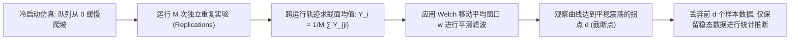

# Lec 20 仿真输出统计分析与实验设计 (DOE and Simulation Output Analysis)

> MIT 15.066J 制造与运营系统优化分析 (System Optimization and Analysis for Manufacturing) · 授课教师：Prof. Stephen Graves (MIT Sloan / LGO)

## TL;DR

- 初始瞬态偏差（Initial Transient Bias）与预热期（Warm-up Period）截断确立仿真稳态有效性。
- 全因子设计（Full Factorial Design）与正交表通过正交投影分离主效应与交互效应。
- 方差分析（ANOVA）为复杂的离散制造参数调优提供了公理化的统计显著性检验。

## 仿真数据的统计陷阱：自相关与初始偏差

当我们在计算机上运行离散事件仿真（DES）时，从软件中导出的一连串数据（例如工件等待时间序列 $W_1, W_2, \dots, W_N$）具有极其危险的统计学特征：
1. **强烈的序列自相关性（Autocorrelation）**：如果工件 $i$ 遭遇了严重的机台堵塞排队很久，那么紧跟在它后面的工件 $i+1$ 大概率也必须排队很久（自相关系数 $\rho_k \gg 0$）。经典的独立同分布（i.i.d.）样本方差公式 $S^2 / n$ 会严重低估真实标准误差达 5 到 10 倍！
2. **非稳态初始瞬态偏差（Warm-up & Initialization Bias）**：仿真通常在“空且闲置（Empty and Idle）”的零状态冷启动。前几个小时系统几乎没有任何在制品排队。如果直接将这些初始冷启动数据计入全天平均值，算出的平均在制品水平会被严重低估拉低！

在麻省理工学院 15.066J 体系中，严格掌握**稳态预热截断法**与**实验设计（Design of Experiments, DOE）**是每一位工程师的必修基本功。

## 预热期判定与 Welch 图形移动平均法

为了消除冷启动的非稳态偏差，必须丢弃仿真初期的数据（称为**预热期 Warm-up Period**，截断点记为 $d$）。

::: definition [Welch 移动平均预热判定法 (Welch's Procedure)]
1. 执行 $M$ 次独立重复运行，每次运行包含 $N$ 个观测值；
2. 计算每个时间点跨 $M$ 次运行的截面样本均值：$\bar{Y}_i = \frac{1}{M}\sum_{m=1}^M Y_{mi}$；
3. 选取移动平均窗口大小 $w$，计算平滑序列：
$$
\bar{Y}_i(w) = \begin{cases}
\frac{1}{2w + 1}\sum_{s = -w}^w \bar{Y}_{i+s}, & w + 1 \le i \le N - w \\
\frac{1}{2i - 1}\sum_{s = -(i-1)}^{i-1} \bar{Y}_{i+s}, & 1 \le i \le w
\end{cases}
$$
4. 绘制平滑曲线，视觉定位曲线由上升趋势进入平稳水平振荡的拐点时刻 $d$。$t \le d$ 之前的所有数据被永久切除作废。
:::

## 实验设计基础：全因子设计 (Factorial Design)

当我们在仿真模型中测试优化策略时，通常有多个参数需要调优（称为**因子 Factors**，例如：AGV 行驶速度、缓冲栈容量上限、工位排班人数）。每个因子可以取不同的水平（Levels，如高/低两水平）。

设存在 $k$ 个因子，每个因子取 2 个水平（记为 $-1$ 低水平与 $+1$ 高水平）。
**$2^k$ 全因子设计（$2^k$ Full Factorial Design）**需要进行 $2^k$ 次不同的仿真配置组合。

以三因子设计（$k = 3$）为例，因子分别为 $A, B, C$：
- 因子主效应（Main Effects）：$e_A, e_B, e_C$；
- 二阶交互效应（Two-Factor Interaction）：$e_{AB}, e_{AC}, e_{BC}$；
- 三阶交互效应（Three-Factor Interaction）：$e_{ABC}$。

| 实验序号 | 因子 $A$ | 因子 $B$ | 因子 $C$ | 交互 $AB$ | 交互 $AC$ | 交互 $BC$ | 交互 $ABC$ | 仿真响应产出 $Y$ |
| :---: | :---: | :---: | :---: | :---: | :---: | :---: | :---: | :---: |
| 1 | -1 | -1 | -1 | +1 | +1 | +1 | -1 | $y_1$ |
| 2 | +1 | -1 | -1 | -1 | -1 | +1 | +1 | $y_2$ |
| 3 | -1 | +1 | -1 | -1 | +1 | -1 | +1 | $y_3$ |
| 4 | +1 | +1 | -1 | +1 | -1 | -1 | -1 | $y_4$ |
| 5 | -1 | -1 | +1 | +1 | -1 | -1 | +1 | $y_5$ |
| 6 | +1 | -1 | +1 | -1 | +1 | -1 | -1 | $y_6$ |
| 7 | -1 | +1 | +1 | -1 | -1 | +1 | -1 | $y_7$ |
| 8 | +1 | +1 | +1 | +1 | +1 | +1 | +1 | $y_8$ |

正交设计矩阵的每一列与另一列点积严格为 0（**正交性 Orthogonality**）！
这使得我们能够将各因子的独立贡献完全解耦计算：
$$
\text{Main Effect of } A = \frac{1}{4}\left(-y_1 + y_2 - y_3 + y_4 - y_5 + y_6 - y_7 + y_8\right)
$$

## 方差分析 (ANOVA) 与交互效应洞察

传统的“单变量轮换法（One-Factor-at-a-Time, OFAT）”是工程实践中最大的毒瘤：每次只改变一个变量，保持其他变量不变。OFAT 永远无法发现**因子之间的协同交互效应（Interaction Effects）**！

例如在半导体蚀刻仿真中：
- 单独提高射频功率（因子 A），蚀刻均匀度提高 2%；
- 单独提高腔体气压（因子 B），蚀刻均匀度降低 1%；
- 但当**同时提高功率与气压**（交互效应 $AB$）时，等离子体密度发生非线性谐振，蚀刻均匀度暴增 35%！
单变量轮换法会直接错过这一黄金组合，而方差分析（ANOVA）通过分解平方和：
$$
SS_{\text{Total}} = SS_A + SS_B + SS_C + SS_{AB} + SS_{AC} + SS_{BC} + SS_{ABC} + SS_{\text{Error}}
$$
借助 $F$-检验（$F = \frac{MS_{\text{Effect}}}{MS_{\text{Error}}}$），能够严谨给出各交互效应在统计学上的置信度（$p$-值）。

::: pitfall 将相关性伪相关当做因果效应
仿真输出的多重回归分析很容易受到共线性（Multicollinearity）干扰。没有经过严谨正交实验设计的随机数据挖掘，极易把无关变量误判为关键影响因子。
:::

::: insight 实验设计是用最少样本提取最大信息的数学杠杆
运行一次高精度的有限元或大规模制造仿真可能需要数小时计算。
**正交实验设计（DOE）的伟大之处，在于它利用线性代数的正交投影基底，在庞大的参数高维超立方体中，仅用极少数量的代表性采样点，就完备剥离出了全要素的主效应与非线性交互作用**。这种统计理性，是现代六西格玛（Six Sigma）与智能制造的核心基石。
:::
