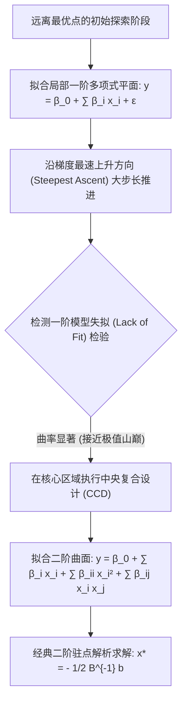

# Lec 21 基于仿真的优化方法与响应曲面代理模型 (Simulation-Based Optimization and Metaheuristics)

> MIT 15.066J 制造与运营系统优化分析 (System Optimization and Analysis for Manufacturing) · 授课教师：Prof. Stephen Graves (MIT Sloan / LGO)

## TL;DR

- 基于仿真的优化（SBO）突破了黑箱目标函数缺乏解析梯度与显式表达式的困境。
- 响应曲面法（RSM）通过局部多项式回归与最速上升法逼近最优极值区域。
- 高斯过程克里金代理模型（Kriging）与期望提升准则（EI）奠定了现代贝叶斯黑箱优化底座。

## 当目标函数没有数学公式：黑箱优化挑战

在经典非线性规划（NLP）中，我们假设目标函数 $f(x)$ 拥有明确的解析代数表达式（例如 $f(x) = x_1^2 + \sin(x_2)$），从而能够求出一阶梯度向量 $\nabla f(x)$ 与二阶 Hessian 矩阵 $\nabla^2 f(x)$ 进行牛顿迭代。

然而在高度复杂的工业制造系统中，我们关心的优化目标——例如：
$$
\min_{x \in \mathcal{X}} \quad F(x) = \mathbb{E}[g(x, \xi)]
$$
其中 $x$ 为工厂缓冲栈容量、派工阈值与库存水平等决策向量；
评价该决策优劣的唯一方式，是**把 $x$ 输入进包含数万行代码的工业离散事件仿真器中，运行 20 分钟并收集蒙特卡洛统计输出**！

这个目标函数是一个典型的**带有随机噪声的黑箱函数（Noisy Black-Box Function）**：
- 没有显式解析公式；
- 没有导数与梯度信息；
- 每次函数评估极其昂贵且带有随机抽样方差噪声。

**基于仿真的优化（Simulation-Based Optimization, SBO）**应运而生。

## 响应曲面法 (Response Surface Methodology, RSM)

1951 年由 George Box 提出的响应曲面法，是工业界最成熟的全局黑箱寻优框架。它采用**两阶段渐进逼近战术**：

### 1. 一阶阶段：最速上升法（Method of Steepest Ascent）
在远离极值的区域，局部曲面可以近似为线性超平面：
$$
Y = \beta_0 + \sum_{i=1}^k \beta_i x_i + \epsilon
$$
通过小规模 $2^k$ 实验估计回归系数 $\hat{\beta}$。向量 $\mathbf{g} = (\hat{\beta}_1, \dots, \hat{\beta}_k)^T$ 即为局部梯度的无偏估计！
算法沿着该梯度方向 $\Delta x \propto \mathbf{g}$ 以大步长向前跃进，直到仿真响应值不再提升。

### 2. 二阶阶段：中央复合设计与驻点分析 (CCD & Canonical Analysis)
当接近极值山顶时，高阶曲率（Curvature）占主导地位，一阶模型发生严重失拟。
此时在局部补充**星号点（Axial/Star Points）**与中心点，构成**中央复合设计（Central Composite Design, CCD）**，拟合完整的二阶响应曲面：
$$
Y = \beta_0 + \mathbf{b}^T \mathbf{x} + \mathbf{x}^T \mathbf{B} \mathbf{x}
$$
其中对称矩阵 $\mathbf{B}$ 为估计出的二阶曲率矩阵。
直接对该二阶多项式求导置零，瞬间得出解析驻点（Stationary Point）：
$$
\mathbf{x}^* = -\frac{1}{2}\mathbf{B}^{-1}\mathbf{b}
$$
通过对矩阵 $\mathbf{B}$ 进行特征值谱分解（Eigenvalue Decomposition），可以严密断定该驻点是局部极大值、极小值还是鞍点（Saddle Point）！

## 高斯过程代理模型与贝叶斯优化 (Kriging & Bayesian Optimization)

当仿真运行单次耗时达到数小时以上时，响应曲面法的多项式逼近显得过于粗糙。
现代顶尖工程设计全面转向**基于高斯过程回归的高保真代理模型（Kriging / Gaussian Process Surrogates）**。

Kriging 模型假设未知目标函数是高斯随机场的实现：
$$
f(x) \sim \mathcal{GP}\left(m(x), k(x, x')\right)
$$
给定已有的 $n$ 次昂贵仿真测试点数据 $\mathcal{D}_n = \{(x_i, y_i)\}_{i=1}^n$，Kriging 不仅能预测任意新未探索点 $x$ 处的**期望预测均值 $\mu_n(x)$**，更能严谨给出该点预测的**不确定性方差 $\sigma_n^2(x)$**！

::: definition [期望提升准则 (Expected Improvement, EI)]
在选择下一次昂贵仿真实验的参数点时，我们需要在“利用（Exploitation：在已知高均值附近微调）”与“探索（Exploration：在高不确定性未测盲区钻探）”之间做最佳平衡。
**期望提升准则（Expected Improvement）**定义为：
$$
\text{EI}(x) = \mathbb{E}\left[\max(0, y_{\text{current}}^* - f(x)) \mid \mathcal{D}_n\right]
$$
闭式解析积分表达式为：
$$
\text{EI}(x) = (y^* - \mu_n(x)) \Phi\left(\frac{y^* - \mu_n(x)}{\sigma_n(x)}\right) + \sigma_n(x) \phi\left(\frac{y^* - \mu_n(x)}{\sigma_n(x)}\right)
$$
第一项驱动算法榨取已知优良区域；第二项由标准差 $\sigma_n(x)$ 支配，强力驱动算法探索未知高方差深水区！
:::

每次只需在计算机内部用极低成本最大化 $\text{EI}(x)$，即可选出下一个最具战略价值的真实工厂仿真采样点，通常仅需几十次迭代即可逼近全局复杂多峰极值！

::: pitfall 忽视代理模型维数灾难导致不确定性评估失效
高斯过程核矩阵求逆的复杂度为 $\mathcal{O}(n^3)$。当参数维度超过 20 维时，空间体积几何级稀疏爆炸，标准的 Kriging 代理模型会出现严重失真。高维黑箱问题通常需结合随机投影或稀疏变分推断。
:::

::: insight 代理模型是在黑暗中摸索的概率雷达
没有解析导数的黑箱世界如同一片漆黑的迷雾森林。
盲目的网格枚举如同大海捞针，而**贝叶斯代理模型就像一台高灵敏度的概率雷达：它用每一次仿真观测的宝贵回波，点亮地图的一部分，并在均值收益与方差迷雾之间计算出期望提升最高的最优航向**。这是当代算法在复杂工程系统寻优中最具智慧的探戈。
:::
