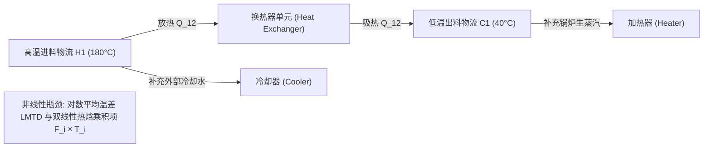

# Lec 22 流程工程中的非线性规划建模：能效与产率优化 (Non-Linear Programming Formulations)

> MIT 15.066J 制造与运营系统优化分析 (System Optimization and Analysis for Manufacturing) · 授课教师：Prof. Stephen Graves (MIT Sloan / LGO)

## TL;DR

- 流程工业中物料质量-能量守恒与热力学状态方程天然呈现高度非线性与非凸性。
- 换热器网络（HEN）综合展现了夹点分析（Pinch Analysis）向双线性规划的数学转化。
- 化工反应器产率极大化与分馏塔气液平衡揭示了多局部极值陷阱的几何成因。

## 告别线性：流体、热力与化学反应的非线性王国

在离散装配与汽车制造中，大部分物理约束可以通过线性规划（LP）或整数规划（MIP）以极高精度进行逼近。
然而，一旦我们步入石油炼化、基础化工、生物制药与现代材料工程等**流程工业（Process Engineering）**的核心腹地，线性的假说将被物理学定律彻底击得粉碎！

流体动力学与热力学遵循严格的物理守恒定律：
- **热传导与焓平衡方程**：热交换量正比于温差与流量的乘积 $Q = U A \Delta T_{\text{LM}}$；
- **流体管网压降**：沿程阻力损失与流速的平方呈正比 $\Delta P \propto v^2$；
- **化学反应动力学速率**：阿伦尼乌斯定律（Arrhenius Law）呈现指数非线性：$k = A \exp\left(-\frac{E_a}{R T}\right)$。

在这些领域，**非线性规划（Non-Linear Programming, NLP）**与**非线性混合整数规划（MINLP）**是唯一能准确刻画物理现实的建模语言。

## 经典工艺案例：换热器网络综合 (Heat Exchanger Networks, HEN)

在大型炼油厂中，上百股高温物料物流（Hot Streams）需要被冷却，同时上百股低温物料（Cold Streams）需要被加热。
传统粗暴的做法是：高温物料用工业冷却水循环冷却，低温物料用锅炉燃烧蒸汽加热。这会消耗海量的煤炭天然气，带来巨额能耗账单与碳排放。
**换热器网络综合（HEN）**的核心目标是：**在全厂各物料之间建立最优的热量交叉换热网络，最大限度实现余热自回收，将外部公共公用工程（Utility）消耗降至物理极限！**



### 非线性热焓平衡与对数平均温差 (LMTD)
设某换热器进出口的高温流体温度为 $T_{\text{in}}^H, T_{\text{out}}^H$，低温流体温度为 $T_{\text{in}}^C, T_{\text{out}}^C$。
两端的换热温差驱动力分别为：
$$
\Delta T_1 = T_{\text{in}}^H - T_{\text{out}}^C, \quad \Delta T_2 = T_{\text{out}}^H - T_{\text{in}}^C
$$
根据热力学传热方程，换热面积 $A$ 与热负荷 $Q$ 的严格关系由**对数平均温差（LMTD）**确定：
$$
Q = U \cdot A \cdot \Delta T_{\text{LM}}, \quad \Delta T_{\text{LM}} = \frac{\Delta T_1 - \Delta T_2}{\ln(\Delta T_1 / \Delta T_2)}
$$
如果将换热器投资成本（通常与面积呈幂律非线性关系：$\text{Cost} = a A^\beta$，$0 < \beta < 1$ 呈现显著规模报酬递增）计入目标，整个模型将包含对数除法、双线性温度乘积项与非凸幂函数！

## 反应器产率极大化与分馏塔分离

考虑连续搅拌釜反应器（CSTR）中发生的二级不可逆化学反应：
$$
A + B \xrightarrow{k} C
$$
物料 $A$ 与 $B$ 的反应速率方程为非线性的反应物浓度乘积：
$$
r_A = k(T) \cdot C_A \cdot C_B = A_0 \exp\left(-\frac{E_a}{R T}\right) C_A C_B
$$
在稳态物料守恒平衡下：
$$
F \cdot (C_A^{\text{in}} - C_A) - V \cdot r_A = 0
$$
$$
F \cdot (C_B^{\text{in}} - C_B) - V \cdot r_B = 0
$$
$$
F \cdot \rho c_p (T^{\text{in}} - T) + V (-\Delta H_r) r_A - U A (T - T_w) = 0
$$
由于温度 $T$ 深度嵌套在指数阿伦尼乌斯项内部，且与物料浓度 $C_A, C_B$ 发生高度三阶非线性耦合，该系统的可行域不再是凸集，而是呈现出极其险峻的曲面折叠！

## 非凸性（Non-Convexity）带来的多局部最优陷阱

在凸优化（Convex Optimization）中，任何局部极小值（Local Minimum）在数学上必然是全局最优解（Global Optimum）。
然而在流程 NLP 中，由于双线性项（Bilinear Terms $x \cdot y$）与热力学非线性的存在，**可行域多面体内部充满了无数个凹坑与鞍点（Saddle Points）**！

```text
目标能量消耗
     ^
     |         /\               /\
     |        /  \   局部最优   /  \
     |       /    \   (坑 1)   /    \       全局最优
     |      /      \__/\______/      \_____ (真实坑 2)
     |     /                                \______
     +---------------------------------------------> 设计参数
```

若直接对这种非凸模型运行普通的局部非线性梯度求解器（如 IPOPT 或 Minos）：
算法的收敛结果将**极度依赖于给定的初始初值起点（Starting Point）**！
如果初值选在左侧，求解器会迅速滑入坑 1 并沾沾自喜地向用户宣布“已找到局部最优”，而真正能节约数百万美元能耗的全局最优（坑 2）却被一座巨大的非凸能量壁垒彻底隔绝！

::: pitfall 盲目使用常规凸规划内点法求解非凸流程模型
常规内点法（如 Barrier 方法）在非凸空间中极易发生 Hessian 矩阵不定、牛顿步发散或收敛至伪鞍点。工业级流程优化必须采用**全局优化求解器（如 BARON、SCIP）**，通过 McCormick 凸包包络松弛（Convex Envelopes）进行严格的分支定界空间割切。
:::

::: insight 非线性是物质世界最真实的物理笔触
线性化只是人类数学为了计算便利而强加给大自然的微积分切线；
而**非线性规划才是物质宇宙遵循热力学第二定律时写下的真实诗篇**。从分子扩散到高温裂解，只有在数学上勇敢接纳非线性的崎岖与复杂，运筹工程才能真正穿透工业流程的微观物理实质，解锁现代重工业皇冠上的能效明珠。
:::
