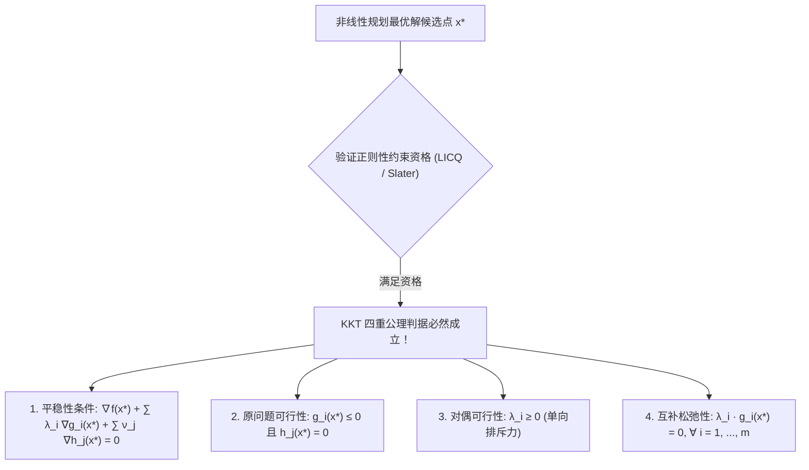

# Lec 23 非线性规划算法、KKT 最优性条件与对偶理论 (NLP Algorithms, KKT and Lagrangian Duality)

> MIT 15.066J 制造与运营系统优化分析 (System Optimization and Analysis for Manufacturing) · 授课教师：Prof. Stephen Graves (MIT Sloan / LGO)

## TL;DR

- Karush-Kuhn-Tucker（KKT）一阶条件奠定了现代约束非线性规划最优解的完备代数判据。
- 严格互补松弛性（Complementary Slackness）与有效约束集识别揭示了边界激活机制。
- 序列二次规划（SQP）与内点惩罚障碍函数法构成了驱动当代大型工业 NLP 的核心计算算力。

## 约束极值分析的数学巅峰：KKT 定理

在微积分发展初期，对于无约束极值问题 $\min f(x)$，牛顿与费马教导我们将梯度置零 $\nabla f(x) = 0$；
对于仅含等式约束的问题 $\min \{f(x) : h_i(x) = 0\}$，拉格朗日（Lagrange）在 1788 年发明了引入乘子的拉格朗日乘子法。

然而，工业界绝大多数真实约束都是**不等式约束（Inequalities $g_i(x) \le 0$）**。
面对带有不等式的大规模非线性规划，直到 1951 年，哈罗德·库恩（Harold W. Kuhn）与阿尔伯特·塔克（Albert W. Tucker）才正式发表了现代最优化理论中最著名的奠基石——**KKT 条件（Karush-Kuhn-Tucker Conditions）**（注：William Karush 曾于 1939 年在其硕士论文中独立推导）。

## KKT 一阶必要最优性条件体系

考虑通用非线性规划问题：
$$
\begin{aligned}
\min_{x \in \mathbb{R}^n} \quad & f(x) \\
\text{s.t.} \quad & g_i(x) \le 0, \quad i = 1, \dots, m \\
& h_j(x) = 0, \quad j = 1, \dots, p
\end{aligned}
$$
其中函数 $f, g_i, h_j$ 均连续一阶可微。

定义广义**拉格朗日函数**（Lagrangian Function）：
$$
\mathcal{L}(x, \lambda, \nu) = f(x) + \sum_{i=1}^m \lambda_i g_i(x) + \sum_{j=1}^p \nu_j h_j(x)
$$
其中 $\lambda \ge 0$ 为不等式约束拉格朗日乘子向量，$\nu \in \mathbb{R}^p$ 为等式约束乘子向量。

::: theorem [KKT 一阶必要条件定理]
设 $x^*$ 为上述 NLP 的局部最优解，且在 $x^*$ 处满足某种**约束资格（Constraint Qualification）**（最常用的是线性无关约束资格 LICQ：所有有效约束的梯度向量线性无关；或 Slater 条件：凸规划存在严格内点）。
则必存在唯一的乘子向量 $\lambda^* \in \mathbb{R}^m$ 与 $\nu^* \in \mathbb{R}^p$，使得以下四大公理严格成立：
1. **平稳性（Stationarity）**：
$$
\nabla_x \mathcal{L}(x^*, \lambda^*, \nu^*) = \nabla f(x^*) + \sum_{i=1}^m \lambda_i^* \nabla g_i(x^*) + \sum_{j=1}^p \nu_j^* \nabla h_j(x^*) = 0
$$
2. **原问题可行性（Primal Feasibility）**：
$$
g_i(x^*) \le 0, \quad \forall i = 1, \dots, m; \quad h_j(x^*) = 0, \quad \forall j = 1, \dots, p
$$
3. **对偶可行性（Dual Feasibility）**：
$$
\lambda_i^* \ge 0, \quad \forall i = 1, \dots, m
$$
4. **互补松弛性（Complementary Slackness）**：
$$
\lambda_i^* g_i(x^*) = 0, \quad \forall i = 1, \dots, m
$$
:::

### 互补松弛性的物理本质
对每一个不等式约束 $i$，互补松弛条件 $\lambda_i^* g_i(x^*) = 0$ 强行锁定了两种非此即彼的物理状态：
- **情况 A：非活动约束（Inactive Constraint）**：若在最优解处 $g_i(x^*) < 0$（严格在可行域内部），则其乘子必须**精确为零**（$\lambda_i^* = 0$）！该约束如同不存在一样，不提供任何反作用力；
- **情况 B：活动约束（Active / Binding Constraint）**：若在最优解处 $g_i(x^*) = 0$（紧贴物理边界），则其乘子可以严格为正（$\lambda_i^* > 0$）。此时 $\lambda_i^*$ 精确等于该边界阻挡最优解进一步向外扩张时施加的**垂直法向支撑反作用力**！

## 凸规划下的充分性定理

在一般的非凸规划中，KKT 只是必要条件（驻点可能是鞍点）。
但在**凸规划**（Convex Programming：$f$ 与 $g_i$ 均为凸函数，$h_j$ 为仿射函数）中：
**KKT 条件从必要条件瞬间升华为充要条件！只要一个点满足 KKT 条件，它就无可置疑地必然是全局唯一最优解！**

## 现代大型 NLP 计算算法：SQP 与原对偶内点法

如何求解复杂的非线性 KKT 系统？现代工业优化主要依靠两大王牌算法：

### 1. 序列二次规划 (Sequential Quadratic Programming, SQP)
SQP 是非线性优化中的“牛顿法”。在每一次迭代中：
- 将目标函数局部二阶泰勒展开为二次型；
- 将非线性约束局部一阶线性化；
- 在当前点构造并求解一个**子二次规划问题（QP Subproblem）**：
$$
\begin{aligned}
\min_{d} \quad & \nabla f(x_k)^T d + \frac{1}{2} d^T \nabla_{xx}^2 \mathcal{L}(x_k, \lambda_k, \nu_k) d \\
\text{s.t.} \quad & \nabla g_i(x_k)^T d + g_i(x_k) \le 0, \quad \forall i \\
& \nabla h_j(x_k)^T d + h_j(x_k) = 0, \quad \forall j
\end{aligned}
$$
求解该 QP 得到搜索方向 $d_k$ 与新乘子估计，具有极致的局部超线性与二次收敛速度！

### 2. 原对偶内点法 (Primal-Dual Interior-Point Methods)
内点法通过引入扰动参数 $\mu > 0$，将互补松弛条件平滑化：
$$
\lambda_i (-g_i(x)) = \mu \mathbf{1}
$$
并在牛顿方向更新中强制点保持在可行域内部（Barrier）。随着 $\mu \downarrow 0$，迭代点沿着平滑的**中心路径（Central Path）**精准穿透至最优极值点，在大规模稀疏问题上展现出极高的稳定性。

::: pitfall 忽视二阶充分条件检验导致误判鞍点为极小值
在非凸优化中，满足 KKT 一阶条件的点可能是一个局部的“山顶”（极大值）或“马鞍面”（鞍点）。必须严格检验**降维 Hessian 矩阵（Reduced Hessian）在切空间上的正定性**（二阶充分条件 Second-Order Sufficient Conditions, SOSC）。
:::

::: insight KKT 体系是物理虚功原理在数学上的终极投射
从经典力学的视角审视 KKT 条件，它简直就是物理学达朗贝尔虚功原理的数学孪生体：
目标函数的负梯度 $-\nabla f(x^*)$ 是物体试图向低势能滑坠的主动外力，而 $\sum \lambda_i^* \nabla g_i(x^*)$ 恰好是所有活动刚性约束表面提供的法向法向反作用力。
**KKT 平稳性条件 $\nabla \mathcal{L} = 0$，本质上就是质点在约束边界表面达到微观受力静力学完全平衡的庄严宣言**。数学之美与物理之美在此刻完成了完美的合流。
:::
